# Data Agent

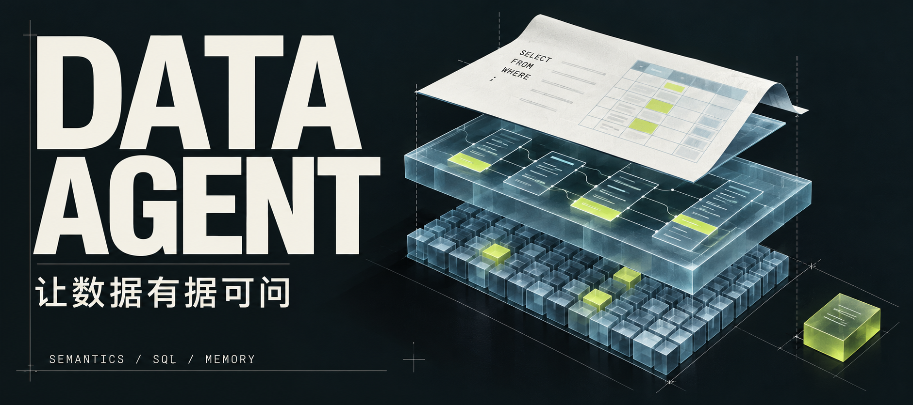

Data Agent 是面向产品、算法、数据分析和数据开发的工作台。用自然语言找表、理解指标口径、生成 SQL；确认口径后，在对话里要求执行，再查看结果、下载和继续追问。

数据开发维护共享语义，每位用户积累自己的纠错记忆和分析方法。系统通过适配器复用数据平台的元数据、血缘、调度与查询能力。

[快速开始](#快速开始) · [功能预览](#功能预览) · [软件架构](#软件架构) · [验证与边界](#验证与边界) · [文档导航](#文档导航)

> 当前按阶段试用版交付。分析依据、组合报告、来源失效保护及超级管理员模型配置已完成相应工程验证；最新修复已验证批量查询授权、记忆索引、独立条件分离、跨来源方法与带来源的定量交付。绑定值准确不代表所有自然语言解释或因果正确，复杂场景仍需持续试用。试用包含真实 DeepSeek Flash / Pro、Mem0 与合成查询；真实 Datasight、正式认证和同事使用验收仍待接入。进度与证据见 [CURRENT](docs/CURRENT.md)。

封面与四张概念说明图由 GPT Image 生成；五张功能截图来自当前应用的隔离合成环境，工具选择由脚本控制，不代表真实模型回答质量。[图片来源与生成提示词](docs/images/README.md)。

## 功能预览

### 共享语义由数据开发维护

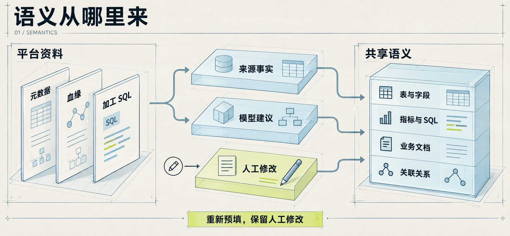

*重新预填时保护人工值。接受纠错建议后，负责人仍需核对、编辑并保存；语义维护权与平台查询权分别校验。*

从平台元数据、DDL、血缘、调度节点与加工 SQL 建立基础目录，再由模型分析补充语义建议。数据开发在页面维护表与字段含义、指标及计算 SQL、关联关系和长篇业务文档。

- 字段用紧凑行展示，业务文档整篇阅读、章节跳转、编辑与预览。
- 离开未保存的语义、文档或个人资产时会提醒；保存失败保留输入。
- 来源事实、模型建议、人工修改分别记录，保留出处和版本。
- 手动同步来源或重新预填时保留人工值，新建议供负责人核对。
- 常用表优先分析，普通表按需深入。检索结合名称、关键词与向量，命中后回源核对权限和有效版本。

谁可以修改哪部分语义：

| 对象 | 维护规则 |
| --- | --- |
| 表与字段 | 沿用 Datasight 最近一次同步的表维护人；当前为 mock 来源 |
| 指标、业务文档等独立对象 | 当前空间的 Datasight 表维护人可以创建，首次人工创建者自动成为负责人 |
| 共享语义的管理 | 超级维护者可修改全部共享语义、调整独立对象归属；引用关系不传播编辑权 |

其他用户发现口径有误，可以先保存私人纠错草稿，核对共享内容后提交建议。负责人可驳回，或接受后核对、编辑并保存。接受建议不会自动改写正式语义。页面展示对象负责人和本人可做的操作。

Data Agent 的语义角色与 Datasight 的查询、取数和 SQL 执行权限分别校验。流程与接口见[语义维护设计](docs/semantic-retrieval-design.md#117-跨用户纠错与共享语义维护)。

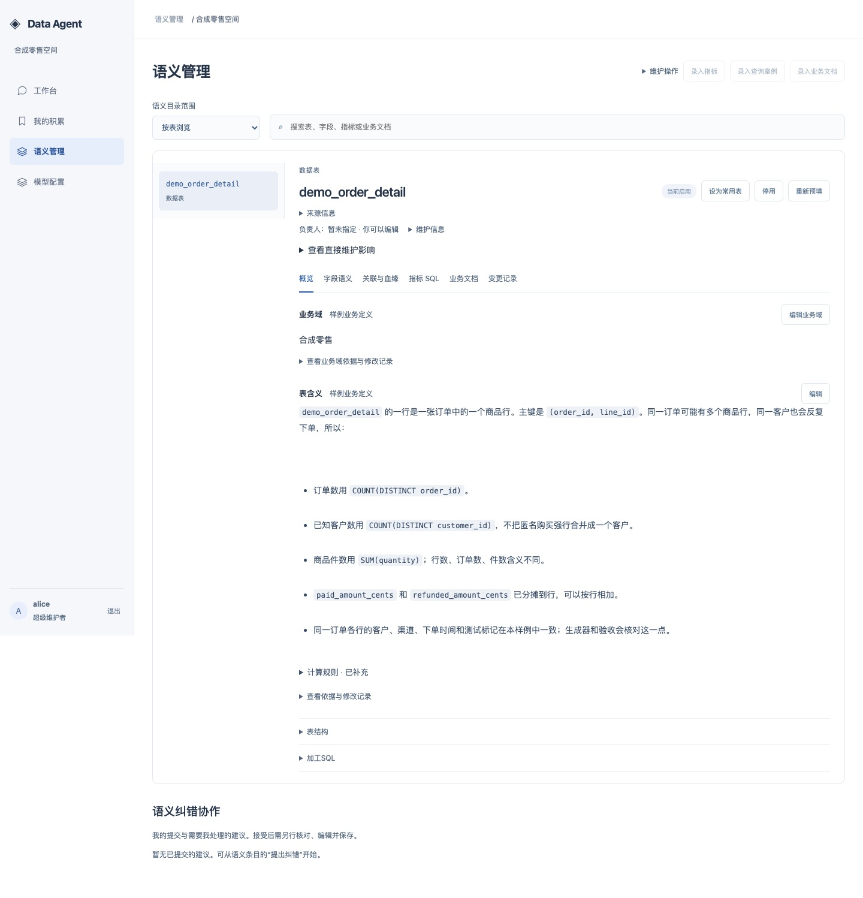

*合成管理员 Alice 按表浏览语音链路资料；对象负责人和可执行的维护操作由服务端返回。业务文档按整篇阅读和编辑，拆分检索由后台处理。*

### 从问题到结果，始终可以补充和纠正

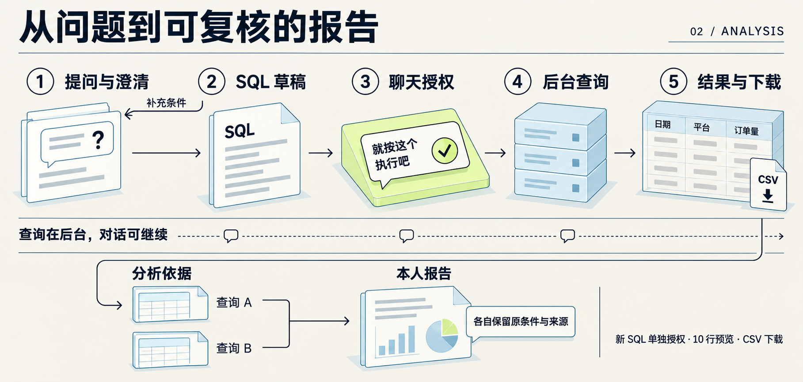

*通过聊天授权执行，查询在后台运行。结果可保存为分析依据、组成本人报告；每条新 SQL 仍须单独授权。*

1. 提问与澄清：Agent 检索表、字段、指标和业务文档；缺少必要信息时主动询问。
2. 查看 SQL：展示 SQL、参数和口径依据，可以复制，也可以继续补充条件。
3. 聊天取数：说“执行这条”或“改成 8 月，再执行”。Pi 理解意图，服务端校验权限、只读和版本，并将这条用户消息与最终 SQL 绑定。只修改条件不会执行。同一句明确授权的多条既有 SQL 可一起确认，分别运行，并保持原消息和预算归属。
4. 后台查询：执行中的查询留在对话里，可以单独停止；输入框持续可用，同一对话可以发起多条 SQL。完成后在对话通知，点击“查看结果”回到对应查询。
5. 预览与下载：表格及图表预览前 10 行，最终 SQL 和参数可查看、复制；“下载 CSV”取得该查询已保存的结果。当前合成平台最多保存 1,000 行，超出时提示截断。

深入分析可沿已有结果补读、比较、拆解趋势与变化贡献，保存带具体查询引用的分析依据，并组装本人报告。图表与文字引用同一条件和结果；结果过期、撤权或依据失效后需重新调查。每条新 SQL 仍需被聊天授权明确覆盖；用户可一次授权多条已展示的 SQL。成功查询的正式数值说明通过实际结果、统计和参数引用交付，缺少的差值或比率先补 SQL。普通调查和操作确认保留流式显示。

用户限定的业务域和资料范围会作为调查要求，本次明确单位优先于历史偏好。有多个合理分母或时间归属时先澄清，名称相似不代表已经选定口径。这些理解由模型完成；权限、只读、版本、完整消息绑定和幂等由服务端校验，模型遵循仍需按实际场景验证。

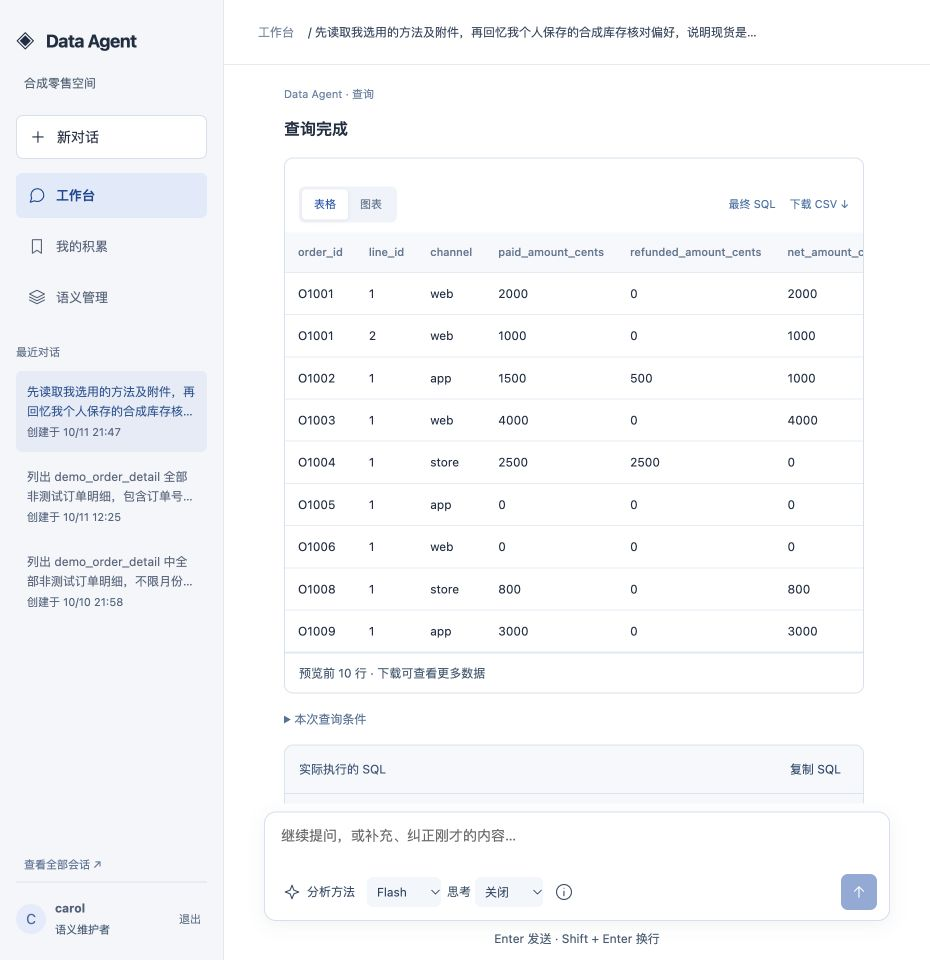

*正式工作台中的合成语音任务达成率查询。结果先展示，SQL 可展开；查询运行期间仍可继续聊天。*

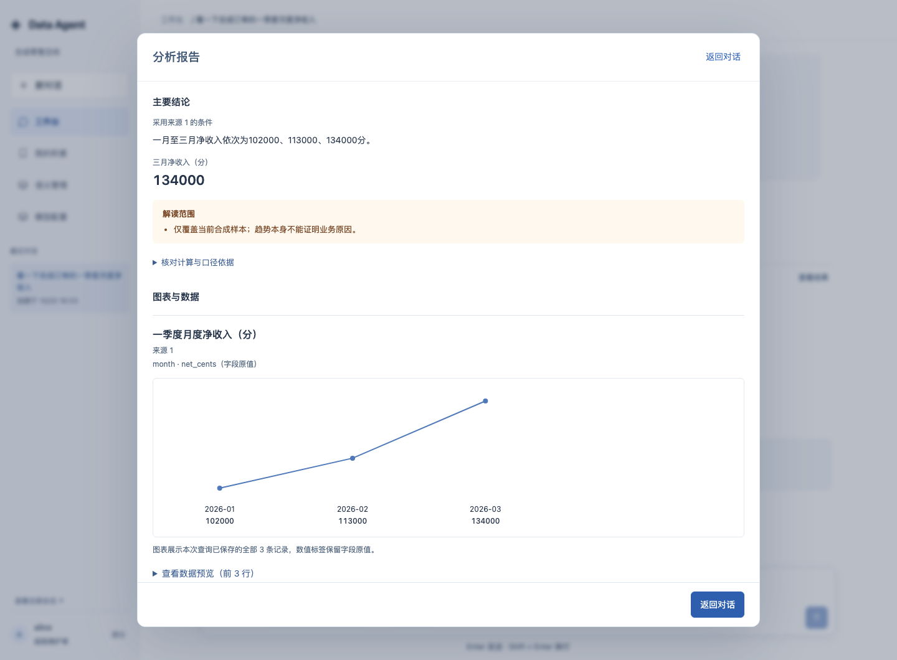

*同一份已保存结果用于文字与图表，百分比由查询计算。报告保留来源条件、计算引用与限制说明，可随时返回对话继续核对。*

输入框工具栏可选管理员启用的模型和对应思考强度；DeepSeek 部署首次导入 Flash / Pro。选择随对话保存，从下一条消息生效。生成中的回复与后台查询的结果解释继续使用原请求配置。

### 超级管理员配置模型接入

当前空间的超级管理员可以在“模型配置”中维护服务地址、API Key、协议和具体模型，再设置模型的思考档位、输入输出限制、价格、启停和默认项。普通用户只看到已启用的可选模型；管理权限由服务端校验。

聊天模型通过 Pi SDK 的 OpenAI Chat Completions、OpenAI Responses、Anthropic Messages 三种原生协议接入。密钥在后端加密保存，页面只显示是否已设置。每条消息保存当时的配置版本；后续修改影响新消息，停用会阻止后续发送，系统不会自动换用其他模型。预填、Mem0 和 embedding 继续使用部署配置。

每条用户消息最多调用模型 24 次，连续临时失败 3 次停止；恢复、摘要和后台结果解释沿用原消息的额度。三种协议已通过本地合成端点测试，真实供应商兼容性与回答质量仍需分别验证。配置步骤和主密钥保管见[开发说明](docs/development.md)，配置版本的流转见[模型配置时序图](docs/architecture/module-diagrams/V06.svg)。

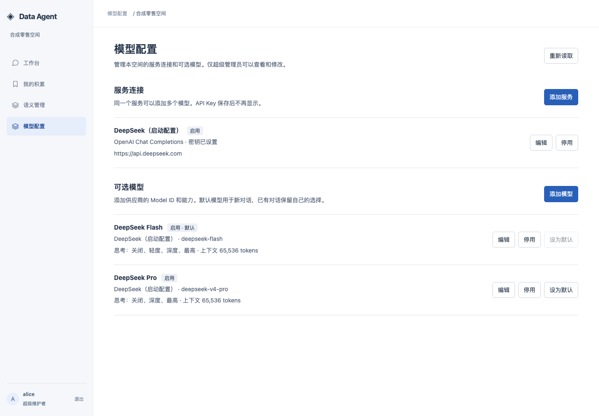

*隔离合成空间的实际管理页，展示示例服务与模型配置，未连接真实供应商。凭据保存后只显示是否已设置，普通用户没有管理入口。*

### 持续对话与结果查看

历史在工作台侧栏，同一对话可持续多轮、多项分析。新对话选用 Skill 或切换页面时保留未发草稿和模型选择；发送回执未确认时，按原消息重试，保留后来输入的内容。手机导航、资料和长表格各自滚动，返回对话可继续输入。空闲页面减少刷新，返回时重新核对状态。

图表需要适合的分类与数值列；只有两个金额列时，不会把它们误画成趋势。只修改某个目标的条件时，可以将它从联合分析中分离，其余问题和查询保留原归属。普通回复里的已知系统标识显示为业务名称，排查时可打开“显示技术标识”；SQL 和未知业务编号保持原文。

### 个人记忆与个人 / 公共 Skill

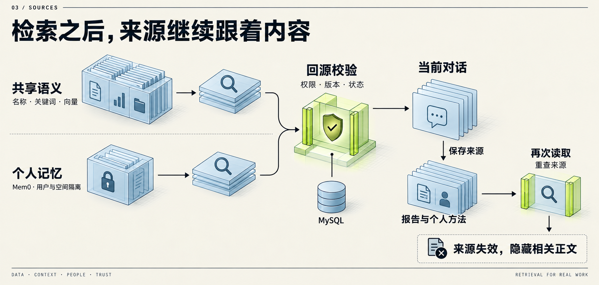

*检索候选回源核对权限、版本与状态。保存为报告或个人方法后，来源约束继续保留；来源失效时隐藏相关正文。*

这三类内容用途不同：

| 内容 | 保存什么 | 如何使用 |
| --- | --- | --- |
| 共享语义 | 表、字段、指标、SQL 和业务文档的正式口径 | 按权限检索，采用前核对当前版本 |
| 个人记忆 | 本人确认的偏好、可复用纠错和经验 | Mem0 提取和召回候选，Rust 校验；按用户与空间隔离，可修订、停用或删除 |
| Skill | 可复用的分析步骤、说明和文本模板 | 用户明确选用后，由 Pi 原生能力按需读取；分个人与当前空间的公共副本 |

共享语义由 Rust 接入向量检索，个人记忆由 Mem0 接入；两者均使用百炼 Qwen 1024 维向量。个人经验不会自动变成公共口径。

### 分析方法可以留给下一次

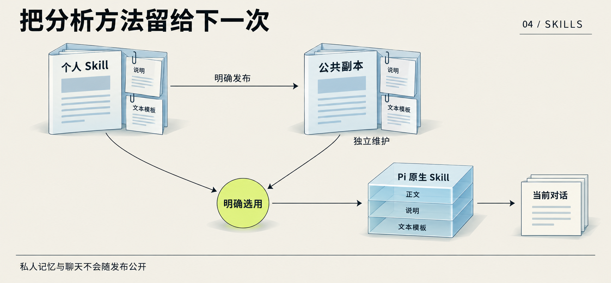

*草稿经本人编辑保存后，才能作为个人 Skill 选用。明确发布才产生独立公共副本；私人记忆和聊天不随发布公开。*

Skill 按选定版本用于当前对话。Pi 原生目录和 `read` 按需加载正文、配套说明与文本模板；方法改版后，工作台提示重新选用。“从本会话移除”会保留资产和其他对话。当前输入正在处理或恢复时，暂缓更换方法；已结束的失败不会挡住操作，已授权的后台 SQL 继续运行。

个人记忆和 Skill 可按名称、内容、适用范围搜索，并按状态筛选。新建 Skill 提供可修改的分析模板，完整正文和次要操作收在详情中。

成员可预览并明确发布自己的 Skill，生成当前空间的独立公共副本。发布人和超级维护者维护正文，其他成员可使用、提建议；处理建议不会自动改正文。私人记忆、聊天和来源备注不随发布公开。公共方法也不授予数据平台读取或执行权限。

Pi 继续负责会话延续和原生上下文压缩，Mem0 个人记忆负责跨会话的长期积累。

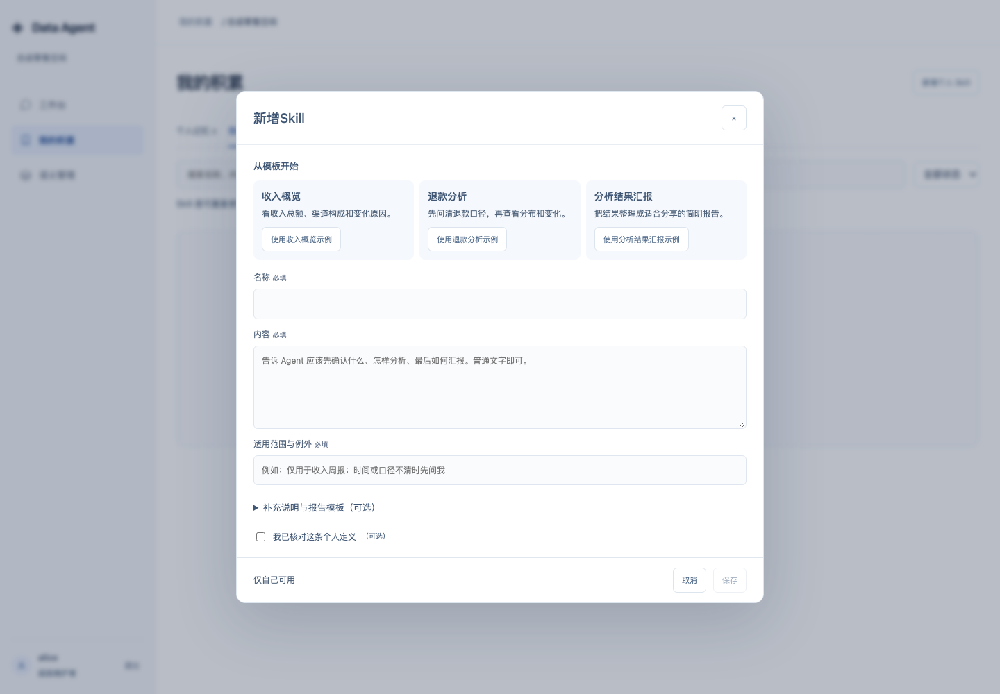

*当前“确认个人 Skill”页面：核对分析步骤与适用范围，保存后再在需要的对话中明确选用。也可以从模板新建方法。*

<details>
<summary>语义改版后，如何维护引用它的记忆和 Skill</summary>

在“我的积累”打开编辑，在“知识依赖”中读取当前内容，核对后更新引用版本，或在方法已不再依赖它时明确移除。保存会产生新的资产版本，已有对话中的 Skill 需要重新选用。修改正文、范围、附件或依赖会撤销旧的“已核对”标记；可以重新核对后勾选，也可以保存为待核对线索。


保存或发布成功后，列表刷新失败会单独提示，可重新加载列表。关窗后未收到成功回执时，页面保留原资产名称供核对；核对操作只读取列表。完整操作说明见[资产维护与结果核对](docs/development.md#资产维护与结果核对)。

</details>

## 第二版的分析与复用能力

共享语义可以保存每行代表什么、唯一键、时间用途、指标计算和表间关联。Agent按对象种类和业务范围寻找资料，需要时补读同一版本的完整文档。影响计算的疑点在聊天里澄清，自由回答和换话题沿原会话继续。

| 使用场景 | 当前实现 |
| --- | --- |
| 生成SQL前核对口径 | 读取结构化规则；对能可靠识别的SQL形状给粒度、关联和时间诊断，复杂形状明确说明未检查范围 |
| 深入分析 | Pi根据已有观察继续调查；保存结论、计算说明、精确数字引用及限制，每条新SQL仍须聊天授权 |
| 留下成果 | 聊天中打开本人分析报告，查看有依据的结论和聚合图表，随时返回对话；修改条件后保存新修订 |
| 复用查询案例 | 维护者录入适用问题、参数、SQL、粒度和资料依赖；Agent核对后说明沿用原逻辑或参考后改写 |
| 保存个人方法 | 用户要求整理方法后，先产生本人待确认草稿；到“我的积累”编辑并保存，再明确选用原生Pi Skill |
| 维护来源变化 | 知识详情及纠错保存处按需查看已有直接引用，包括公共案例、本人方法和公共方法；旧绑定和停用项仍可核对 |

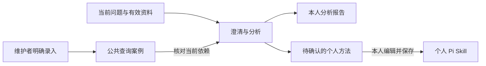

个人记忆继续由Mem0提取和检索，正式内容仍以MySQL为准。查询案例是共享知识，报告属于本人任务，待确认方法属于本人；这几类内容分别保存。私人分析不会自动成为公共案例或公共方法，引用关系也不会授予维护权。

图表使用有界的已保存结果，保留精确金额和截断说明。同一会话的组合报告可引用 1–5 份分析依据，各自保留原查询与条件身份；任一来源失效时整份报告只显示状态。待确认方法也可组合本人同会话不同任务或历史条件的有效依据，各份来源保留原身份；来源失效或会话删除后，草稿正文清理。已保存的个人 Skill 保留资产记录，生成正文继续携带来源约束；清空引用或原文重传不能解除这些约束，人工独立改写另按保存规则处理。

接口和边界见[第二版执行包](docs/analysis-capabilities-execution.md)及[实现设计](docs/architecture/implementation-design.md)。最新完成状态与验证范围见[CURRENT](docs/CURRENT.md)；本轮新增能力的本地协议测试不代表真实模型的自主分析准确率。

## 软件架构

React 负责交互，Rust 负责业务约束，Pi SDK 负责唯一的 Agent 循环，Mem0 负责个人记忆提取与检索。API 和 Worker 复用同一个 Rust 业务库，按职责分进程、统一交付。

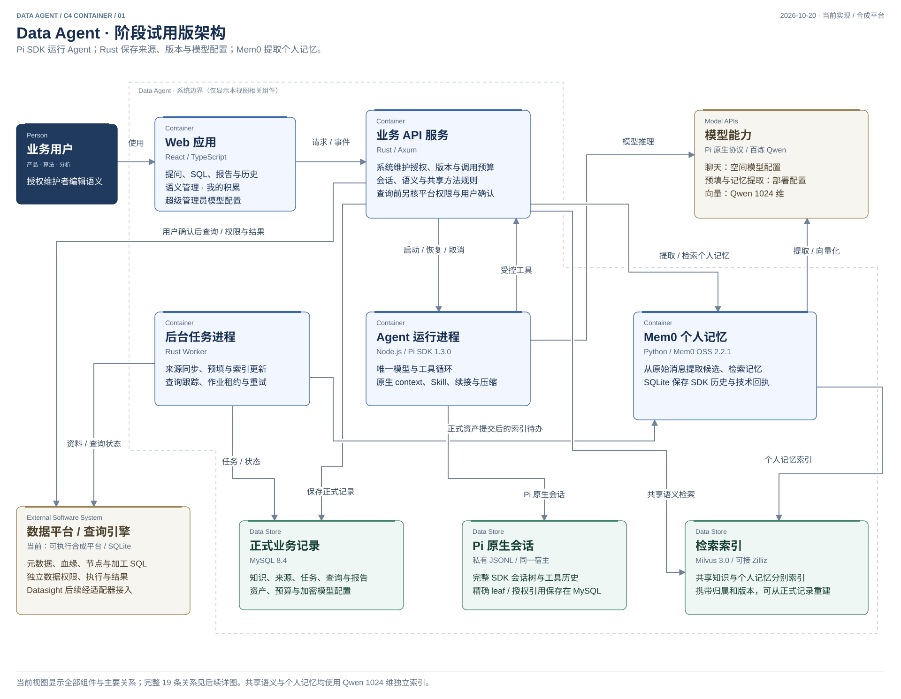

*[完整架构说明](docs/architecture/README.md)包含三张详图及存储职责，保留 11 个组件、19 条调用关系。正式架构图使用可编辑 SVG / draw.io。*

| 部分 | 技术 | 负责什么 |
| --- | --- | --- |
| 工作台与维护页面 | React / TypeScript | 提问、通过聊天要求执行 SQL、结果、历史、共享语义与个人积累 |
| 业务 API / Worker | Rust / Axum / SQLx | 权限、版本、任务、查询、预算、同步、预填与索引作业 |
| Agent 运行进程 | Node.js / Pi SDK 1.3.0 | 模型与工具循环、澄清、流式输出、取消、续接与原生压缩 |
| 个人记忆适配进程 | Python / Mem0 OSS 2.2.1 | 原始消息提取、个人记忆候选检索、派生索引 |
| 正式业务记录 | MySQL 8.4 | 语义、文档、资产、会话引用、SQL、状态、预算与版本 |
| 会话与技术回执 | Pi JSONL / Mem0 SQLite | 原生 SDK 会话历史；记忆组件的幂等回执与 SDK 历史 |
| 检索索引 | Milvus 3.0 | 可重建的共享知识和个人记忆索引，保留 Zilliz 适配方向 |
| 模型 | Pi 原生多协议；部署辅助模型 | 超级管理员配置聊天服务与模型，首次导入 DeepSeek Flash / Pro；共享语义与个人记忆使用 Qwen 1024 维向量 |
| 数据平台适配器 | 当前为合成 SQLite 平台 | 元数据、血缘、节点 SQL、权限、只读查询及结果 |

语义层把业务含义对应到数据结构。Agent 取得有出处、有版本的表、字段、指标、SQL 与文档。共享知识和个人记忆的向量索引都能重建；正式内容以 MySQL 为准，采用前重新核对权限和状态。

图源和导出：[SVG 合集](docs/architecture/data-agent-c4-container.svg) · [PNG 合集](docs/architecture/data-agent-c4-container.png) · [可编辑 draw.io](docs/architecture/data-agent-c4-container.drawio) · [模块与流程图册](docs/architecture/implementation-atlas.html)。

## 快速开始

当前验证环境是 macOS ARM64。需要 Node 26.8.1 / npm 11.19.0、Rust 1.99.0、Python 3.10+、Make、Colima 和 Docker CLI / Compose。依赖与镜像按锁文件固定，首次安装需要联网下载。其他系统尚未按同一启动流程验收。

```sh
git clone https://github.com/yaoziyaoguai/data_agent.git
cd data_agent
make setup-node setup-rust
make infra-up
make dev
```

打开 [http://127.0.0.1:5173/](http://127.0.0.1:5173/)，用启动器生成的 `.local/development-cockpit/identities.json` 中 `alice` 或 `bob` 的值登录。该文件只保存在本机；Alice 用于超级维护者试用，Bob 用于普通用户试用。表维护者账号需按[开发指南](docs/development.md)配置 mock 表归属并同步。

Ctrl+C 关闭应用进程，数据库与会话保留；结束后可用 `make infra-down` 停止基础服务，或用 `make vm-stop` 停止项目虚拟机。

默认使用本地模拟模型和词法检索，无需模型密钥，不调用付费向量接口。默认资料为座舱语音交互链路，可以先问“查2026年9月语音任务达成率”，查看 SQL 后说“执行这条”；也可问“ASR耗时怎样统计”或“语音交互链路有哪些表”。模拟模型只支持这些固定演示及达成率按天、按车型分组；多轮修订和自由调查需要切换真实模型。

| 运行方式 | 入口与说明 |
| --- | --- |
| 正式工作台，本地模拟 | `make dev`；运行 React、Rust、Pi 与可执行合成平台 |
| 真实 Flash + Mem0 | 先 `make setup-memory`，再按[模型配置](docs/development.md#6-真实模型小样与取消)和[记忆配置](docs/development.md#7-mem0个人记忆)启动；需要模型及 embedding 凭据、生成模型 profile 和共享向量维护 profile |
| 纯交互原型 | `make prototype`，打开 `http://127.0.0.1:8765/`；使用浏览器本地存储，不执行 SQL、不调用模型 |

超级维护者可从主导航“模型配置”添加服务地址、API Key和具体Model ID，管理能力、启停和新对话默认值。支持Pi原生Chat Completions、Responses、Anthropic Messages，兼容服务不要求Model ID已在SDK目录中；普通用户仅选择已启用模型。配置加密保存，修改影响新消息，旧消息与恢复沿原版本；停用阻止后续请求。操作与主密钥备份见[接入聊天模型](docs/development.md#通过管理页接入聊天模型)。

本地服务只监听回环地址。`.env.example` 和 `apps/memory/config.example.json` 提供配置格式；凭据、运行数据库、会话和日志保存在被 Git 忽略的本地目录。启动方式、端口、恢复及索引重建见[开发指南](docs/development.md)。

## 座舱语音试用资料

默认合成资料覆盖唤醒与入口、VAD、ASR尝试与候选、意图与槽位、多轮对话、技能路由、动作回执、TTS、播报打断、用户反馈和网络重试：28张实际表、421个字段、26项指标和14份业务文档。车型、软件版本和运行策略是分析维度；导航、媒体、空调只是语音指令的执行目标。全部从零构造，没有原始音频或公司资料。

业务数据覆盖2026年7月至9月，快照截止2026年10月4日。标签只覆盖部分轮次，识别准确率、标签覆盖率、任务达成率和播报完成率分别定义；每个字段注明粒度、单位和空值含义。知识清单只提供结构、加工SQL和业务定义，生成参数、种子和独立参考不进入知识输入。

[资料说明](docs/sources/cockpit/README.md) · [100项递进试用](docs/dogfood/cockpit/README.md) · [交给其他Agent的Prompt](docs/dogfood/cockpit/AGENT_PROMPT.md)。资料和固定mock接入检查不代表真实模型试用通过；新清单初始均为`not_run`。

## 验证与边界

### 已有证据

2026-10-19新版160项`flash-r1`已逐项处理，保留真实Flash、UI与工程专项各自证据及失败，不折算成模型准确率。2026-10-20的[一般性根因复核](docs/reviews/dogfood-root-causes-20261020.md)记录执行恢复、完整来源、澄清、知识维护及多来源报告修复，并单独保留高思考档对照中尚未闭环的语义问题。当前结果、未全通过原因和本机报告入口统一见[CURRENT](docs/CURRENT.md)；原始对话、账户与运行账本保留忽略目录，未公开上传。

2026-10-18至19日按120项手册继续试用，使用连续月份合成资料与真实DeepSeek Flash。交接报告已逐项定级；本轮核对重点是限定范围、歧义澄清、金额单位、粘贴SQL执行及后台反馈，修复与证据边界见[试用交叉审计](docs/reviews/dogfood-20261019.md)。部分场景和未知回执仍有缺口，不将手册项数当整体准确率。

此前2026-10-11的全功能试用覆盖三个主入口和三类角色，其5组统一验收包含28个专项及工程检查。该历史结果仍保留在[本地试用报告](docs/reviews/local-dogfood-20261011.md)，不能替代当前版本验收。

真实 Flash + Mem0 的代表性流程完成了 Skill 正文及附件读取、本人记忆召回、SQL 展示后聊天执行、10 行预览和 CSV 下载。查询返回的 14 行结果与独立 SQLite 参考一致；停用记忆后，同一对话不再采用它。该流程有 17 次已结算模型调用，包含工具往返和结果解释，不代表 17 道独立题或整体准确率。

<details>
<summary>历史基线、记忆方案对比与工程验证</summary>

| 验证 | 结果与适用范围 |
| --- | --- |
| MVP 收尾 | 四组增量验收及独立审查通过；记忆范围一致性、Markdown 安全渲染、契约、代码、Pi 续接与压缩、工作台回归均有记录 |
| 真实 Flash 质量基线 | 固定 16 个合成场景各测一次，独立内容判分 12/16（75%）；这是历史版本基线，保留 4 个错例 |
| 记忆方案对比 | 完整场景均为 16/18；Mem0 的记忆管理 17/18、SQL 24/24，原方案为 16/18、22/24；据分项选择 Mem0，小样未证明稳定统计优势 |
| 接入后试用与修复 | 原始试用 5/6、SQL 7/7；自动记忆范围扩写和 Markdown 显示两项问题已修复。新针对性回归 4/4 条消息通过，旧评分不改写 |
| 真实共享向量小样 | 百炼 Qwen 1024维，原4个中文问题均在前6候选命中；56次调用、6,317输入token；小样不代表千表召回率 |
| 合成目录规模与恢复 | 1204 张合成表、2408 个新增对象，首次建索引和两次丢库重建通过；协议向量用于工程验证，中文语义质量由上方真实小样单列，不代表千表真实模型召回率或低延迟 |
| 资产维护补充修复 | 8 项确认的问题已修复；7 组统一验收和补充独立审查通过。覆盖迟到回执、列表同步、依赖维护及核对标记；使用合成平台、真实 Rust API、隔离 MySQL 和 Chromium，本轮应用模型调用为 0 |

证据入口：[共享向量真实小样](docs/sources/evaluation/qwen-shared-trial.json) · [共享向量审查](docs/reviews/shared-embedding-review.json) · [最终验收记录](docs/CURRENT.md#完成与验证) · [收尾审查](docs/reviews/mvp-closeout-review.json) · [质量基线](docs/reviews/mvp-accuracy-20261005.md) · [记忆 A/B 对比](docs/research/mem0-extraction-comparison-results.md) · [接入与修复报告](docs/research/memory-adoption-trial.md)。这些测量的题目、版本和分母不同，分别保留。

资产维护证据：[问题与修复对照](docs/research/asset-maintenance-audit-20261008.md) · [独立审查](docs/reviews/asset-maintenance-review.json)。

</details>

### 在本机检查

```sh
# 无模型调用的静态与离线检查
make verify-materials verify-fixture
make verify-code verify-contracts

# 需要本项目 MySQL；各项串行运行
make verify-query-workflow verify-knowledge-workflow
make verify-mvp-browser verify-mvp-regression
make verify-business-acceptance verify-hybrid-retrieval
make verify-shared-embedding verify-memory
```

检查使用合成资料和隔离测试环境。完整命令及依赖见[开发指南](docs/development.md#4-正式工作台与增量检查)。`make verify-increment`、官方试用审计等命令还需要本机冻结的私有运行证据；新克隆仓库只有公开报告和测试源码，不能直接重放未发布的收据。源码检查、本地模拟、真实模型和真实平台证据分别报告。

### 后续接入

- 真实数据平台的元数据、权限、执行与状态接口，以及正式身份认证。
- 新表自动发现、来源变化对比和按变化范围同步；当前只提供既有手动同步与预填能力。
- 同事实际使用、真实业务正确率、长期运行与容量验证。
- 更大个人记忆库下的效果、延迟与费用测量。

各增量只对记录中的范围作验收；合成平台测试不能替代真实平台、业务数据或生产容量验证。

## 文档导航

| 想了解 | 从这里开始 |
| --- | --- |
| 当前状态、有效决定、剩余事项 | [CURRENT](docs/CURRENT.md) |
| 六篇图文工程实践与固定提交源码 | [Data Agent 工程实践系列](https://wangjinkun333.me/blog/series/data-agent-engineering)：整体设计、知识与个人积累、查询恢复、工程维护、来源追踪、多模型接入 |
| 交给 Coding Agent 做语音链路及产品能力试用 | [座舱语音 Dogfood 包](docs/dogfood/cockpit/README.md)：100项、7级递进、执行 Prompt 与独立参考；旧[160项包](docs/dogfood/2026-10-19/README.md)保留为历史回归 |
| 最新试用问题、修复与验证边界 | [一般性根因复核](docs/reviews/dogfood-root-causes-20261020.md)；此前[试用交叉审计](docs/reviews/dogfood-20261019.md)与[本地试用报告](docs/reviews/local-dogfood-20261011.md)保留各自时点的结论 |
| 系统方案和需求边界 | [系统设计](docs/semantic-retrieval-design.md) |
| 软件架构与调用关系 | [架构说明](docs/architecture/README.md) |
| 语义、个人记忆与两类召回 | [图文讲解](docs/visualizations/data-agent-knowledge-and-memory.html)，含最新语义权限与纠错流程 |
| 模块接口、存储归属与流程 | [实现设计](docs/architecture/implementation-design.md)、[知识模块](docs/architecture/knowledge-modules.md)、[运行模块](docs/architecture/runtime-modules.md) |
| HTTP、工具和事件契约 | [OpenAPI 3.1](packages/contracts/openapi.json)、[共用 JSON Schema](packages/contracts/schema.json) |
| 安装、配置、检查与恢复 | [开发指南](docs/development.md)、[基础设施](infra/README.md) |
| 当前合成业务、字段与口径 | [座舱语音资料](docs/sources/cockpit/README.md)；旧[零售回归夹具](docs/sources/README.md)仅供已有测试 |
| 个人记忆接入与选型依据 | [Mem0 接入报告](docs/research/memory-adoption-trial.md)、[比较实验](experiments/mem0-comparison/README.md) |
| Skill 依赖修复、保存反馈与验收 | [操作说明](docs/development.md#资产维护与结果核对)、[维护契约](docs/dogfood-repair-execution.md#11-资产维护补充修复)、[审计对照](docs/research/asset-maintenance-audit-20261008.md) |
| 工程规则和防漂移约定 | [AGENTS.md](AGENTS.md) |

```text
apps/                React 页面、Rust 入口、Pi 桥、Mem0 侧车、合成平台
crates/data-agent/   按业务能力组织的 Rust 模块与具名 use_cases
packages/contracts/ 跨语言契约及生成类型
migrations/         MySQL 迁移
tests/              契约、业务、恢复、浏览器与真实模型试用程序
infra/ · scripts/   本地环境、启动和检查工具
docs/               设计、架构图、合成资料与公开验证报告
prototype/          前期交互原型
experiments/        独立记忆对比实验
```

## 资料、联网与许可

表、SQL、数据、业务文档和案例均为从零构造的合成材料。独立验收答案与 Agent 知识输入分开；密钥、私有会话及原始试用日志不进入 Git。

首次准备会下载依赖和镜像；不再下载本地 embedding 权重。真实模型调用会向管理员配置的聊天端点或部署配置的辅助服务端点发送允许的模型输入；Mem0 遥测在本项目适配器中关闭。未配置真实模型服务的默认模拟模式不发起付费调用。

本仓库尚未指定开源许可证；公开可见与授予开源使用许可是两件事。各依赖的许可证以其自身声明为准。
