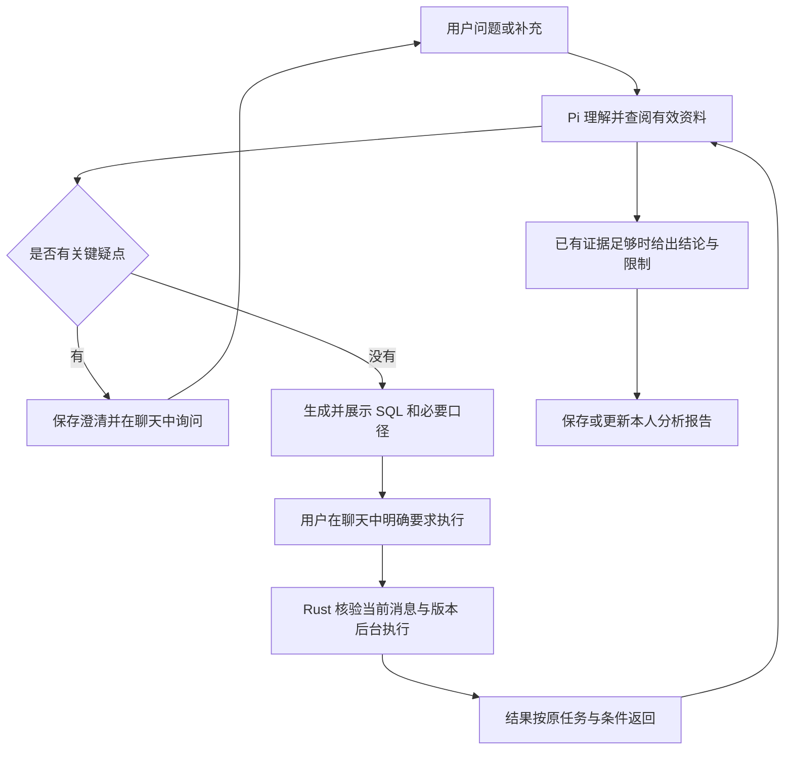

# 语义、澄清与分析能力执行包

日期：2026-10-13。本包记录第二版的实施规格；当前增量、进度、授权和证据只在 [CURRENT](CURRENT.md) 维护。基线为 `6801df79f3b09d51552df51dc20a44a916773447`。本文是实施规格，当前实现、验证与未完成项均以CURRENT为准。

## 1. 目标与已确定边界

用户接受的五项方向：让语义可靠地参与计算、检索更有针对性、深入分析、可继续使用的成果、经验复用。主动澄清贯穿五项。最新要求是先确保 mock 来源和预填内容足够正确；先提升公开合成环境中的能力与体验，验证保持轻量。

用户已于2026-10-13授权按本包实施，进度与证据继续只记录在CURRENT。接手者沿用本包与 CURRENT，不重新立项，不把某个业务演示题写成产品策略。

### 1.1 继续沿用

- Rust 业务模块、Node/Pi SDK、MySQL、Mem0、Qwen embedding、Milvus 的既有分工。Pi 是唯一 Agent 循环；新增数据工具保持薄接入。
- SQL 先展示，用户通过聊天明确要求执行或修改后执行。每个查询绑定实际用户消息、最终草稿与条件版本。澄清答案本身不授予额外执行权；既有待完成执行意图只能按原规则核验。
- 同一会话长期、多轮、多任务；查询独立运行，输入持续可用，每个查询可单独取消。晚到结果归原条件。
- MySQL 是正式状态和正文真源；索引可重建。权限、版本、引用、幂等、预算、恢复均由现有宿主入口落实。
- 表负责人沿用平台维护人；独立对象由有资格的首位人工创建者负责；建议接受后仍须编辑保存。系统角色不授予平台查询权，也不开放他人私有内容。
- 保留自然语言解释、长文档、事实/模型建议/人工覆盖及其依据。人工确认不自动证明业务结论正确。

### 1.2 本包的范围限制

真实 Datasight 接入、同步缓冲区、微服务拆分、替换 Pi 或 Mem0、自动选用 Skill、任务级批量查询授权、通用语义编译器、Python 沙箱、公共报告分享、完整 BI 编辑器、评测平台均后置。报告首版沿用本人/空间隔离，重新运行仍走聊天授权。普通本地实现与验证不包含提交、推送、发布或部署。

## 2. 一一对应的工作与顺序

编号只用于交付记录，禁止用于源码中的类型、模块或函数名称。`I2` 沿用项目交付检查器的既有分类，不表示产品仍处于第一版。

| 顺序 / 增量 | 对应问题与可观察成果 | 依赖 | 需求 / 模块 |
| --- | --- | --- | --- |
| 1 / `I2-SOURCE-TRUST` | 来源、实际数据、目录和预填依据一致；未知和推断明确；人工值受保护 | 当前基线 | D04、D05、D06、D17、C07、C08 / M02、M03、M07、M10、M12 |
| 2 / `I2-SEMANTIC-RULES` | 问题1：常用指标、粒度、关联与时间规则可被读取、维护和检查 | 来源可信 | D01、D04、D05、D06、C04、C07 / M01–M04、M07、M12 |
| 3 / `I2-CONTEXT-RETRIEVAL` | 问题2：按范围和对象补查，返回相关摘要与可继续读取的位置 | 语义结构 | D06、C02、C06、C07 / M01–M04、M09、M11 |
| 4 / `I2-CLARIFICATION` | 贯穿五项：发现关键歧义时主动问，回答后准确续接，允许用户换话题 | 可信来源；结合新检索 | D08、D09、C03、C04、C05 / M05–M08、M11、M12 |
| 5 / `I2-ANALYSIS-EVIDENCE` | 问题3：比较、拆解、查看中间结果，再决定补查或给结论 | 语义、检索、澄清 | D09、D15、C01、C03、C04 / M06–M08、M11 |
| 6 / `I2-ANALYSIS-REPORTS` | 问题4：有依据、范围正确的图表报告，可保存、重开、继续修改 | 分析证据 | D02、D03、D13、D14、C02、C07、C08 / M05–M07、M11、M12 |
| 7 / `I2-KNOWLEDGE-REUSE` | 问题5：纠错、查询案例与方法进入正确的保存位置，并能维护依赖 | 前述真实使用路径 | D01、D10–D13、C02、A08 / M01、M02、M04、M09、M11、M12 |

每个增量交付一个能使用的流程，并同步相关文档。澄清在增量1–3的缺口表达中就要保留，增量4集中完成交互和恢复行为。增量5–6可先约定数据形状，再按独立文件分工；共享契约与迁移由一个负责人串行修改。

## 3. 首个增量：来源与预填可信

### 3.1 真源与已核实的问题

| 材料 / 入口 | 职责与注意点 |
| --- | --- |
| `docs/sources/schema.sql`、`seed.sql`、`etl.sql` | 可执行表、样例行和加工逻辑；由 SQLite 实际执行核对 |
| `docs/sources/business-guide.md` | 从零制定的业务约定；不能从几行数据推断业务定义 |
| `scripts/build_semantic_catalog.py` → `docs/sources/semantic-catalog.json` | 生成演示语义；生成器中还有硬编码解释/SQL，必须核对来源，不能自我证明 |
| `docs/sources/knowledge-manifest.json` | 模型知识允许列表；独立核算资料继续排除 |
| `apps/platform-mock/server.py` | 实际数据库、平台目录、血缘、加工节点、只读检查和查询适配 |
| `modules/ingestion/{mod,catalog,prefill}.rs`、`use_cases/prefill_materials.rs`、`use_cases/semantic_prefill.rs` | 内置来源读取、目录导入、预填材料收集、模型预填与发布；路径前缀为 `crates/data-agent/src/` |

基线已经看到四个待核对修正的问题：

1. mock 目录中 `demo_order_detail` 的上游只列订单行和支付事件，但 `etl.sql` 还关联 `dim_customers`。缺失血缘会影响预填收集材料。
2. mock 只在 `business.sqlite` 不存在时加载数据，却在读取目录时使用磁盘当前的加工 SQL。Rust 内置来源默认还通过 `include_str!` 编译进二进制。更新资料后可能出现旧库、新 SQL、旧二进制三者混用。
3. 目录生成器把包括人工编写指标 SQL、别名和关联说明在内的内容统一写入 `source_facts`。运行时会重新核对部分内容，但生成物仍需区分直接来源与派生解释；目录单独改变也不保证已存在对象自动更新。
4. 平台导入对象通过明确对象关联收集文档；内置目录里存在业务说明，不代表平台对象已经关联到它。需核对实际预填输入，补明确关联，不按同名表推导权限或身份。

实现应核对并固定当前实例使用的来源版本或内容指纹。发现不一致时明确拒绝相应操作并给出更新方式；不得自动删除用户试用库、查询账本或历史结果。新合成样例使用独立运行目录，既有实例通过明确的本地更新操作切换。

### 3.2 要做的工作

1. 清点当前演示对象，逐项对照 DDL、加工 SQL、文档、目录和可执行数据，修复有证据的不一致。核对字段存在性、粒度/唯一性、关联、金额单位、时间边界、退款和状态条件。
2. 首增量修好当前五张可执行表的资料一致性。连续月份和业务变化的扩展放到增量5，先保留当前小样及参考结果，不把修资料和扩大业务同时推进。目录生成器增加只读检查入口，校验生成物可复现；硬编码解释有明确规范来源，不再暗藏第二份业务规则。
3. 明确各类预填：DDL 明示的字段/类型/约束、SQL 明示的加工/过滤、文档约定属于有出处的信息；粒度和业务意图等推断保留推断身份；未知保留缺口。样本中的唯一性不能证明长期主键，生产血缘不能自动当查询关联。
4. 模型建议必须带当前来源及定位。核对引用是否存在只能证明可追溯，不能冒称推断正确；对程序能确定的矛盾给诊断，其他由维护者核对。
5. 重新预填保留人工覆盖及其编辑记录，新建议和冲突可回看。待复核内容可以供 Agent 作为线索，但关键未确认项要补查/澄清，不能隐式成为确定的计算规则。
6. 页面默认展示清楚的内容和需要处理的缺口；来源定位、版本、运行记录放在详情。这里复用现有语义维护页面，不重做全站设计。

### 3.3 成功行为

- 新实例的实际 DDL、加工 SQL、血缘与目录一致；修改来源后，旧实例不能继续冒称使用新版本。相同来源重复加载不破坏状态。
- 一订单多行、一客户多标签、跨期退款、空值/未知、无支付/失败事件、半开时间边界各有独立可核对数据；不能仅靠“所有数都为0”通过。
- 同一份已核对资料分别经过内置导入和平台导入时，事实不矛盾；对象可以有不同来源身份，不能靠名称强行合并。
- 预填遗漏关键事实、引用失效或凭空补业务口径时能够被发现；模型超时保留明确失败，不用手填正确答案冒充模型成功。
- 人工修订后再预填，人工值保持；无依据字段仍明确未知。

首增量允许修改范围由 CURRENT 精确列出。新增检查优先扩展 `docs/sources/verify.py` 与现有 prefill/materials 测试。先写独立可核对事实，再检查产品输出，不读取产品输出反写预期。不构建评测平台或追求所有自然语言表述100%一致。

界面状态可复用 `tests/mvp/check-semantic-status.mjs`，其部分响应替身只证明展示。编辑后重新预填、人工值保留及同版来源展开，通过计划新增的窄测试 `tests/mvp/check-semantic-source-browser.mjs` 连接实际本地API与预填替身验证；不能拦截页面响应制造保护成功。相关知识页面、`shared/knowledge-labels.ts`、启动脚本和测试均应进入本增量指纹。

## 4. 语义结构与检查

### 4.1 最小设计

在 M02 现有版本化知识对象上增加按对象类型校验的结构内容，避免另建一套语义真源。以下是所需语义，不要求照抄为字段名：

| 对象 | 需要明确的结构 | 使用方式 |
| --- | --- | --- |
| 表 | 行粒度、唯一键、时间列角色、单位、已知约束 | 检索返回必要信息；SQL 诊断核对聚合和时间依据 |
| 关联 | 两端稳定对象/字段引用、关联条件、一对一/一对多等关系、适用范围 | 补查有效路径，指出重复累计风险；历史有效期/多对多未支持时明确限制 |
| 指标 | 表达式或已确认计算 SQL、输入粒度、时间依据、必要过滤、单位、可用维度 | 常用计算遵循定义，复杂 SQL 仍由 Pi 生成 |

文字解释、结构内容、来源和人工覆盖须在一次保存中一致更新；不得一份正文与一份结构互相覆盖。旧对象没有结构时保持可读，标明缺口，不能把字符串解析失败当空结构已验证。结构与正文冲突时要求维护者处理。

### 4.2 接口与存储归属

- 复用 `KnowledgeObject`、`read_knowledge`、`save_knowledge` 及现有负责人校验。新增可选结构在 `packages/contracts/schema.json` 定义；生成类型和正反例同步。
- M02 保存正式结构与版本；M03只产来源与建议；M04生成索引。沿用知识 JSON/版本记录，除非现有存储无法表达明确约束，不提前新建通用图存储。
- `validate_sql` 的语法/只读结果继续来自平台。新增业务诊断独立表达 `检查了什么、依据、发现、覆盖限制`；语法通过不等于口径通过。
- SQL 诊断由 M07 负责查询检查；组合用例经 M02 接口提供有效结构快照。M07不得直接查询知识私有表；不得为所有 SQL 自建完整编译器。
- 可靠识别的条件才可阻断；静态无法判定的复杂 SQL 返回未检查或警告，交 Pi 补查。诊断不获得额外执行权。

验收覆盖有依据的关联重复累计、错误时间列/单位、缺失结构、过期引用及人工保存保护。先限定可支持的 SQL 形状，明确其余覆盖范围。

## 5. 有针对性的检索

- 扩展现有 `SearchInput` 的可选范围：对象种类、所属表/对象引用和有依据的业务域；身份与空间仍由宿主绑定。旧调用不带过滤继续有效，语义搜索与个人资产分页不要互相混用。
- 复用词法/向量融合、精确名称、关联补充及回源核验。范围条件是搜索意图，不能变成权限；关联补查仍检查每个对象的访问权与版本。
- 返回相关条目摘要、命中位置、范围/截断说明、可补读引用，整体回执有合理上限。继续通过 `read_knowledge` / `read_source` 分页，不把整个对象所有条目无差别送入模型。
- 跨域问题可扩展范围；过滤无结果不能假称全空间没有资料。权限过滤不泄露隐藏对象数量、名称或存在性。
- 只有现有排序暴露具体问题，才引入重排依赖；本包先解决检索表达力、补读和上下文体积。

验收使用同名对象、跨表指标、长文尾部规则、范围过窄后补查、停用对象和跨用户资产等少量通用场景。记录实际回执大小与往返，性能结论只对测过的范围成立。

## 6. 主动澄清与自然对话

### 6.1 行为规则

Pi 先查有权读取的资料，仍存在影响计算或结论的歧义时主动问。提问说明疑点与影响，给少量可选答案和有依据的推荐，用户始终可以自由回答。

需要问：同名口径、冲突资料、必要条件缺失、用户意图无法归属。资料中已有答案时直接使用；展示样式等低影响选择可以采用合理默认。无法证明因果时说明证据边界，询问用户是否有可补充的信息，不暗示一个选项能创造缺失证据。

问答使用聊天消息；可选项放在该条消息内。不能弹出必须处理才能继续聊天的表单，不能恢复“继续这个问题/取消这个问题”式技术状态组件。用户换话题时保留原问题的待回答状态；无关查询继续执行。

### 6.2 复用现有契约

源码基线 `AnalysisUpdate.action` 为 `create/revise/clarify/route`，有 `question/options/condition_patch`。接入链路是 `apps/agent/tools/data-tools.ts` → `use_cases/data_tools.rs` → M06 `analysis`，M05记录消息，M07处理受影响草稿。旧设计中的 `attach/resolve_clarification` 是设计名称，不应直接当成现有可调用 action。

首版沿用每个任务一次聚焦一个当前澄清。当前任务修订会关闭该任务开放澄清，不能声称已支持一次多题分别回答；用户的回答由Pi理解后通过现有条件修订落地，同会话其他任务仍可独立等待。若实现发现回答归属缺口，优先修现有状态规则，不扩大为问卷系统。不得从回复中的问号推断状态，不新增澄清服务或规则式中文意图分类器。

验收至少包括：资料可查不问；关键口径不明会问；自由回答后保留其他条件；回答和新话题可区分；刷新/恢复仍能续接；新条件不会误执行旧稿；未回答不当同意。模型决定问法与调查路径，宿主校验消息、任务和条件归属。

## 7. 深入分析与依据

目标是让 Pi 根据中间观察继续工作，支持趋势、分组比较、占比、排名和变化贡献。优先用现有 SQL 与受控结果读取表达计算；必要的条件在 M06 持久保存，查询与结果由 M07负责。模型输出的结论需引用具体查询及其条件版本；不能用模型心算代替应可复核的业务计算。

图示可反复调查，也可只读资料后直接回答；不是固定必须调用的工具流水线。执行动作后沿用既有结果通知续接。多个查询各自授权，不把一句“分析原因”扩成任意后续查询授权。

此时补充连续月份的数据、渠道变化和退款情形，复用当前已修正的样例加载路径，以独立合成数据集隔离现有固定参考。数据行数和表数由这两类分析需要决定；新资料经过增量1的同一一致性检查。用户补充的外部原因也应标为用户提供，不能凭生成器设置的情节自动让模型知道答案。

在既有 M06 任务下增加轻量的结论/依据引用形状，供下一增量的报告复用：结论文字、对应查询/结果引用、采用条件、资料引用、计算说明、已知限制。工具只校验引用和记录事实，不由 Rust 规划下一步，也不保存模型内部思考过程。

验收使用至少两类分析：时间变化与分组贡献、跨表去重与退款影响。用户可在过程中改变一个条件、提出无关问题或停止单个查询；部分结果只能支持相应范围的结论。解释数据中的贡献与关联，不能自动宣称业务因果。

## 8. 可继续使用的分析报告

### 8.1 产品与数据契约

报告在聊天中提供简洁入口，打开详情能随时返回原对话。Pi通过薄受控读取获取当前修订与有界正文，压缩或外部修订后局部修改保留原选依据及图表；不在启动目录自动塞全文。首版每个任务维护一份可修订报告，沿用本人/空间访问范围，不加入新顶层导航或公共分享流程。

M06拥有报告正文与不可变修订；M07拥有查询结果引用；M05拥有来源消息。建议的 `AnalysisReport` 包含任务/会话引用、标题、结论列表、图表配置、证据引用、条件修订、数据范围、生成时间和限制。版本用于服务端并发与历史，不在主界面堆数字。

每张图绑定查询、列与数据范围；每个关键数字绑定计算来源。系统只验证引用、列类型与范围，不能把引用有效等同于模型结论已证明。金额与精确小数沿用现有类型。

`save_analysis_report`受控工具由报告组合用例调用M06记录；HTTP与Pi工具共用同一规则。HTTP读写入口为 `GET/POST /conversations/{conversation_id}/tasks/{task_id}/report`；会话快照只附报告引用和状态，不每次附完整报告。保存输入为命令ID、起点版本、标题、已有`evidence_ids`及图表配置，身份由宿主绑定。结论与精确数值从已核验依据组装；修改结论先保存新依据，避免两份正文互相覆盖。输出只给报告引用与新版本，详情按需读取。首次创建无起点版本，后续修订使用 `expected_version`，重放沿用原操作身份。端点与工具在增量6由同源契约定义，实现及验证状态见CURRENT。

### 8.2 图表与重新运行

- 保留表格前10行预览和CSV下载。趋势图、分类比较图使用该查询完整且适合绘图的聚合结果；超过上限或不完整时标明覆盖范围，必要时请求新的聚合 SQL。
- 后端读取既有结果分页不等于授权新查询。平台现有1000行上限继续明确；不能把截断明细在浏览器累计成完整指标。
- 用户通过聊天修改条件时，报告生成新修订。原报告不被晚到查询覆盖，已有图表和文字必须来自同一分析范围。
- 保存报告不复制完整结果快照。结果过期/撤权时，显示失效状态，不用保存的数字或图表绕过读取权；重新运行需要新的有效执行授权。
- 报告与会话删除联动，不留下可恢复的私人派生正文；主动保存的独立个人资产遵守既有删除规则。

验收覆盖完整/部分/空结果、超过10个分类或时间点、金额精度、重新打开、条件修订、查询取消、结果过期及越权读取。实际浏览器核对窄屏、键盘、滚动和返回对话焦点。

## 9. 经验复用与维护

| 信息 | 保存位置与权限 | 需要补强的行为 |
| --- | --- | --- |
| 本次条件 | M06 当前任务 | 后续追问沿用；“仅本次”不长期化 |
| 明确可复用的个人纠错/偏好 | M09 + Mem0，沿现有授权与告知规则 | 保留适用范围、来源和例外，错误记忆可改/停用；不新增全量审批 |
| 公共口径问题 | M02 修改建议 | 负责人可驳回或接受后编辑保存；展示影响到的已有依赖 |
| 可复用方法 | 现有个人/公共 Pi 原生 Skill | 从用户明确要保存的分析中准备草稿，经用户确认保存；公共发布是独立明确动作，选用仍须明确 |
| 已核对查询案例 | M02 已有知识体系 | 保存适用问题、参数、SQL、粒度和依赖；提供给检索作参考，避免每次重新猜算 |

查询案例不单建服务。基线 KnowledgeObject 尚无独立案例类型；本包选择在M02增加 `query_example` 类型，保存适用问题、参数定义、SQL、粒度、依赖与核对记录，复用知识创建/保存/检索/状态接口及独立对象负责人规则。个人方法仍放原生Skill，不把同一个案例的正式本体同时保存到M02和M09。执行案例原逻辑与参考案例后改写的 SQL 分别表达，不能由模型自称“认证”。单次运行成功只证明可执行，口径核对记录须有来源与明确维护者动作。

从私人分析沉淀公共案例时必须由有资格者明确选择可公开内容；不能自动复制私人消息、结果或记忆。独立验收答案不进入案例库。维护影响通过既有显式引用确定，不承诺识别任意文字中的全部依赖；失效案例/Skill在采用时复核。

本阶段分别试用一次个人偏好、仅本次条件、公共口径建议、Skill保存/选用和查询案例复用，并检查来源修改后的行为。记忆提供方和原生Skill接入的已完成规则保持。

## 10. 实施与验证方法

### 10.1 每个增量的开工方式

1. 读 CURRENT 的当前增量与本包对应章节，核对工作区。当前默认分支上开始实质代码修改前建立 `codex/` 工作分支，保留本轮未提交规划文档。
2. 对照实际源码固定需要变化的接口与存储；先补同源Schema、迁移/兼容方案和少量正反例。公共契约没有变化时不机械加接口。
3. CURRENT登记本增量目标、要求、模块、允许路径、不变量、验收命令与待审查项，再实现。后续增量只在开始时替换当前增量，不维护第二套进度表。
4. 新状态归既有模块私有存储；跨模块流程使用具名 `use_cases`。Pi桥、HTTP和Worker都不复制规则。新增依赖需写明解决的具体问题。
5. 相关代码完成后，由未负责该实现的人核对需求、测试和实际结果。修复已证实问题，完成对应检查后再进入下一增量。

### 10.2 可复用的现有检查

| 改动 | 已存在的命令或测试入口 | 能证明的范围 |
| --- | --- | --- |
| 合成源 | `make verify-fixture`、`make verify-materials` | 当前SQL/材料一致性；需补目录/数据版本及语义核对，不代表模型预填正确 |
| 预填 | `cargo test --offline --locked -p data-agent --lib modules::ingestion::prefill::tests`；`tests/mvp/check-prefill{,-materials,-concurrency,-timeouts}.mjs` | 既有预填契约、材料和并发；先检查测试是否含真实网络配置 |
| 检索 | `tests/mvp/check-retrieval-{coverage,excerpts}.mjs`、`check-large-tool-context.mjs` | 回源、覆盖和分页/体积；现有千表精确名称检查不能当中文语义准确率 |
| 澄清与查询 | `check-query-workflow.mjs`、`check-conversational-query.mjs`、`check-long-conversation.mjs`、`check-mixed-task-pi-continuation.mjs` | 既有执行、任务和续接；需要补自然澄清与多问题归属场景 |
| 结果与页面 | `check-query-result-statistics.mjs`、`check-background-queries-browser.mjs`、`check-query-stop-browser.mjs`、`check-evidence-return-browser.mjs` | 已有结果/交互边界；新增报告需绑定自己的验收 |
| 经验复用 | `check-memory-context.mjs`、`check-memory-revisions.mjs`、`check-native-skills.mjs`、`check-semantic-governance.mjs` | 保留记忆失效、原生Skill和语义维护规则；新增案例另补检查 |
| 通用工程 | `make verify-code verify-contracts verify-architecture` | 类型、构建、契约与边界；按实际改动运行 |

未写完整路径的测试文件均位于 `tests/mvp/`，通过 `node` 运行。不把表中全部命令当作每个增量必跑清单；选择受影响流程和可信风险。新命令尚未实现时CURRENT允许`command:null`，关闭前必须绑定实际命令，不能用材料检查代替行为。

### 10.3 真实试用与费用

本轮执行包准备没有模型调用预算。此前某次试用的“无限调用”或旧增量预算不自动延用到第二版。实现先用离线/协议测试；真实预填、主动澄清和分析的小样需要在执行前按当前用户授权确定模型、范围与调用上限，凭据只用获准的本地配置，不读取或复用聊天密钥。

真实行为只抽取能说明本次改变的少量合成情境，不建立新评分平台、不追求100%。一次失败保留原因，避免反复付费抽到成功。合成平台、模型替身、真实模型分别报告；没有真实模型证据时，相关用户行为保持未验证。

### 10.4 收尾

随增量更新系统设计、模块契约、必要的图和接口；架构图只在关系/职责改变时重画。README只写已经实现且验证过的能力。最后沿五项成果和主动澄清做一次本地试用，记录问题、修复和剩余边界。

`make verify-delivery`验证映射，不证明实现。绑定实际验收和独立审查后，才运行`make verify-increment`关闭当前增量。本包完成需七项成果都有对应证据，不能因为某个净收入案例成功就宣布全部完成。提交推送仍以当时用户授权为准。

## 11. 交给执行模型的起步任务

先执行 `I2-SOURCE-TRUST`：重读CURRENT，核对资料真源和四类已识别问题；在隔离合成实例中建立反例，再修源版本一致性、来源缺口和预填保护。完成检查与独立审查后，按第2节逐项推进。实现发现常规可逆选择可自行处理；涉及查询授权、公共发布、删除已有数据、替换底座或新增付费授权时再给出具体选择。

从此入口开始，不恢复历史付费评测、文章发布或已经完成的记忆框架修复。
