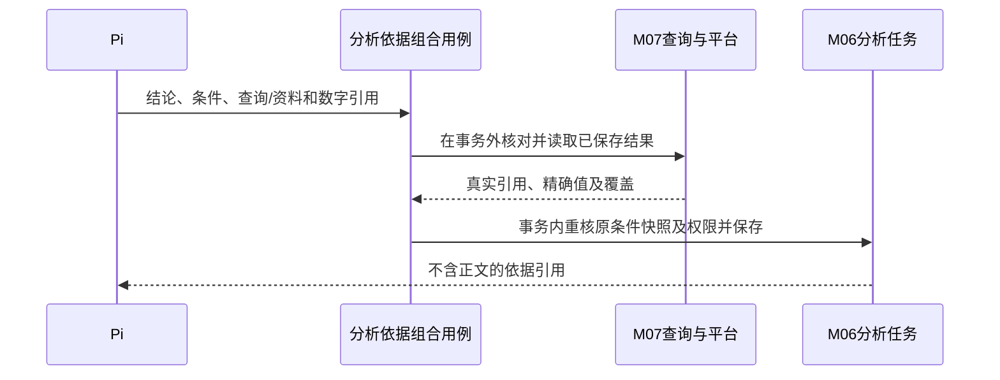

# Data Agent 实现设计

更新：2026-10-23。状态：设计与实施契约；实际完成范围及证据见CURRENT。产品范围沿用 [系统设计第 17–20 节](../semantic-retrieval-design.md#17-实施基线与交付顺序2026-10-02)，当前阶段与证据只记录在 [CURRENT](../CURRENT.md)。

**本轮工程设计入口：**[第17节](#17-语义检索与上下文的实施合同2026-10-23)明确来源、准备成果、混合检索、任务事实、容量与迁移的目标合同，替代相关旧设计选择；产品代码仍是旧实现。标为“当前实现”的段落用于迁移对照，不代表新合同已生效。实际可调用字段仍以`packages/contracts`为准，后续每个实现增量先同步Schema及生成类型，再改生产者与消费者。本轮只交付设计、文档与图。

本次补充[系统内部权限](../semantic-retrieval-design.md#61-语义维护权限与平台数据权限)与[跨用户纠错](../semantic-retrieval-design.md#117-跨用户纠错与共享语义维护)：表负责人或超级维护者处理建议，接受后编辑保存才生效。相关授权、协作接口及页面已接入本轮增量；Datasight 查询与执行权限继续独立校验。

本设计补足“系统由哪些进程组成”到“代码由哪些模块组成”的距离。模块不是新微服务；同一模块内的函数可以普通调用。这里定义模块职责、公开接口、数据归属、组合事务、代码依赖及验证边界，具体 SDK 可行性仍须 I0 试验。

## 1. 阅读入口

| 想了解什么 | 材料 |
| --- | --- |
| 快速看图、切换模块、查看流程 | [实现设计图册](implementation-atlas.html)；离线页面，由下列 Markdown 的图生成 |
| 整体组件、代码依赖、一次完整分析 | [V01–V03 框架与时序](implementation-views.md) |
| 身份、知识、同步预填、检索、个人资产 | [M01–M04、M09 模块契约](knowledge-modules.md) |
| 会话、分析任务、SQL 查询、Agent 运行 | [M05–M08 模块契约](runtime-modules.md) |
| 后台任务、Pi 集成、React | [M10–M12 模块契约](implementation-views.md) |
| 第二版的增量、接口归属与依赖 | [语义、澄清与分析能力执行包](../analysis-capabilities-execution.md)；阶段契约，实施与证据以CURRENT为准 |

来源可信增量复用现有边界：平台适配器冻结合成运行资料，M03保存包括语义目录在内的来源快照，M02合并候选并保护人工值，具名同步用例组合两者。M07保存平台检查的目标修订并沿版提交；明确版本拒绝是确定失败。合成文档身份映射只用于资料关联，不传播维护权或引入新进程。实际验收范围见CURRENT。

默认合成资料为[座舱语音链路](../sources/cockpit/README.md)。M03从显式打包的17份来源读取正文并核对SHA与核心文件字节，按所属表刷新字段类型；平台适配器从已核对SQLite结构建立可读表集合，分别返回三张日汇总的实际ETL和上游。生成器、seed与Dogfood参考不进入知识包。启动器将新资料绑定到独立的持久开发库，已有Pi、权限和查询模块边界保持。

Markdown 中的接口和图是设计源；图册是生成的阅读视图，不维护另一份需求。原有 C4 容器图继续解释部署边界，本次组件图解释内部代码职责。

规则分工：产品行为以系统设计第 17–20 节为准；模块状态与公开操作以相应模块文档为准；本文件第 5.2 节登记跨模块组合及权威细节入口，图册只从设计源生成。修改取消、恢复等规则时同时核对这些入口，不能用某一处简写扩大作用范围。

## 2. 模块清单与职责归属

| ID / 代码名 | 负责的功能 | 私有记录与状态 | 主要调用者 |
| --- | --- | --- | --- |
| M01 `access` | 可信身份、系统语义授权与平台权限分别校验、模型端点资料范围 | 请求级授权结果；版本化负责人/可信配置的超级角色；无第二套数仓权限库 | 各业务组合用例 |
| M02 `knowledge` | 表、字段、粒度、关联、指标、文档/章节、版本、出处、人工覆盖与修改建议 | 知识版本/引用/状态及建议；独立共享提交与处理记录 | 维护、调查、预填与检索组合用例 |
| M03 `ingestion` | 当前表资料与完整生产SQL、完整性、变更识别、准备输入与成果 | 同步批次、来源当前正文、处理覆盖与准备成果 | Worker 的同步/预填用例 |
| M04 `retrieval` | 分词/别名匹配、候选合并排序、向量检索与索引构建 | 可重建索引及各对象索引进度 | 检索与索引用例 |
| M05 `conversations` | 消息、事件顺序、历史、消息归属阻塞、会话串行租约 | 会话、消息、事件、待归属记录、会话租约 | 消息、运行交付与查询确认用例 |
| M06 `analysis` | 分析任务、条件版本、澄清、依据与本人报告 | 分析任务、条件修订、澄清记录、不可变依据与报告修订 | 任务工具、报告读写、修订和取消用例 |
| M07 `queries` | SQL 草稿、检查、确认请求、平台执行、取消、结果读取和导出 | 草稿版本、查询请求、执行/取消状态、结果引用 | 查询工具、用户确认、Worker、结果页面 |
| M08 `runtime` | Agent 运行、恢复条目、输出尝试、工具调用账本、模型预算 | 运行、Pi 检查点、输出、工具回执、调用预留/结算 | 运行与工具组合用例、受控模型调用 |
| M09 `assets` | 用户记忆与纠错、Skill、待确认方法草稿、选择记录、启用/停用/删除、采用记录 | 个人资产版本、方法草稿、记忆索引待办、Skill 选择、采用记录 | 资产页面、记忆/方法草稿工具、运行准备 |
| M10 `jobs` | 持久待办、领取、租约、有限重试、完成 | 后台任务与领取代次 | 业务事务和 Worker 调度入口 |
| M11 `pi-bridge` | Pi SDK 会话重建、工具映射、流式事件、模型调用许可、取消 | Pi 原生私有 JSONL 会话；M08 事务保存原 session/leaf/authority 小引用 | Rust 运行用例；调用 Rust 受控接口 |
| M12 `web` | 工作台、历史、结果与确认、语义维护、个人资产管理 | 界面状态、未发送草稿、事件游标；正式业务状态来自 Rust | 用户 |

这 12 个代码模块与早期讲解中的“八类能力”不是一一对应：理解/规划/解释由 Pi 承担；资料、语义、检索、工具、记录和用户资产拆出明确实现责任。M08 内有多个小职责，必须按 `runs`、`checkpoints`、`outputs`、`tool_ledger`、`budgets` 分开，不做万能 `AgentService`。

## 3. 代码布局与依赖方向

以下按稳定职责展示代码布局，具体文件以源码为准。

```text
apps/
  api/                       Rust HTTP/SSE 入口与依赖装配
  worker/                    Rust 任务领取与处理入口
  memory/                    Python / Mem0 SDK薄适配，提取与派生检索
  agent/                     Node.js / Pi 适配
    session/                 重建和导出 SDK 恢复条目
    tools/                   受控工具描述和桥接
    transport/               Rust 内部协议
    provider/                每次模型调用的许可与结算
  web/src/
    app/                     路由、会话身份、功能装配
    features/workbench/      会话、任务、SQL 卡片、结果
    features/knowledge/      语义与文档维护
    features/assets/         记忆和 Skill
    shared/                  API 客户端、基础 UI；不放业务规则
crates/data-agent/src/        首版一个 Rust 业务库
  modules/                   M01–M10；每个只暴露自己的 public API
    queries/                 示例：drafts、confirmation、execution、results
    runtime/                 示例：runs、checkpoints、outputs、tool_ledger、budgets
    ...                      按当前增量添加其他已定模块
  use_cases/                 一个文件负责一个具名的跨模块流程
  adapters/                  platform、model、vector、identity 的具体接入
  persistence/               MySQL 连接和 AppTx，不能塞入各模块业务 SQL
  types/                     ID、时间、错误基础类型等少量公共定义
packages/contracts/          HTTP、SSE、Pi 及工具 JSON Schema / OpenAPI
migrations/                  按增量管理 MySQL schema；记录所属模块
tests/                       跨模块契约、流程和故障验收
```

### 依赖规则

1. `apps` 装配依赖并调用 `use_cases`；`use_cases` 调用业务模块的公开操作。模块之间不直接导入，避免知识/检索/资产与任务/查询/会话互相咬住。
2. 每个模块的状态判断和规则放在内部；MySQL SQL 位于所属模块私有 `store.rs` 等文件。模块公开 `*_in_tx(AppTx, …)` 方法，自己校验并写自己的数据。
3. `use_cases` 只组合步骤、传递结果和确定事务边界，不写 SQL、不重复模块规则。按 `receive_message`、`confirm_query`、`apply_prefill` 等分别组织，不能汇成一个总调度类。
4. 外部能力的窄接口由使用方模块定义，`adapters` 实现。连接池、平台配置和模型客户端从装配入口传入，不在各模块读取环境变量或全局单例。
5. HTTP/SDK/向量库类型停在接入边界。`packages/contracts` 是传输约定，转换后才交给业务模块；业务核心不依赖 React、Pi SDK 或外部平台响应类型。
6. React feature 通过应用层连接；不能互相导入内部 store。服务端数据缓存与输入草稿分开，SQL、执行和结果状态来自服务端事实；用户通过聊天提出执行意图。

这是单库内的代码边界。Rust 私有子模块隐藏存储实现，公开函数显式导出，不使用 `pub use *` 暴露内部存储。`pub(crate)` 可被整个 crate 访问，不能限制为“只有指定兄弟模块可以访问”。禁止兄弟模块互导、SQL 只出现在所属 store、表归属与锁顺序由工程检查和评审落实；动态 SQL 同样必须接受检查。I0 增加故意越界的反例，证明检查能拒绝协调层 SQL 与模块互导。

共享 `AppTx` 只协调已知的同库事务，不提供数据库表级权限隔离。存储层所需的底层连接出口须保持最窄可见范围，不向用例层提供通用 `Executor` 或 `Deref` 便利入口；单 crate 无法仅靠 Rust 可见性表达的限制由上述检查补足。无需因此拆库、拆 crate 或创建通用事务框架。

## 4. 共用契约

### 4.1 身份、版本与回执

接口表中省略的共用参数在此统一。以下为设计类型，不假装已经生成 SDK。

```text
Principal = user(user_id) | service(service_id, maintenance_config_version)
AccessContext = { principal: Principal, space_id, authn_source, request_id }
ResourceRef = { kind, id, version }
RunContext = { run_id, recovery_chain_id, conversation_id, task_id?, lease_epoch,
               trigger_event_id, budget_scope_id, model_profile_id }
MaintenanceContext = { job_id, job_lease_epoch, space_id,
                       maintenance_config_version, budget_scope_id, model_profile_id }
Command = { operation_id, expected_version?, payload }
MutationReceipt = { operation_id, resource_ref, state, index_state? }
AppError = { code, message, retryable, request_id, resource_ref? }
```

- `AccessContext` 由已验证身份生成；开发身份明确限定开发模式。用户或模型提供的对象 ID 仍逐个校验归属，不信任它们自行声明的 `user_id`、预算或租约。
- 会话、查询和个人资产动作要求 `user` 主体。后台处理用户请求继续引用原用户，并重新核对其权限；Worker 的服务认证与 job 租约不改变资源归属。自动目录维护使用配置限定范围的 `service` 主体，不假借某个用户，不获得个人会话或资产访问权。`MaintenanceContext` 只证明作业和预算，不能单独代替动作授权。
- 模型输入再携带有效模型配置引用，由 M01 核对该端点可接收的数据范围。权限拒绝不能返回越权对象名称、正文、候选数量或存在性。
- `operation_id` 是幂等标识。同 ID 同规范化参数返回原回执引用，内容交付仍重新核对当前权限；参数不同返回冲突。工具副作用以宿主绑定的稳定操作标识去重，恢复运行沿用原标识，`run_id` 只证明当前执行权与出处。契约收紧后，旧版已提交且身份/参数指纹匹配的操作仍须先接回原回执；当前输入校验约束新执行，不得把已有副作用改报成“未执行”。未取得确定回执时保留未知，旧数据不自动改写。业务修改使用 `expected_version`，不能最后一次写入直接覆盖。
- 版本用稳定整数/不透明字符串；超过 JavaScript 安全范围的整数、金额与精确小数按明确类型使用字符串。时间为带时区的时间戳，业务计算的时区另外保存。任务条件的 `time_start` 为包含起点、`time_end` 为不包含终点；Pi 按明确业务时区解析后填写以 `Z` 结尾的完整 UTC 时间戳，未指定时保持 `null`。创建与 `ConditionPatch.set` 使用同源 Schema 格式及日历合法性校验，不自动猜测日期字符串的午夜、时区或结束日语义。
- `AppError` 统一基础结构，各模块保留具体错误。常见代码包括 `forbidden`、`not_available`、`version_conflict`、`message_pending`、`lease_lost`、`unsupported`、`upstream_failed`、`outcome_unknown`、`budget_exhausted`、`budget_unavailable`；不可访问和不存在的对象对外统一为 `not_available`，内部审计可区分。

### 4.2 前端到 Rust 的操作面

下表与当前 `packages/contracts/openapi.json` 的公开操作对应；字段以同源Schema为准。对应模块负责行为，HTTP 层仅解析、认证、调用和编码。有副作用的业务写入沿用命令ID；对话模型偏好用期望版本校验，并可接回紧邻版本的相同内容重放。查询结果 GET 不得隐式重新执行 SQL。

| 当前操作 / 路径 | 核心输入 → 输出 | 组合用例 / 归属 |
| --- | --- | --- |
| `POST /conversations` | 客户端命令 ID → 会话 ID；标题取首条用户消息 | `create_conversation` / M05 |
| `GET /conversations` | 游标 → 当前用户的会话页 | `list_history` / M05 |
| `DELETE /conversations/{id}` | 命令 ID → 已删除及相关任务收尾状态 | `delete_conversation` / M05+M06+M07+M08+M10 |
| `GET /models` | → 当前空间启用模型、档位、默认选择与是否需要配置模型 | `model_configuration` / M08；不输出地址、凭据或价格 |
| `GET /model-configuration/access` | → 当前用户是否可管理模型 | M01 可信超级维护者身份 |
| `GET /model-configuration` | → 服务与模型版本、默认模型；密钥只给已设置标志 | `model_configuration` / M01+M08；仅当前空间超级管理员 |
| `POST /model-services`、`POST /model-definitions` | 配置和期望版本 → 最新配置 | M08；同版冲突拒绝、相同紧邻重放可接回 |
| `POST /model-configuration/default` | 空间配置期望版本、模型逻辑ID → 默认模型 | M08；必须为启用模型及服务 |
| `GET/POST /conversations/{id}/model-selection` | 读取；或 `selection + expected_version` → 已保存选择与版本 | `conversation_models` / M05+M08；仅本人对话 |
| `POST /conversations/{id}/messages` | 客户端消息 ID、正文、可选模型选择 → 持久消息 ID、归属状态、事件序号 | `receive_message` / M05+M07+M08+M10 |
| `POST /conversations/{id}/messages/{message_id}/withdraw` | 命令 ID → 撤回状态及剩余确认阻塞 | `withdraw_pending_message` / M05+M07+M08；已应用内容只能新修订 |
| `GET /conversations/{id}/events?after_seq=&view=workbench` | 已接收序号 → 持久事件及工作台状态增量 | M05 先订阅，再补读持久历史以防漏接；断层以快照重同步，省略 `view` 保留原事件消费方式 |
| `GET /workspace/events` | 当前会话身份 → 目录、纠错和权限变更信号 | M01 绑定空间；对象标识、版本和正文由有权读取接口提供 |
| `POST /internal/live-changes` | Worker 或平台适配器通知 → 204 | 内部凭据；接收已提交写入，经 API 广播 |
| `GET /conversations/{id}/snapshot` | 会话 ID → 任务/请求/输出状态与快照截止序号 | `read_conversation` / M05+M06+M07+M08 |
| `POST /queries/{id}/confirm` | 显式客户端提交草稿版本、条件版本、确认ID → 同一查询状态；Web改用聊天 | `confirm_query` / M05+M06+M07+M10 |
| `GET /queries/{id}` | 查询 ID → 执行与取消状态、绑定条件 | `read_query` / M07 |
| `GET /queries/{id}/results?cursor=` | 结果游标 → 字段、行、分页、完整性、来源及本页确定性统计 | `read_results` / M07+M01 |
| `GET /queries/{id}/export.csv` | 已有结果的范围引用 → 相同有权范围的 CSV | `export_results` / M07；不新增查询 |
| `POST /conversations/{id}/tasks/{task_id}/cancel` | 命令 ID → 仅该任务的运行/查询已知取消状态 | `cancel_task` / M05+M06+M07+M08+M10 |
| `POST /queries/{id}/cancel` | 命令 ID → 该查询的执行/取消状态 | `cancel_query` / M07+M10；不取消整个分析任务 |
| `GET /knowledge`、`GET /knowledge/{id}` | 空间、筛选/ID、版本可选 → 有权对象与出处 | `read_knowledge` / M01+M02 |
| `POST /knowledge` | 命令 ID、类型、正文/引用、可选来源稳定键；无起点版本 → 首版或原创建回执 | `create_knowledge` / M01+M02+M10 |
| `PATCH /knowledge/{id}` | 命令 ID、正文/引用补丁、必填起点版本、可选提案 ID/修订号 → 新版本、索引状态 | `save_knowledge` / M01+M02+M10；基版本冲突不得覆盖 |
| `PATCH /knowledge/batch-entries` | 命令 ID、多个目标与起点版本、条目/结构改动 → 对象最终版本 | M01+M02；同一事务保存全部改动、回执和最终索引任务 |
| `GET /knowledge-proposals` | → 本人建议列表、基版本和依据 | `proposals` / M01+M02 |
| `POST /knowledge-proposals/{id}/apply` | 命令ID、目标起点版本 → 维护者本人应用后的知识版本 | `apply_proposal` / M01+M02；先核对维护权限与当前基版 |
| `POST /knowledge/{id}/disable`、`POST /knowledge/{id}/enable`、`POST /knowledge/{id}/delete` | 命令 ID、起点版本 → 状态及引用失效回执 | `change_knowledge_state` / M01+M02+M10 |
| `POST /source-syncs` | 命令 ID → 202批次与进度地址；旧成功命令保持原200回执 | `catalog_import::sync` / M01+M03+M10 |
| `GET /source-syncs/{sync_id}` | 批次 ID → 同步、准备、原文/知识索引的独立进度及失败原因 | `catalog_import::progress` / M01+M02+M03+M10 |
| `POST /knowledge-index/rebuilds` | 命令ID → 幂等重建排队回执 | `rebuild_index` / M01+M02+M04；只重建派生索引，不改正式语义 |
| `POST /knowledge/{id}/reanalyze` | 对象与来源版本、命令 ID → 预填任务及预算状态 | `request_prefill` / M02+M03+M08+M10 |
| `POST /knowledge/{id}/analysis-preference` | 表ID、配置版本、命令ID、是否常用 → 当前配置回执 | `set_table_analysis_preference` / M01+M02+M03；当前表/字段优先排队，正文版本保持 |
| `GET /assets` | → 本人资产与当前空间公共 Skill，含可见范围、负责人、can_edit | `read_assets` / M01+M09 |
| `POST /assets` | 命令 ID、可空ID/起点版本、memory/skill、正文/范围 → 新建或修订资产 | `save_asset` / M01+M09+M10 |
| `POST /assets/{id}/disable`、`POST /assets/{id}/enable`、`POST /assets/{id}/delete` | 命令 ID、起点版本 → 状态及索引任务 | `change_asset_state` / M01+M09+M10 |
| `POST /conversations/{id}/skill-selections` | Skill ID/版本 → 当前会话选择回执 | `select_skill` / M05+M06+M09 |
| `GET /conversations/{id}/skill-selections?after_id=` | 已选版本、个人/公共、当前可用状态、下一页 | `skill_selections` / M05+M09+M02 |
| `POST /assets/{id}/publish` | 精确版本与明确发布 → 独立公共 Skill v1 | `publish_skill` / M01+M09+M02 |
| `GET/POST /assets/{id}/suggestions` | 公共方法修改建议列表/提交 | `skill_suggestions` / M09 |
| `POST /assets/{id}/suggestions/{suggestion_id}/review` | 建议修订号、处理状态和说明 → 建议回执 | `review_skill_suggestion` / M01+M09 |


文档和章节是 M02 的知识对象，具备正文、引用与版本，不另开一套文档数据库。表/字段/指标编辑属于 `save_knowledge` 的按类型校验正文；能力复用不等于让任意 JSON 无校验入库。

当前实现的维护与历史接口补充：

- 停止生成使用`POST /conversations/{id}/cancel-run`；任务取消与查询取消分别使用上表入口。身份入口为`POST/GET/DELETE /session`。
- 原设计还描述过提案修订/忽略；当前提案只公开本人列表与明确应用。来源同步已提供上表的202提交及独立进度读取，完整验收与实施状态见CURRENT。

- `GET /conversations?q=&before_id=`按当前用户的首问题标题搜索，稳定顺序为创建时刻/ID，返回`next_before_id`；每页100条。
- `GET /queries?q=&before_id=` 每页最多交付 50 条可见查询，返回的游标取自本页最后交付的查询。搜索匹配仍可读的已存 SQL 和摘要。来源被撤回后，无关键词列表可显示查询状态，有关键词时只有可读正文参与匹配。
- HTTP 会话从连接池直查。会话事件流按 `after_seq` 与 `Last-Event-ID` 较大值补读，然后接收进程内广播。登录撤销或过期结束对应流，常规保活只发注释。Worker 的查询状态、目录写入在提交后发通知，持久事件可在重连时补齐。空间权限变化会触发历史投影重核及打开的报告、查询结果重新读取，窗口重新获得焦点时也会重验权限。
- 管理目录 `GET /knowledge?directory=all|maintained&directory_view=grouped` 在服务端分页前排除字段和关系，保留表、指标、文档、术语；省略 view 或 flat 保持原列表契约。字段/关系仍由所属表的关联接口读取，权限、对象身份及来源不变。直接对象地址仍可定位字段，单独字段查找需显式展开。

- `GET /conversations/{id}/snapshot?before_seq=`读取旧事件页，`after_seq=`读取新事件页。响应携带最后序号和后续状态；React按全部已加载事件投影，完整提交替代同次片段，恢复隐藏旧尝试。带报告的任务投影含可选`report_timeline_event_seq`——该报告跨全部版本的首次`analysis_report_saved`事件序号，由同一读取事务经会话模块窄查询组合（覆盖Snapshot与refresh同一路径）；报告卡优先按它定位，当前事件页缺保存事件时不落0，补旧页只可能前移一次，锚点只随任务`report_ref.report_id`匹配生效，不注入事件流、不影响分页游标。无保存事件的旧记录省略该字段并回退已加载页事件。
- `GET /knowledge?after_id=`按ID分页；`q=`做有界词法检索并回源。`search_coverage`只表达候选完整性和固定工作量上限，不提供权限过滤数量。长JSON的候选排序按主键扫描，正文在确定ID后读取。目录变化由有权目录和已打开的关联列表读取并按对象版本合并。来源同步运行期间退避读取轻量状态，结束后停止。条目和结构编辑可在页面内暂存，离开前询问，批量提交只发一次。
- `PATCH /knowledge/{id}`的document正文编辑可同时改变`source_url`和`related_ids`，保存到同一版本；正文创建、编辑、响应均允许100000字符。URL和关联对象权限沿用创建规则。
- M05在消息接收时持久保存`request_clock`；M08提供`budget_message_in_tx`读取原预算消息身份，M07结果编排把该身份交给M05读取原时钟。不会通过客户端ID的文本前缀判断原消息。首次聊天执行的查询预算绑定执行消息；结果解释以实际SQL的绝对日期参数为准，不按执行日期重新展开相对时间。

### 4.2.1 语义协作接口

以下接口已进入 `packages/contracts/openapi.json` 与共用 JSON Schema，并生成 Rust/TypeScript 类型。身份由宿主绑定，页面不传 user_id 或角色。`GET /knowledge-proposals` 继续只读本人私人草稿；历史 `/knowledge-proposals/{id}/apply` 保留兼容并增加逐对象授权，不作为共享建议的接受入口。

| HTTP | 输入与响应 Schema | 行为 |
| --- | --- | --- |
| `POST /knowledge` | `KnowledgeCreate` → `KnowledgeObject` | 本空间平台表维护人或超级维护者创建独立对象，自动归属可信登录者；不接收 maintainer_id，调整负责人另调管理接口 |
| `GET /semantic-access` | `SemanticAccess` | 返回 can_admin、can_create 和 highest_role；前两项表示全局管理与独立对象创建资格，最高语义角色只供账号区展示；动作仍在事务内重验 |
| `GET /knowledge`、`GET /knowledge/{id}` | `KnowledgeObject.maintenance` | 返回负责人、授权来源、授权版本、can_edit/can_assign；created_by 与 updated_by 分开 |
| `GET /semantic-members` | 当前空间有效用户 ID 列表 | M01 可信登录目录；只供超级维护者选择转交对象，不返回凭据 |
| `POST /knowledge/{id}/maintainer` | `AssignSemanticMaintainer` → `SemanticMaintenance` | 超级维护者调整独立对象负责人，目标须为当前空间有效成员；首次创建自动归属登录者，表和字段拒绝本地改派 |
| `POST /knowledge-proposals` | `ProposalDraftCommand` → `Proposal` | 保存私人草稿，与 Pi 的私人提案相同归属 |
| `POST /semantic-corrections` | `SubmitSemanticCorrection` → `SemanticCorrection` | 提交可共享内容；share_confirmed 必须 true，原值由服务端读取 |
| `GET /semantic-corrections`、`GET /semantic-corrections/{id}` | `SemanticCorrectionList` / `SemanticCorrection` | 本人提交及当前负责范围；after_id 每页最多 50 条，含 next_after_id |
| `PATCH /semantic-corrections/{id}` | `ReviseSemanticCorrection` → `SemanticCorrection` | 提出者修订未生效建议，expected_revision 竞争校验，返回待处理 |
| `POST /semantic-corrections/{id}/review` | `ReviewSemanticCorrection` → `SemanticCorrection` | 负责人接受或驳回并填写理由，只改处理状态 |
| `POST /semantic-corrections/{id}/apply` | `ApplySemanticCorrection` → `SemanticCorrection` | 已接受建议的最终编辑内容、expected_revision、expected_version；保存正式版本及实际采用记录 |

所有写入有 operation_id。相同内容重试返回原回执，异参重放返回 idempotency_conflict；表单保留同一次内容的操作身份。无维护权拒绝，跨用户不可读统一 not_available，版本竞争为 version_conflict/stale_knowledge。接受不写知识版本和索引。

`use_cases/semantic_governance.rs` 组合 M01/M02，不含 SQL。正式保存先按当前授权锁定，再按对象 ID 排序锁定目标和公共依据，复核建议修订与当前来源；正式语义、版本、索引待办、采用记录和幂等回执处于同一事务。目录同步沿用授权→来源→知识的锁顺序。共享提交仅含显式整理的字段，接口拒绝夹带聊天、资产或额外字段；不把它们接入共享召回。

### 4.3 Pi、工具和事件

- Rust → Node：`resume_and_deliver`、`cancel_run`。恢复载荷包含 SDK 格式版本、头/条目/活动分支、目标事件和允许的工具；条目在集成边界转换，业务模块不解析 SDK 内部对象。
- Node → Rust：`invoke_tool`、`append_output`、`finish_run`，以及模型调用的预留、发出许可、结算接口。内部请求绑定有效运行和租约；内网并不等于无须认证。
- 工具按业务意图提供，沿用既有名称：`search_knowledge`、`read_knowledge`、`read_source`、`validate_sql`、`request_query`、`execute_query`、`update_analysis_task`、`get_query`、`present_analysis_answer`、`cancel_query`、`manage_personal_asset`、`propose_semantic_change`。个人资产候选由搜索返回，正文读取经资产模块校验；Skill正文只有已有用户选择才可正式加载。禁止给模型暴露通用数据库写入或可自报用户/确认状态的入口。`execute_query`必须经Rust绑定当前真实用户消息。
- `request_query`只产生待执行草稿。`execute_query`接受完整`instruction_quote`和`queries`集合，每项绑定查询ID、草稿及条件版本；一次最多12项，不得重复查询。Rust在同一事务核对全部新确认并登记任务归属，任一项失败不留下本批新增确认；平台仍逐查询执行，不承诺外部批量原子性。单条`query_id/draft_version/condition_version`输入保留兼容及原归属检查，与`queries`互斥。v2来源未就绪时先完成本消息的必要归属，等待宿主回执或刷新确认`source_context_ready=true`后get_query核对并执行；route成功不直接解锁或授执行权。批量授权无需逐一route各目标，读取仍受当前活动来源限制，不自动并集许可；拒绝只回滚本调用新增项，先前成功route保持。v1及旧登记操作保留原直接执行兼容，其他未处理消息仍可阻塞。首次确认绑定原消息和原预算，已确认项重放不改绑；自然语言是否确实授权仍由Pi理解，不能把真实原话匹配视为语义证明。
- 当前消息的执行动作完成后，Pi结束本轮，由既有结果通知续接解释。M07通过`is_confirmation_message_in_tx`识别确认来源；`get_query`在读取外部结果前及最终事务核对，对该来源消息保留真实成功状态、返回空结果与等待交付提示。同消息恢复不提前取得结果，系统结果消息及后续追问不受影响；不新增结果调度器或去重状态。
- 查询取消的HTTP和Pi入口共用`query_workflow::cancel_in_tx`。本地可结束的未提交/排队查询在同事务记录终态事件并更新等待阶段，重复取消只返回原状态；已提交查询继续向平台请求取消并查证。终态事件格式、稳定查询身份和平台结果解释入口保持。
- M12将同一会话的查询作为独立组件显示，按已加载的确认事件定位；确认事件尚在未加载的历史页时暂置顶部，补页后恢复真实位置。`query_result`事件生成可定位原查询的终态通知，按查询身份去重。消息区独立滚动、输入区持续可用。表格/图表只预览前10行；CSV仍由M07按原查询权限逐页读取，预览不修改SQL、结果分页或下载范围。该展示调整不改变M05会话串行租约或M07后台查询接口。
- `Event = { schema_version, event_id, event_seq, conversation_id, task_id?, query_id?, type, payload }`。SSE 从持久事件投递；客户端重复序号不重复显示，有缺口补读，版本不支持则停止应用并重同步。
- 输出片段另有 `output_id / attempt_id / chunk_seq`，不可用文字前缀去重。正式提交与恢复条目、消费游标同事务；重生成显示替代关系。

工具桥只转换参数和结果，每个工具进入一个具名 Rust 用例；不在 Node 复制业务规则。下面是映射，不要求模型按行顺序调用：

| Pi 工具 | Rust 用例 | 主要归属与边界 |
| --- | --- | --- |
| `search_knowledge` | `retrieve_context` | M01/M02/M03/M04/M09 回源与有界补取，Embedding 经 M08 许可 |
| `read_knowledge` | `read_knowledge` / `read_assets` | M01/M02/M03/M09 依类型读取；Skill 返回原生受控路径 |
| `read` | `read_skill_file` | M09 校验已选版本/空间/附件，M02 核对依赖，M11 复用 Pi read 格式及分页 |
| `read_source` | `read_source` | M01/M02/M03，统一解析原始来源与文档别名并核对固定版本 |
| `validate_sql` | `validate_sql` | M01/M07，检查能力和完整 SQL，无执行副作用 |
| `request_query` | `request_query` | M05/M06/M07/M08，保存绑定条件的待确认请求 |
| `execute_query` | `execute_from_message_in_tx` | M05/M06/M07/M08，核对当前真实消息并复用确认事务；同事务标记消息已应用 |
| `update_analysis_task` | `apply_analysis_update` | M05/M06/M07/M08，保存归属、条件或澄清；`split`建立独立目标并迁移指定开放题 |
| `present_analysis_answer` | `analysis_answers::prepare / check_in_tx` | M05/M06/M07/M08，核对来源并填充精确值，正式交付绑定成功工具回执 |
| `get_query` | `read_query` / `read_results` | M01/M07，读取当前授权范围及明确范围的结果统计；不重复提交 |
| `cancel_query` | `cancel_query` | M07/M08/M10，只登记该查询取消与查证 |
| `manage_personal_asset` | `save_asset` / `change_asset_state` | M01/M09/M10；用户的明确范围与 Skill 保存决定仍须核验 |
| `propose_semantic_change` | `propose_semantic_change` | M01/M02/M08，仅存本人建议和依据；正式修改另走维护者保存 |

所有工具统一经过 M05 当前运行权与 M08 调用账本；表中列出的是额外业务归属。新恢复运行通过原 SDK 条目映射接回同一个 `operation_id` 和回执；映射缺失时停止该副作用的自动恢复，不用新 ID 重做。细节以 M08 契约为准。

执行状态来自对应工具与平台回执：保存草稿不等于执行，`queued`表示已排队，`submission_unknown`表示提交待查证，只有`succeeded`表示平台确认成功；取消请求也不等于已取消。Node对控制工具及`get_query`内嵌的`query`使用同一状态说明，拒绝回执完整保留错误及恢复信息。`route`只登记消息归属，不能代替`execute_query`；恢复提示区分本条消息未归属与其他消息未归属，不允许替另一条消息作决定。用户一句明确的“分别执行”可以覆盖其已给出或已看过的多条具体SQL，每条仍独立绑定最终SQL、版本和同一真实消息；“修改后执行”已覆盖的最终稿不重复索要授权，模型自行新增且尚未获授权的补算SQL仍先展示。

`manage_personal_asset`保存或修订时用`instruction_quote`逐字定位当前消息中的相关指令。句子/分号边界，以及逗号后明确以“另外/此外”另起的指令可作起点；引用在逗号结束时，宿主将同句余下原文补至句末或分号，保留尾部限定后核对并保存`source_text`。模型决定记忆正文及可复用范围，临时任务不会被宿主拼入记忆正文。宿主核对原文、明确的否定/临时限定、用户与依赖；这些有界检查不承担完整中文意图识别。

`manage_personal_asset`的动作是`save_memory`、`update_memory`、`disable_memory`。后两者要求本人记忆的ID和当前版本，复用M09的资产修改规则。主动修订只替换本轮采用清单中的对应记忆版本；其他失效依据仍拒绝发送。新输入丢弃包含旧记忆的SDK检查点并重建上下文；同输入中断后不能复活旧检查点。`prepare_skill_draft`只准备本人待确认方法，用户在页面编辑并明确保存后才创建正式Skill；选用仍为独立明确动作，详见第15节。

自动记忆在保存入口统一字段来源：Mem0最终正文（builtin为工具正文）同时成为body/scope，name仅截取前40个Unicode字符作为标签。工具中的name/scope仍接收以保留既有Pi检查点参数兼容，scope只参与临时限定预检查，不独立作为正式语义；提示与Schema明确回执才是最终保存结果。人工资产接口保持显式编辑行为。

修订提取的`MemoryExtractionRequest.previous_memory`由宿主从本人可用的起点版本绑定`id/version/body/scope`，不接受Pi拟稿替代。Mem0以旧内容理解“刚才”等指代，按当前真实指令修改并保留未改范围及边界，返回完整新版；旧内容仅作资料，不能成为新指令。当前`message/quote`仍是原话，旧记忆上下文参与同一operation的幂等指纹。发送前核验旧显式依赖和字段来源；Mem0修订后的新版合并旧显式依赖，并继承旧字段authority、移除旧记忆自身引用，后续撤源仍可阻断。提取只使用原话与旧上下文，不因此继承主Agent本轮其他调查内容。字段可省略或为null，新建及旧无上下文请求保持原行为与指纹；同次服务升级先启用侧车再启用Rust调用方，无持久数据迁移。该输入修复不证明任意自然语言修订都保真，实际提取效果另以真实试用核对。

同一原请求预算下，`memory_extraction`的实际供应商载荷指纹已有unknown时，M08在持有预算行锁后以当前读拒绝新call/operation ID的同载荷许可，返回`memory_operation_unknown`，事务回滚新调用记录且不加计数或预留。原call ID仍返回原状态、不能外发；后续真实usage可以按原ID结算。此守卫只约束同请求同提取载荷，不阻断不同载荷或其他请求；unknown记录、费用及预留不清除。Python侧车原样保留该错误，不把它翻译为可重试的`memory_unavailable`。

记忆的来源原话沿用 `read_knowledge`，指定 `object_id=asset-<id>`、`entry_id=source_text`、`version/offset/limit` 按 Unicode 字符补读，仍核对当前归属、启用状态、依赖和版本。`ModelAssetPreview.source_page` 与正文的 `content_page`、范围的 `scope_page` 分别声明完整性；缺省不带原话正文，保留其总长和补读位置。模型可以核对提取前的限定与例外，宿主不据此宣称已验证两段自然语言语义等价。

### 4.4 平台与模型边界

| 边界 | 必须提供的操作 | 无能力时的行为 |
| --- | --- | --- |
| 身份与权限 | 验证身份、检查对象/动作范围、核对模型端点资料范围 | 拒绝或说明不可用；无开放权限回退 |
| 资料平台 | `read_catalog`、`read_source`：目录、元数据、血缘、节点 SQL 与完整性 | 保留缺口；部分同步不能推断删除 |
| 查询平台 | `get_capabilities`、`submit_query`、`lookup_submission`、`get_status`、`read_results`、`cancel_query` | 不支持查证时维持未知，不重提；取消回执与终态分开 |
| 向量索引 | `upsert/delete/search`，带对象/用户/空间/正文及索引版本 | 报告索引延迟；可用的精确匹配补查标明降级范围 |
| 模型调用 | Pi 生成、两阶段结构化预填、Embedding；每次外发均受许可/数据范围/预算限制 | 缺配置、未知结果或额度不足明确保留状态 |

预填使用有界的分析、依据复核各一次，由 M03 模型适配实现；`prefill_materials` 在两阶段之间补读固定来源版本的连续后续范围并保留原引文，最终核验使用复核实际可见材料；两阶段正文预算不变。两个阶段分别计入同一维护预算，第一阶段成功不等于最终建议可采用；没有自主工具规划循环。Pi 仍是唯一 Agent 循环。Embedding 和预填不必伪装成用户聊天。

共享检索固定使用百炼 `qwen3.7-text-embedding`、1024维，与Mem0个人索引分开。`use_cases/knowledge_embeddings`组合权限、版本/租约和原预算；M04 `retrieval/embedding`负责受控HTTP，M08 `runtime/provider_calls`保存调用及成功向量回执。`knowledge_index_jobs.embedding_profile`冻结该对象版本首次维护额度，`model_call_attempts.response_json`供相同操作恢复、重建复用。HTTP、Pi工具与SSE接口不变；新增同源配置契约 `EmbeddingProfile`（trial_id、call_limit、cost_limit_micros），生成模型仍用 `ModelProfile`。

本轮补出的预算细化：`scope_kind=user_request|maintenance`。主动用户消息沿用第 19.8 节原规则；自动同步后的模型预填和索引向量化引用原维护配置，显式试用限额和期限按原授权执行，不能靠每次 Worker 重试自动创建新额度。正常产品不默认增加累计调用、费用或整轮时长硬帽。维护模型预算未配置时仍可保存来源事实，模型工作返回 `budget_unavailable`。实际金额、并发等在真实试验前确定，本设计不暗中授权付费。维护调用的分片估计、服务计费上界、原调用预算快照和旧issued/unknown兼容见[M08运行模块](runtime-modules.md#5-m08-runtime运行检查点工具输出与预算)；准备、预留、实际输出cap与结算沿原调用关联，不以当前profile替换旧事实。

### 4.5 跨语言契约真源

`packages/contracts` 保存唯一的传输契约：HTTP 用 OpenAPI 3.1，Pi 内部命令、工具参数和 SSE payload 用 JSON Schema；共用定义相互引用，不抄出三套正文。Rust/TypeScript 的边界类型从该源生成，入口对外部输入做运行时校验；业务领域类型在模块内部手写并显式转换。生成文件不手改。

API在开始监听前初始化共用契约校验器，健康端点可访问前已完成初始化，第一条身份或业务请求不再触发全量契约编译。启动检查仍保留单次2秒与健康等待25秒限制。空空间首次初始化导入合成样例；已有来源的重启保留持久版本，资料包更新经手动来源同步进入。M03在同一来源锁内交付更新前目录及本次内容，知识组合层比较实际候选变化，并结合来源依赖决定重分析范围；目录文件变化本身不使全部未变对象升版。

I0 先用消息、工具调用、查询确认和错误四类代表对象验证生成器及运行时解析器，再固定版本。必验必填字段、标签分支、空值、未知字段、精确数字与格式版本；同一组正反例在 Rust/Node/Web 契约测试中一致。当前已使用JSON Schema/OpenAPI真源与quicktype生成器，并有跨语言正反例；实际版本与最新证据见CURRENT。

## 5. 数据归属与跨模块事务

### 5.1 存储边界

- M02 独占知识对象、版本、引用和个人可见的语义修改提案；M03 独占当前表资料与完整生产SQL、准备成果和批次，旧快照仅走兼容读取；M09 独占个人资产、选择和采用记录。提案不进入正式知识版本、公共检索或公共文档。
- M05 独占会话、消息、事件与串行租约；M06 独占任务、条件和澄清；M07 独占草稿与查询；M08 独占运行、工具、输出和模型账本；M10 独占后台工作记录。
- M04 的索引状态是独立派生进度，不反向改写 M02/M09 的当前正文。索引或模型失败不能把已经提交的人工修改回滚为旧语义。
- MySQL 连接池共享，写入归属不共享。需要组合读取时由用例调用各模块批量查询接口，不在 UI 或别的模块跨表拼接私有字段。
- 物理迁移随增量落地，但唯一性约束提前明确：空间/对象/版本、空间/平台/来源稳定键、用户/客户端消息 ID、会话/工具 operation_id、恢复链/原 SDK 调用映射、查询请求 ID、输出尝试/片段序号、后台工作类型/对象/目标版本。同 ID 不同参数冲突。`origin_run_id` 作为出处，不作为工具副作用唯一键。索引版本与正文版本分开。

### 5.2 必须具名的组合用例

| 用例 | 事务内由哪些模块修改什么 | 事务外做什么 / 失败如何接回 |
| --- | --- | --- |
| `conversation_models::read/save` | M05只读选择或锁会话；M08核对允许组合；M05按期望版本保存选择 | 仅读本人未删除会话；保存不改已启动运行或查询 |
| `receive_message` | M05锁会话、消息去重后选择本条/会话/默认模型并保存初次选择；M07标记明确修订的旧待确认；M08冻结原请求模型配置与预算；M10登记交付 | 提交后才响应已接收；Pi失败不解除未判定暂停 |
| `withdraw_pending_message` | M05标记尚未应用消息撤回、处置对应输入并重算阻塞；M07释放未失效请求；运行确实包含该输入时，M05撤销对应运行权且M08中断输出 | 其他未取消输入重新安排交付；旧代次结果拒绝，已应用消息不得走撤回 |
| `apply_analysis_update` | M05核验归属；M06创建任务/新条件或澄清，仅显式ID解决已回答问题；M07失效受影响待确认；M08保存工具回执 | 不能修改已确认/运行查询的条件；生成新SQL另一次操作 |
| `confirm_query` | 相同会话锁顺序；M05核验待归属；M06核验条件；M07原子确认同一请求；聊天入口同事务记录confirmation_message_id与执行消息budget_scope_id，并把M05消息标为已应用；Worker领取待提交请求 | 提交前重新核对平台权限/能力；有变化不得静默换SQL执行 |
| `query_workflow::agent_results` | M05/M07核对查询归属，M02/M03校验依据；M07对固定保存页做有界行/单元格/统计投影 | 原平台读取，不提交SQL；重新核对result_ref、绝对游标与连续性，超长内容沿原JSON分页 |
| `query_workflow::process_due` | M07领取后由两个并行future推进准备及有效领取续租；来源/权限/版本核验后，提交事务末尾按query/epoch/未过期刷新原租约 | 领取、续租和交接同用15秒；lease_owner为Worker，过期/换代拒绝并回滚新增提交计数；commit后仍先拦authorization_error，再沿原submit/lookup/cancel调用 |
| `record_query_observation` | M07保存平台已知状态/结果引用；M05登记稳定结果事件；M10登记可续跑事件 | 交付原任务/条件/预算；预算不足仍保存结果，不新增解释调用 |
| `finish_run` | M05核验代次、推进消费并释放运行权；M08检查点/输出提交；M06按事实更新阶段；M10完成工作并登记下一交付 | 外部模型无法与DB原子提交；已提交工具靠账本接回 |
| `sync_sources` | M03保存快照并按采集起点 CAS 推进来源头；M02创建来源新对象或标记既有受影响条目待复核；M10登记预填/索引待办 | 来源头冲突只留冲突元数据，不把旧载荷换起点重试；新对象首版含可确定事实/缺口，读取始终核对来源头 |
| `create_knowledge / save_knowledge / apply_prefill` | M02首次创建去重或起点版本校验、新版本/引用；预填时M03标记建议采用；M10登记索引/失效任务 | 模型和Embedding在事务外；失败不丢人工修改，旧建议冲突重算；首次创建与修改入口区分 |
| `propose_semantic_change / apply_semantic_proposal`（当前本人路径） | M02保存本人建议；维护者本人明确保存时另验权限、基版本和公共资料范围，再保存正式版本及应用回执；M10仅为正式变更登记索引 | 现有归属过滤保留；跨用户协作按下一行独立处理，不直接开放私人记录 |
| 提交、处理建议与关联保存 | 提交时M01校验本人、目标可读及内容可共享范围；接受/驳回和正式编辑才校验表负责人/超级维护者。M02保存提交与处理记录；正式保存经版本检查后，原子保存新版本、实际采用回执及M10待办 | 普通用户无需维护权即可提交建议；仅接受不发布、不建正式索引；数据查询另验Datasight权限并保留SQL确认 |
| `save_asset / change_asset_state` | M09版本/状态、采用依据；M10登记索引更新；相关通知经M05记录 | 后续读取和模型上下文重新校验，旧索引不能复活停用内容 |
| `cancel_task` | M06核验命令回执及终态并取消目标任务；M05保存输入全部目标归属；M07取消关联请求；M08仅中断实际处理该任务的运行，M05按匹配运行撤销租约；M10登记收尾与剩余目标续跑 | 原message、恢复链、预算和job不变；重传原取消不再次中断剩余运行，同操作改目标或版本拒绝；旧会话按成功工具回执回填归属，平台终态另查证 |
| `delete_conversation` | M05标记删除、处置全会话输入并撤销运行权；M06停止全部关联任务；M07登记取消；M08停止全会话运行；M10登记收尾 | 平台取消在事务外查终态；已独立保存资产不随会话删除 |

会话相关锁序以运行模块第 1 节为准：会话/输入 → 运行/恢复链 → 工具或模型尝试 → 任务/澄清 → 查询请求 → 预算范围 → 试验总额 → 后台任务；各组按 ID 排序。不涉及会话的同步/知识事务按来源头、知识对象、语义提案、个人资产、索引进度的顺序，各组内按ID排序，最后登记后台任务。知识索引行的读取、更新与续租使用完整主键`(target_kind,source_kind,object_id,version)`，知识目标的`source_kind=''`不能省略；来源退休先列候选ID，再逐主键锁定并重核来源/状态，避免无索引范围锁住其他来源。模型许可、后台领取使用短独立事务，不持有业务对象锁等待模型或网络；不能持有job行锁再回头领取会话。死锁重试仅重放已具幂等且未产生外部副作用的事务。

组合层通过所属模块的 `lock_*_in_tx` 取得锁定快照，不写 `SELECT … FOR UPDATE`。普通读取不暗含写锁，锁定快照只在当前 `AppTx` 有效；发现需要更早顺序的锁时重新开始事务，不能倒序追加。M05–M08 的锁接口与具体取消/恢复事务以 [运行模块契约](runtime-modules.md) 为准；来源头校验、首次创建及提案应用以 [知识模块契约](knowledge-modules.md) 为准。

## 6. 怎么避免逐渐变成巨石

| 容易长大的位置 | 提前限定的边界 | 实现时的检查 |
| --- | --- | --- |
| `AgentService` 包办一切 | Pi负责模型循环；Rust运行、任务、查询、知识分别归属 | M08不得包含选表/指标口径/查询提交业务规则 |
| 聊天组件塞所有状态 | 会话流、任务、SQL卡片、结果按职责组织，组合由页面完成 | feature不能导入其他feature内部状态；服务端事实不在浏览器重算 |
| 大型 `utils` / `common` | 共享内容仅少量稳定类型；行为回归所属模块 | 新共享函数必须指出已有调用和一致语义 |
| 模块越拆越多但仍互相写表 | 私有store、公开操作、具名跨模块用例 | 导入规则检查+模块测试；迁移注明owner |
| `use_cases` 再长成总服务 | 每个业务动作一个小流程；业务判断委托模块 | 不允许SQL、SDK对象或重复的状态转移判断 |
| 每次接入改动遍及全库 | 平台、模型、索引通过所属port接入 | 同一契约运行mock和真实适配测试；不把mock特例写入业务 |

I0 建立编译与导入约束检查；涉及哪个模块，就补对应行为测试。当前已提供导入/SQL归属检查、反例及MySQL锁测试；这些检查的版本与通过范围见CURRENT。

## 7. 实施前完成度与后续验证

| 项目 | 本轮设计交付 | 实现时必须取得的证据 |
| --- | --- | --- |
| 模块与依赖 | 12个模块、3类视图、每模块内部框架/流程和公开操作 | 导入限制、API/Worker复用、薄入口 |
| 数据与状态 | owner、版本、幂等、错误、关键事务 | 实际迁移约束、并发/故障试验 |
| 对外接口 | 路径/操作、共用DTO、工具映射和契约真源 | 单一契约源生成Rust/TS边界类型，正反例运行时解析测试 |
| Agent接入 | Pi适配边界、恢复和预算协议 | 固定SDK的三个故障点、每次模型调用许可 |
| 平台/模型/索引 | 能力边界、mock/真实区别 | 实际平台能力、模型配置/预算、Embedding小样 |

开工前应先用本设计走查“提问与SQL确认竞争”“来源变更与人工保护”“纠错停用与旧上下文”三条跨模块流程，确保每次读写和失败都有归属。之后按既有 I0→I1→I2→I3 实现，不提前铺完全部schema。接口字段在相应增量编码前转成可校验契约，SDK细节不凭设计宣称已验证。

## 8. 图册生成与设计检查

图册包含 V01–V06 六个整体视图、S01–S12 十二个模块内部框架、F01–F12 十二个模块流程，以及 F13 来源变更时序，共 31 张图。来源为 implementation-views.md、knowledge-modules.md 和 runtime-modules.md；本总设计中的独立说明图不属于编号图册。同一模块可以切换内部框架和处理流程，公开操作表来自同一份模块文档。

使用已锁定的 Playwright，本地构建临时使用 Mermaid 10.9.3，不添加到应用依赖，也不在阅读页面加载外部脚本。首次准备构建资源：

```sh
mkdir -p .local/diagram-renderer
curl --fail --location https://cdn.jsdelivr.net/npm/mermaid@10.9.3/dist/mermaid.min.js -o .local/diagram-renderer/mermaid-10.9.3.min.js
node docs/architecture/render-implementation.mjs
python3 docs/architecture/check-implementation.py
```

构建脚本校验 Mermaid 的 SHA-256，再从本地 Markdown 生成 SVG 与离线 HTML；渲染时阻断 HTTP 请求。检查覆盖图语法、图中文字是否超出SVG边界、模块接口表、导航/缩放/视图切换、手机页面溢出、链接、图来源指纹以及声明代码依赖图的无环性。交叉连线与图意仍需人工核对。结果见 [图册检查](implementation-diagram-checks.json)；此证据不代表业务运行、并发或恢复已通过。

## 首条运行链路的实现说明

当前子集按既定M01/M05/M06/M08/M10/M11/M12边界实现，代码入口和证据统一见[CURRENT](../CURRENT.md)。API与Worker共用一个Rust业务crate，各模块私有store；跨模块事务由具名use_cases组合。Pi接入器不读取本机工具或私人资源，业务状态由Rust受控入口推进。

跨语言使用JSON Schema 2020-12与OpenAPI 3.1，quicktype生成Rust/TypeScript；运行时校验与业务规则分开。会话恢复保存真实SDK会话树；对于assistant工具调用后退出，只查证或完成已登记调用，再将工具回执交还Pi继续。稳定operation_id、origin_run_id、recovery_chain_id、budget_scope_id和输入request_id跨恢复保留。此接入处理不产生第二套Agent规划循环。

实际交付次数与作业领取次数分开；会话忙退回等待，交付最多四次后保存明确失败。准备期间沿既有心跳维持M10作业租约；M05会话行锁固定本次运行代次，上下文与检查点准备完成后才正式领取会话租约，并在同事务内续验作业租约、记录本次交付次数及提交运行。准备失败回滚，不能提交一个尚未派发且会话租约已经过期的attempt；两份租约、原恢复链、操作身份和预算的含义不变。当前 SSE 在建连时补读持久事件，随后由 API 按会话广播；空闲连接只发保活注释。实现这些最小接口不意味着完整模块或MVP已完成。


派发准备的批量只读查询使用各模块声明的关系和字段。先在短事务取得带锁的输入、会话及检查点，结束后查平台授权。再按原会话代次锁定当前输入和恢复链原运行，从同一事务读任务、查询观察、资产及可读来源。作业续租和记录本次尝试一起条件更新。Worker 沿已核对的身份交付，资料撤权和范围变化仍按原来源证明及原生分支处理。查询数以实际派发实测为准，研发证据见 [CURRENT](../CURRENT.md)。

实时通知在数据库提交后入队。API 先发送持久正文事件，再按会话合并刷新任务、运行和查询状态。各会话在占用状态投影槽前读取当前平台权限。慢连接发送超过期限时释放订阅，客户端重连按当前权限和持久序号补读。API 停机时关闭订阅，Worker 等业务任务收尾后限时补发未确认通知。当前工作台按单 API 实例广播。

回复底部按需读取该回复对应运行的工具步骤。检查点记录当前输入有效 Pi 分支的工具 ID，来源切换前已定稿部分的步骤沿同一输入保留。恢复运行沿原恢复链接回这些工具的登记和完成时间。时钟回拨时保留步骤并标注耗时不可用。回读校验会话、用户和空间，目标名称按当前可读范围投影。对话历史目录只需要当前用户和空间，报告、结果及工具步骤各自核对当前来源权限。

### Pi 会话持久化与旧检查点迁移

M11 使用锁定 Pi 的原生 `SessionManager.create/open/branch/resetLeaf`，在项目忽略的 `.local/pi-sessions` 保存完整 JSONL 会话树，包括原始消息、工具调用和原生 compaction。M08 在业务事务内保存精确 leaf、SDK session ID、私有文件名和 authority；请求不重复传输全部历史。引用提交前 M11 验证目标叶子已落盘并 fsync 文件及目录。恢复必须使用 MySQL 保存的 leaf，文件中的未确认后续分支保留但不进入本次上下文。目录 0700、文件 0600，文件缺失、损坏、错 session/leaf 和不安全路径明确失败。

旧 inline 检查点在 `start_delivery` 同事务绑定到当前 run 的不可变副本，封套只带其指纹。受内部身份、当前 run/epoch/authority 校验的 `/internal/checkpoints/read` 返回该副本；调用方不选其他恢复链。Node 验证原始响应指纹，再按原 Pi JSONL 格式一次性物化，保留原 header 和 SDK entry/call ID。Rust 不写 SDK 文件，也不新增规划或压缩循环。MySQL 与原生私有会话目录必须一同保留及备份；当前统一部署在同一宿主，不据此宣称跨主机无状态恢复。

Pi 依赖统一精确锁定为 1.4.0，恢复仍使用原SessionManager格式，不重写旧会话身份或工具操作身份。新检查点的`sdk_version`来自公开`VERSION`；旧1.0.0的原生v3/inline检查点继续按原格式验证、物化及定位leaf。SDK负责拒绝完整响应中损坏的工具JSON，不能以部分解析的字段执行；模型可在原会话中修正，业务校验与预算仍由宿主控制。跨模型思考块不作为正文传递给新模型，原生摘要不包含思考块；可见正文、工具和依据仍按既有上下文规则保存。上述行为复用SDK，无新增规划、解析补丁或压缩层。

### Pi 工作区与个人记忆上下文接入

M11 使用 Pi SDK 1.4.0 的官方扩展 `context` 事件，由 `session/workspace-context.ts` 投影本轮已回源的工作区与记忆。`ResourceLoader` 只保留固定行为规则、工具和已明确选择的Skill目录，仅注册宿主指定的扩展，不启用文件或用户目录自动发现。时钟、任务、查询观察及记忆作为临时参考放在已恢复历史之后、本轮用户输入之前；轮内工具回执在其后。split-turn压缩移走用户输入时，参考放在摘要之后、保留的完整工具组之前。Pi将`custom`转为模型的`user`消息；固定规则和参考标记说明它们是资料，不授予执行权。指标定义/存储单位与当前展示单位分开：适用且不冲突的稳定偏好用于展示，换算不改共享定义，回答保持记忆对象、范围和例外；本轮明确条件优先，不匹配的局部偏好不泛化。该指导不构成答案重写或单位规则引擎，真实答案一致性另验。

工具正常执行和半轮恢复都经过 `dataTools.invokeRecorded`。成功回执撤下已修订/停用的旧记忆、已换条件版本的任务候选，以及已补读的任务/查询观察；新正文来自原工具结果，不拿模型参数重建。`route`同版回执不带完整条件，故保留同版任务候选，避免强迫补读；拒绝或未知不撤旧。投影只使用本轮快照，无额外数据库或Mem0调用，不改宿主authority，不积累跨轮启动快照。当来源在同一轮由未就绪变为就绪后，继续由Pi原生provider序列化回放合法工具回合的thinking、signature与工具配对；应用不再删除思考块。`data-tools.ts`随控制回执返回`execution_tools_ready: true`与当前控制说明，模型仍须沿原工具实际完成读取或提交，不能凭说明宣称已执行。

未就绪时，Rust复用原归属/来源判定在回执和`WorkspaceContext`给出可选`source_context_blocker`：`input_not_routed`、`source_scope_unknown`或`context_refresh_pending`。这是既有判定的解释，不是新的权限状态。Node只把原因、任务/版本身份和固定恢复指导送入实际Pi请求，成功归属的`routed`事实也保留；创建后刷新同样携带原因，不能只依赖已移出分支的旧回执。来源仍未知时重复route不改条件，Pi按真实原话显式revise来源声明或clarify；宿主不补null、不放开已选Skill的来源门。等待刷新期间不提前解锁，刷新确认就绪后去掉旧原因，继续原Skill版本和原任务。旧回执/快照可以缺此字段，缺省不证明就绪，也不重放创建操作。 `asset_counts.selected_skills`记录经过权限、状态与版本核对的明确选用数量；`selected_skills`只含当前来源范围允许交付的预览。来源未定可隐藏预览，不能据空预览声称用户没有选择；此计数不放开正文读取，也不包含已失效资产。

条件修订使未提交草稿失效时，Rust在同一事务返回可选控制字段`superseded_query_ids`；Node只撤下这些查询的当前观察，不重做条件或SQL有效性判断。启动及刷新查询观察同时包含`draft_version`和`confirmation_state`，`not_submitted`不表示草稿仍可执行。旧回执缺少新字段时不据此推断有效。

`context` 返回值不写入Pi会话树，原生compaction直接读取持久分支，不接收这份临时投影；压缩后下次普通请求重新投影当前候选。既有工具结果、助手复述和摘要仍属会话历史，不承诺清除历史正文。权限与预算继续由Rust在reserve/send边界校验；Pi捕获context异常后可能继续请求，因此扩展仅做资料投影，不承担失效拒绝。新输入与同输入恢复的旧依据处理保持原规则。在来源边界上，`read_source`（M02 `use_cases/knowledge_sources.rs`）在完成权限、完整性和当前修订校验之后，仅对合法当前来源的超界请求在 `invalid_input` 回执附带 `available_length`、`valid_locator` 与 `hint`（对 `stale_source`/`not_available`/`source_not_allowed` 不回传任何长度细节），且 v2 证据工具仅在 `source_context_ready === false` 或 `context_reset` 存在时附带控制提示，不破坏既有 JSON Schema 与结果载荷。

提交前的容量预检读取`session.systemPrompt`、完整Pi消息、完整工具定义、实际临时参考和本轮输入，额外计算JSON字符串转义并留协议余量；超阈值只调用Pi原生`session.compact()`。预检为保守估算，不能保证所有未来SDK协议的准确字节。Pi 1.4.0 未提供公开的 canCompact；仅把其明确的Already compacted/Nothing to compact当作无摘要可做，继续实际载荷检查，其余压缩失败传播。provider继续在SDK序列化后、预算预留/网络发送前按原64KiB或所选profile上限检查完整请求。轮内`request_too_large`由Pi 1.4.0 原生识别并最多compact-and-retry一次；不另造重试/摘要器，也不剪掉最近完整工具组。

保留目标仍由Pi选择合法切点。基于工作区、工具、提示和当前输入占用后的剩余容量，通过公开`SettingsManager.applyOverrides`将原2048/256目标限制在128至原目标之间；按24字节折算一个SDK估算token是结合字符/4与JSON转义的启发式，不是精确token或硬字节保证。小历史从预检起使用本轮目标；历史自身接近摘要载荷上限时，首次预检先保留较多尾部，避免初始摘要请求本身超限，之后应用本轮目标。成功修订回执及原生工具组保持完整；最小工具组仍装不下时沿原有限失败，不抬高预算或剪正文。已有依赖和每次实际摘要调用保持原权限/预算。参考消息只留资料身份和回执优先提示，固定的优先级、补读和权限原则由系统资源承担。

工作区仅为启动候选。M05按未撤回消息的实际`event_seq`返回任务关联顺序，组合层把本轮已知`input_task_ids`排在最近目标之前；不以随机UUID推断时间，不猜测新消息归属。普通候选最多24，已知本轮目标优先保留。M08投影预算包含这些归属ID，排除仅宿主使用的authority；裁剪从低优先级端开始，当前目标必要正文仍过大时保留ID/版本/状态及`context_complete=false`，完整业务数据和分页工具不变。goal缩短也标明不完整。

澄清、消息归属和授权原则集中在系统资源中；工具保留action/参数/版本和状态前置条件。Pi可在一次响应合批发出相互独立的登记与检索；宿主工具通过SDK原生`executionMode: "sequential"`按模型给定顺序执行，使用新ID、版本或执行授权的动作仍必须等前置成功回执。各工具会校验并扩展同一个run的来源清单，并行执行会让后一个工具持有先前快照而被`stale_context`拒绝；顺序执行保留严格的最终快照、权限和版本检查，不放宽撤权规则，不添加宿主调度器或代替模型登记消息。同一批的工具外部耗时变为求和，不新增模型往返；不同会话和后台查询仍可独立运行。基础建任务工具遵守同一宿主工具顺序约定，其独立事务路径不等同于上述来源自冲突路径。

### 语义材料与实际上下文依赖

- 预填材料由 `use_cases/prefill_materials` 组合 M02 文档和 M03 来源，沿已导入血缘读取必要上游及关联表/字段文档。文档仍属M02，`document-<id>`仅作来源引用别名，最长73字符；统一经 `knowledge_sources` 检查读取、检索、预填及依赖有效性。不能用目标文档自身旧正文作为其重分析来源。
- 普通维护入口在排队时冻结输入。目录自动预填保留原子待办与原目标/来源版本，等本批分页终止后，在首次模型调用前装配并持久冻结补充材料。上游32份、深度8、关联文档32份和正文24576 UTF-8字节是当前维护边界；超限/缺失均进入coverage，裁剪片段标记不完整。装配先按同版实际位置保留本对象语义定义原句、字段类型、相关DDL和生产SQL，再分配普通材料前缀；sources、supporting_excerpts、最终metadata及coverage共同冻结。发送与引文核验消费同一可见集合，放不下的metadata引文同步撤下。复核保留首阶段核心片段和草稿引用，再补既有后续窗口；片段与整来源完整性分别记录。元数据不重复携带DDL/ETL全文，辅助引用目录总量4096字节；metadata与sources重复展示的字节计入实际完整请求，仍受profile上限校验。终态释放临时metadata及原文，保留分析结果、引用、范围、原调用与费用。
- 维护输入容量归M03既有`prefill::prepare_submission`：先装配实际system、user材料及完整function schema，在维护预留/发送前核HTTP字节与公开编码token数。私有`input_tokens`使用固定官方Flash/Pro tokenizer与公开prompt格式，对完整prompt一次BPE计量；function沿公开Python JSON空格，HTTP外层转义不重复计入。超出`profile.input_limit`沿原`payload_limit`拒绝，输出cap及M08预留仍取同一profile。固定资产与MIT许可见[计量说明](../../crates/data-agent/resources/deepseek/README.md)。该计量不证明托管API模板/别名的无条件映射；通道未获充分证据时通过已有启动器`--prefill disabled`关闭，聊天及原账本身份保持。
- 采用建议前先锁来源空间与当前来源头，再按ID锁定目标和所有引用文档的版本/状态，网络在事务外。人工覆盖不被建议替换；`material_refs`保存全部已采用材料依赖。
- `read_knowledge`的有效值与`suggestion.details`各自按`entry_id/offset/limit`分页。后者保存JSON文本形式的缺口、依据、验证状态和资料完整性；`pending_review`时另含候选value，不能将候选缺口套到人工定义。
- M08只登记实际交给模型的启动材料与工具输出，在Pi会话检查点中累积依赖；原生压缩后仍保留早期引用。无关知识改版不影响会话。实际依赖失效或旧清单不完整时，新输入重建，同输入恢复拒绝且不更换原副作用身份。用户和助手历史均沿用Pi检查点；`recent_messages`保留空兼容字段，不再注入额外300字短副本。需要压缩前原话时经`read_conversation`按消息ID完整分页，按当前任务ID用`read_analysis_task`补齐条件/问题；新输入重建和同输入失效拒绝规则不变。

### 角色边界的完成条件

目录同步逐表保存来源与知识，M01 负责人变更先收集，完整分页完成后由 `catalog_import` 与成功回执共同提交。完成事务先按对象 ID 锁授权，再核对来源/目录基线，任何失败均不提交新负责人；沿用现有并发版本检查。

`GET /knowledge` 增加可选 `directory=all|maintained` 与 `state=enabled|disabled`，管理目录按名称和游标查找启用/停用对象。M01 提供当前负责人对象 ID，M02 只过滤自己的知识记录；引用不传播归属。默认查询及 Agent 召回维持原有效状态规则。

知识与建议的只读页面使用已提交权限快照，不阻塞正在提交的负责人改派；所有修改动作仍在事务内当前读并加授权共享锁，改派完成后重新校验。

## 9. Skill 原生资源与共享资产补充（2026-10-07）

M09 保留历史表名 personal_assets，新增 visibility（旧行 personal）、版本化文本 files，以及私有 skill_publications/skill_suggestions 存储。发布创建独立公共副本；M01 的超级维护者能力只放宽本空间公共 Skill 的维护，不放宽私人资产读取。模型不能声明负责人或修改可见范围。

M11 的 ResourceLoader 由已授权的选择元信息装配，使用 SDK loadSkills 和 createReadToolDefinition；正文/附件由 Rust 受控读取，原生 read 负责分页输出。临时解析文件只含元信息并及时清理，不能成为数据真源。关闭 /skill 命令直接展开和主机文件工具。M08 继续记录读取的 ID/版本，失效时沿既有检查点规则重建或拒绝，不造第二套会话引擎。

M12 在我的积累页内区分个人和公共，发布前预览、建议处理与正文保存分开；工作台展示服务端选择摘要。完整字段、权限矩阵、流程和验收见[执行包](../dogfood-repair-execution.md)，完成状态见 CURRENT。

### 通用可靠性修复补充（2026-10-11）

- M04 保留检索命中位置，经 M01/M02 回源校验后交付正式正文片段；排序预计算不改变业务规则。详见知识模块“当前检索片段交付”。
- M05/M12 消息重试保持创建与消息身份、冻结内容，并按用户与空间持久保存。
- M08/M11 仅合并 Pi 文本事件的传输与优化片段查询，不增加模型循环或压缩器。
- M09 管理本会话 Skill 移除与选择身份；M05 提供输入/运行状态，组合层同事务校验，后台 SQL 保持独立。
- M12 负责空闲退避、恢复刷新和语义维护状态，权限与业务有效性仍由原服务端接口检查。完整约定见 runtime-modules.md、knowledge-modules.md 和 implementation-views.md；验收状态只记录于 CURRENT。

## 10. 计算规则与限定 SQL 诊断（2026-10-13）

M02 的知识条目在来源、建议和人工覆盖三层中保存可选 `structured_value`，有效文字与 `effective_structure` 取自同一层。同一对象只保留一套有效结构；正文单独修改时结构留缺口，不借用底层旧规则。表粒度/键/时间、字段单位、完整关联键/基数、指标表达式/时间/过滤/维度沿既有 JSON 正文与不可变版本保存，无新知识真源。当前表列以有效 DDL AST 核对；显式知识引用保持原版本语义，内部结构绑定按已证相关DDL及当前结构核验并返回本次实际依赖。旧调用仍可读写文字。

M03 提供结构候选和来源，不决定正式有效层；M02保存时统一投影，重新预填保留人工说明与结构并标为待复核。M02 校验对象类型、实际列、当前引用和总字节上限；该校验只证明结构可追溯且格式适用，不证明业务口径正确。结构与文字的业务一致性仍需维护者核对。

`data_tools` 组合经 M02 的 `semantic_snapshot_in_tx` 读取有效规则并回核来源，随后调用 M07 的纯诊断 `check_semantics`。M07 不读知识私表。成熟 `sqlparser` 0.59.0 仅用于 AST，限制递归；平台仍决定 SQL 语法、只读和执行能力。这个依赖隔离静态语法解析的复杂度，不承担新的 Agent 规划循环。

`validate_sql` 与草稿工具回执附 `semantic_checks`，独立列出检查、依据、风险与未检查范围；草稿回执按原操作身份持久保存。普通 `GET /queries/{id}` 不承诺重现该诊断。单 SELECT、普通表、至多一个 INNER/LEFT 等值关联与直接列 SUM 属首批范围。CTE、预聚合、窗口、集合操作和复杂表达式明确未检查。没有总体“语义通过”标志，诊断也不授予执行权。Pi 决定后续查证、修订和澄清。

M04 保留有界有效结构；较大结构通过 `read_knowledge` 的 `structure_only`、同版条目与字符游标读取 `structure_text/structure_page`。截断结构不以部分 JSON 冒充完整规则。M12 在原语义条目下维护计算规则，表引用按名称选择，对象 ID/版本保留在协议中。实际验收与剩余限制见 CURRENT。

采用链复用原有有效性机制：正式引用检查扩展到结构引用的表与来源；模型读取先去掉过期结构并交付可核验依赖。M08将有效结构依赖、独立分页的依赖元信息以及SQL诊断依据纳入已有清单。结构依赖自格式2纳入，当前格式5同时覆盖查询结果、案例传递依赖和任务正文来源；不完整旧格式按原有缺清单规则重建或拒绝同输入恢复，原操作身份与预算保持。维护页面仍可查看旧规则以便修订。

单表顶层加减把已确认的指标表达式和空值样本合在同一列时，诊断标出与登记口径的差异。该提示独立于整条 SQL 的覆盖范围。结果页将实际投影与查询所选、已确认的字段或指标结构对应。字段别名可以沿用单位，换算后的列需要自己的指标依据。单位和中文说明按各自来源交付。

## 11. 检索范围与模型回执（2026-10-13）

`SearchInput` 的 `kinds`、`related_object_id`、`business_domain` 是可选搜索范围，三种约束共同生效，种类内部任选其一。对象关联采用稳定引用，业务域只采用对象自身明确来源或人工确认的 `business_domain` 条目，不从关联表继承。手工创建可指定业务域；维护者沿既有版本/CAS/幂等编辑入口补录或修改该保留条目，显式空值表示未分类，清除人工覆盖恢复来源/建议。人工域在重新预填时保留，仍遵守待复核与来源完整性规则。身份与空间仍由宿主提供；范围不能增加权限。共享 `search_scope` 只拼接绑定参数的条件，不执行查询或访问模块私表。

M02正式知识与M04词法索引各自在候选上限之前应用范围；向量库先筛种类，关联和域在回源时核验，因此向量覆盖仍可能有界。组合入口再次校验当前对象、来源和结构依赖。范围内无结果不证明整个空间没有资料。Pi可调整自己选择的过滤；用户明确限定的业务域、对象或资料范围须保持，先在范围内改写或补读，扩大前取得用户同意。这是模型调查约定，不新增业务域权限或假称服务端可以从自然语言强制识别所有范围。

用户指定资料时，模型先核对名称与对象身份，再读取必要章节；近似命中不能冒称指定文档。文字、完整DDL和加工SQL分别支持其实际含义，排除条件不能补成未定义的正向规则，必要条件不能冒充充分条件。结论、分子、分母、过滤与实际SQL必须一致；这些是模型调查与表达要求，不宣称服务端已校验自然语言语义真值。

页面资料选择器按`next_after_id`继续读取目录，追加时按对象ID去重；换搜索词后忽略旧请求的晚到结果。失败保留已读项目、选择与游标，可重试当前页；选择后不因分页或重试丢失。资料关联只建立引用，不继承业务域或维护权限。

模型工具专用投影最多保留三个相关条目，真实命中摘录使用原始Unicode字符位置；有效向量位置与独立词法位置分别标注通道。正文前缀、命中片段、完整性和同版补读引用分开；HTTP维护目录继续用原投影。

`search_knowledge` 完整JSON工具回执上限为24KiB，内容预留512字节给外层。先保留当页个人资产标识和游标，再分配正文。被省略的有权知识对象保留 `reply_coverage.omitted_objects` 同版引用；最小目录仍超限时明确要求减小limit，不能推进资产游标。正文、范围覆盖和该次回执完整性分别表达，不把裁剪后的摘要当作完整知识。Pi沿原有补读、会话与压缩能力继续调查。

## 12. 澄清与多任务续接（2026-10-13）

M06使用 `AnalysisUpdate` 的 `create/revise/clarify/route/split`；`clarify`必须给出非空`question`或`clarifications`列表，两者互斥；列表最多8个独立问题，各有独立ID，不能借空澄清关闭旧问题。独立目标分别建任务，同一目标的多个独立缺口可同批提出，条件修订只合并明确set/unset字段；仅以 `resolved_clarification_ids` 解决本次用户真实回答或当前获准资料已唯一解决的对应问题，事实条件与依据在同次revise保存；普通修订保留其他未解决问题。`read_analysis_task` 每页返回最多8条开放问题与真实ID，可按游标补齐。普通route不改条件，也不关闭问题；其他任务的更新不影响原问题。

联合分析可以共用任务；用户开始只修订、澄清或执行其中一个目标时，`split`从原任务当前版本创建独立目标。输入保留原`task_id/expected_version`，给出新目标的完整`goal/conditions`和`moved_clarification_ids`；指定开放题保留原ID、问题、选项与来源，仅迁移归属。原任务条件及旧查询不迁移、不改版，剩余开放题继续有效。复制的相同条件保留原来源，新内容继承本轮已核对来源；拆分不授予执行权。验收看局部条件与未答事项是否独立，不要求三个指标机械对应三个任务。

启动任务快照只预览最早未答问题；还有其他未答问题时标明 `has_more_clarifications=true` 与 `context_complete=false`，由 `read_analysis_task` 按 `next_clarification_after` 补读。更新回执同样以 `has_more_clarifications` 区分首题与问题全集；正式分页读取按当前页和游标表达范围，不继承启动预览标记，后续正文来源保护仍照常执行。

`read_analysis_task.condition_version`可选：省略读取当前条件，指定则读取真实历史条件和对应依据。`current_condition_version/lifecycle/phase`始终表示当前控制状态。历史分支只提供当前开放问题的`current_open_clarification_ids`及分页游标，不带当前目标、问题/选项正文或报告引用；需要当前正文时须另读当前版本并核验其来源。历史读取不授执行权，也不把旧条件当成当前条件。

任务目标、开放澄清和条件文字由会话所属用户读取。条件修订保存正式采用的知识引用与实际约束。SQL 执行、结果读取及依据采纳核对对应来源和版本。会话读取保留原正文。

宿主短控制投影可容纳时，直接呈现经过字段来源保护后仍可读的当前持久澄清问题及选项，不能只说“等待已保存的问题”而假设另有任务卡。长问题/选项超过8000字符的短控制总量时，不生成伪完整控制投影，继续沿已有Pi当前任务正文、来源校验和输出绑定路径交付说明，可明确归纳或按用户意图继续解释；原长选项完整保存在任务记录中，不把简述冒称原文全文。预览之外还有未答项时明确说明仍有其他问题，沿既有读取分页继续；不宣称当前预览就是全集。其他任务的冻结答案仍按原引用组合，开放问题保持开放，原成功回执不因刷新或重放被改写。

启动上下文、任务读取、任务目录及任务更新的成功/重放回执共用正文保护。某个目标、问题或条件字段来源失效时只隐藏相应正文，保留问题身份和等待状态，并返回`text_unavailable`、受影响的`unavailable_clarification_ids`或`unavailable_condition_fields`；其他合法字段仍可读取。原更新条件整体失效的重放只接回控制事实，不重复应用更新或带回旧正文。实际交付的有效正文来源进入上下文依赖清单格式5。它区分本会话直接使用的`skills/query_results`与持久正文继承的`source_skills/source_query_results`：后者仍核对当前用户、空间、版本、状态、原查询会话可读性与平台结果授权，并核对快照完整包含上游私有来源，但不要求接收会话重新选用上游Skill，也不把旧查询改属接收会话；来源引用不授予Skill执行或新查询权。保存正文与再次交付统一复用这一格式，不另建来源框架。

格式4虽覆盖案例传递依赖，却不能证明独立正文的完整来源，因此新输入经Pi接口重建，原输入恢复以`stale_context`停止，不能换SDK调用身份或预算重做未知操作。本轮最终格式5之前的临时格式5只用于会销毁的隔离验证库，不复用其会话；用户常驻服务的升级起点仍为格式4，不能将临时验证库视为可直接升级的持久数据。

Pi先查资料，仍有关键疑点时说明影响、给有据的参考选项并允许自由回答。用户明确采用的指标或会话口径直接沿用；模糊名称有多个合理分子、分母或时间归属时，不能把唯一命名指标或相似别名当成用户选择。金额单位与精度分别核对，本次明确条件优先于会话默认和语义展示约定；以分输出不等同于转元保留两位，仍有歧义先澄清。自由回答回到原任务revise；解释选项route，换话题归属另一任务。启动摘要省略内容时用现有任务读取工具补读，问法与归属仍由Pi判断，不增加中文意图分类器或问卷服务。问答通过聊天消息展示，输入持续可用。

`request_query.semantic_resolution`是可选、向后兼容的口径决策；新工具说明要求模型给出`interpretation`、`basis`、`user_quote`及`unresolved_differences`。`basis`只接受`explicit_user`、`unambiguous`或`needs_clarification`。Rust在使旧稿失效、平台检查与保存前拒绝已声明需要澄清或存在未决差异的调用，返回可回放的`clarification_required`；`explicit_user`要求本轮确为用户提交的消息，且`user_quote`与完整真实正文在去除首尾空白后相等，否则返回`invalid_evidence`；不能只截取去掉否定或前提的子串。已有任务或模型刚写的条件不能作为另一种“已采用”凭证；有效旧回执仍按原操作身份接回，旧调用省略此字段保持兼容。

该检查保证已声明的未决事项不会继续保存，并核验用户引用的真实性，不证明引用语义充分、`unambiguous`判断正确或模型已发现全部歧义。静态规则与协议回归也不证明模型会先充分检索、提出恰当问题、避免自行心算或作出正确因果解释；真实模型的通过和失败须另据具体运行记录判断。它不从自然语言提取意图、不增加执行权，也不强制所有普通问题再次确认。只有在聊天中提问而未调用任务工具保存问题，仍不构成持久澄清；真实模型是否遵守须由独立行为证据验证。

M05记录真实消息归属，M07按原规则失效受影响草稿；等待澄清和旧条件不能执行。服务端优先区分`version_conflict`、`task_inactive`和`waiting_clarification`，解决非开放问题返回`clarification_not_open`。已鉴权工具拒绝回执提供有界任务/查询状态与恢复方向，无SQL或资料正文；Node完整透传到Pi。仅明确拒绝可修正后继续原动作，未知回执仍按原操作查证。答案、未答、推荐或换话题本身不新增执行授权。长期会话、半轮工具恢复和压缩继续使用原Pi会话和宿主操作身份。相关离线流程与真实模型效果分开报告，完成证据只在CURRENT维护。

## 13. 分析依据与结果有效性（2026-10-13）

当前v2正式定量说明先使用`prepare_analysis_answer({sources, values})`核定数值绑定，再由Pi生成一次正文。`values`按名字引用`cell`、`statistic`、`parameter`或`metadata`，`sources`绑定真实查询与`result_ref`；准备回执只给bindings、required_suffix和来源身份，不接收template或返回完整answer_text，也不表示任务已回答。单元格按精确字符串读取，统计在完整已保存页合并后重新计算；参数引用原执行条件，元数据限实际快照和保存行数。原`present_analysis_answer`在v1、旧已登记操作与checkpoint恢复中保持原义，v2日常工具目录提供prepare，不用旧名字执行新语义。

Rust支持raw、固定精度decimal和单值ratio的percent展示，十进制半值远离零，不先经JS Number；NULL不变零，非数值不猜单位。正常年份、编号和“分母为0时比例为空”等语义数字可以直接写，不再用数字字符禁令检查全文。绑定只证明来源值、格式及定位相符，不机械证明自由正文、指标语义或因果。差值、跨值比例等未返回的派生指标仍另给补算SQL并按原规则取得执行授权；把单个0.4显示为40%不需补算查询。

Node从Pi text_delta替换`{{name}}`并沿既有outputStream保存和展示，只有可能尚未闭合的标记尾部被缓存；原assistant完整结束后追加一次required_suffix并await drain。展示片段、assistant_delta及正式正文使用同一份文本；RenderedAnswerBinding分别绑定原SessionManager entry的source_text/SHA256、原prepare SDK调用和实际展示chunk范围。Rust在冻结/finish入口核`display = replace_once(source_text, bindings) + required_suffix`，并沿原来源、版本、范围、原操作和提交幂等约束保存正式正文。完整候选先沿原checkpoint发布，失败恢复接原binding/prepare，不重叫模型；旧present恢复不改登记身份。准备本身不能覆盖成功结果通知。失败、取消、结果不可用及普通概念解释、澄清、纯保存仍可自然回答；冻结后最多一个合法新自然尾项可交付保存结果说明，原冻结项不丢失。Pi继续负责唯一循环、会话、压缩与取消，完整合同见[交互修复包§5](../execution/semantic-runtime/interaction-delivery-repairs.md#5-答案准备一次流式正文与定稿)。

Pi通过`save_analysis_evidence`保存绑定真实原任务及条件版本的轻量结论；条件修订后仍可显式保存有效历史成功结果，不把旧结果改标为当前条件。M06拥有不可变正文、当时条件和命令回执，M07拥有查询及平台结果；`use_cases/analysis_evidence.rs`组合两者，不访问模块私有表。回执和任务摘要只包含引用，完整结果、SQL和参数不复制进依据存储。

组合用例先在事务外读取同任务、同条件的成功查询及平台已保存结果，核对真实 `result_ref`、列与数字。`figures.row_index` 从整个已保存结果第 0 行起计，数字按平台精确字符串核对。空结果和部分结果须说明范围。最后事务核对本人、空间、会话、条件版本、查询引用和当前知识，再保存已核验的依据。正式证据保留实际知识与结果引用，读取或再次采用时沿引用复核；本人历史正文按归属保存。结论、计算说明及对因果的判断仍由模型解释和核实。

查询持久保存原 SQL、条件版本与显式知识引用。确认时检验当前条件与知识。提交仍由平台执行授权与只读检查，读取已保存结果时复验平台权限。

证据直接引用既有查询结果时，即使本轮没有读取过该查询，也必须取得并继承该查询完整来源；平台仍允许读结果不代表生成查询的上游资料仍有效。报告按原查询再次核验并传递这些来源。平台结果身份预检不递归展开正文，只在完整来源已随正文保存和交付的前提下复用。

M07复用原结果读取接口，逐页重核访问与知识依据，校验连续游标、列、引用和保存覆盖一致；最多10页、1000行、512KiB，超限明确失败。`saved_row_count/saved_result_complete`表示平台整体保存范围，原`result_complete`保持当前页含义。合并完整保存结果后重新计算统计，末页无游标不能证明原查询未截断。平台`/result-authority`只查结果身份、可读性和有效期，不执行SQL或返回正文。



实际交付的结果及保存成功的已核验结果依赖进入上下文清单；查询结果依赖自格式3纳入，当前格式5还核验案例传递依赖和任务正文来源。任务目录中的引用摘要不表示已采用结果。新轮、恢复、模型调用预留和发送前，组合用例在事务外查平台结果授权，最终事务重核同一依赖集合与本地状态。结果过期或撤权时，新输入沿原Pi接口重建；同输入恢复明确拒绝，保留原副作用身份和预算。平台失败保留失败，不当成空结果或授权成功。外部平台撤权不能与本地事务形成跨系统原子操作，授权核验发生在边界调用时。

聊天数值可来自查询精确值或宿主`results.statistics`，统计结论必须符合实际完整结果或分页范围；新增比例、变化贡献等计算没有可靠结果列时先保存补算SQL并取得相应执行授权，不用模型心算补齐。`figures`仍只绑定查询列的精确单元格，不能把统计对象或说明文字伪装成查询列。最终正式回答需独立包含本次核实结论、必要依据、限制及实际保存结果；工具之后只说“已保存”不满足分析加保存的请求。

执行消息只提交查询，结果续接后才能读取并保存相应依据。改条件、换话题与取消仍沿原任务规则；晚到旧结果不能保存到新条件，只能按真实原版本保存依据。删除会话在同一事务物理清除全部条件历史的依据正文和相关命令记录。

停止本人查询只返回控制状态，保留运行租约、主体/空间、同会话归属与幂等校验；已读结果过期不剥夺停止能力。停止回执不包含SQL、参数或结果，后续模型预留和发送仍须核验原结果依赖。

## 14. 本人分析报告（2026-10-13）

每个任务维护一份报告，M06保存不可变修订和命令回执；M07仍拥有查询与平台结果。`use_cases/analysis_reports.rs`组合已有分析依据、当前知识和已保存结果，HTTP与`save_analysis_report`共用同一保存规则。新工具是Pi数据业务入口，不新增Agent循环。

保存输入使用本人同会话的1–5个有效`evidence_ids`、标题和最多6个图表配置。报告容器仍绑定当前活动任务/条件，每份来源可以属于不同任务或历史条件，保留原`task_id/condition_version/conditions`；逐份核对原快照、查询、知识和结果权限。报告正文从已核验依据组装，数字保留原精确字符串，不复制完整结果或SQL；修改结论先保存新依据。首建`expected_version=null`，后续修订核对当前版本，稳定操作标识重放只返回原引用。任务摘要、事件和工具回执只给`report_ref`，按需读取详情。

报告标题和每张图的标题分别保存于`analysis_report_revisions.text_authorities`。Agent生成的文字继承宿主完整来源；HTTP人工编辑只为实际改写的字段建立新来源，未改标题继承原来源，图表重排或仅修改图形配置也不能清除同文标题来源。模型同文重存仍保留原来源。旧NULL来源持续不可用；人工真正重写标题只恢复该字段，证据及条件仍须全部有效。

`GET/POST /conversations/{id}/tasks/{task}/report`只允许会话本人和当前空间。读取先核原条件各字段、证据及标题的完整正文来源、知识及平台结果授权，再组装图表；最终事务重核报告引用与全部来源。报告容器条件变化返回`condition_changed`，任一来源失效使整份报告返回`sources_unavailable`，均不附标题、数字、正文或图表；网络失败保留失败。结果授权是调用边界时的核验，不能与外部平台撤权形成跨系统原子操作。

图表复用最多10页、1000行、512KiB的已保存结果，覆盖与截断由平台回执表达，保存页末尾不能证明原查询完整。维度列与数值列须唯一，数值以实际保存单元格中的规范十进制字符串核验，支持平台声明为文本的精确小数；空/全NULL不猜类型或总额。分类维度不能重复；折线图还需可核对的SQL维度排序且维度非空。图形坐标临时近似，精确字符串正文不变；空结果不画趋势，NULL数值保持缺口。更复杂的绘图需求应由用户授权新的聚合SQL，而不是对截断明细补算全量。

聊天提供简洁报告入口；详情逐份显示来源条件，图表标明对应来源。复用原Modal，返回对话恢复阅读位置与焦点。前10行预览和CSV下载沿用原查询接口，无新主导航、公共分享或BI编辑器。改条件后须完成新分析并保存新修订，旧结果晚到不能覆盖新条件。删除会话在同事务清理所有报告修订、命令和分析依据，已明确保存的独立个人资产沿原规则。实现与验证状态以CURRENT为准。

Pi按需通过`read_analysis_report`读取当前报告的标题、选中依据、图表配置和有界JSON正文页。HTTP与工具沿同一身份、条件和来源核验；后续页绑定报告修订，改版后拒绝旧页。完整工具回执不超过24KiB，目录不自动附正文；实际读取才把证据、条件与标题的完整正文来源登记到原Pi上下文清单。这样压缩或HTTP修订后，局部修改可以保留未要求改变的依据与图表，不依靠模型猜测旧选择。失效分支只返回状态与引用。

## 15. 查询案例、个人方法草稿与维护影响（2026-10-14）

### 保存位置与权利

| 内容 | 正式归属 | 用户操作与约束 |
| --- | --- | --- |
| 已核对查询案例 | M02现有知识对象及版本，`kind=query_example` | 有创建资格的维护者明确录入可公开内容，首次创建者负责；引用表的负责人不能代替案例负责人 |
| 待确认方法草稿 | M09私有 `personal_assets.state=draft` | 用户明确要求整理方法，Pi提交候选；本人编辑并保存之前不进入正式资产、索引或选用目录 |
| 已保存个人方法 | M09现有个人Skill | 复用原生Pi Skill及正文/附件读取；空间发布生成独立副本，发布和选用仍分别确认 |
| 直接维护影响 | M02/M09各查询自己的记录 | 组合用例只汇总可读的显式引用；不会修改依赖或传播维护权 |

### 查询案例

结构包含适用问题、参数定义、SQL、结果粒度、`dependencies`及可空的核对记录。依赖和核对依据均保留完整`object_id/version/path`，可以引用表、指标、文档具体条目。结构与正文沿同一人工层保存，继续使用既有8192字节结构上限；不足时明确拒绝，不截断为有效规则。

有效案例沿既有150条有界引用遍历核对完整依赖，并将传递引用一起交付和登记；例如案例引用指标、指标引用表，相关必要内容变化会使当前采用失效。完整有效性依据不能因裁小正文或撤下结构而缩减；有效层required依赖实际失效时，当前工具读取按第17.3.2/17.4节拒绝并返回`stale_knowledge`，不交付旧正文或SQL。仅在必要来源仍有效、缺口来自非required结构内容时，才可交付有效线索并说明缺口；线索不授予规则采用权。传递引用自清单格式4纳入，当前格式5还覆盖独立任务正文来源；更早格式通过原Pi上下文接口在新输入重建，同输入恢复仍拒绝不完整或失效清单，操作身份和预算保持。正式查询、任务和依据保存继续递归核对当前依赖。

核对记录是维护者保存的说明及依据，不由模型声明“认证”。检索摘要包含适用问题和有界参数，并给完整补读入口。Pi采用前按同版`read_knowledge`补齐结构与依赖，说明本次沿用原逻辑还是参考后改写；两者都先展示最终SQL，再沿既有聊天授权执行。必要来源实际失效时，Agent当前读取拒绝；维护HTTP仍保留正式结构供负责人核对编辑。已保存查询、分析和报告的历史展示另按第17.4节，不能借历史豁免把旧内容作为当前语义依据。

### 方法草稿与确认

| 边界 | 当前接口 |
| --- | --- |
| Pi准备 | `prepare_skill_draft` / `PrepareSkillDraftInput`，工具回执仅`SkillDraftRef` |
| 本人待确认列表 | `GET /assets/skill-drafts?after_id=` / `SkillDraftList`，每页20项 |
| 按需详情 | `GET /assets/skill-drafts/{draft_id}` / `SkillDraft`状态联合 |
| 用户确认 | 原`POST /assets` / `AssetSave`增加可选`draft_id`；只允许首次创建个人Skill |

准备绑定当前完整真实用户消息、本人/空间、草稿当前任务和条件版本、已保存分析依据与宿主持久操作身份。每份依据可来自本人同会话的不同任务或历史条件，各自保留原任务、条件快照和查询结果身份；复用报告的逐来源检查，不能将旧结果改标为草稿当前条件。草稿归属条件改变仍使待确认草稿失效。结果唤醒不能冒充用户来源。公开知识依赖由依据推导，最多 50 条。草稿的任务、原消息、操作与证据引用随个人资产保存。打开草稿或确认时检查实际采用的结果。列表和状态筛选使用同一资产接口。

`pending`才返回编辑正文；`condition_changed`、`sources_unavailable`和`confirmed`仅返回引用与状态（确认另附正式资产ID）。失效时清理未确认正文。确认复用资产幂等入口，在同一事务保存正式个人Skill、更新草稿状态并清正文。不同操作并发确认不得创建两份资产。来源会话删除清所有未确认正文，已明确保存的独立资产沿原规则保留。

### 个人资产正文来源

已确认的个人记忆和 Skill 归用户所有，当前版本可直接读取。采用资产时检查明确列出的知识引用、状态、版本和用户选用事实。待确认草稿沿实际依据检查，查询结果的访问权限仍由平台查证。

资产列表、详情、成功操作重放、已选Skill、原生Skill文件读取及模型检索共用私有正文来源核验。私有来源失效时保留身份、版本、控制操作和`text_unavailable`，隐藏名称、范围、正文、附件及原话；不交付未经核验的旧回执。HTTP维护仍允许编辑独立人工正文并调整已过期的显式`dependencies`，实际采用时另严格核验这些依赖；维护可见不等于当前可采用。模型实际读取后完整来源进入上下文清单，压缩和跨会话复用仍能再次核验。发布到空间不会授予其他成员读取上游个人资料或本人查询结果的权限；来源Skill只表示出处，不要求接收会话另行选用它。

Mem0启用索引的发送与供应商回调都核验私有正文来源。停用/删除使用原持久作业清除索引，不因正文来源失效而阻断；发送只保留稳定资产ID、版本与控制状态，名称和范围替换为固定文字，正文、原话、附件和依赖清空。清除回执按原状态处理，不能把外部删除成功后的记录再恢复为失败待办。

### 直接维护影响

`GET /knowledge/{id}/maintenance-impact`使用`MaintenanceImpactQuery`，必须绑定目标`expected_version`，`kind=knowledge|skill`分别分页，每页50个可见对象。目标改版拒绝旧页；按对象ID查引用，因此旧版绑定及停用依赖仍可出现。每个对象最多显示50条位置，截断由`references_complete=false`表达。

M02覆盖结构、案例依赖及核对依据、文档材料别名和明确关联；关联没有绑定版本时单独标记。M09在SQL匹配、排序、分页之前限制当前空间、非删除Skill及本人/空间公共可见性。超级维护者权限不放宽他人私人Skill读取；公共副本不交付原私人发布来源。返回名称、状态、维护权和引用摘要，不返回正文或隐藏数量。页面默认只呈现业务状态，原版本与路径收在可选“引用详情”。此功能只覆盖已记录的直接引用，未记录文字与间接链需要另行核对。

### 正常请求预算与原生重试

**2026-11-14确认、已在本地候选实现的运行政策：** 正常新任务取消固定累计调用总数，不设置默认累计费用或总时长硬上限。正常模拟输入与`ModelProfile.budget_mode=request`的新请求均遵循这一规则，不能改为48/100次或只排除embedding计数。原scope仍贯穿摘要、重试、恢复和结果唤醒，完整记录次数、费用及原操作身份。[报告修复包](../execution/semantic-runtime/dogfood-report-repairs.md)的验证和剩余缺口见[CURRENT](../CURRENT.md)，本地实现不代表日常服务已升级。

旧有限scope、冻结profile和trial原值保留；新正常scope用可空调用限制表达无限，不以0或巨大整数替代。显式试用费用授权单独生效，本次dogfood原100元包含已花与未知预留，不能因取消产品总次数门而重置或绕过。迁移不清计数/未知预留、不覆盖同一账本配置指纹；配置装配、后台embedding与历史恢复的兼容验收见修复包。正常产品不限累计额度不等于新的付费授权。

M11启用Pi 1.4.0 原生retry，maxRetries=2，普通与摘要均复用；HTTP SDK层maxRetries=0。固定错误码只对明确临时provider失败开放重试；429的quota/billing由SDK分类排除，调用者取消与单次超时分开。缺少可靠usage、宿主许可未知或结算不确认停止。每次重试重新申请许可且扣原额度，不重放业务副作用。取消信号只中止本次请求，保留未知预留、不新增或清零模型失败；进程中断后的恢复仍沿原scope，真实用户取消由Rust运行终态拒绝续发。

M08在budget_scopes保存连续失败，在model_call_attempts保存scope调用序号和outcome。outcome区分模型结果与费用settled/unknown；同attempt结算幂等，按最近三次实际调用顺序重算，旧run晚到成功不清较新失败、晚到失败也不漏计。第三次失败后reserve/send都拒绝继续；成功仅清失败计数，不退已使用次数或未知预留。Pi仍是唯一执行循环，宿主落实调用许可和显式费用边界。单次超时取冻结配置（历史缺省90秒，大窗口配置600秒），工具HTTP超时、运行租约/取消保持；Worker不由次数推导额外整轮截止。


## 16. 模型接入配置（2026-10-20）

M01复用可信空间超级维护者身份授予模型管理操作；管理读写和普通模型目录使用独立用例。M08 `model_configuration`拥有服务、不可变服务修订、模型定义、不可变模型修订和空间默认设置，SQL只在其私有`store.rs`。React负责输入和展示，配置权限与可用性在Rust检查；普通用户无法通过URL或直接调用接口访问管理配置。

空间默认trial由M08账本owner的`ensure_default_trial`引导：缺失时原子创建，存在时保持原指纹、状态、期限、帽和记账值，不把GET/POST视为显式重配置。该引导在无环境profile时每次初始化都可调用，以覆盖已托管模型撤下环境profile的生命周期；显式`configure_trial`仍对同ID的真正配置变化报冲突。`model_configuration`只调用具名业务入口，不直接写trial表。

消息接收在会话锁内解析空间模型逻辑ID，把服务/模型版本、实际Model ID、API、思考、上下文/输出/载荷上限和输入输出费率复制进原`budget_scope.model_profile.configured_model`。配置编辑只影响后续消息；恢复、原生摘要和查询结果解释继续使用原版本。停用逻辑模型或原服务后，交付、预留和发送许可拒绝；已在途请求仍可结算。改绑服务不使旧运行改用新服务，也不由新服务的启停替代原服务状态。正常新消息取消累计调用上限，连续临时失败3次保持；旧冻结操作及显式试用费用沿原账本，实施状态见上节。

服务API Key使用ring AES-256-GCM加密，随机nonce及空间/服务/修订AAD；服务请求的重放指纹使用主密钥HMAC，不留下可离线猜测的密钥普通哈希。主密钥位于API主机的`DATA_AGENT_MODEL_KEY_FILE`（默认`.local/model-configuration.key`），必须与数据库一起安全备份。数据库已有密文而主密钥缺失时失败关闭；不自动换密钥。管理GET只返回`credential_configured`；密钥不进入目录、消息、日志和Pi检查点。修改连接目标必须重新输入密钥。

M11只为已绑定租约的运行调用`POST /internal/model/connection`，由M08读取原服务修订并解密。Pi `ModelRuntime`注册受控provider，底层请求和流解析直接使用Pi1.3原生`openai-completions`、`openai-responses`或`anthropic-messages`。其中 DeepSeek `openai-completions` 兼容配置显式启用 `requiresReasoningContentOnAssistantMessages: true`，确保当轮剥离 `thinking` 块或无思考内容助手消息由 Pi 原生补齐兼容字段而不触发供应商校验拒收。内置模型复用SDK能力信息，目录外Model ID使用管理员声明的能力；供应商独有的新协议仍须适配代码。`provider/controlled.ts`共用许可、实际字节检查、用量核验与结算，旧DeepSeek入口作为薄兼容适配。Undici连接器在每次DNS解析后拒绝非公网地址并使用该已验证结果；不跟随重定向。只允许SDK既定路径及Anthropic固定`beta=true`，测试模式才允许回环HTTP。

派发诊断仍归M11原适配边界：`RustTransport.post`以类型携带固定宿主路径、HTTP状态、耗时和有限原因；`guardedModelStream`在SDK覆盖异常之前，每个失败阶段只记录一次`model_dispatch_failed`，区分payload、reserve、send许可、provider请求和finalize阶段，并关联原run/call及客户端已确认的reserved/sent。受控原因取同源AppError码或timeout/network/invalid_response/other，不输出任意异常文本或请求资料。诊断不新增公共事件、存储或重试；reserve超时及send未知均不能据此释放预留，丢失结算仍仅重送原payload。宿主HTTP错误通过私有符号携带该边界已核定的元信息并保留原异常类型；provider与Bridge共用读取，避免改写工具JSON错误或取消语义。Bridge将原失败日志结构化，区分答案finish、其他宿主请求和本地交付阶段，只输出有限异常类型/原因与原run/message/chain身份；不输出任意异常原文。HTTP对外码及Worker终态/恢复策略不因诊断改变。

OpenAI复用同一管理、加密、冻结及原生Responses链。明确选择OpenAI的表单初值为Responses，仍可编辑兼容协议。`gpt-6.1-sol/high`使用管理员声明的官方容量覆盖旧SDK目录窗口；有效思考档按原生`configuration_update`核验，顶层兼容effort保持SDK原值。encrypted reasoning、工具关联和phase由Pi保留，同服务修订可回放、跨修订隔离；`store:false`及应用侧Pi压缩继续沿用。实际配置值、折算费率与验证边界见[开发说明](../development.md#通过管理页接入聊天模型)，账户接入状态见CURRENT。

工具账本完整保存Pi的复合`call_id|item_id`等不透明SDK标识（最多512字符、无空白/控制字符、区分大小写）。不截断、不换操作身份；恢复仍按原恢复链映射到同一`operation_id`。

当前演示使用合成资料。服务启用表示空间管理员批准该连接用于现有合成工作区；接入真实平台时仍需落实第19.4节的资料类别/结果字段端点政策，不能把模型配置管理称为已完成真实企业数据出域控制。Mem0提取、embedding与独立预填接入继续沿原部署配置，本页不管理这些辅助服务。

模型接入能力补充：新接收消息（含首次导入的Flash/Pro）冻结不可变服务修订、模型修订、明确的推理能力与档位；首次导入凭据也加密封存。历史无引用消息只保留原部署适配并检查原部署服务停用状态。Pi运行provider身份绑定空间/服务/修订，避免跨账户回放opaque推理签名；SDK模型目录只提供兼容元数据，禁用隐式fallback和未纳入宿主许可的工具注入。Anthropic显式区分预算与adaptive模式，实际发送载荷的输出cap必须不大于冻结值，所有摘要、重试与恢复沿同一许可边界。

## 17. 语义检索与上下文的实施合同（2026-10-23）

这是两条主链审计后的**待实现目标**。用户已同意进入工程设计收口；本节没有修改运行配置、迁移数据库或授权新的付费执行。已有代码与差异证据见[讨论稿第16节](../reviews/semantic-architecture-discussion-20261022.md#16-两条主链的交接核对2026-10-23)。本节负责设计，CURRENT负责进度，Schema负责已发布边界，不另建一套当前计划。

### 17.1 模块、调用者与修改范围

沿用十二个顶层模块及单库、API/Worker/Node进程分工。公共语义采用MySQL当前内容和有类型的关系＋Milvus BM25/dense；Mem0个人集合和Pi原生Skill保持。新增能力归入原owner，不新增图数据库、问题重写模型、资料包会话或Agent循环。

| owner | 本轮新增或深化的能力 | 主要消费者 / 接口 |
| --- | --- | --- |
| M03 ingestion | 一表一份完整生产SQL、当前来源、变化识别和可复用准备成果 | 同步/预填用例；CatalogTable、来源读取、准备结果 |
| M02 knowledge | 带范围的陈述、出处、必要支持、示例输出关联；依赖索引 | 维护、准备与取证用例；批量知识/依赖读取 |
| M04 retrieval | 中文BM25/dense、融合、完整分块投影及覆盖状态 | 搜索/索引用例；候选及投影接口 |
| M06 analysis | 持久来源限制、业务时间角色和本题采用口径 | 任务工具、取证及查询用例；Conditions/ConditionPatch |
| M07 queries | 保存并返回草稿实际采用的语义决策 | request_query、QueryView；执行状态机保持 |
| M08 runtime / M11 pi-bridge | 分开的容量字段、Pi参数适配、回执预算和错误传播 | 模型管理、运行交付、普通及摘要请求 |
| 具名use_cases / Worker入口 | 短事务、批量取证、变更后登记准备作业、临时故障恢复 | HTTP、Pi工具、现有后台队列 |

M01继续提供权限与端点范围；M05保留会话、消息和串行推进；M09保持个人资产；M10复用作业、租约与领取代次。M12只调整受影响字段与状态展示；现有“同步来源”改为显示后台进度，不新增定时同步或另一套维护流程。模块内部操作不必全部成为HTTP或Pi工具；共享传输字段在实现时统一落到JSON Schema/OpenAPI。

### 17.2 身份、位置与语义记录

以下是拟新增或扩展的字段约定；不把Milvus键用作永久业务引用。ID沿原不透明字符串，修订号沿原十进制字符串。必填字段不能用缺省猜测；可空字段的null表示未声明/未知，不表示已核验不存在。

| 类型 / 字段 | 约定 |
| --- | --- |
| 既有EvidenceRef | 保留object_id、version、path的含义，定位知识对象某修订的条目；不改变成平台source_id |
| SourceKey | kind为platform或document，id为对应owner的稳定ID；无修订，供“只用这些来源”的持续限制使用 |
| SourceCitation | 必填source:SourceKey、revision、locator；平台修订来自M03，文档修订来自M02。旧document-ID别名仅在边界转换 |
| SourceLocator | 必填offset、length，单位固定为Unicode code point，区间为[offset, offset+length)；可选heading_path只作提示。行号/UTF-8字节由owner转换后返回，不混用单位 |
| 公共检索record_kind | source_excerpt表示可回读的原文片段，knowledge_entry表示正式有效条目或其中的SemanticStatement；两者共用公共索引，分别按来源定位或知识引用回源，具体交接见17.6.1。不是新增业务对象类型 |
| SemanticStatement | 必填statement_id、object_ref:EvidenceRef、text、scope_text、origin、citations、supports；origin为source_fact/model_inference/human，不能用模型自报human。statement_id由knowledge生成，来源范围变化不按新chunk ID换身份 |
| supports[] | 每项有稳定support_id、role（prerequisite/exception/calculation_dependency）、知识引用或来源定位、必要内容及其承载位置；必要内容已完整写入陈述时记录承载它的字段/范围，否则保存可回读的支持位置。实际回执返回content或指向本回执已包含内容的delivered_in，不能只有来源ID；状态规则见17.5。普通related不进入必需展开 |
| query_example.computed_metrics[] | 每项有metric_ref、output_name、expression；表达SQL实际输出哪个口径。普通dependencies继续表示所依赖资料，不能把过滤用指标冒充输出 |
| semantic relations | 关系有稳定id、subject、predicate、target、scope_text、citations、origin；首批predicate为explains/requires/exception/computes/derived_from/joins/related。SQL所属目标表由M03来源记录说明，知识关系引用其解析事实 |

scope_text保留完整业务限定，已有粒度、表达式、JOIN条件与基数结构继续使用；不创建万能条件DSL。同名字段仅是候选，同一概念不证明编码、单位或JOIN基数相同。自动成果未知的映射保留缺口和原文，不以全部结构化作为可读取的前提。

来源定位绑修订，改版后旧offset不解释为新正文位置。内容复用与位置复用分别核验，规则见17.3.2。工具返回可修正的stale_source/stale_knowledge及允许透露的当前引用；不自动拼接新旧全文。正文不可访问返回not_available，不能通过错误暴露受限对象。

来源HTTP读取提供可选的 `version/offset/length` 参数，三者同时给出时返回 `SourceExcerpt {citation,content}`；同源Schema约束位置与修订，组合层核对当前头后才切片。平台来源由M03读取，文档来源由M02读取，`document-<id>`只在旧URL入口转换。无位置参数的 `SourceDocument` 入口保持既有快照兼容，不能据此将旧片段作为当前依据。

### 17.3 当前内容、关系与依赖的存储

| 数据 / 物理落点 | owner与索引 | 写入和保留方式 |
| --- | --- | --- |
| source_heads＋新增source_current | M03；主键source_id，唯一(space_id, adapter_id, source_kind, namespace, external_id) | source_current保存当前body、metadata、内容/解释指纹及比较方法版本；头保存内容修订，平台观测版本和负责人元数据另存。沿平台表稳定身份与既有单节点关联；生产SQL不因内容改变而更换表身份，比较规则见17.3.1 |
| knowledge_objects及知识修订元数据 | M02；沿原ID/空间/状态索引 | 当前有效正文仍保存事实/模型/人工层。新修订保留操作者、指纹和变更路径；不默认永久复制每版全文。既有精确正文归并到同版本知识修订记录 |
| 新增knowledge_statements、knowledge_relations | M02；分别按(object_id, version, statement_id)和(space_id, subject_id, predicate, target_id)读取；关系反向索引(space_id, target_id, predicate, subject_id) | 当前语义陈述及类型关系与知识更新同事务保存。旧修订停止用于新检索；人工值与自动派生分别表达 |
| 新增knowledge_dependencies | M02；键含owner_id、owner_version、entry_path、layer、purpose、target身份/修订/路径及role；反向索引(space_id, target_kind, target_id, owner_id)，有效层读取索引(owner_id, owner_version, entry_path, layer, purpose) | 从material_refs、structured_evidence、结构依赖、必要支持和原文出处统一生成。layer区分source_fact/model_suggestion/human_override，purpose区分required/related；只有实际有效内容的required参与语义有效性。出处与外发来源追踪仍保留，详见下文 |
| 新增source_preparations | M03；唯一(source_kind, source_id, revision, method_version)，包含规范化内容、实际必要依赖及其相关内容指纹 | 保存分段处理进度、覆盖范围、当前可复用成果、未解释项及错误；引用M02文档原文，不再复制一份可编辑文档。作业与预算仍归既有队列/账本 |
| 同步批次成员记录 | M03；按(sync_id, source_id)唯一，按sync_id分页读取 | 保存本批已见来源、已接受修订、保留子对象及待生效负责人，内容未变也登记；与页保存、待办及游标同事务。用于恢复与完成核验，不保存另一份来源全文或建设目录历史库 |
| condition_revisions / query_requests | M06 / M07；沿现有任务、版本和查询索引 | 条件增加17.4字段；query_requests增加可空semantic_resolution和其来源，保留SQL、参数、条件/目标修订及既有回执 |
| Milvus公共集合 | M04派生投影；record_kind、record_id、chunk_id、知识引用或来源修订/位置、范围元数据、text、BM25 sparse与1024维dense | 同一集合包含source_excerpt与knowledge_entry；原文投影不等待模型整理，可分别更新和重建。不写业务明细或独立正式口径；个人Mem0集合不迁移 |

依赖查询按有索引的目标ID分页，批量返回owner；更新正式内容时在同一短事务登记一个现有类型的“受影响来源重新整理”待办，后续按页发现并登记依赖者，避免一个大文档扇出把保存事务拉长。当前采用立即核对有效层必要依赖的相关内容指纹和状态，不能等队列遍历完才拒绝已变依据；普通元数据变化不使定义失效。用于反向查询的依赖索引和知识更新同事务变更；运行中的旧作业回写须重核来源、知识修订和租约代次。

latest-only作用于新公共资料保留策略，不删除任务、SQL、操作账本、结果引用、Pi历史、个人资产版本，也不承诺旧分析可永久重放原文。已完成分析按17.4的历史展示规则读取；资料本身未保留的旧正文返回明确状态，禁止拿当前正文冒充旧修订。正在执行的准备作业只保存完成该作业需要的冻结输入；结束后按现有清理路径释放，不构成历史资料库。旧数据物理清理不属于首个迁移。

生产SQL范围按2026-10-23最新决定收缩：一张表对应一份完整的当前生产SQL，沿用CatalogTable.node单节点入口。上游提供授权范围内完整且含义清楚的资料；生产SQL是已上线逻辑的文本，Data Agent同步和解释它，不执行它，不为假设的逐项不可得新增状态体系。一份SQL中的CTE、子查询和多层计算共同构成该表生产逻辑，分段处理不创建多个生产来源。多独立作业写同表暂不考虑，不新增production_sources数组、production_targets关系表或多生产者兼容兜底。保留完整正文、指纹比较和受影响语义的重新整理；不要求所有SQL每次同步都重新分析。

#### 17.3.1 首次同步、后续比较与准备复用

**触发与接口。** 维护者手动发起全量比较，后台分批读取并处理，随后自动整理和更新索引；本轮不增加定时同步或平台事件订阅。空库和后续同步复用同一路径，差别仅在稳定来源键是否已存在。当前`POST /source-syncs`等待整个同步的行为是迁移基线；目标同一路径以原命令ID登记批次和既有后台作业后返回`202 {sync_id, status, status_url}`，`GET /source-syncs/{sync_id}`读取进度。Rust/Web同批升级，旧已成功命令仍接回原回执，不为它新增作业；新命令重传返回同一sync_id。

M03拥有同步范围、采集基线、分页游标、已处理数和queued/running/completed/failed状态，M10只管理后台执行租约。进度响应分别给出资料同步、准备覆盖、原文/知识索引的实际状态；sync完成只证明完整目录比较与保存完成，不等待模型整理，也不声称索引就绪。负责人沿已有规则在完整同步校验结束后生效。未完成同步不推断删除；完整目录按平台声明的权威范围执行既有退休规则，不扩展逐资料失败状态体系。网络在事务外，每个小批保存与游标推进同事务，旧领取代次不能推进进度；同步仍有普通明确失败和重试，不增加新调度服务。

同步重试与终态固定如下，不新增第二套租约：

| 情形 | 行为与身份 |
| --- | --- |
| M10对可重试故障重新领取 | 沿原sync_id、原命令和已提交游标继续，更新领取代次；M03保持非终态，不能另按旧catalog_imports租约把合法重试标失败 |
| 已终态failed，原命令再次提交 | 返回原失败同步及进度，不暗中重新采集 |
| 用户明确重新同步 | 新命令/新sync_id从当前已保存内容全量比较；未变复用，不回滚或重做前批已提交内容 |
| 前批已提交，后续失败 | 保留已提交来源；不完成负责人整体切换、不推断缺席对象删除；已提交来源的原文索引可独立继续 |
| 整理仍等待目录结束 | completed或终态failed均解除等待，只冻结已经提交且当前有效的资料；缺关联资料记缺口，不永久等待失败批次。准备与知识索引沿自己的修订、租约和预算 |
| 最后一页读完但保存/CAS尚未完成 | 同步仍非completed；按新采集基线重读冲突对象后处理，无法收口则明确failed，不能跳过冲突宣布完成 |

同步完成须在全部分页提交、冲突收口及完整性核验后，原子完成负责人同步、权威范围退休与批次终态。沿现有namespace generation校验同一权威范围的完成代次，批次回写与最终提交均核验；单对象来源头CAS不能替代它，旧同步不得退休较新同步新增的对象。分页提交后崩溃只恢复未提交游标，不重新触发已提交待办。

**分页恢复所需证据。** M03按sync_id持久保存每页已见来源、已接受修订、保留子对象及待生效负责人；unchanged对象也属于本次已见成员。成员记录、页内内容、待办及游标在同一事务提交，不能只保存游标和数量。完成用例从M03公开查询读取该批次成员，组合M01/M02完成归属和退休；不依赖Worker内存集合，也不能从当前内容是否更新推测本批是否见过它。重传同页不重复登记，失败批次不应用待生效负责人；终态与原命令回执保存后，成员记录按既有保留策略清理，不影响原失败/成功回执的重放。

**比较合同。** 稳定身份、内容修订、知识修订、索引代次分别表达不同变化：

| 变化 | 保存与后续工作 |
| --- | --- |
| 平台观测版本、采集时间、负责人变化，业务资料未变 | 只更新观测或归属元数据；不推进内容修订，不重新解析/整理/embedding。权限与负责人检查独立生效 |
| SQL仅无意义空格、换行等格式变化 | 方言词法归一后相同则保留已存正文、修订和全部出处位置，只更新平台观测元数据；不为追随排版重写原文或重定位引用 |
| SQL逻辑或解释输入变化 | 字符串、标识符、常量、运算符、hint/执行性注释均参与指纹；普通注释的文字也参与解释指纹。真实变化保存完整当前正文并推进内容修订，重整受影响内容；不证明不同SQL在所有数据上等价 |
| 字段结构、名称、业务说明、文档正文变化 | 按稳定字段ID比较；集合仅在顺序不表达意义时排序，SQL输出/字段顺序及文档段落顺序保留。文档不套SQL去空白规则。变化按对象/条目路径登记影响，不能可靠定位时重整该来源 |
| 原文未变但准备成果缺失/依赖已变/方法升级 | 根据当前来源、必要依赖相关内容指纹与method_version判断；缺有效成果仍排整理。模型版本变化是否重整通过显式method_version升级表达，不因部署重启自动全库重跑 |
| 仅索引/切块/embedding配置变化 | 重建相应投影，复用当前有效语义成果；表示或embedding模型变更才重新算向量，不调用语义整理模型 |

平台external_id的唯一性限定在适配器声明的namespace内；规范化外部键保留namespace，不假设不同命名空间的同名ID唯一。迁移沿已有source_id/对象ID建立映射，不重新生成已存身份；真实平台改变ID规则须由适配器明确映射。

SQL归一只忽略解析上无意义的词间空白及注释边界外的排版，保留token边界、引用方式、大小写和注释文字；方言不支持或词法失败时按原文比较并记录未解析，不猜测等价。纯格式变化保留的正文是含义等同的已存版本，产品不承诺字节级镜像平台最新排版。历史“每次保存最新排版再重定位”建议不采用，避免仅排版变化牵动全部引用。

**大资料传输。** 目标替换当前CatalogNode的40000字符、200字段及100目录页硬门槛；按完整来源JSON的实际UTF-8字节控制传输，首轮单来源8MiB、单页16MiB，页按完整对象边界拆分，页数只影响后台批次数而非完成判据。单来源超过配置上限明确失败并给出大小，不截断保存、不推进该对象修订，也不把本次同步标成完整；真实平台接入时据实际资料调整。SQL/DDL/列列表的Schema、HTTP接收及MySQL正文类型随同一增量对齐，不能只提高模型窗口。索引、准备和聊天仍各按自己的批次/片段容量处理，不把8MiB原文塞进单次模型请求。这些是待验证初值，不是当前已支持的上限。

#### 17.3.2 依赖用途与有效内容

每条依赖绑定具体条目、内容层、用途及目标相关内容指纹，正文及依赖同事务保存；条目还记录依赖提取是否完整。M02先按原合并规则确定effective_value及其实际组成，再取这些组成的required依赖；不是把事实、旧建议和人工覆盖的全部来源无差别并集，也不是遇到人工值就清空来源。查询`find_dependents`可以返回潜在受影响内容，真正失效/重整只针对相关内容发生变化的有效依赖；无法可靠细分时按该来源保守重整，不让仅有修订号变化代替内容比较。

**条目选择与结构绑定。** 显式EvidenceRef继续严格核object_id/version/path；M02先把支持的entry_id或path解析为规范条目选择，省略path保持全对象含义。选择贯穿结构窄读、有效required依赖、全部贡献来源和草稿来源门；登记去重保留target_path，游走节点包括所选范围。相关正文指纹相等只完成该边比较，仍沿原登记版本及所选条目的必要依赖下钻。

内部table_binding与显式知识正文分责。`read_current_bindings_in_tx`返回所选结构的CurrentTableBinding，M02按原相关DDL指纹及当前列、类型、键和约束核对；组合层再核实际来源与任务范围，并把本次核定的当前表引用交给原上下文登记。表仅普通说明改版不使未变DDL失效，显式旧表正文引用仍拒绝。新结构在原保存事务登记当时已核DDL指纹。旧缺指纹只对触及条目从可读原版DDL或同版字段/表原文补证；缺原文保留缺口，相关内容变化沿原定点整理。原结构说明、历史read_binding和原receipt保持原身份。

上下文authority可带`knowledge_entries=[object_id,version,path]`清单，空path表示全对象；同一对象不同条目均保留。旧清单缺该字段时继续按原整对象范围核验，后续窄读不能收紧已保存范围。它是原Checkpoint开放对象中的宿主元数据，不是模型可选择的授权或兼容方言。已保存答案、条件、查询和报告的历史读取也沿保存时条目范围检查全部贡献来源；显式ref.path按原登记修订解析，省略仍为整对象；原修订缺定位证据时保守核整对象，不额外要求旧正文。历史普通改版容忍和unknown回退保持，未选条目撤回不隐藏合法历史，已选来源撤回仍限制。

人工真正替换的部分由最终保存值与已有结构化来源映射确定；未改部分及仅确认、同文重存保留真实来源。旧建议的依赖仍可追溯，但不阻断已完全替换的有效人工值。仅调查/关联的资料标related，普通改版不会因曾读过就使定义失效。缺少依赖映射的旧自动成果标未知并重新整理，未知不能伪装成已确认无依赖。

语义依赖与隐私来源用途分开：前者决定口径更新、适用性及必要支持；实际交付资料与其派生内容仍沿既有authority清单追踪。权限、端点范围、用户明确来源限制要检查所有实际贡献内容的来源，不能只检查模型自报required，也不能因背景资料不是业务前提就删除已经外发的来源记录。当前有效内容的来源允许集通过M02公开查询构造，再由M01核验；旧层不用来收紧新独立人工内容的业务依赖。这里不新增每轮模型判断、审批、图服务或跨会话交付账本。

**明确来源限制与人工内容。** 本题声明 allowed_sources 时，知识依据按对象自身、直属表或直接来源的稳定身份与允许集比较。独立文档以自身为来源。个人资产检查其明确引用的可读知识；没有引用的个人笔记不能作为额外限源任务的依据。任务目标、用户条件和控制状态仍可用。对确实显示的原文引用继续核当前来源及修订。

**间接依赖。** 正式采用定义和结构时仍核对必要引用、版本和表权限，例如指标所需关联键或 SQL 底表。按用户声明的来源筛选候选在召回前做一次直属身份比对，依赖图上的间接对象和旧映射状态不决定这项筛选。精读及回执重放核对本次将交付的实际资料。撤权后读取/导出结果及执行 SQL 继续核实时权限；新的用户输入重新投影有效上下文并沿原会话调查。

**出处更新与内容复用。** 来源改版但某条被引用内容未变时，语义内容可复用，不自动意味着SourceCitation/支持定位可复用。来源owner先凭稳定字段ID、条目路径或可证明唯一且范围一致的结构映射，核验当前内容及新位置；M02通过正常版本事务保存更新后的出处/支持绑定和依赖，旧引用保持原含义，不能原地替换旧revision。只更新可靠位置不必调用语义模型。文档重复段落、结构不明或映射有歧义时不靠首个字符串匹配猜位置，沿既有重新整理路径处理；当前原文可正常检索/定点读，外置支持给stale_source或partial/unknown。已完整内嵌在定义中的条件按本次实际内容判断交付，不因出处暂不可回读就谎称内容没交付；能否当前采用仍另核依赖有效性，delivered不代替该检查。无法证明相关内容未变时，不以“可能只是前文增删”宣称复用成功。

### 17.4 任务范围与本题采用事实

任务仍由Pi理解和修订，Rust保存可检查的结构及可信消息来源。保留Conditions原时间区间、timezone、metric、group_by、filters、knowledge_refs与notes；不把座舱维度硬编码成新的channel枚举。分析目标、统计对象及SQL表过滤本身不新增来源禁令；用户明确限定依据资料时才保存来源允许集。身份目录返回直属允许键及当前版本。roots_complete 说明这组直属身份是否完整，实际用户许可与正文读取另有明确依据。允许集内缺必要依据时说明具体缺口并请求范围决定，不自动解除或扩大。

| 扩展字段 | 创建、修订与读取语义 |
| --- | --- |
| TaskReadContext | task_id＋condition_version。进入有约束分析后，search/read请求携带task_ref；宿主核对所属会话及实际活动任务。缺task_ref不能绕过已绑定活动任务的限制，多任务不能合并允许范围；没有绑定受限任务的普通知识浏览可省略 |
| Conditions.source_limits | null表示本题未声明额外来源限制；否则为非空allowed_sources:SourceKey[]和由宿主绑定的origin_message_ids。限制跟稳定来源身份走，实际读取仍核对当前修订。省略修订字段表示继承，撤销必须显式unset并来自真实用户修改 |
| Conditions.time_roles | 数组；每项role为event_time/observation_cutoff/data_batch，description说明业务含义；field_ref可空，evidence_refs可空。event_time表示采用的时间字段/含义，value可空，实际区间沿原time_start/time_end；observation_cutoff必须带有时区的时间值，data_batch必须带批次值。统计起止仍在原time_start/time_end，request_clock和平台data_freshness保持独立 |
| Conditions.semantic_resolution | 当前格式仅保存已采用解释、basis、user_quote、adoption_message_id和evidence_refs；不是所有任务的必填槽。开放问题由clarifications独立表达；省略继承，null/unset只清说明。explicit_user保宿主核实的真实采纳消息；旧未决形状只在兼容边界读取 |
| ConditionPatch | set替换指定字段，unset清空指定字段，省略继承；新增字段进入同源枚举及校验。口径/限制/快照改变产生条件新版本，原已执行查询仍指原版本 |
| QueryView.semantic_resolution | 保存草稿时的决策及依据，旧记录返回null。历史展示的可读性按下文检查；仅普通语义改版不设置text_unavailable，不从自由文本或模型历史猜出旧决策回填 |

time_roles不是所有草稿都必须补齐的前置清单。用户明确条件优先；已采用的有效指标定义若明确给出适用于本题的计算限定或默认参数，可核对出处后沿用并注明依据，不能伪称用户逐字声明。未给出且当前计算不依赖的角色保留未知，不凭request_clock、平台freshness或样例现象造值；只有所求答案确需、且资料/既有约定无法确定的选择才先澄清。已登记的用户选择须按真实回答处理；待查事实可由当前有效且获准资料唯一确定，在同次revise落实事实条件、unambiguous依据和对应resolved_clarification_ids。仍有多义、冲突或未回答的选择保持open，不能静默关闭。

旧channel保留解码；迁移到通用filters时保留原值及历史条件版本，不改写已执行SQL。新任务不再填写web/app/store专用字段。普通“九月改十月”只改统计区间，不能重置观察截点、来源限制和口径。

旧数据没有source_limits不能证明用户从未限定来源；已存在任务续接先利用原条件/原消息核对，不能把缺字段当解除限制。兼容期旧工具调用仍继承宿主已保存限制；活动任务不明确且涉及限制时返回task_context_required，模型通过原任务工具确定归属。没有约束的普通知识阅读不强制建任务。

v2新增证据准入复用当前消息的`routing_state`：本消息未归属或来源声明仍未知时，取证与资料采用返回`task_context_required`，控制、取消及来源身份发现仍可用。普通无限制浏览可以`route(task_id:null)`，不新建分析任务；taskless route不会清除原活动任务已有的限制。新v2完整条件缺少source_limits时保留未知，不自动补null；null仅表示Pi已根据真实用户输入判断无额外来源限制，不能代替尚未解析的来源身份。用户没有附加资料限制时，Pi须在新任务完整条件中显式声明null；业务口径、指标或维度仍待澄清不等于资料许可未知，不能要求用户额外授予一次资料读取范围。用户已限制资料但范围或身份尚未判断时继续保持未知；宿主不替Pi自动补null，普通route也不补来源声明。

已持久的明确工具拒绝由Node按Pi原生`isError:true`结果返回，保留原回执`details`；不把它再次转成只剩错误文本的异常。来源未就绪期间仅为已核定的`task_context_required`补入Rust固定hint及原recovery的task/query身份、条件/草稿版本、生命周期/确认/执行状态和问题ID；不携带条件、SQL、问题/答案正文、自由detail或尚未开放工具的read_tool建议。错误不更新来源就绪状态，不能解锁。`stale_knowledge`等可能拼接外部detail的hint保持原隐藏行为。Pi本地未知工具没有Rust回执，只保原SDK调用身份和isError，由当前宿主来源控制事实指导归属；不从arguments造恢复身份或重送任意SDK错误正文。未取得明确回执的传输错误、参数错误仍沿原异常传播，不伪造成功或拒绝回执。

`read_conversation(task_directory=true)` 返回本人任务的简短目标、标识、当前版本和状态。按 `next_task_after` 翻页，按任务 ID 另读条件和问题。已停用的资料仍不能用于正式 SQL 或当前依据。

`search_knowledge(view=source_identity)`通过当前可读元信息查稳定来源身份，不调用向量、embedding或Mem0，不取正文/定义/摘录/建议，也不将结果登记为已读证据。返回`source_identity`项的name、可选kind/object_id/object_version、source_keys和roots_complete；知识对象版本不是正文引用。roots_complete仅证明贡献根映射完整，不表示根闭包等于用户允许范围；映射不完整不能当无来源，聚合semantic-catalog/schema整包不能被解释成某张表或子域。该视图的非空`kinds`只列对应知识对象；没有知识对象的平台原始来源须不筛种类并按来源ID发现，不能把`kinds=[document]`当作全部文本资料目录。该视图不列个人资产，memory_retrieval=excluded_by_view及资产数零只描述该视图，不证明用户没有记忆。query按空白分隔的名称/标识词做任一词的子串匹配，不拆业务语义、不检索正文；单独*浏览元信息目录。目录以独立游标绑定view/query/kinds/hints、匹配语义版本及actor/space，按当前头keyset推进，不承诺冻结语义排名；旧匹配绑定及evidence游标不可混用。实际正文仍走既有来源门及当前权限/版本核验，身份发现本身不授正文读取权。

取证视图的`kinds`同样收窄原文候选：文档原文按document身份纳入，平台原文在不筛种类或由匹配表对象定位时纳入。空结果或仅无关命中不证明其他种类来源缺失，可调整Agent自选筛选，仍须遵守用户的来源允许集。查询embedding与Agent调用继续关联原消息记账范围；正常新消息不再共享固定24次停止门，显式测试费用仍合并核算，实施状态见“正常请求预算与原生重试”。已知ref/citation可直接补读，筛选、来源准入与原操作身份保持。

Pi 始终可以调用检索、精读和 SQL 校验工具。来源限定由宿主按活动任务核对。工作区提示活动任务或条件变化，执行和正式采用沿用原身份、版本和依据核验。

口径决策与时间角色里的evidence_refs同样是外部引用。保存草稿时与主knowledge_refs、有效条件依据合并去重后核对真实对象/版本/路径、可读性及任务来源允许集；条件写入在提交前核对同类引用。不存在的ID明确拒绝，不能先把它提升为run/checkpoint/query的持久authority再在下一次派发失败，也不按相似名字自动修正。原已保存的坏引用及失败操作保留保护状态，修后用真实正确依据生成新版本，不伪装历史已修复。

上述程序边界不证明Pi对每句自然语言的来源判断都正确。原话到允许集、否定/例外及“相关定义”的成员关系仍需真实原题验证；模型显式提交错误null不能因结构合法被算作范围落实成功。

当前条件格式以clarifications为唯一未决状态，semantic_resolution仅描述已采用的解释，basis为explicit_user或unambiguous；当前模型参数不再暴露needs_clarification和unresolved_differences。普通无歧义、无开放问题且条件充分的任务可直接出稿，不要求额外采纳槽或工具回合。新草稿从目标task/condition_version继承采纳说明；兼容携带只核同义内容，改变解释先修订条件，不能在request_query独立作决定。采纳前置核对不让被拒修订失效旧稿；平台调用后最终事务仍核同一目标版本及当前权限，不重复作一份决定。

condition_revisions.decision_state_version由analysis owner写入，旧行默认1，新条件和明确转换后的版本为2；模型不能set/unset该标记。普通读取不迁移。普通新v2修订可无损规范化旧无未决条件，v1及已识别旧命令保持原决定格式；旧仍有未决时read_analysis_task返回带原版本和稳定索引的legacy_pending，basis-only旧项也保留。仅revise显式legacy_resolution_migration执行一次转换：links连接实际clarification_id，未连接项按原说明来源登记open；既有open沿原ID，已resolved项须核同会话/任务的成功条件修订回执、真实原用户消息及所指condition_fields的当前值和原来源，不能只认resolved或比较整份conditions。缺条件依据的项保留或恢复open。runtime只提供指定版本的窄出处，analysis不查询runtime私表，不扫描全历史或建立证明台账。

旧已登记未完成命令的写入方言由工具边界依据原ledger、wire指纹和合法原合同一次识别。v1调用，以及同v2中registered无receipt且确属旧AnalysisUpdate形状的操作，通过内部AnalysisUpdateRequest保留旧create/revise未决语义及格式；新v2登记仍使用CurrentAnalysisUpdate。模型没有方言参数，宽AnalysisUpdate校验不能将普通当前命令降级。原operation/origin/合同版本、预算及receipt路径保持同一套；目标已迁移时按原expected_version和既有冲突规则处理，新状态不降版，unknown仍先按原操作查证。

新explicit_user由宿主核对本轮完整真实原话并绑定adoption_message_id；复制继承须与原已核对象一致，不用自由填写旧消息ID授信。旧未决的早退不是采纳核验：转换继承旧explicit_user时重新核原消息的采纳部分，条件可证明而解释不可核实时保留条件/字段来源并省略该说明，不制造历史用户采纳。当前新回答、必要条件/采纳、指定问题关闭和格式标记同事务完成；确认同值可关闭实际已答题，省略或清说明不关闭其他题。split复制相同条件/解释时保原字段来源及采纳身份，仅迁移指定开放题。历史版本、旧稿和原成功回执不改写；旧操作先按原wire指纹接回，采纳不授SQL执行权。

来源限制适用于所有通道、按ID读取、必要支持及实际模型上下文。update_analysis_task在本轮收紧限制后，下一次provider派发前，M08/M11通过Pi原生上下文投影或会话重建去除不可再用材料及依赖它们的摘要；不能仅使用现有“交付新运行前”的重建入口便宣称覆盖轮内变化。若不能保留原SDK工具身份安全续接，沿既有stale_context返回受影响输入失效，明确说明并等待新输入，不换operation_id重做副作用。这里处理用户主动改变范围，不新增持续语义变化监听。自然语言解释仍由模型完成，程序校验身份和明确保存的值，不声称能证明模型完整理解了用户原话。

实际允许来源集合发生变化时，成功工具回执通过 `context_reset` 通知 Pi。`turn_end` 在同一会话树上开启干净分支，带入真实本轮输入和变更提示。原调用参数、完整回执和既有操作身份保存在旧分支。宿主同事务保存新叶及授权记录，普通派发与 Pi 原生摘要均从新叶读取。只调整条件或改变允许集排列时沿用原分支。

平台表权限独立于任务的来源允许集。用户语义读取按平台给出的当前用户与空间的可读表集合过滤；表、字段、指标、关系和案例依据正式绑定确定归属，平台原文沿来源身份检查。SQL 提交以及已保存结果读取由平台核验当时的权限。平台未返回清单时语义目录明确失败。本人聊天和个人资产正文按归属读取。工具重放、资料、查询结果和报告检查对应权限与版本。组装新的用户输入时剔除失权的旧资料，新消息仍可派发。

**消息归属与活动取证任务。** `input_task_ids` 记录本轮涉及的全部任务。一次受限取证绑定一个 `active_task_ref`。路由和任务更新由宿主记录实际归属。读取按目标任务的来源允许集检查，批量执行仍逐条核对已确认查询。

允许来源集合相同的两侧保留同一分支。顺序、重复项和声明消息变化不影响集合比较。用户主动重申时保存本条消息身份，省略时沿用已存声明。同一消息仍可顺序完成多个任务，共用原Pi会话、消息、恢复链和请求预算；正常新scope无累计调用门，旧有限scope及显式费用帽保持。对于来源限制不同的任务，分别保存已核验的答案，再由宿主按任务有序组合交付，不能让模型把互斥范围的依据混成新的综合结论。复用现有工具账本和输出尝试：查询结果答案引用成功的present_analysis_answer回执，普通解释沿原自然回答路径引用已持久的完整助手消息及片段范围，不能取调查过程或半截消息；各部分绑定task_ref、生成时的范围指纹和实际来源。内部finish_run合同扩展有界且有序的answer_parts引用，按各任务分别复核，正文必须来自原回执/输出，宿主只加任务标题和分隔，仍为同一个output_id的一次原子提交。后续任务不能清空前一任务已经定稿的部分，恢复沿原引用接回；尚未完成部分按实际状态说明，不冒称整条消息全部完成。无需强制保存分析依据或报告，不新增交付账本、规划器、子会话或模型汇总调用。跨范围的新比较仍须具备适用的任务条件，不能借“合并展示”获得授权。

控制交付使用会话所有者的任务目标和开放问题。已保存的控制回执按原任务、查询和澄清身份恢复。涉及真实查询结果的报告、依据和交付仍核对实际保存的结果引用。

切换后M11可保留前一任务答案的宿主引用和“已完成”等控制状态，不把该答案正文留在另一受限任务的模型投影。各答案的持久来源与当前送给模型的来源分开核验，不能继续以全run来源并集代替活动任务范围；组合后的最终文本也不作为一个不分任务的引用重新送给模型。查询结果回执可含多个原查询，但须全部符合其所属答案任务的限制；普通解释不被迫调用要求查询结果的答案工具。来源/结果有效性检查失败沿原明确失败路径处理，不能静默删掉某一部分后冒称全部交付。

**2026-11-06交付修订（实施与验证状态见CURRENT）：** 普通解释在Pi正常完成、最终助手条目stop且无未完成工具、原消息/来源/输出绑定有效时直接交付，SQL等待状态不替换该正文，Rust仍保持原查询等待相位及执行确认。settle、正式提交和恢复采用同一交付选择；只有等待快照不能证明解释已完成。详见[答案交付修复包](../execution/semantic-runtime/dogfood-delivery-repairs.md)第3–4节。下述显式定稿用于中途保存任务答案，不是普通同任务最后回答的前置要求。

中途冻结说明沿既有route使用可选finalize_current_answer，模型声明当前说明已完整，可切到其他目标，也可留在同一任务。M11根据该SDK调用绑定真实的完整助手条目与已持久片段范围，不接受模型自报正文位置。该助手消息只允许这一route控制调用，不能混有尚待完成的检索/写入；Rust核验当前任务、消息未以error/aborted/length结束、片段完整及前序工具已结算后，同事务冻结本任务交付引用。普通route不定稿，message_end也不能单独把“我先查一下”变成答案。同一任务既解释业务又保存待确认SQL时，显式定稿后的说明沿原绑定展示，SQL仍保持原等待确认阶段和执行约束；所有本轮目标已有冻结正文时只提交这些引用，不再追加同任务末条或用控制摘要覆盖说明。其他最后任务仍可沿原无工具回答定稿；查询结果继续使用成功答案工具回执，不绕过数字与来源核验。不新增工具、独立模型判定器或自建循环，正常工具闭环沿Pi原机制并计入原每消息预算。

答案的交付task/condition与实际查询sources分别表达。一份答案可引用符合其原scope的多个任务结果，不能从sources唯一性反推归属，也不能要求所有source等于交付owner。宿主可选`DataToolOutcome.answer_task_ref`表示首次工具登记的候选归属，由runtime owner带出原task/condition列；不能把通知运行中全部答案改绑通知任务。普通候选/冻结沿原登记，实际承担通知的单答案或末项沿原query/task/condition及适用scope，旧冻结项沿原handoff及scope指纹。旧receipt只补有原证明的返回副本，原存储保持。通知可由另一owner的合法冻结答案实际覆盖，不必重复生成一份通知正文；Rust整体覆盖和finish均核实际成功来源，任务推进只包括明确交付owner与确已覆盖的原通知条件，其他被引用任务不自动结清。各自范围单独核验，不取许可并集。Node在成功回执边界保留原owner与各source三元组；Rust在新答案、回放、冻结、组合及单答案交付分别使用其原证明。刷新与同输入恢复启动在锁外补齐原冻结项的有效性证明，但不把前项来源加入当前任务snapshot；交付采用纯来源查证，新取证成功及回放仍沿原入口登记当前来源。工程与真实效果的当版证据见CURRENT，合同说明不替代验收。

正常完整final的恢复沿Pi原生分支与可恢复leaf接续。宿主在输出队列确认后，以Pi已有custom entry保存原输入、task_ref和`AssistantOutputBinding`，不复制正文或建立第二套恢复存储。合法自然绑定在现有finish准备阶段连同候选检查点保存；已消费的成功答案候选同样在原SDK/正文核对后沿此发布点保存。候选保存只提供恢复位置，后续仍核原条件及来源，正式正文/read_binding/完成状态在最终事务原子提交；单有本地条目不声称宿主leaf已更新，也不伪造范围刷新。已消费成功答案回执与pending tool分开接回，先还原仍有效候选，再决定是否需要Pi继续调查；已有可交付正文及绑定时不额外调用模型。无冻结前项时`FinishRun.output_binding`复用同一绑定类型，须带final_text并与answer_parts、答案SDK、控制引用及当前片段起点互斥；有前项仍用既有末项`output_binding`。Rust复用同output/会话/恢复链、原片段和SHA核验，不用新attempt空输出冒充原正文。旧无自然绑定路径与原commit指纹保持，已提交请求先接回原事实；已消费成功回执缺新owner字段时，只回放原成功tools回执取得有证据的返回副本，不重新登记或执行。未能证明的旧自然输出继续原Pi恢复，只有waiting快照或未发布本地尾部也不能跳过调查。详见执行包第3.5节及CURRENT当版验证。

**逐任务定稿的持久接线。** `AssistantOutputBinding`保存宿主确认的Pi `entry_id`、原`attempt_id`、`stop_reason`、整条`tool_call_ids`、正文UTF-8 SHA256和已确认的首尾`chunk_seq`；模型业务参数只含`finalize_current_answer`。M11在唯一route的异步execute中定位原助手条目并等待`output.drain`，通过`DataToolInvocation.answer_handoff`首次登记到原`tool_calls.answer_handoff`。查询候选另携原成功答案工具的SDK引用，成功回执本身不冻结。Rust在原route事务内复核正文/来源、排除route自身后核前序工具均结算，沿原工具行保存`answer_part_sequence`并按route登记目标（可保留当前任务）；成功`DataToolOutcome.answer_parts`与恢复`RunEnvelope.answer_parts`只返回有序引用。本次route回执必须与该事务持久的完整引用一致，包含查询答案实际采用的`source_query_ids`；这些ID只标识来源。通知是否已由冻结答案覆盖，M11消费`DataToolOutcome.frozen_notification_covered`或启动/恢复/刷新的同名`WorkspaceContext`字段，缺省不证明覆盖。Rust在原控制义务计算中，复用按原通知query/task/condition及原scope核验的结果，同时产出控制正文和覆盖事实；控制正文为空也保留该布尔值，不重复查证来源。B的宽范围冻结答案命中A查询但含A范围外来源时，B仍合法冻结、A仍需沿自身范围交付，不合并允许集。历史成功回执重放仅在返回副本省略旧覆盖值，沿当前宿主上下文事实继续，原存储字节与引用不改。恢复先读原登记/回执，不能用新attempt的空输出重绑旧答案。旧v1缺新字段不推断定稿。

`FinishRun.answer_parts`按冻结顺序引用前项，并为最后任务携原无工具完整输出绑定或成功查询答案引用；存在新末项时`final_text`只发送该末项原文。新工具首次登记在原行保存宿主核定的`task_id/task_condition_version`及`execution_started=false`；`create/split`及`revise/clarify`缺省或null `task_id`均属新建，不猜活动任务为owner。恢复检查点中尚未接回的新建目标先沿原`invokeRecorded`处理，不能仅凭已建立的`input_task_ids`提交冻结项；新目标自然澄清可交付且保留`waiting_clarification`，版本、活动状态和来源继续核验。执行在原预检事务提交前保存`true`，先于业务派发；此前的来源权限查证不执行工具业务。历史缺该事实保持NULL。正式取消在会话/运行锁之后、任务锁之前，仅将属于原任务且明确未开始的登记操作记为原身份的`task_inactive`拒绝；已开始、历史未知及跨任务批量操作不批量结算，原未结算guard保持。取消末尾未完成任务后，如果原消息剩余有效任务均有当前条件的冻结引用，合法结算后恢复入口直接提交全部原引用并省略`final_text`，不执行已取消任务业务、不重新生成已定稿正文。Rust在原会话锁下核对原消息全部任务，仍未取消的未完成任务不能省略；已冻结项逐一核条件、生成范围指纹和当前实际来源，再读取原输出/回执，原子写入同一`assistant_outputs`的组合正文与引用。失效项仍明确拒绝，不能借取消省略。组合只加保存的任务标题和分隔，不追加Pi消息或模型汇总。结果通知的可选`task_ref`由Rust按原查询绑定，不能依赖最近12条查询观察猜任务；同输入恢复保留已经提交的route进度。旧通知缺字段沿兼容读取，默认新消息仍v1，专用v2完整联调和后续切换分开验证。

**历史展示与当前采用分开。** 查询详情、已完成分析与本人报告保留保存时的SQL、条件、口径决策、结果摘要、结论和报告正文。普通语义内容改版不隐藏这些记录，也不修改原条件版本；保留生成时间和原依据引用，不冒称采用了当前口径。缺失旧资料全文只影响旧引用的回读，不连带隐藏仍可访问的已保存分析。平台原始结果沿原有效期，过期明确说明并保留SQL及已存摘要，不自动重跑。报告中已经持久保存的标题、结论、数字和原条件继续按历史展示核验；需要从平台结果重建的图表或明细，单独标为结果过期/不可用，不能连带隐藏整份报告，也不新增永久结果缓存。

新答案在finish_run正式提交事务内同时保存final_text及assistant_outputs.read_binding。M08的schema=1格式按实际拼接记录有序UTF-8字节范围、各份原authority、query/result依赖、SDK及可靠chunk身份，覆盖单答案、冻结组合、控制尾项、自然final及其标题；只有组合器固定分隔字面量不归具体单元。标题使用冻结时或本次实际采用字段的来源，宿主中性标签不虚构字段来源。新格式读取直接取原文范围，不再扫描链回执或反推Markdown；旧NULL行保留窄兼容入口，不回填历史，非NULL损坏绑定不降成无来源自然文本。相同commit重放接原已存结果，不采用当前标题重组。

Rust会话读取用例让snapshot与SSE共用历史输出投影，经query owner读取原文字来源，在锁外按当前查看者核平台结果权限，再锁定会话重核当前状态和来源。已提交绑定不可变，不重复重建；未提交输出仍接回当前绑定。不可读只改变返回正文，保留输出/attempt/事件身份、用户消息和合法份，可靠chunk范围逐份核验；缺失来源不当无依赖。结果TTL与撤权分开：仅明细过期仍保留有权历史正文，不改持久内容，恢复权限重新读回原文。

同一snapshot资源保留旧GET严格形状及SSE，新增POST的SnapshotRequest/SnapshotRefresh。客户端提交全部已加载连续区间内的attempt及first/last_event_seq和可选指纹，不提交来源或许可。新页与缓存范围走本次同一权限投影，每范围返回projection_result=unchanged/replace/not_available；replace带完整assistant事件（可为空），缺失与外会话均not_available。指纹绑定会话、attempt、范围、状态和实际当前投影，比较前先核归属和权限，不追加持久事件或推进游标。M12先合并分页，再按回显范围替换events并统一生成messages，保未加载空洞和无关事件；游标按实际分页独立合并，不从展示删减反算。首次页、SSE 权限补读及更早消息共用一次在途快照。完成合并后才捕获下一范围与指纹。查询列表随工作台状态独立交付，快照成功后可继续展示会话。

工作台在 SSE 权限变更后补读快照。期间点选更早消息会在本次快照合并后继续读取。坏事件帧与断流共用退避，新的有效工作台状态重置等待时间。历史正文遇平台结果权限暂不可查时，只隐藏受影响单元。原始结果读取仍按当前权限、有效期和错误码处理。

Skill 目录预览的来源用于核对检查点复用及目录回执，精读正文的来源随对应 Pi 分支及其生成的答复保存。新用户输入单独登记当轮精读。Pi 保留的上轮正文继续携带已读来源，实际来源重置时随旧上下文一起离开。普通答案和结果通知的模型正文在定稿时检查当轮实际精读。

旧结果通知与另一任务冻结正文组合时，末项按通知原query/task/condition及实际结果来源核验，原条件scope不替换为当前版本；没有历史goal时使用宿主中性标题“原条件查询结果”。成功答案复用原答案核验责任，不能用当前goal或整轮来源并集替代，旧通知不结清新条件任务。普通当前答案仍核当前scope及生成文字来源。

读取用例明确区分history_display和current_use，参数由具体用例确定，不能让模型或客户端选择较宽检查来执行。history_display核对本人/空间、当前资源访问权、删除/停用与资料端点范围，不仅因修订号不同拒绝正文；任一实际内容来源撤权、删除或停用仍按既有规则限制相应派生内容。current_use用于新草稿、执行、口径采用和作为当前语义依据的模型上下文，继续验证当前有效定义及全部适用边界。旧分析可作为带原条件的历史事实读取，不因此变成当前语义依据或执行授权；请求再分析/执行时按当前资料重新核对。Pi恢复不能因历史展示放宽而重新注入不允许的旧工具正文/摘要。不建设旧语义全文库，不监听旧分析的变化、不提醒、不自动重算。

**历史分析进入Pi。** 现有查询/分析依据/报告读取用例可构造`purpose=historical_analysis`的受控投影，固定保存时的记录引用、内容指纹、生成时间、SQL/原条件/已存结论及原依据引用，明示“这是当时的分析”。用途由宿主按读取的记录类别赋值，不接受模型或客户端传入用途来放宽检查；查询和报告工具沿原入口，当前语义仍走knowledge/source读取。

历史投影核验本人/空间、当前访问权、停用/删除、端点与本题来源限制；原始结果到期只影响需要回读的结果，不抹掉仍可访问的已存摘要。它的来源引用不是当前语义校验凭据，不能直接充作新草稿的有效EvidenceRef；新查询和执行仍单独校验当前依据及用户授权。

实际来源保留扁平、去重的来源清单，不在新历史记录里递归复制前代历史投影。历史核验读取当前来源身份和保存时的依赖映射，不依赖旧知识全文；旧全文已清理且来源映射完整时仍可读。来源映射为unknown时不能猜成独立无来源内容，沿既有来源不可证明路径限制派生正文。正文读取、旧回执重放和恢复分支投影核验实际结果权限；只有明确的result_expired允许保留已存正文，result_unavailable不能代表授权成功。

现有authority清单在对应实现增量扩展格式，加入`historical_analyses[]`：每项kind=query/evidence/report、所属记录原有reference、projection_fingerprint及实际来源清单。未使用历史投影的新清单也明确带空数组，避免把缺字段猜为空；已发布dependency_schema=5保持原解码，新格式统一经Schema发布并递增版本。这里是有用途的既有来源追踪，不是另建上下文存储。M08按历史用途核验并恢复这些受控投影，M11通过Pi原生恢复/上下文接口交付；旧知识工具正文、旧结果明细及依赖它们的摘要仍走current_use。压缩摘要继承其实际输入的用途和来源，不能把整个旧摘要改标成历史以跳过检查；混合摘要缺少可靠区分时沿原保守重建，再按保存记录重新取得历史投影。旧格式没有用途证明时不猜回填，原operation_id/预算/会话身份保持。

### 17.5 搜索、批量读取与内部组合合同

工具集合沿现有search/read演进。引入RunEnvelope.tool_contract_version，旧记录缺省为1，新运行在完成两端兼容后发2；版本绑定原运行/工具账本。登记回执与新生成的成功/明确拒绝回执携带原工具版本，Node据此选择读取包装和容量分配；当前run版本只决定新调用的模型参数合同。历史保存回执缺版本时不改写，接收侧可沿登记回执补足返回副本。1维持已发布形状，2使用下表。HTTP知识维护入口只加必要的可选读字段，不另建文档服务。

| 操作 / v2输入 | 必需输出与可选项 | owner / 失败语义 |
| --- | --- | --- |
| search_knowledge：query必填；limit默认10、1–30；task_ref可省；kinds可省；hints含可选business_domain、related_object_ids；source_selection可省、非空时1–20项{object_id,version}且仅evidence；cursor可省；asset_after沿旧资产分页 | hits[]、search_coverage及原personal_memories/selected_skills资产分支；公共hit按record_kind区分原文和有效知识，字段及补读入口见17.6.1。limit计去重后的命中项，同一文档不同相关位置可以各占一项；必要支持不另占名额 | M04召回，M02/M03取内容，use_cases组合。hints仅排序；旧v1 business_domain/related_object_id保持原硬过滤，不能静默改义 |
| read_knowledge：items必填、1–20；每项kind=knowledge或memory/skill；knowledge有ref:EvidenceRef、可选statement_id及structure_only；memory/skill有asset_ref:{id,version}，memory的part=body/scope/source_text；offset默认0、limit默认4096字符，knowledge可带supports_cursor；task_ref可省 | 按输入顺序返回带kind的items；knowledge含ref、state、content、supports、citations、continuation及两个交付状态，可按陈述或条目读，structure_only保留结构分页；memory保留正文/范围/原话各自分页；skill只返回已选版本descriptor。批量中某项不可用不抹掉其余合法项 | M02/M09按kind公开读取，use_cases复核授权/来源、陈述或资产归属。state为ok/stale/not_available；服务故障为整次upstream_failed，不冒充每项不存在 |
| read_source：citation必填，可选limit默认8192字符；task_ref可省 | 原source/revision、实际locator、source_length、text、content_state、next_locator可空；source_length为该版原文总Unicode字符数 | M03或M02按owner读取；修订不符为stale_source，缺权限统一not_available；不接受只给chunk_id的请求。读取范围由citation.locator明确指定，limit只限制本次交付 |
| 内部read_statements / read_supports | 指定EvidenceRef[]、已核对范围→定义与已记录必要支持、依赖版本及未取项 | M02，批量读私有表；不替Pi挑口径，不遍历普通related全图 |
| 内部prepare_source / apply_preparation | 冻结SourceCitation与依赖指纹→有出处成果及覆盖；提交另带预期修订和作业代次 | M03准备，M02保存有效层，use_cases在原事务中组合 |
| 内部search_candidates / build_index_payload | 有效候选范围＋query/向量→候选/通道状态；当前内容＋出处→派生索引批次 | M04不读其他模块私表；检索网络不在会话续租锁内 |

`source_selection`由来源身份视图返回的object_id/object_version构造，其中version填对象修订；它只选择当前对象正式来源事实的原文定位，不把对象修订当来源revision，不授派生知识或结构采用权。M02提供所选对象的窄来源事实，来源owner按真实SourceKey、空间、可读性、当前修订与完整性核验，沿受核citation或同修订唯一quote确定Unicode code point区间。输出仍为source_excerpt及SourceCitation，随后用原read_source补读；首次正文只交选定片段，无法唯一定位时保留缺口，不猜offset或退回大块/全文。普通原文support_state仍unknown，采用派生陈述或结构继续核必要citation/support、table_binding→DDL及整对象依赖。选择不改变来源允许集，hints仍只排序；省略时保留旧请求与游标绑定，v1和已登记回执不改写。当前实现和验证状态见CURRENT。

来源准入与上游有效性分别核验。旧格式文档窗口保留实际交付的knowledge对象、版本与path，沿既有规则接受文档直接许可或完整贡献根许可；不能把上游版本/完整性清单无差别登记成本次已读来源，也不能额外强要document许可。共享上下文验证仍按所选path的有效贡献来源核对当前完整性，并沿原owner核版本/指纹；未选path的不完整来源不污染合法正文。显式citations/supports继续登记各自来源依赖，来源声明不产生额外许可。

交付状态固定区分三件事：content_state=complete/partial表示这次指定内容是否交齐；support_state=delivered/partial/unknown表示本次最终可见回执是否实际包含声明范围的必要支持内容；search_coverage只表达本次通道的查询覆盖。unknown不能解释为没有例外，complete也不证明业务结论正确。continuation含可空content_next_offset与supports_next_cursor，分别对应正文位置和必要支持续读；携statement_id时正文offset以该陈述的text及非空scope_text拼接为原点，不使用整个entry的基址或总长。支持续读允许limit=0，只读支持、不重传正文。正文offset不能代替支持列表游标。全部需要的依据已交付时，Pi可以直接采用。

**必要支持按内容交付。** 支持映射在整理/人工维护时随陈述保存：每项指向定义中完整承载条件的字段/区间，或可定点读取的必要片段。回源校验后，回执附短内容，或以delivered_in指向本回执中实际保留的内容；不在每次搜索用模型重新判断“语义相同”。映射只证明有明确承载关系，不证明原整理正确。出处ID、数据库存有全文、模型以前读过都不能单独算交付。

- delivered：该条目/陈述的支持记录在声明范围内已知完整，且所记录的必要内容在本次最终回执实际可见。
- partial：存在已知必要内容未交付，给出缺项与具体补读位置；即使还有未知部分，也保留unknown信息，不把已知缺项藏掉。
- unknown：支持提取完整性未确定；空列表及支持分页结束不能转换为delivered。回执另给supports_complete，false/null表示仍有缺口/未知，以免partial掩盖未知。

状态在Rust最终裁剪后计算。v2的Node桥不再结构性裁剪Rust已定稿的工具正文，只做无损SDK包装；Rust在最终回执中计算游标和状态，并预留包装开销。任何后续改动若裁剪，都须同时维护下述游标和delivered_in，不能只改状态。按完整条件分配回执空间，优先短条件/例外；不得截掉半句再标完整。支持列表按稳定ID去重、防环并分页，每回执最多50项；正文与支持游标各走自己的进度。已保存支持正文超过单页或最终容量时，附可选content_page表达该支持自己的Unicode字符区间，supports_next_cursor同时保目录位置与当前支持内偏移；未交齐当前支持前不能越过它。保存正文即使不同于引用全文也保持原内容，不能用引用正文替换；原本未保存内容时才沿引用指定范围补读。分页结束只表示支持目录遍历结束，多页内容没有在同一回执同时交付时不能冒称本次delivered；Pi可结合已收到的多页判断本题依据是否足够，不新增跨回执记账器。partial/unknown不是禁止回答、通读全文或无限递归的指令，交付状态不保证模型理解或压缩后永久保留。

**宿主容量交接。** v2内部DataToolInvocation增加宿主生成的response_budget，包含max_bytes、estimated_tokens及projection_fingerprint，分别表示已扣除SDK包装余量的正文JSON字节上限、保守估算token额度和M11所用上下文投影基准。它不是模型可填写的工具参数，也不是新的费用额度。M11持有Pi实际上下文，结合冻结profile、临时资料和同批工具组分配；同批多个工具共享一份余量，不能每个调用各拿全部剩余量。Rust按提示与自身硬上限取小值，完成正文、支持、状态与游标的最终裁剪；估算tokens不声称等于供应商实际用量，最终provider预检仍负责完整载荷。

容量提示不参与业务参数指纹、不改变operation_id；首次成功生成的最终回执与原操作一同保存，重放接回原正文和游标，不因当前提示较小而重新执行业务或改写原回执。M11在模型派发边界发现空间不足时先使用Pi原生压缩；提示无法容纳最小身份/补读位置时明确返回容量状态，由Pi在同一会话处理，不在正在执行的工具内递归启动摘要循环。恢复后的投影基准重新核对，不能依靠旧提示放大余量；单项即使压缩后仍无法容纳时给出明确容量错误。现有v1维持原合同，具体字段随v2同源Schema一起发布。

**v1→v2完整能力对照。** 公共检索改造不能减少现有个人资产和结构读取能力：

| 现有能力 | v2保留方式 |
| --- | --- |
| search_knowledge公共objects及结构补读 | 改为hits分支及knowledge批量读取，保留structure_only分页；原v1参数与回执不改义 |
| personal_memories、selected_skills、next_asset_after、asset_total、asset_cursor_invalid、memory_retrieval | 字段及归属/选择/状态校验保留；query=*和asset_after继续翻本人有效资产目录。公共cursor与资产cursor独立，不能一个游标跳过另一目录 |
| 个人记忆正文、scope、source_text | memory分支以asset_ref绑定版本，part明确读取内容；对应content_page/scope_page/source_page沿原含义，各自offset/next_offset，不默认附全部原话 |
| read_knowledge中的Skill descriptor及Pi read | skill分支只给已选当前版本descriptor；长scope按最终容量给前缀与scope_page，保完整总长及native_path。正文、完整范围和附件仍走Pi原生read按行续读，不改用公共SourceCitation，不迁移Mem0或增加Skill选择权 |
| 同一Pi长期会话升级 | 新用户消息可采用合同2；历史合同1工具内容保留解码，恢复原已登记调用按原合同形状接回。保留session、operation_id、原预算及未完成副作用身份，不能重新建会话/重做操作来兼容 |

asset_ref只表示现有资产身份和版本，不能当作公共知识EvidenceRef。资产目录的limit沿原独立分页，不占公共hits名额；两部分共同受最终回执容量限制，被裁剪的未交付项必须保留可恢复的资产续读位置，不能推进游标越过它。公共kinds/hints不改变个人资产原有范围；任务明确来源限制同样约束实际交付的资产及其来源。没有权限或未选Skill不以批量读取绕过，错误不泄露他人资产。

**裁剪与续读一致。** 公共命中、必要支持和个人资产均区分“已扫描候选”与“已交付内容”；只有交付或留下明确可恢复身份/位置的项才能越过。Rust先确定最终可见内容，再生成各推进游标。整项被裁掉的公共命中保留本页起点及有界待交付引用/位置（绑定原查询、范围和修订），支持游标停在首个未交付项或保留它的定点位置；不能仅按扫描到第几个候选或支持目录末尾推进。游标只携带有界本页续取信息，不保存正文，不新建服务端检索会话。后续重新核验发现对象改版时返回stale_cursor，不把裁剪漏项伪装成索引更新。

content_next_offset、supports_next_cursor、公共cursor、asset_after和delivered_in必须与最终内容一致；delivered_in只能指向仍在回执中的完整条件。最小身份/补读位置都容纳不下时返回明确容量问题，不发一个越过缺项或永久不前进的游标。Node对v2按原形状包装，剩余上下文不足使用Pi原生压缩；不可压缩的单项已在Rust分片，非法超大回执明确报容量错误，不临时剪成伪完整结果。每次成功续页必须交付内容、推进有界扫描或返回真实终止/错误状态。

搜索cursor由search_coverage.next返回，带查询参数/范围指纹、任务条件版本及各路进度；支持游标另绑定知识/来源修订和已展开支持位置。宿主校验当前权限及绑定值，不让游标成为授权凭据；参数变化返回invalid_cursor，已知版本或索引代次变化返回stale_cursor并要求重查。批次查询不承诺跨请求快照，索引异步更新仍可能影响排名；不建立服务端资料包会话。分页去重沿知识/陈述身份或来源修订与片段位置，不能按文档ID把不同位置全部合并，也不能把局部页的排名当全局排名。

**短引用与旧回执投影。** v2公共搜索游标为`rc1:operation_id`短引用，指向本会话原成功搜索操作的持久工具回执；续页经runtime窄读取按当前用户/空间/会话定位原回执后交原检索恢复逻辑核验，短引用不是读取凭据。同会话下一条消息在相同任务/条件/查询/范围下可复用原短引用，不要求沿同一recovery_chain；会话授权复用conversations公开边界，runtime私有store不跨表重查conversations归属。这修订早前"游标完全自包含且不新增服务端状态"的取舍：不新建独立服务端检索会话，改为引用已存在的持久工具回执（已测游标占回执约81.5%时的体积主导项）。已恢复Pi分支中的旧结构化search回执（content含长游标、details带operation_id）由宿主在交付启动时扫描：只对能按operation_id准确关联的成功回执追加Pi原生context edit，把模型可见投影中的长游标替换为对应rc1短引用；原entry、持久回执与原调用参数不变，同targetId幂等不重复追加。Pi原生prepareCompaction沿buildSessionProjection输入，持久context edit同样进入压缩，普通请求与摘要请求看到同一短引用。不扫描正文猜ID、不改用户文字或旧压缩摘要；已写入旧摘要、无法准确定位的长文本不做全量迁移，沿Pi正常压缩收敛，列为历史优化限制。

65536字节硬上限在包含查询、范围和任务绑定的完整公共cursor上执行。较小cursor保持原JSON；超过该限的内部状态采用标准gzip和URL-safe base64无损封装，封装后仍须满足65536字节及整份回执预算，压缩后仍超限则明确拒绝。旧JSON继续可读，恢复时先限制外部长度，压缩格式最多临时展开8MiB并检查完整压缩流，再执行原成员、位置、版本、排名及权限/任务绑定核验。不增加服务端检索状态，不因编码改变候选、排名或交付进度；只包含原身份/定位元信息，仍无正文。

搜索回执v2的coverage包含channels[]（exact/bm25/dense各自available/unavailable/not_configured）、state（searched/bounded）、reasons[]（index_lag/candidate_limit/deadline/channel_unavailable）、next可空；不暴露过滤数量或受限对象名。searched只代表本次声明的通道/范围已查，不表示全库不存在答案。旧SearchCoverage.complete保持旧合同及已有局限，v2不复用它表达更强保证。 v1兼容字段filtered_candidates只表示已取得候选在后续核验中实际被排除的数量；未进入允许范围的记录不属于本次候选，不为补算数量反向查询范围外正文。

具名取证用例分三段：①短事务核对运行、任务版本和范围，记录稳定工具身份；②锁外召回、分批读候选及内容；③短事务重核运行/任务/来源修订，保存工具回执及实际交付依赖。无锁阶段不得跨模块直接SQL；发生版本竞争返回对应可修正错误，不能交付混合版本正文。会话逻辑串行仍保留，只有数据库行锁不跨慢工作。

### 17.6 任意文档、中文召回与容量初值

原文完整保存，标题仅是线索。先识别段落、列表、表格行组、代码块及位置；没有可靠结构时按段落/句边界切。超长表格按行分组并重复表头，超长SQL保留整体源定位和CTE/语句依赖；检索片段不是独立可执行SQL。说明中出现“前述/除外/最终”等跨段条件时，整理成果记录对应支持；不确定则保留缺口。文档级关联只帮助候选对象识别，不自动复制为每段的归属。

| 参数 | 首轮工程初值与理由 |
| --- | --- |
| 原文检索片段 | 目标约1200 Unicode字符，单块上限2400，边界重叠160；另加至多256字符的可溯源标题/对象背景。完整原文不裁剪；无每对象128块总上限，后台每批64块持续到结束 |
| Embedding | 保留现有Qwen 1024维；每块还须满足部署模型的真实输入token上限，超过则继续拆。字符初值不冒充token精确计数；更换表示/模型才重算向量 |
| 自动整理 | 按源修订分批，单批原文目标至多32K估算tokens且受实际模型剩余容量约束，单批最多32个目标陈述；分析/复核沿现有有界维护调用。 交给模型的coverage.segments_read/covered_chars表示此前已提交批次的累计进度；当前批由segments和batch_*表达，final_batch表示之后无剩余片段，首批累计0不表示当前原文缺失。未覆盖范围进入后续作业，不能截头后标完成 |
| 依赖补齐 | 按已记录的必要关系批量展开、去重并防环；单回执最多50个支持引用。未交付部分提供续读定位，不能用层数/数量上限声称没有更多条件 |
| 召回与排序 | 精确名称/标识＋BM25＋dense；BM25采用Jieba search起步，不使用删除否定/顺序/例外词的通用停用词表。标识保留完整项及可解释别名；首轮RRF k=60，两通道同权，精确ID优先，无类型配额，不接重排模型 |
| 候选批次 | 每路首批max(50, 5×limit)，过滤不足再扩大；单次合计最多1000候选、5批、10秒，均为可调初值。先在各路按相关性取候选，不能按数据库ID先截1000再评分；到界给bounded和继续入口 |
| 批量回源 | 每批最多50个候选元信息，最终选中的最多30个命中项才读取所需定义、陈述或原文片段；不因命中一个条目而读取整对象/整篇。按需继续取候选，必要支持不消耗命中名额，也不能挤走同表高相关字段 |
| 工具回执 | v2默认目标96KiB，硬上限256KiB，并受本轮实际剩余token/字节预算约束；按对象/完整条件优先分配。超长部分返回引用续读，不静默删例外；v1沿24KiB兼容 |

索引时保留知识条目、原文范围和已知支持的对应关系，不用对象JSON串作为正文。候选先排序，再批量回源；每路召回都应用权限与明确来源限制，之后还要复核当前版本。M01给授权资源集合，组合层经M03/M02取得可读知识及原文身份，再按用户声明的直属身份缩小范围。M04将结果转换为每路标量过滤。普通原文召回只考虑已索引超过 10 万字符的平台来源，独立文档统一以知识条目定位。大允许集分批过滤时，先在同一通道按可比较的原始分数合并、去重和排序，再把该通道排名交给RRF；不能把各批局部RRF分数直接相加，未查完允许集须表达bounded。不能因表达式太长改成全库top-k后过滤。实际通道不能执行范围时标该通道不可用，只用仍能执行范围的通道。

对有多个必需来源的派生陈述，允许读取须满足全部必需来源，不是命中其中一份就可读。反向依赖与可读record集合查询需要基于索引，不能逐项装配完整正文。其大空间成本属于后续性能验收，不宣称本轮已证明可扩展。索引过期接受暂时漏召回，当前原文仍可按正常路径读取；不建设双活索引或变更提醒。

准备覆盖同时记录source_ranges_read、semantic_status（pending/partial/ready/failed）和unresolved[]。读完全文只证明输入覆盖；语义提取是否完整仍可能有缺口。重建索引复用有效准备成果，变更来源或必要依赖才重新整理；无法可靠定位影响时重整单文档/SQL，先不实现精确行级增量。

#### 17.6.1 原文与整理成果的检索交接

本节按开发前审计A3及用户确认收口，属于待实现合同。**正常问答以检索和定点补读为默认路径，不通读整篇资料。** 后台整理可以分批覆盖全文，其输入与聊天上下文分开。未整理、整理失败或support_state=unknown都不能触发强制通读、无限补查或等待全部整理；Pi围绕本题补足关键依据，够用即交付。

**保存与后台处理。** 平台资料原文归M03，用户文档原文归M02；保存当前原文及修订时，在同一短事务通过既有组合用例登记两类待办：原文索引和语义整理。原文索引只做确定性切块、必要Embedding及索引写入，不依赖语义整理模型的完成状态。整理产物经M02保存后另行登记knowledge_entry索引；两类作业复用现有Worker、租约与预算，不新建服务、消息总线或第二个Agent。

M02保留公共knowledge_index_jobs的登记/领取职责，扩展待办目标以区分record_kind、所属来源或知识对象、目标修订和索引版本；平台来源待办由组合用例调用M02公开入口登记，M03不写其私表。M04保存对应投影的应用进度，M03的source_preparations只记录整理覆盖。完成整理不等于索引成功，原文索引完成也不把semantic_status改为ready。统一消费者在知识轮询为空后先结束其事务，再开启原文领取事务；不能让锁定领取看见的新作业沿用旧知识轮询的一致性快照核来源，以免将其误判为superseded。来源/正文仍在原文领取事务内由owner核对，原租约、修订及Embedding账本纪律保持。

**两类记录与读取合同。** 它们共用同一Milvus公共集合和BM25/dense通道。索引记录中的正文仅为派生检索文本；工具正文均从owner按当前有效修订读取。

内部owner接口：M02的`read_document_windows_in_tx`接收文档ID、当前修订及字符窗口，返回总字符数、原文完整性和各窗口正文；M03对应`read_source_window_in_tx`。文档legacy依赖只投影来源ID/修订，经既有规则核验，不为核验加载正文或quote。窗口越界、修订/hash不符不能交付截短文本配旧定位。该接口不表示knowledge条目/statement窄读或整条检索期限已完成，实现状态仍见CURRENT。

结构关系核验使用M02的`read_structure_refs_in_tx`：返回同版对象/条目身份、有效层结构引用和完整必要来源，不附正文、DDL、加工SQL或指标表达式。列绑定由`validate_current_bindings_in_tx`读取相关表的当前DDL投影并复用原规则，单个表在本次核验只读取一次，不恢复整对象snapshot或重复结构Schema校验。保存边界校验结构输入，但重分析保留人工规则、自动预填并不证明列绑定有效；后续DDL或绑定对象变化仍须核验当前结构能否采用，不能把“曾经保存合法”当成永远有效。投影携带的完整必要来源用于最终新鲜度核验，实际可见内容的依赖登记另按已有映射；不从裁小entries反推完整来源。这不新增模块或存储owner，具体修复与验证状态见CURRENT。

知识窄投影保留实际entry/statement、修订、原位置及补读信息；M02按已收到的规范record核同版长度与映射元信息，补缺失定位，并检查展示子区间仍在原entry/适用statement的规范窗口内；未知键或显式冲突按候选拒绝，不按query重定位、重读整entry或修写索引。适用陈述不能因缺冗余字段丢失其支持依赖；Milvus接入仅把显式空statement_id视为普通entry标记，缺身份时仍保留已给出的statement_offset交owner核验，不替外部冲突字段补成正确值。必要依赖和实际贡献来源由既有元信息/有效层索引/legacy窄引用取得，随内容传给最终核验，不能从裁小的正文推断完整依赖。v1装配、来源过滤及交付依赖登记复用这份依据，裁剪后仅登记实际可见内容对应的依赖，不以整对象回读维持兼容。

内部完整检索由`use_cases/knowledge/search_stage.rs::search_stage_outside_lock`接收`ScopedSearchRequest`，其中`drive_stage`拥有唯一推进循环：边界在范围准备前建立绝对期限，用例共享候选身份、分片深度、有效性及已读内容；`knowledge_embeddings::SearchLaunch`仅持原查询Embedding句柄，保留原授权/发送/结算，M04提供`next_page/fetch_page/accept_page`及共同融合。`ScopedSearchStage.search`的`KnowledgeSearch`保存按共同次序的`SearchHit::Knowledge`或`SourceExcerpt`、v1末端聚合`objects`、未交付定位`pending`及内部`scan_progress`。进度区分实际消费位置、实际轮数、主读取数和各分片状态；元信息未完成或出口才接回的候选只保留引用，后续交付前须正常重核，不能冒充已验证正文。知识规范身份使用`knowledge-statement-window-3`的360字符窗口/280步长，raw身份绑定`source-structure-1`及原来源/修订/字符窗口；相交raw合并保留全部成员身份，不退已消费额度。SQL后备在各自owner内以最多24个去重分布词筛候选，完整去重问句词项参与同一次SQL的名称/内容评分，再按相关性和稳定定位排序、以quota/OFFSET限制下行；词项覆盖不足仍如实表达，不增加通道票或在组合层重读正文评分。知识及raw索引覆盖探测同样受原期限限制，未完成报incomplete；知识覆盖还核同目标成功回执的`projection_version`，旧或缺失版本不报current，不因此自动重领作业或改变原Embedding身份，新公共集合仍由08显式切换。最终`assert_search_fresh_in_tx`按同一组实际命中重核来源和修订，原Embedding收尾仍可跨期。目录检索传`include_raw=false`，旧 v1 回执按原合同接回。未配置Milvus原文通道的词法模式保留未整理文档的正文候选，按命中ref同版补读，不能因启用v2便把它们过滤为空；配置原文通道时，独立文档正文走raw、整理陈述保留知识身份；同步派生文档没有独立document原文索引，正文仍由现有知识窗口召回。各路只在原允许记录集中搜索，不因文档关联上游而扩大平台来源许可；覆盖核验也只要求相应owner负责的索引。双类型不另建调度模块，`hits/pending/scan_progress`均不是公开v2 Schema，公开v2装配与续读编码仍归06。验证状态与证据见CURRENT。

| record_kind | 建索引的资料与身份 | 公共搜索hit的必要字段及补读 |
| --- | --- | --- |
| source_excerpt | 原文中可定位的说明、DDL、完整生产SQL、文档正文区间；确定性片段键绑定SourceKey、原文revision、locator及切块版本 | citation:SourceCitation、source_length、text、name、所属对象类型及已知关联线索、content_state、support_state、semantic_status。没有Knowledge EvidenceRef时不伪造ref；调用read_source按位置补读 |
| knowledge_entry | M02保存的当前有效定义、字段说明、规则、指标/SQL示例或条目内SemanticStatement；键绑定EvidenceRef、可选statement_id及投影版本 | ref:EvidenceRef、可选statement_id、name/type、definition、scope_text、supports、example_refs、citations、content_state、support_state、continuation；调用read_knowledge补读陈述或条目，原始出处调用read_source |

source_excerpt的semantic_status读取对应当前来源的准备记录，取pending/partial/ready/failed；未整理默认pending，不依据全文可读性猜ready。raw片段不因整理完成就删除；相应DDL/ETL/文档全文不再作为另一份knowledge_entry重复索引，原知识条目的读取兼容保持。有效知识条目的自动事实、模型推导和人工来源仍按原origin区分；两类record_kind不是可信度等级。

source_excerpt的content_state只表示请求的片段是否交齐，不能表示整篇读完；support_state默认unknown。已有明确支持时可以附带经核验的相关内容，但不能把空支持列表视为没有例外。knowledge_entry继续采用实际内容交付状态；只交支持ID不能标delivered，必要支持按17.5最终内容交付规则计算。文档整篇的表/字段关联只作线索，不能把一段自动归给文档关联的所有表或字段。

公共命中采用可校验的分支合同，原文分支不伪装成已整理definition。此分支仅作用于公共知识；个人记忆及Skill保留原独立目录、正文和分页能力，跨版本对照见17.5，不用这两个record_kind替代个人资产类型。

**切块、召回与交付。** 沿用17.6的1200/2400字符、160字符重叠及批量初值；完整原文全部覆盖，不截掉文末，也不以每对象固定块数结束。标题/表头/对象背景与实际片段分别标识出处，不拼成原文中不存在的连续引文。SQL切块不执行SQL、不改一表一份完整SQL的身份。

两类记录一起参加每条通道的前置范围过滤与相关性排序，再融合；不给原文或整理成果固定配额，也不因“已整理”让弱相关结果挤掉高相关原文。相同记录跨通道只算一个候选；相交的原文窗口可合并，但合并窗口仍不超过2400字符及本次交付余量，不能链式合并成全文。不同位置保留。原文及引用它的陈述不是两份独立证据，返回citations保留同源关系，不以重复条数提高可信度。kinds作用于所属知识对象的实际类型，不根据整篇关联臆造片段所属字段。

原文record按其owner、SourceKey和实际读取范围校验，整篇关联不扩大权限也不自动变成每段的必要依赖；knowledge_entry另核对当前有效内容的必要来源。M03/M02通过公开接口向组合层提供各自可读引用，M04不以跨模块私表扫描构造允许集。有效层、必要依赖与隐私来源分别按17.3.2执行。

回源只读取候选元数据及选中条目/片段和本题需要的支持，不为了一个命中装载整表所有字段或整篇文档。search_knowledge返回足够可读的命中正文；缺条件时Pi可用同源定位、相邻范围或有针对性的再次搜索补查。read_source的next_locator只续接本次请求范围内尚未交付的部分，扩大到其他段落须明确构造同修订的新locator；source_length支持合法定位，不能把旧offset套入新修订。正文或支持达到回执/上下文容量时给续读入口，不静默去掉例外。96KiB目标/256KiB硬上限仍受当轮剩余token与字节空间约束，Pi原生压缩负责长会话续接，不能据有压缩就每次塞入全文。

**就绪与更新。** 页面和工具区分下列状态，不另建全局工作流：

| 实际状态 | 能做什么，不能声称什么 |
| --- | --- |
| 原文已保存，原文索引未就绪 | 已知对象/来源可按ID定点读；本次范围有索引滞后时search_coverage给index_lag。不能承诺仅凭问句一定搜到，也不退回全库扫描 |
| 原文索引可用，整理pending/partial/failed | 正常搜索并交付原文；Pi可据充分原文回答或生成SQL，不必等待整理。未完成范围和支持缺口如实表达 |
| 整理成果已保存，相应索引未就绪 | 已知知识引用可读取；已可检索的原文继续参加召回，不能把保存成果当成已建好索引 |
| 相应当前索引可用 | 两类记录共同召回并回源，整理ready不证明所有业务含义已经正确或所有例外都已找到 |

索引作业绑定各自输入修订。原文编辑只使受影响来源的投影过期；保存派生陈述不会推进文档原文修订或反过来触发原文重整。过期raw候选不能用旧offset截取新版原文；核实不了当前位置就舍弃并表达滞后，已知来源仍可读当前正文。旧知识候选也只交付经当前有效性核验的内容。旧作业不得回退新状态，重建索引复用有效整理成果；A2的格式变化复用按其比较合同落实，不借本节要求全库重算、长期双索引或持续监听提醒。

**实现验收。** 下列是待执行场景，文档检查不代表已通过：

1. 整理任务停在pending或failed，但原文索引已完成：仅出现在长文末尾的目标定义能被搜索并回读，原文修订/位置一致。
2. 一文关联多表多字段：命中只呈现该片段支持的对象和范围，不把整篇关联套给每段；同源不同位置可以分别命中。
3. 定义与例外相隔较远：搜索、定点补读或必要支持能够交付两处依据；只读部分、只返回支持ID时不宣称交齐，正常问答不自动装载全文。
4. 同一依据同时被原文与整理陈述命中：跨通道去重，保留同源出处；无类型配额，相关原文不被弱相关已整理条目挤掉。
5. 原文改版而索引未更新、旧索引任务晚到：旧位置不解释为新正文，不回退新状态；返回可读当前引用及真实覆盖限制。
6. 只重建索引或保存派生陈述：不新增语义整理模型调用、不改变原文修订；真实原文/必要依赖变化另按A2更新。
7. 长文与大SQL超过128片段：分批索引覆盖末尾，工具交付受当轮容量约束；后台全文处理不进入聊天上下文，无每轮必读全文步骤。

### 17.7 模型容量与Pi原生压缩

运行前置读取同样受租约保护：领取后到run建立前由原job心跳覆盖锁外来源校验，run建立后接正常会话与job续租。派发前记忆准备与完整续租future必须同时推进；不能在心跳分支内阻塞等待续租，使持会话锁的准备future停止推进。请求结束时停止后续心跳并等已开始的续租事务完成，不中断数据库BEGIN。慢Skill选择采用短事务核原回执/忙闲、锁外来源校验、短事务重核版本和来源再保存；已成功操作只接回原回执，不重新激活选择。

复用精确锁定Pi coding-agent 1.4.0的SettingsManager、SessionManager和AgentSession；不借用durable包的backgroundTokens或另写摘要循环。原生阈值为contextWindow−reserveTokens，keepRecentTokens是按完整消息/工具组选择切点的目标，不是尾部硬帽。1.4摘要忽略历史reserveTokens参数，普通/分段摘要采用模型输出能力，并可按上下文余量收紧实际wire cap。依据为[官方1.4变更记录](https://github.com/earendil-works/pi/blob/v1.4.0/packages/coding-agent/CHANGELOG.md)、[压缩文档](https://github.com/earendil-works/pi/blob/v1.4.0/packages/coding-agent/docs/compaction.md)及锁定包compaction.js / agent-session.js / simple-options.js。

新保存的ModelDefinition/SaveModelDefinition及其新冻结ModelProfile要求context_window（总tokens）；历史持久profile解码明确允许缺字段，仅在legacy路径使用，不能给所有旧RunEnvelope/Checkpoint直接追加required后拒绝恢复。input_limit继续表示请求输入策略，output_limit表示含思考在内的单次输出策略，payload_bytes_limit只表示UTF-8完整JSON字节。能力来源记录为SDK目录或管理员声明；目录外型号不猜窗口。request_timeout_ms随新模型修订冻结，历史缺字段维持90000；字段UI用“总上下文 tokens / 最大输入 tokens / 最大输出 tokens / 请求体 MiB / 请求超时秒”，不把128KiB标成128K上下文。输出Schema上限提高到已支持模型能力所需的范围（首轮至少393216），仍由端点能力和窗口校验约束。

容量推导固定为：C=context_window，I=input_limit，O=output_limit，B=min(I, C−O)，H0=min(65536, max(16384, ceil(0.02×C)))，H=min(H0, max(1024, floor(B/8)))；要求B>2H。Pi注册contextWindow=C、maxTokens=O；R=reserveTokens=C−B+H，原生触发线T=B−H；K=keepRecentTokens=min(65536, floor(T/4))，不能因为平均消息短降到256/128。H是工具/临时资料/估算误差预留，输入、输出不能分别占满C；按B缩放H使小窗口不用硬套大窗口预留。

配置有效仍须给两次新摘要预留空间：Pi1.4的单次历史摘要上界S1=O，单次split-turn前缀摘要上界S2=O；新配置要求S1+S2+K<T，每次运行再按固定规则、活动工具及不可压缩开销F核对S1+S2+K+F<T。这保留了新摘要的空间校验，但2O+K不是压缩结果的通用上界：没有新history时SDK直接沿用previousSummary，旧摘要可能来自不同输出配置；SDK还会追加文件操作附记。session_before_compact依据原生preparation另核实际沿用的旧摘要、完整保留组超出K的部分、拼接标记与文件附记；这些都不裁剪到O/K。附加量绑定该preparation的firstKeptEntryId，只在Pi原生buildContextEntries()仍选择该边界时计入；成员判断不构建完整消息投影，压缩准备仍按实际消息估算。业务范围替换撤下旧边界后失效，普通leaf追加不清除，刷新失败回到原分支则仍计原开销。无法满足时在摘要派发前明确拒绝，逐请求实际JSON/token启发式硬门继续保留，不能承诺任意固定部分都必能续答。可行范围沿同源向量给出，旧配置沿下述legacy路径，不静默扩大原限额；普通工具内容按原接口分页，不靠反复摘要解决当前完整工具组本身超限。反例C=1,000,000、I=O=65,536仍被拒绝；默认大窗口方案有余量。

DeepSeek已核对的1M窗口采用十进制1,000,000 tokens作为首轮配置基准（不向上猜1,048,576），默认I=900000、O=65536、载荷8MiB；由此B=900000、H=20000、reserveTokens=120000、近期保留65536、触发线880000。max档或明确长输出可采用O=131072，此时B=868928、触发线848928。供应商最大393216输出是能力上限及Schema可表达上限，实际可启用组合仍须通过容量校验；首轮默认/长输出档分别为65536/131072，不承诺原生摘要参数下全部极值组合可同时启用。上述是待验证的配置初值，当前服务未变；代理/网关须先验证8MiB真实接收能力。

容量适配只负责预检、设置与错误转换：普通发送前考虑系统规则、工具定义、临时workspace、用户输入和实际工具组。Pi估算优先使用有效usage，无usage或原生摘要后使用SDK估算；临时context及工具定义未纳入的部分单独计入预留，不能重复算整份历史。轮内按本次回执预算返回可续读内容；预计加入后越阈值时使用Pi原生压缩路径。provider仍在reserve/send前核对实际JSON字节和冻结上限，字节不换算成“精确tokens”。

Node provider调用上界使用min(SDK本次maxTokens, O, 已知端点上限)，未给出的项不参与取小；SDK还可按上下文余量收紧最终wire cap，旧接入也不得再覆盖回O，不改写冻结profile。摘要保持SDK选择的reasoning。reserve/send按调用上界保守预留，可高于较小wire cap；每次真实摘要及重试单独按真实usage结算，前段成功后段失败仍保留前段费用，SDK汇总usage不再次收费，直接沿用旧摘要不新建账目。未知结算仍沿原规则。正常历史压缩沿同一Pi会话、原用户消息记账范围和操作身份。预计不能容纳单条工具内容时先分页；摘要的不可恢复失败、不可再压缩的超大单条输入、供应商明确拒绝、用户取消及显式测试费用耗尽按各自原因结束。正常压缩与工具回合不再因固定累计调用次数停止，不新增应用循环。

旧模型修订及正在进行的消息配置不重写。已知旧profile可从原能力目录补充只读总窗口元数据，保留原I/O/载荷及预算；只有通过新容量校验才进入新公式，否则沿legacy接入。无法确定能力的目录外旧配置标记legacy能力来源，暂沿旧行为并在管理页提示补充，不虚构C。新消息升级到新修订后生效；tool_contract_version不承担模型profile格式版本的职责。

三次连续临时失败保持；正常新任务累计调用上限已按2026-11-14决定取消，本地候选的验证和完整出口见CURRENT。新大窗口配置的单次provider请求超时初值为600秒，含思考阶段；用户取消立即中止请求，运行仍按原租约续租，不设新的整轮截止。历史冻结配置/旧接入的90秒保持。将该超时随模型修订冻结并核对HTTP/代理链不先于它断开；真实高思考样本验证首事件等待、持续输出及取消。600秒是工程配置，不是供应商时延保证，也不取消显式测试费用与失败次数边界。

### 17.8 迁移、发布边界与恢复

采用同一交付包升级Rust/Node/Web，避免长期维护两套工具。兼容只解决真实的存量消息、检查点、幂等回执和旧客户端形状，不增加通用协议平台。

检查点新导出标实际运行的1.4.0；历史导入只接受同源枚举中的已验证版本，保留原1.0兼容回归并新增1.3→1.4的inline/storage验证，不重标旧检查点或放开任意版本。两版原生session格式均为3，仍须实际open/restore、确认leaf与落盘校验。1.4恢复工具loadout不替代宿主首个出站前的活动工具投影；来源未就绪时正文与旧摘要继续隐藏。原生length恢复仅在输出未达原目标上限等SDK适用条件内使用；Rust已提交的半轮工具仍按原operation/origin和budget接回，不能因SDK隐去助手/工具投影而重做。

1. **先扩展可读结构。** 增加当前来源、关系/依赖/准备记录及可空查询决策；生成Schema类型，provider和consumer同时支持新字段。旧源/知识ID、修订号、任务/SQL/操作ID不改。按批回填当前内容及有证据的依赖，namespace纳入外部键并映射已有ID，不从自然语言猜回填口径或语义关系。
2. **再切换新写入。** 确认当前内容回填一致、依赖索引可用后，停止为新公共修订永久复制全文；同事务更新当前内容、版本元数据和待办。既有历史原样保留，终态查询不改写；旧完整快照仍按其原版本读取；已完成分析按17.4历史展示，未完成操作沿原身份恢复。操作幂等先查原回执，不能因Schema变化重做已成功操作。
3. **准备新公共索引。** Milvus保留当前3.0.2版本路径，实施时验证REST的BM25函数、Jieba search、1024维及过滤实际能力；索引schema变化创建一次性新公共集合，从当前内容/有效成果重建。个人Mem0不变。切换使用现有索引目标配置，旧公共集合停写，不做长期双写；切换期间允许精确读取和明确的召回缺口。
4. **新运行使用工具合同2。** 原tool_contract_version=1的已登记操作按原形状接回回执，模型采用内容仍做当前有效性核验；旧分析的UI历史展示另按17.4，不混用豁免。新一条用户消息可进入合同2并保留个人资产能力。恢复必须保留原operation_id和budget_scope，不能用换版本来重放未知副作用。旧检查点缺必要范围身份时按已有stale_context/新输入重建规则处理，不丢掉限制后继续。历史分析用途按17.4扩展authority并验证迁移，不给整个旧工具/摘要套历史豁免。
5. **回退按数据兼容处理。** 索引可回退到仍能回源验证的旧集合，或明确降级读取；新source/关系字段存在后不能直接启动不认识它们的旧writer。停止新写入再使用兼容读取版本，或从升级前备份恢复整个一致状态；本轮不做破坏性清理。新配置只影响新消息，旧账本不补额。

原始SQL和文档变化后的正常依赖维护保留；已完成分析的持续变化监听、主动提醒、自动重算、全历史全文库、双索引热切换和额外Agent均不进入迁移。真实Datasight接入仍是独立验收范围。

### 17.9 实现增量与验收对应

阶段编号只用于计划与验收，代码命名使用业务含义。未来开始实现时按对应行建立CURRENT的delivery.increment；本轮不把设计检查登记为业务通过。

| 增量目标 | 要求与修改边界 | 必须取得的证据 |
| --- | --- | --- |
| 运行恢复与容量 | D03/D07/D08/D09、C01/C02/C05/C07、A02/A10；runtime、Pi/provider、检索组合事务、worker与必要模型UI/契约 | 慢读取期间可续租；临时DB错误不结束整个worker；取消/额度/超限/未知分别传播；完整载荷压缩与摘要cap，包含摘要请求本身的输入；旧预算和操作身份保持 |
| 来源与任务合同 | D01/D04/D05/D06/D07/D08、C02/C03/C07、A05/A07/A09；M02/M03/M06/M07/M08/M11及同源契约/适配器 | 单表完整大SQL变化后保留原身份、更新受影响语义，纯格式未变复用且不改定位；手动发起后台同步、全目录完成才退休；分页崩溃后unchanged对象/子对象不误退休，待生效负责人完整恢复；大SQL/宽表/超过100页完整；文档编辑排依赖整理、有效层与调查依赖分开；改版后可复用内容与出处重定位分开；间接依赖及时核验；同步重试/终态/最后一页CAS；原文定位；限制跨轮继承及跨任务投影；同消息多任务分别交付、原预算/身份不变；只改月份保留快照；决策与SQL可读回；普通改版保留历史分析、撤权仍限制；旧记录迁移与重放 |
| 混合检索与依据交付 | D04/D06/D07、C02/C06/C07、A06/A09；M04、取证用例、既有工具与索引适配 | 每路前过滤；独立人工内容不以空来源/旧标签绕过明确限制；同类高相关不被挤走；1200候选末尾高相关可召回；17.6.1的原文独立索引/定位/无强制全文7项场景；长文尾部和跨段例外；完整CTE；批量部分不可用、索引滞后、无类型配额；个人记忆/Skill与structure_only不退化；支持引用不冒充内容、裁剪后状态与公共/支持/资产游标一致；response_budget同批不重复分配，恢复较小余量不改原回执 |
| 两链真实多轮复验 | D03/D08/D09/D13/D15/D17、C01–C08及相关A项；验收资料、测试与必要修复 | 独立答案不入上下文；原结果晚到不覆盖新条件；长会话压缩后正确续接；同消息A/B来源互斥时顺序处理且答案不丢、不混用依据；历史分析投影可重述、不能冒充当前语义；模型/平台mock与真实结果分别报告；没有真实证据不宣布全功能通过 |

完整行为反例沿[讨论稿16.5](../reviews/semantic-architecture-discussion-20261022.md#165-可观察的验收与尚未完成的工程细化)，每个增量只取相关项并补接口兼容、迁移及失败分支。RRF、分块、候选量、8MiB和Pi阈值是可调工程初值，只有实现后的代表性样本与真实多轮能证明效果；本轮不报告性能提升或准确率。
