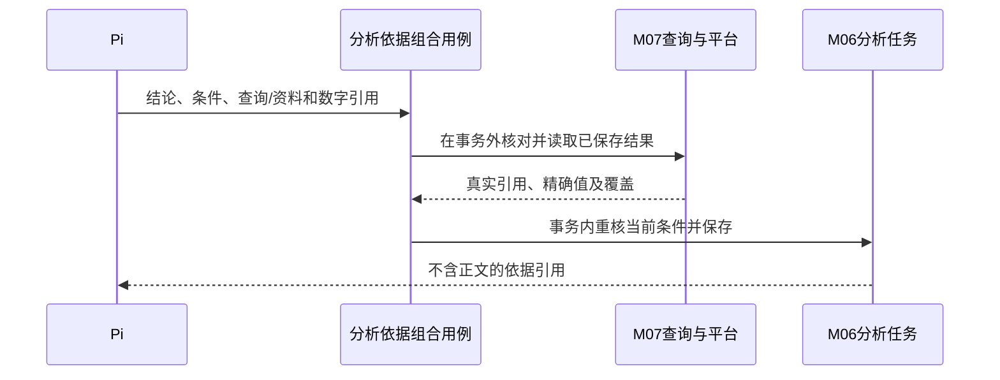

# Data Agent 实现设计

更新：2026-10-06。状态：设计与实施契约；实际完成范围及证据见CURRENT。产品范围沿用 [系统设计第 17–20 节](../semantic-retrieval-design.md#17-实施基线与交付顺序2026-10-02)，当前阶段与证据只记录在 [CURRENT](../CURRENT.md)。

本次补充[系统内部权限](../semantic-retrieval-design.md#61-语义维护权限与平台数据权限)与[跨用户纠错](../semantic-retrieval-design.md#117-跨用户纠错与共享语义维护)：表负责人或超级维护者处理建议，接受后编辑保存才生效。相关授权、协作接口及页面已接入本轮增量；Datasight 查询与执行权限继续独立校验。

本设计补足“系统由哪些进程组成”到“代码由哪些模块组成”的距离。模块不是新微服务；同一模块内的函数可以普通调用。这里定义模块职责、公开接口、数据归属、组合事务、代码依赖及验证边界，具体 SDK 可行性仍须 I0 试验。

## 1. 阅读入口

| 想了解什么 | 材料 |
| --- | --- |
| 快速看图、切换模块、查看流程 | [实现设计图册](implementation-atlas.html)；离线页面，由下列 Markdown 的图生成 |
| 整体组件、代码依赖、一次完整分析 | [V01–V03 框架与时序](implementation-views.md) |
| 身份、知识、同步预填、检索、个人资产 | [M01–M04、M09 模块契约](knowledge-modules.md) |
| 会话、分析任务、SQL 查询、Agent 运行 | [M05–M08 模块契约](runtime-modules.md) |
| 后台任务、Pi 集成、React | [M10–M12 模块契约](implementation-views.md) |
| 第二版的增量、接口归属与依赖 | [语义、澄清与分析能力执行包](../analysis-capabilities-execution.md)；待实现，继续复用本文模块边界 |

来源可信增量复用现有边界：平台适配器冻结合成运行资料，M03保存包括语义目录在内的来源快照，M02合并候选并保护人工值，具名同步用例组合两者。M07保存平台检查的目标修订并沿版提交；明确版本拒绝是确定失败。合成文档身份映射只用于资料关联，不传播维护权或引入新进程。实际验收范围见CURRENT。

Markdown 中的接口和图是设计源；图册是生成的阅读视图，不维护另一份需求。原有 C4 容器图继续解释部署边界，本次组件图解释内部代码职责。

规则分工：产品行为以系统设计第 17–20 节为准；模块状态与公开操作以相应模块文档为准；本文件第 5.2 节登记跨模块组合及权威细节入口，图册只从设计源生成。修改取消、恢复等规则时同时核对这些入口，不能用某一处简写扩大作用范围。

## 2. 模块清单与职责归属

| ID / 代码名 | 负责的功能 | 私有记录与状态 | 主要调用者 |
| --- | --- | --- | --- |
| M01 `access` | 可信身份、系统语义授权与平台权限分别校验、模型端点资料范围 | 请求级授权结果；版本化负责人/可信配置的超级角色；无第二套数仓权限库 | 各业务组合用例 |
| M02 `knowledge` | 表、字段、粒度、关联、指标、文档/章节、版本、出处、人工覆盖与修改建议 | 知识版本/引用/状态及建议；独立共享提交与处理记录 | 维护、调查、预填与检索组合用例 |
| M03 `ingestion` | 来源快照、完整性、变更识别、预填输入与建议 | 同步批次、快照、预填运行与建议 | Worker 的同步/预填用例 |
| M04 `retrieval` | 分词/别名匹配、候选合并排序、向量检索与索引构建 | 可重建索引及各对象索引进度 | 检索与索引用例 |
| M05 `conversations` | 消息、事件顺序、历史、消息归属阻塞、会话串行租约 | 会话、消息、事件、待归属记录、会话租约 | 消息、运行交付与查询确认用例 |
| M06 `analysis` | 分析任务、条件版本、澄清、依据与本人报告 | 分析任务、条件修订、澄清记录、不可变依据与报告修订 | 任务工具、报告读写、修订和取消用例 |
| M07 `queries` | SQL 草稿、检查、确认请求、平台执行、取消、结果读取和导出 | 草稿版本、查询请求、执行/取消状态、结果引用 | 查询工具、用户确认、Worker、结果页面 |
| M08 `runtime` | Agent 运行、恢复条目、输出尝试、工具调用账本、模型预算 | 运行、Pi 检查点、输出、工具回执、调用预留/结算 | 运行与工具组合用例、受控模型调用 |
| M09 `assets` | 用户记忆与纠错、Skill、待确认方法草稿、选择记录、启用/停用/删除、采用记录 | 个人资产版本、方法草稿、记忆索引待办、Skill 选择、采用记录 | 资产页面、记忆/方法草稿工具、运行准备 |
| M10 `jobs` | 持久待办、领取、租约、有限重试、完成 | 后台任务与领取代次 | 业务事务和 Worker 调度入口 |
| M11 `pi-bridge` | Pi SDK 会话重建、工具映射、流式事件、模型调用许可、取消 | Pi 原生私有 JSONL 会话；M08 事务保存原 session/leaf/authority 小引用 | Rust 运行用例；调用 Rust 受控接口 |
| M12 `web` | 工作台、历史、结果与确认、语义维护、个人资产管理 | 界面状态、未发送草稿、事件游标；正式业务状态来自 Rust | 用户 |

这 12 个代码模块与早期讲解中的“八类能力”不是一一对应：理解/规划/解释由 Pi 承担；资料、语义、检索、工具、记录和用户资产拆出明确实现责任。M08 内有多个小职责，必须按 `runs`、`checkpoints`、`outputs`、`tool_ledger`、`budgets` 分开，不做万能 `AgentService`。

## 3. 代码布局与依赖方向

以下按稳定职责展示代码布局，具体文件以源码为准。

```text
apps/
  api/                       Rust HTTP/SSE 入口与依赖装配
  worker/                    Rust 任务领取与处理入口
  memory/                    Python / Mem0 SDK薄适配，提取与派生检索
  agent/                     Node.js / Pi 适配
    session/                 重建和导出 SDK 恢复条目
    tools/                   受控工具描述和桥接
    transport/               Rust 内部协议
    provider/                每次模型调用的许可与结算
  web/src/
    app/                     路由、会话身份、功能装配
    features/workbench/      会话、任务、SQL 卡片、结果
    features/knowledge/      语义与文档维护
    features/assets/         记忆和 Skill
    shared/                  API 客户端、基础 UI；不放业务规则
crates/data-agent/src/        首版一个 Rust 业务库
  modules/                   M01–M10；每个只暴露自己的 public API
    queries/                 示例：drafts、confirmation、execution、results
    runtime/                 示例：runs、checkpoints、outputs、tool_ledger、budgets
    ...                      按当前增量添加其他已定模块
  use_cases/                 一个文件负责一个具名的跨模块流程
  adapters/                  platform、model、vector、identity 的具体接入
  persistence/               MySQL 连接和 AppTx，不能塞入各模块业务 SQL
  types/                     ID、时间、错误基础类型等少量公共定义
packages/contracts/          HTTP、SSE、Pi 及工具 JSON Schema / OpenAPI
migrations/                  按增量管理 MySQL schema；记录所属模块
tests/                       跨模块契约、流程和故障验收
```

### 依赖规则

1. `apps` 装配依赖并调用 `use_cases`；`use_cases` 调用业务模块的公开操作。模块之间不直接导入，避免知识/检索/资产与任务/查询/会话互相咬住。
2. 每个模块的状态判断和规则放在内部；MySQL SQL 位于所属模块私有 `store.rs` 等文件。模块公开 `*_in_tx(AppTx, …)` 方法，自己校验并写自己的数据。
3. `use_cases` 只组合步骤、传递结果和确定事务边界，不写 SQL、不重复模块规则。按 `receive_message`、`confirm_query`、`apply_prefill` 等分别组织，不能汇成一个总调度类。
4. 外部能力的窄接口由使用方模块定义，`adapters` 实现。连接池、平台配置和模型客户端从装配入口传入，不在各模块读取环境变量或全局单例。
5. HTTP/SDK/向量库类型停在接入边界。`packages/contracts` 是传输约定，转换后才交给业务模块；业务核心不依赖 React、Pi SDK 或外部平台响应类型。
6. React feature 通过应用层连接；不能互相导入内部 store。服务端数据缓存与输入草稿分开，SQL、执行和结果状态来自服务端事实；用户通过聊天提出执行意图。

这是单库内的代码边界。Rust 私有子模块隐藏存储实现，公开函数显式导出，不使用 `pub use *` 暴露内部存储。`pub(crate)` 可被整个 crate 访问，不能限制为“只有指定兄弟模块可以访问”。禁止兄弟模块互导、SQL 只出现在所属 store、表归属与锁顺序由工程检查和评审落实；动态 SQL 同样必须接受检查。I0 增加故意越界的反例，证明检查能拒绝协调层 SQL 与模块互导。

共享 `AppTx` 只协调已知的同库事务，不提供数据库表级权限隔离。存储层所需的底层连接出口须保持最窄可见范围，不向用例层提供通用 `Executor` 或 `Deref` 便利入口；单 crate 无法仅靠 Rust 可见性表达的限制由上述检查补足。无需因此拆库、拆 crate 或创建通用事务框架。

## 4. 共用契约

### 4.1 身份、版本与回执

接口表中省略的共用参数在此统一。以下为设计类型，不假装已经生成 SDK。

```text
Principal = user(user_id) | service(service_id, maintenance_config_version)
AccessContext = { principal: Principal, space_id, authn_source, request_id }
ResourceRef = { kind, id, version }
RunContext = { run_id, recovery_chain_id, conversation_id, task_id?, lease_epoch,
               trigger_event_id, budget_scope_id, model_profile_id }
MaintenanceContext = { job_id, job_lease_epoch, space_id,
                       maintenance_config_version, budget_scope_id, model_profile_id }
Command = { operation_id, expected_version?, payload }
MutationReceipt = { operation_id, resource_ref, state, index_state? }
AppError = { code, message, retryable, request_id, resource_ref? }
```

- `AccessContext` 由已验证身份生成；开发身份明确限定开发模式。用户或模型提供的对象 ID 仍逐个校验归属，不信任它们自行声明的 `user_id`、预算或租约。
- 会话、查询和个人资产动作要求 `user` 主体。后台处理用户请求继续引用原用户，并重新核对其权限；Worker 的服务认证与 job 租约不改变资源归属。自动目录维护使用配置限定范围的 `service` 主体，不假借某个用户，不获得个人会话或资产访问权。`MaintenanceContext` 只证明作业和预算，不能单独代替动作授权。
- 模型输入再携带有效模型配置引用，由 M01 核对该端点可接收的数据范围。权限拒绝不能返回越权对象名称、正文、候选数量或存在性。
- `operation_id` 是幂等标识。同 ID 同规范化参数返回原回执引用，内容交付仍重新核对当前权限；参数不同返回冲突。工具副作用以宿主绑定的稳定操作标识去重，恢复运行沿用原标识，`run_id` 只证明当前执行权与出处。契约收紧后，旧版已提交且身份/参数指纹匹配的操作仍须先接回原回执；当前输入校验约束新执行，不得把已有副作用改报成“未执行”。未取得确定回执时保留未知，旧数据不自动改写。业务修改使用 `expected_version`，不能最后一次写入直接覆盖。
- 版本用稳定整数/不透明字符串；超过 JavaScript 安全范围的整数、金额与精确小数按明确类型使用字符串。时间为带时区的时间戳，业务计算的时区另外保存。任务条件的 `time_start` 为包含起点、`time_end` 为不包含终点；Pi 按明确业务时区解析后填写以 `Z` 结尾的完整 UTC 时间戳，未指定时保持 `null`。创建与 `ConditionPatch.set` 使用同源 Schema 格式及日历合法性校验，不自动猜测日期字符串的午夜、时区或结束日语义。
- `AppError` 统一基础结构，各模块保留具体错误。常见代码包括 `forbidden`、`not_available`、`version_conflict`、`message_pending`、`lease_lost`、`unsupported`、`upstream_failed`、`outcome_unknown`、`budget_exhausted`、`budget_unavailable`；不可访问和不存在的对象对外统一为 `not_available`，内部审计可区分。

### 4.2 前端到 Rust 的操作面

下表与当前 `packages/contracts/openapi.json` 的公开操作对应；字段以同源Schema为准。对应模块负责行为，HTTP 层仅解析、认证、调用和编码。有副作用的业务写入沿用命令ID；对话模型偏好用期望版本校验，并可接回紧邻版本的相同内容重放。查询结果 GET 不得隐式重新执行 SQL。

| 当前操作 / 路径 | 核心输入 → 输出 | 组合用例 / 归属 |
| --- | --- | --- |
| `POST /conversations` | 客户端命令 ID → 会话 ID；标题取首条用户消息 | `create_conversation` / M05 |
| `GET /conversations` | 游标 → 当前用户的会话页 | `list_history` / M05 |
| `DELETE /conversations/{id}` | 命令 ID → 已删除及相关任务收尾状态 | `delete_conversation` / M05+M06+M07+M08+M10 |
| `GET /models` | → 可信模型目录、每模型支持档位和默认选择 | M08 `model_catalog`；不输出凭据或预算 |
| `GET/POST /conversations/{id}/model-selection` | 读取；或 `selection + expected_version` → 已保存选择与版本 | `conversation_models` / M05+M08；仅本人对话 |
| `POST /conversations/{id}/messages` | 客户端消息 ID、正文、可选模型选择 → 持久消息 ID、归属状态、事件序号 | `receive_message` / M05+M07+M08+M10 |
| `POST /conversations/{id}/messages/{message_id}/withdraw` | 命令 ID → 撤回状态及剩余确认阻塞 | `withdraw_pending_message` / M05+M07+M08；已应用内容只能新修订 |
| `GET /conversations/{id}/events?after_seq=` | 已接收序号 → 有序事件/SSE | `read_events` / M05；游标过旧返回需快照重同步 |
| `GET /conversations/{id}/snapshot` | 会话 ID → 任务/请求/输出状态与快照截止序号 | `read_conversation` / M05+M06+M07+M08 |
| `POST /queries/{id}/confirm` | 显式客户端提交草稿版本、条件版本、确认ID → 同一查询状态；Web改用聊天 | `confirm_query` / M05+M06+M07+M10 |
| `GET /queries/{id}` | 查询 ID → 执行与取消状态、绑定条件 | `read_query` / M07 |
| `GET /queries/{id}/results?cursor=` | 结果游标 → 字段、行、分页、完整性、来源及本页确定性统计 | `read_results` / M07+M01 |
| `GET /queries/{id}/export.csv` | 已有结果的范围引用 → 相同有权范围的 CSV | `export_results` / M07；不新增查询 |
| `POST /conversations/{id}/tasks/{task_id}/cancel` | 命令 ID → 仅该任务的运行/查询已知取消状态 | `cancel_task` / M05+M06+M07+M08+M10 |
| `POST /queries/{id}/cancel` | 命令 ID → 该查询的执行/取消状态 | `cancel_query` / M07+M10；不取消整个分析任务 |
| `GET /knowledge`、`GET /knowledge/{id}` | 空间、筛选/ID、版本可选 → 有权对象与出处 | `read_knowledge` / M01+M02 |
| `POST /knowledge` | 命令 ID、类型、正文/引用、可选来源稳定键；无起点版本 → 首版或原创建回执 | `create_knowledge` / M01+M02+M10 |
| `PATCH /knowledge/{id}` | 命令 ID、正文/引用补丁、必填起点版本、可选提案 ID/修订号 → 新版本、索引状态 | `save_knowledge` / M01+M02+M10；基版本冲突不得覆盖 |
| `GET /knowledge-proposals` | → 本人建议列表、基版本和依据 | `proposals` / M01+M02 |
| `POST /knowledge-proposals/{id}/apply` | 命令ID、目标起点版本 → 维护者本人应用后的知识版本 | `apply_proposal` / M01+M02；先核对维护权限与当前基版 |
| `POST /knowledge/{id}/disable`、`POST /knowledge/{id}/enable`、`POST /knowledge/{id}/delete` | 命令 ID、起点版本 → 状态及引用失效回执 | `change_knowledge_state` / M01+M02+M10 |
| `POST /source-syncs` | 命令 ID → 同步回执或明确失败 | `request_sync` / M01+M03+M10 |
| `POST /knowledge-index/rebuilds` | 命令ID → 幂等重建排队回执 | `rebuild_index` / M01+M02+M04；只重建派生索引，不改正式语义 |
| `POST /knowledge/{id}/reanalyze` | 对象与来源版本、命令 ID → 预填任务及预算状态 | `request_prefill` / M02+M03+M08+M10 |
| `POST /knowledge/{id}/analysis-preference` | 表ID、配置版本、命令ID、是否常用 → 当前配置回执 | `set_table_analysis_preference` / M01+M02+M03；当前表/字段优先排队，正文版本保持 |
| `GET /assets` | → 本人资产与当前空间公共 Skill，含可见范围、负责人、can_edit | `read_assets` / M01+M09 |
| `POST /assets` | 命令 ID、可空ID/起点版本、memory/skill、正文/范围 → 新建或修订资产 | `save_asset` / M01+M09+M10 |
| `POST /assets/{id}/disable`、`POST /assets/{id}/enable`、`POST /assets/{id}/delete` | 命令 ID、起点版本 → 状态及索引任务 | `change_asset_state` / M01+M09+M10 |
| `POST /conversations/{id}/skill-selections` | Skill ID/版本 → 当前会话选择回执 | `select_skill` / M05+M06+M09 |
| `GET /conversations/{id}/skill-selections?after_id=` | 已选版本、个人/公共、当前可用状态、下一页 | `skill_selections` / M05+M09+M02 |
| `POST /assets/{id}/publish` | 精确版本与明确发布 → 独立公共 Skill v1 | `publish_skill` / M01+M09+M02 |
| `GET/POST /assets/{id}/suggestions` | 公共方法修改建议列表/提交 | `skill_suggestions` / M09 |
| `POST /assets/{id}/suggestions/{suggestion_id}/review` | 建议修订号、处理状态和说明 → 建议回执 | `review_skill_suggestion` / M01+M09 |


文档和章节是 M02 的知识对象，具备正文、引用与版本，不另开一套文档数据库。表/字段/指标编辑属于 `save_knowledge` 的按类型校验正文；能力复用不等于让任意 JSON 无校验入库。

当前实现的维护与历史接口补充：

- 停止生成使用`POST /conversations/{id}/cancel-run`；任务取消与查询取消分别使用上表入口。身份入口为`POST/GET/DELETE /session`。
- 原设计还描述过提案修订/忽略及单独同步批次读取；当前公开HTTP没有这些入口，不能作为已实现API调用。提案当前是本人列表与明确应用，资料同步回执经`POST /source-syncs`返回；不在本轮为旧路径新增功能。

- `GET /conversations?q=&before_id=`按当前用户的首问题标题搜索，稳定顺序为创建时刻/ID，返回`next_before_id`；每页100条。
- 管理目录 `GET /knowledge?directory=all|maintained&directory_view=grouped` 在服务端分页前排除字段和关系，保留表、指标、文档、术语；省略 view 或 flat 保持原列表契约。字段/关系仍由所属表的关联接口读取，权限、对象身份及来源不变。直接对象地址仍可定位字段，单独字段查找需显式展开。

- `GET /conversations/{id}/snapshot?before_seq=`读取旧事件页，`after_seq=`读取新事件页。响应携带最后序号和后续状态；React按全部已加载事件投影，完整提交替代同次片段，恢复隐藏旧尝试。
- `GET /knowledge?after_id=`按ID分页；`q=`做有界词法检索并回源。`search_coverage`只表达候选完整性和固定工作量上限，不提供权限过滤数量。长JSON的候选排序按主键扫描，正文在确定ID后读取。
- `PATCH /knowledge/{id}`的document正文编辑可同时改变`source_url`和`related_ids`，保存到同一版本；正文创建、编辑、响应均允许100000字符。URL和关联对象权限沿用创建规则。
- M05在消息接收时持久保存`request_clock`；M08提供`budget_message_in_tx`读取原预算消息身份，M07结果编排把该身份交给M05读取原时钟。不会通过客户端ID的文本前缀判断原消息。首次聊天执行的查询预算绑定执行消息；结果解释以实际SQL的绝对日期参数为准，不按执行日期重新展开相对时间。

### 4.2.1 语义协作接口

以下接口已进入 `packages/contracts/openapi.json` 与共用 JSON Schema，并生成 Rust/TypeScript 类型。身份由宿主绑定，页面不传 user_id 或角色。`GET /knowledge-proposals` 继续只读本人私人草稿；历史 `/knowledge-proposals/{id}/apply` 保留兼容并增加逐对象授权，不作为共享建议的接受入口。

| HTTP | 输入与响应 Schema | 行为 |
| --- | --- | --- |
| `POST /knowledge` | `KnowledgeCreate` → `KnowledgeObject` | 本空间平台表维护人或超级维护者创建独立对象，自动归属可信登录者；不接收 maintainer_id，调整负责人另调管理接口 |
| `GET /semantic-access` | `SemanticAccess` | 返回 can_admin、can_create 和 highest_role；前两项表示全局管理与独立对象创建资格，最高语义角色只供账号区展示；动作仍在事务内重验 |
| `GET /knowledge`、`GET /knowledge/{id}` | `KnowledgeObject.maintenance` | 返回负责人、授权来源、授权版本、can_edit/can_assign；created_by 与 updated_by 分开 |
| `GET /semantic-members` | 当前空间有效用户 ID 列表 | M01 可信登录目录；只供超级维护者选择转交对象，不返回凭据 |
| `POST /knowledge/{id}/maintainer` | `AssignSemanticMaintainer` → `SemanticMaintenance` | 超级维护者调整独立对象负责人，目标须为当前空间有效成员；首次创建自动归属登录者，表和字段拒绝本地改派 |
| `POST /knowledge-proposals` | `ProposalDraftCommand` → `Proposal` | 保存私人草稿，与 Pi 的私人提案相同归属 |
| `POST /semantic-corrections` | `SubmitSemanticCorrection` → `SemanticCorrection` | 提交可共享内容；share_confirmed 必须 true，原值由服务端读取 |
| `GET /semantic-corrections`、`GET /semantic-corrections/{id}` | `SemanticCorrectionList` / `SemanticCorrection` | 本人提交及当前负责范围；after_id 每页最多 50 条，含 next_after_id |
| `PATCH /semantic-corrections/{id}` | `ReviseSemanticCorrection` → `SemanticCorrection` | 提出者修订未生效建议，expected_revision 竞争校验，返回待处理 |
| `POST /semantic-corrections/{id}/review` | `ReviewSemanticCorrection` → `SemanticCorrection` | 负责人接受或驳回并填写理由，只改处理状态 |
| `POST /semantic-corrections/{id}/apply` | `ApplySemanticCorrection` → `SemanticCorrection` | 已接受建议的最终编辑内容、expected_revision、expected_version；保存正式版本及实际采用记录 |

所有写入有 operation_id。相同内容重试返回原回执，异参重放返回 idempotency_conflict；表单保留同一次内容的操作身份。无维护权拒绝，跨用户不可读统一 not_available，版本竞争为 version_conflict/stale_knowledge。接受不写知识版本和索引。

`use_cases/semantic_governance.rs` 组合 M01/M02，不含 SQL。正式保存先按当前授权锁定，再按对象 ID 排序锁定目标和公共依据，复核建议修订与当前来源；正式语义、版本、索引待办、采用记录和幂等回执处于同一事务。目录同步沿用授权→来源→知识的锁顺序。共享提交仅含显式整理的字段，接口拒绝夹带聊天、资产或额外字段；不把它们接入共享召回。

### 4.3 Pi、工具和事件

- Rust → Node：`resume_and_deliver`、`cancel_run`。恢复载荷包含 SDK 格式版本、头/条目/活动分支、目标事件和允许的工具；条目在集成边界转换，业务模块不解析 SDK 内部对象。
- Node → Rust：`invoke_tool`、`append_output`、`finish_run`，以及模型调用的预留、发出许可、结算接口。内部请求绑定有效运行和租约；内网并不等于无须认证。
- 工具按业务意图提供，沿用既有名称：`search_knowledge`、`read_knowledge`、`read_source`、`validate_sql`、`request_query`、`execute_query`、`update_analysis_task`、`get_query`、`cancel_query`、`manage_personal_asset`、`propose_semantic_change`。个人资产候选由搜索返回，正文读取经资产模块校验；Skill正文只有已有用户选择才可正式加载。禁止给模型暴露通用数据库写入或可自报用户/确认状态的入口。`execute_query`必须经Rust绑定当前真实用户消息。
- `request_query`只产生待执行草稿。Pi通过`execute_query`交付当前用户明确执行意图，参数为查询ID、草稿/条件版本、完整`instruction_quote`；Rust核对消息来源、任务归属、知识、版本和阻塞。执行意图来自用户，模型输出中的“已确认”不能改变状态。
- 当前消息的执行动作完成后，Pi结束本轮，由既有结果通知续接解释。M07通过`is_confirmation_message_in_tx`识别确认来源；`get_query`在读取外部结果前及最终事务核对，对该来源消息保留真实成功状态、返回空结果与等待交付提示。同消息恢复不提前取得结果，系统结果消息及后续追问不受影响；不新增结果调度器或去重状态。
- 查询取消的HTTP和Pi入口共用`query_workflow::cancel_in_tx`。本地可结束的未提交/排队查询在同事务记录终态事件并更新等待阶段，重复取消只返回原状态；已提交查询继续向平台请求取消并查证。终态事件格式、稳定查询身份和平台结果解释入口保持。
- M12将同一会话的查询作为独立组件显示，按已加载的确认事件定位；确认事件尚在未加载的历史页时暂置顶部，补页后恢复真实位置。`query_result`事件生成可定位原查询的终态通知，按查询身份去重。消息区独立滚动、输入区持续可用。表格/图表只预览前10行；CSV仍由M07按原查询权限逐页读取，预览不修改SQL、结果分页或下载范围。该展示调整不改变M05会话串行租约或M07后台查询接口。
- `Event = { schema_version, event_id, event_seq, conversation_id, task_id?, query_id?, type, payload }`。SSE 从持久事件投递；客户端重复序号不重复显示，有缺口补读，版本不支持则停止应用并重同步。
- 输出片段另有 `output_id / attempt_id / chunk_seq`，不可用文字前缀去重。正式提交与恢复条目、消费游标同事务；重生成显示替代关系。

工具桥只转换参数和结果，每个工具进入一个具名 Rust 用例；不在 Node 复制业务规则。下面是映射，不要求模型按行顺序调用：

| Pi 工具 | Rust 用例 | 主要归属与边界 |
| --- | --- | --- |
| `search_knowledge` | `retrieve_context` | M01/M02/M03/M04/M09 回源与有界补取，Embedding 经 M08 许可 |
| `read_knowledge` | `read_knowledge` / `read_assets` | M01/M02/M03/M09 依类型读取；Skill 返回原生受控路径 |
| `read` | `read_skill_file` | M09 校验已选版本/空间/附件，M02 核对依赖，M11 复用 Pi read 格式及分页 |
| `read_source` | `read_source` | M01/M02/M03，统一解析原始来源与文档别名并核对固定版本 |
| `validate_sql` | `validate_sql` | M01/M07，检查能力和完整 SQL，无执行副作用 |
| `request_query` | `request_query` | M05/M06/M07/M08，保存绑定条件的待确认请求 |
| `execute_query` | `execute_from_message_in_tx` | M05/M06/M07/M08，核对当前真实消息并复用确认事务；同事务标记消息已应用 |
| `update_analysis_task` | `apply_analysis_update` | M05/M06/M07/M08，保存归属、条件或澄清 |
| `get_query` | `read_query` / `read_results` | M01/M07，读取当前授权范围及明确范围的结果统计；不重复提交 |
| `cancel_query` | `cancel_query` | M07/M08/M10，只登记该查询取消与查证 |
| `manage_personal_asset` | `save_asset` / `change_asset_state` | M01/M09/M10；用户的明确范围与 Skill 保存决定仍须核验 |
| `propose_semantic_change` | `propose_semantic_change` | M01/M02/M08，仅存本人建议和依据；正式修改另走维护者保存 |

所有工具统一经过 M05 当前运行权与 M08 调用账本；表中列出的是额外业务归属。新恢复运行通过原 SDK 条目映射接回同一个 `operation_id` 和回执；映射缺失时停止该副作用的自动恢复，不用新 ID 重做。细节以 M08 契约为准。

`manage_personal_asset`保存或修订时用`instruction_quote`逐字定位当前消息中的相关指令。句子/分号边界，以及逗号后明确以“另外/此外”另起的指令可作起点；引用在逗号结束时，宿主将同句余下原文补至句末或分号，保留尾部限定后核对并保存`source_text`。模型决定记忆正文及可复用范围，临时任务不会被宿主拼入记忆正文。宿主核对原文、明确的否定/临时限定、用户与依赖；这些有界检查不承担完整中文意图识别。

`manage_personal_asset`的动作是`save_memory`、`update_memory`、`disable_memory`。后两者要求本人记忆的ID和当前版本，复用M09的资产修改规则。主动修订只替换本轮采用清单中的对应记忆版本；其他失效依据仍拒绝发送。新输入丢弃包含旧记忆的SDK检查点并重建上下文；同输入中断后不能复活旧检查点。`prepare_skill_draft`只准备本人待确认方法，用户在页面编辑并明确保存后才创建正式Skill；选用仍为独立明确动作，详见第15节。

自动记忆在保存入口统一字段来源：Mem0最终正文（builtin为工具正文）同时成为body/scope，name仅截取前40个Unicode字符作为标签。工具中的name/scope仍接收以保留既有Pi检查点参数兼容，scope只参与临时限定预检查，不独立作为正式语义；提示与Schema明确回执才是最终保存结果。人工资产接口保持显式编辑行为。

记忆的来源原话沿用 `read_knowledge`，指定 `object_id=asset-<id>`、`entry_id=source_text`、`version/offset/limit` 按 Unicode 字符补读，仍核对当前归属、启用状态、依赖和版本。`ModelAssetPreview.source_page` 与正文的 `content_page`、范围的 `scope_page` 分别声明完整性；缺省不带原话正文，保留其总长和补读位置。模型可以核对提取前的限定与例外，宿主不据此宣称已验证两段自然语言语义等价。

### 4.4 平台与模型边界

| 边界 | 必须提供的操作 | 无能力时的行为 |
| --- | --- | --- |
| 身份与权限 | 验证身份、检查对象/动作范围、核对模型端点资料范围 | 拒绝或说明不可用；无开放权限回退 |
| 资料平台 | `read_catalog`、`read_source`：目录、元数据、血缘、节点 SQL 与完整性 | 保留缺口；部分同步不能推断删除 |
| 查询平台 | `get_capabilities`、`submit_query`、`lookup_submission`、`get_status`、`read_results`、`cancel_query` | 不支持查证时维持未知，不重提；取消回执与终态分开 |
| 向量索引 | `upsert/delete/search`，带对象/用户/空间/正文及索引版本 | 报告索引延迟；可用的精确匹配补查标明降级范围 |
| 模型调用 | Pi 生成、两阶段结构化预填、Embedding；每次外发均受许可/数据范围/预算限制 | 缺配置、未知结果或额度不足明确保留状态 |

预填使用有界的分析、依据复核各一次，由 M03 模型适配实现；两个阶段分别计入同一维护预算，第一阶段成功不等于最终建议可采用；没有自主工具规划循环。Pi 仍是唯一 Agent 循环。Embedding 和预填不必伪装成用户聊天。

共享检索固定使用百炼 `qwen3.7-text-embedding`、1024维，与Mem0个人索引分开。`use_cases/knowledge_embeddings`组合权限、版本/租约和原预算；M04 `retrieval/embedding`负责受控HTTP，M08 `runtime/provider_calls`保存调用及成功向量回执。`knowledge_index_jobs.embedding_profile`冻结该对象版本首次维护额度，`model_call_attempts.response_json`供相同操作恢复、重建复用。HTTP、Pi工具与SSE接口不变；新增同源配置契约 `EmbeddingProfile`（trial_id、call_limit、cost_limit_micros），生成模型仍用 `ModelProfile`。

本轮补出的预算细化：`scope_kind=user_request|maintenance`。主动用户消息沿用第 19.8 节原规则；自动同步后的模型预填和索引向量化引用有明确限额的维护配置，不能靠每次 Worker 重试自动创建新额度。维护模型预算未配置时仍可保存来源事实，模型工作返回 `budget_unavailable`。实际金额、并发等在真实试验前确定，本设计不暗中授权付费。

### 4.5 跨语言契约真源

`packages/contracts` 保存唯一的传输契约：HTTP 用 OpenAPI 3.1，Pi 内部命令、工具参数和 SSE payload 用 JSON Schema；共用定义相互引用，不抄出三套正文。Rust/TypeScript 的边界类型从该源生成，入口对外部输入做运行时校验；业务领域类型在模块内部手写并显式转换。生成文件不手改。

I0 先用消息、工具调用、查询确认和错误四类代表对象验证生成器及运行时解析器，再固定版本。必验必填字段、标签分支、空值、未知字段、精确数字与格式版本；同一组正反例在 Rust/Node/Web 契约测试中一致。当前已使用JSON Schema/OpenAPI真源与quicktype生成器，并有跨语言正反例；实际版本与最新证据见CURRENT。

## 5. 数据归属与跨模块事务

### 5.1 存储边界

- M02 独占知识对象、版本、引用和个人可见的语义修改提案；M03 独占来源快照和批次；M09 独占个人资产、选择和采用记录。提案不进入正式知识版本、公共检索或公共文档。
- M05 独占会话、消息、事件与串行租约；M06 独占任务、条件和澄清；M07 独占草稿与查询；M08 独占运行、工具、输出和模型账本；M10 独占后台工作记录。
- M04 的索引状态是独立派生进度，不反向改写 M02/M09 的当前正文。索引或模型失败不能把已经提交的人工修改回滚为旧语义。
- MySQL 连接池共享，写入归属不共享。需要组合读取时由用例调用各模块批量查询接口，不在 UI 或别的模块跨表拼接私有字段。
- 物理迁移随增量落地，但唯一性约束提前明确：空间/对象/版本、空间/平台/来源稳定键、用户/客户端消息 ID、会话/工具 operation_id、恢复链/原 SDK 调用映射、查询请求 ID、输出尝试/片段序号、后台工作类型/对象/目标版本。同 ID 不同参数冲突。`origin_run_id` 作为出处，不作为工具副作用唯一键。索引版本与正文版本分开。

### 5.2 必须具名的组合用例

| 用例 | 事务内由哪些模块修改什么 | 事务外做什么 / 失败如何接回 |
| --- | --- | --- |
| `conversation_models::read/save` | M05只读选择或锁会话；M08核对允许组合；M05按期望版本保存选择 | 仅读本人未删除会话；保存不改已启动运行或查询 |
| `receive_message` | M05锁会话、消息去重后选择本条/会话/默认模型并保存初次选择；M07标记明确修订的旧待确认；M08冻结原请求模型配置与预算；M10登记交付 | 提交后才响应已接收；Pi失败不解除未判定暂停 |
| `withdraw_pending_message` | M05标记尚未应用消息撤回、处置对应输入并重算阻塞；M07释放未失效请求；运行确实包含该输入时，M05撤销对应运行权且M08中断输出 | 其他未取消输入重新安排交付；旧代次结果拒绝，已应用消息不得走撤回 |
| `apply_analysis_update` | M05核验归属；M06创建任务/新条件或澄清；M07失效受影响待确认；M08保存工具回执 | 不能修改已确认/运行查询的条件；生成新SQL另一次操作 |
| `confirm_query` | 相同会话锁顺序；M05核验待归属；M06核验条件；M07原子确认同一请求；聊天入口同事务记录confirmation_message_id与执行消息budget_scope_id，并把M05消息标为已应用；Worker领取待提交请求 | 提交前重新核对平台权限/能力；有变化不得静默换SQL执行 |
| `record_query_observation` | M07保存平台已知状态/结果引用；M05登记稳定结果事件；M10登记可续跑事件 | 交付原任务/条件/预算；预算不足仍保存结果，不新增解释调用 |
| `finish_run` | M05核验代次、推进消费并释放运行权；M08检查点/输出提交；M06按事实更新阶段；M10完成工作并登记下一交付 | 外部模型无法与DB原子提交；已提交工具靠账本接回 |
| `sync_sources` | M03保存快照并按采集起点 CAS 推进来源头；M02创建来源新对象或标记既有受影响条目待复核；M10登记预填/索引待办 | 来源头冲突只留历史，不把旧载荷换起点重试；新对象首版含可确定事实/缺口，读取始终核对来源头 |
| `create_knowledge / save_knowledge / apply_prefill` | M02首次创建去重或起点版本校验、新版本/引用；预填时M03标记建议采用；M10登记索引/失效任务 | 模型和Embedding在事务外；失败不丢人工修改，旧建议冲突重算；首次创建与修改入口区分 |
| `propose_semantic_change / apply_semantic_proposal`（当前本人路径） | M02保存本人建议；维护者本人明确保存时另验权限、基版本和公共资料范围，再保存正式版本及应用回执；M10仅为正式变更登记索引 | 现有归属过滤保留；跨用户协作按下一行独立处理，不直接开放私人记录 |
| 提交、处理建议与关联保存 | 提交时M01校验本人、目标可读及内容可共享范围；接受/驳回和正式编辑才校验表负责人/超级维护者。M02保存提交与处理记录；正式保存经版本检查后，原子保存新版本、实际采用回执及M10待办 | 普通用户无需维护权即可提交建议；仅接受不发布、不建正式索引；数据查询另验Datasight权限并保留SQL确认 |
| `save_asset / change_asset_state` | M09版本/状态、采用依据；M10登记索引更新；相关通知经M05记录 | 后续读取和模型上下文重新校验，旧索引不能复活停用内容 |
| `cancel_task` | M06核验命令回执及终态并取消目标任务；M05保存输入全部目标归属；M07取消关联请求；M08仅中断实际处理该任务的运行，M05按匹配运行撤销租约；M10登记收尾与剩余目标续跑 | 原message、恢复链、预算和job不变；重传原取消不再次中断剩余运行，同操作改目标或版本拒绝；旧会话按成功工具回执回填归属，平台终态另查证 |
| `delete_conversation` | M05标记删除、处置全会话输入并撤销运行权；M06停止全部关联任务；M07登记取消；M08停止全会话运行；M10登记收尾 | 平台取消在事务外查终态；已独立保存资产不随会话删除 |

会话相关锁序以运行模块第 1 节为准：会话/输入 → 运行/恢复链 → 工具或模型尝试 → 任务/澄清 → 查询请求 → 预算范围 → 试验总额 → 后台任务；各组按 ID 排序。不涉及会话的同步/知识事务按来源头、知识对象、语义提案、个人资产、索引进度的顺序，各组内按ID排序，最后登记后台任务。模型许可、后台领取使用短独立事务，不持有业务对象锁等待模型或网络；不能持有job行锁再回头领取会话。死锁重试仅重放已具幂等且未产生外部副作用的事务。

组合层通过所属模块的 `lock_*_in_tx` 取得锁定快照，不写 `SELECT … FOR UPDATE`。普通读取不暗含写锁，锁定快照只在当前 `AppTx` 有效；发现需要更早顺序的锁时重新开始事务，不能倒序追加。M05–M08 的锁接口与具体取消/恢复事务以 [运行模块契约](runtime-modules.md) 为准；来源头校验、首次创建及提案应用以 [知识模块契约](knowledge-modules.md) 为准。

## 6. 怎么避免逐渐变成巨石

| 容易长大的位置 | 提前限定的边界 | 实现时的检查 |
| --- | --- | --- |
| `AgentService` 包办一切 | Pi负责模型循环；Rust运行、任务、查询、知识分别归属 | M08不得包含选表/指标口径/查询提交业务规则 |
| 聊天组件塞所有状态 | 会话流、任务、SQL卡片、结果按职责组织，组合由页面完成 | feature不能导入其他feature内部状态；服务端事实不在浏览器重算 |
| 大型 `utils` / `common` | 共享内容仅少量稳定类型；行为回归所属模块 | 新共享函数必须指出已有调用和一致语义 |
| 模块越拆越多但仍互相写表 | 私有store、公开操作、具名跨模块用例 | 导入规则检查+模块测试；迁移注明owner |
| `use_cases` 再长成总服务 | 每个业务动作一个小流程；业务判断委托模块 | 不允许SQL、SDK对象或重复的状态转移判断 |
| 每次接入改动遍及全库 | 平台、模型、索引通过所属port接入 | 同一契约运行mock和真实适配测试；不把mock特例写入业务 |

I0 建立编译与导入约束检查；涉及哪个模块，就补对应行为测试。当前已提供导入/SQL归属检查、反例及MySQL锁测试；这些检查的版本与通过范围见CURRENT。

## 7. 实施前完成度与后续验证

| 项目 | 本轮设计交付 | 实现时必须取得的证据 |
| --- | --- | --- |
| 模块与依赖 | 12个模块、3类视图、每模块内部框架/流程和公开操作 | 导入限制、API/Worker复用、薄入口 |
| 数据与状态 | owner、版本、幂等、错误、关键事务 | 实际迁移约束、并发/故障试验 |
| 对外接口 | 路径/操作、共用DTO、工具映射和契约真源 | 单一契约源生成Rust/TS边界类型，正反例运行时解析测试 |
| Agent接入 | Pi适配边界、恢复和预算协议 | 固定SDK的三个故障点、每次模型调用许可 |
| 平台/模型/索引 | 能力边界、mock/真实区别 | 实际平台能力、模型配置/预算、Embedding小样 |

开工前应先用本设计走查“提问与SQL确认竞争”“来源变更与人工保护”“纠错停用与旧上下文”三条跨模块流程，确保每次读写和失败都有归属。之后按既有 I0→I1→I2→I3 实现，不提前铺完全部schema。接口字段在相应增量编码前转成可校验契约，SDK细节不凭设计宣称已验证。

## 8. 图册生成与设计检查

图册包含 V01–V03 三个整体视图、S01–S12 十二个模块内部框架、F01–F12 十二个模块流程，以及 F13 来源变更时序，共 28 张图。同一模块可以切换内部框架和处理流程，公开操作表来自同一份模块文档。

使用已锁定的 Playwright，本地构建临时使用 Mermaid 10.9.3，不添加到应用依赖，也不在阅读页面加载外部脚本。首次准备构建资源：

```sh
mkdir -p .local/diagram-renderer
curl --fail --location https://cdn.jsdelivr.net/npm/mermaid@10.9.3/dist/mermaid.min.js -o .local/diagram-renderer/mermaid-10.9.3.min.js
node docs/architecture/render-implementation.mjs
python3 docs/architecture/check-implementation.py
```

构建脚本校验 Mermaid 的 SHA-256，再从本地 Markdown 生成 SVG 与离线 HTML；渲染时阻断 HTTP 请求。检查覆盖图语法、图中文字是否超出SVG边界、模块接口表、导航/缩放/视图切换、手机页面溢出、链接、图来源指纹以及声明代码依赖图的无环性。交叉连线与图意仍需人工核对。结果见 [图册检查](implementation-diagram-checks.json)；此证据不代表业务运行、并发或恢复已通过。

## 首条运行链路的实现说明

当前子集按既定M01/M05/M06/M08/M10/M11/M12边界实现，代码入口和证据统一见[CURRENT](../CURRENT.md)。API与Worker共用一个Rust业务crate，各模块私有store；跨模块事务由具名use_cases组合。Pi接入器不读取本机工具或私人资源，业务状态由Rust受控入口推进。

跨语言使用JSON Schema 2020-12与OpenAPI 3.1，quicktype生成Rust/TypeScript；运行时校验与业务规则分开。会话恢复保存真实SDK会话树；对于assistant工具调用后退出，只查证或完成已登记调用，再将工具回执交还Pi继续。稳定operation_id、origin_run_id、recovery_chain_id、budget_scope_id和输入request_id跨恢复保留。此接入处理不产生第二套Agent规划循环。

实际交付次数与作业领取次数分开；会话忙退回等待，交付最多四次后保存明确失败。SSE当前为持久事件批次，React轮询持久快照；完整上下文、持续推送、查询、取消及个人资产按后续增量补齐。实现这些最小接口不意味着完整模块或MVP已完成。


### Pi 会话持久化与旧检查点迁移

M11 使用锁定 Pi 的原生 `SessionManager.create/open/branch/resetLeaf`，在项目忽略的 `.local/pi-sessions` 保存完整 JSONL 会话树，包括原始消息、工具调用和原生 compaction。M08 在业务事务内保存精确 leaf、SDK session ID、私有文件名和 authority；请求不重复传输全部历史。引用提交前 M11 验证目标叶子已落盘并 fsync 文件及目录。恢复必须使用 MySQL 保存的 leaf，文件中的未确认后续分支保留但不进入本次上下文。目录 0700、文件 0600，文件缺失、损坏、错 session/leaf 和不安全路径明确失败。

旧 inline 检查点在 `start_delivery` 同事务绑定到当前 run 的不可变副本，封套只带其指纹。受内部身份、当前 run/epoch/authority 校验的 `/internal/checkpoints/read` 返回该副本；调用方不选其他恢复链。Node 验证原始响应指纹，再按原 Pi JSONL 格式一次性物化，保留原 header 和 SDK entry/call ID。Rust 不写 SDK 文件，也不新增规划或压缩循环。MySQL 与原生私有会话目录必须一同保留及备份；当前统一部署在同一宿主，不据此宣称跨主机无状态恢复。

### Pi 工作区与个人记忆上下文接入

M11 使用 Pi SDK 1.0.0 的官方扩展 `context` 事件，由 `session/workspace-context.ts` 投影本轮已回源的工作区与记忆。`ResourceLoader` 只保留固定行为规则、工具和已明确选择的Skill目录，仅注册宿主指定的扩展，不启用文件或用户目录自动发现。时钟、任务、查询观察及记忆作为临时参考放在已恢复历史之后、本轮用户输入之前；轮内工具回执在其后。split-turn压缩移走用户输入时，参考放在摘要之后、保留的完整工具组之前。Pi将`custom`转为模型的`user`消息；固定规则和参考标记说明它们是资料，不授予执行权。

工具正常执行和半轮恢复都经过 `dataTools.invokeRecorded`。成功回执撤下已修订/停用的旧记忆、已换条件版本的任务候选，以及已补读的任务/查询观察；新正文来自原工具结果，不拿模型参数重建。`route`同版回执不带完整条件，故保留同版任务候选，避免强迫补读；拒绝或未知不撤旧。投影只使用本轮快照，无额外数据库或Mem0调用，不改宿主authority，不积累跨轮启动快照。

`context` 返回值不写入Pi会话树，原生compaction直接读取持久分支，不接收这份临时投影；压缩后下次普通请求重新投影当前候选。既有工具结果、助手复述和摘要仍属会话历史，不承诺清除历史正文。权限与预算继续由Rust在reserve/send边界校验；Pi捕获context异常后可能继续请求，因此扩展仅做资料投影，不承担失效拒绝。新输入与同输入恢复的旧依据处理保持原规则。

提交前的容量预检读取`session.systemPrompt`、完整Pi消息、完整工具定义、实际临时参考和本轮输入，额外计算JSON字符串转义并留协议余量；超阈值只调用Pi原生`session.compact()`。预检为保守估算，不能保证所有未来SDK协议的准确字节。Pi1.0.0未公开canCompact；仅把其明确的Already compacted/Nothing to compact当作无摘要可做，继续实际载荷检查，其余压缩失败传播。provider继续在SDK序列化后、预算预留/网络发送前按原64KiB或所选profile上限检查完整请求。轮内`request_too_large`由Pi1.0.0原生识别并最多compact-and-retry一次；不另造重试/摘要器，也不剪掉最近完整工具组。

保留目标仍由Pi选择合法切点。基于工作区、工具、提示和当前输入占用后的剩余容量，通过公开`SettingsManager.applyOverrides`将原2048/256目标限制在128至原目标之间；按24字节折算一个SDK估算token是结合字符/4与JSON转义的启发式，不是精确token或硬字节保证。小历史从预检起使用本轮目标；历史自身接近摘要载荷上限时，首次预检先保留较多尾部，避免初始摘要请求本身超限，之后应用本轮目标。成功修订回执及原生工具组保持完整；最小工具组仍装不下时沿原有限失败，不抬高预算或剪正文。已有依赖和每次实际摘要调用保持原权限/预算。参考消息只留资料身份和回执优先提示，固定的优先级、补读和权限原则由系统资源承担。

工作区仅为启动候选。M05按未撤回消息的实际`event_seq`返回任务关联顺序，组合层把本轮已知`input_task_ids`排在最近目标之前；不以随机UUID推断时间，不猜测新消息归属。普通候选最多24，已知本轮目标优先保留。M08投影预算包含这些归属ID，排除仅宿主使用的authority；裁剪从低优先级端开始，当前目标必要正文仍过大时保留ID/版本/状态及`context_complete=false`，完整业务数据和分页工具不变。goal缩短也标明不完整。

澄清、消息归属和授权原则集中在系统资源中；工具保留action/参数/版本和状态前置条件。Pi可在一次响应并行发出相互独立的登记与检索；使用新ID、版本或执行授权的动作必须等前置成功回执。宿主不添加调度器或代替模型登记消息。

### 语义材料与实际上下文依赖

- 预填材料由 `use_cases/prefill_materials` 组合 M02 文档和 M03 来源，沿已导入血缘读取必要上游及关联表/字段文档。文档仍属M02，`document-<id>`仅作来源引用别名，最长73字符；统一经 `knowledge_sources` 检查读取、检索、预填及依赖有效性。不能用目标文档自身旧正文作为其重分析来源。
- 普通维护入口在排队时冻结输入。目录自动预填保留原子待办与原目标/来源版本，等本批分页终止后，在首次模型调用前装配并持久冻结补充材料。上游32份、深度8、关联文档32份和正文24576 UTF-8字节是当前维护边界；超限/缺失均进入coverage，裁剪片段标记不完整。元数据不再重复携带DDL/ETL正文，辅助引用目录总量4096字节，完整请求仍受profile上限校验。
- 采用建议前先锁来源空间与当前来源头，再按ID锁定目标和所有引用文档的版本/状态，网络在事务外。人工覆盖不被建议替换；`material_refs`保存全部已采用材料依赖。
- `read_knowledge`的有效值与`suggestion.details`各自按`entry_id/offset/limit`分页。后者保存JSON文本形式的缺口、依据、验证状态和资料完整性；`pending_review`时另含候选value，不能将候选缺口套到人工定义。
- M08只登记实际交给模型的启动材料与工具输出，在Pi会话检查点中累积依赖；原生压缩后仍保留早期引用。无关知识改版不影响会话。实际依赖失效或旧清单不完整时，新输入重建，同输入恢复拒绝且不更换原副作用身份。用户和助手历史均沿用Pi检查点；`recent_messages`保留空兼容字段，不再注入额外300字短副本。需要压缩前原话时经`read_conversation`按消息ID完整分页，按当前任务ID用`read_analysis_task`补齐条件/问题；新输入重建和同输入失效拒绝规则不变。

### 角色边界的完成条件

目录同步逐表保存来源与知识，M01 负责人变更先收集，完整分页完成后由 `catalog_import` 与成功回执共同提交。完成事务先按对象 ID 锁授权，再核对来源/目录基线，任何失败均不提交新负责人；沿用现有并发版本检查。

`GET /knowledge` 增加可选 `directory=all|maintained` 与 `state=enabled|disabled`，管理目录按名称和游标查找启用/停用对象。M01 提供当前负责人对象 ID，M02 只过滤自己的知识记录；引用不传播归属。默认查询及 Agent 召回维持原有效状态规则。

知识与建议的只读页面使用已提交权限快照，不阻塞正在提交的负责人改派；所有修改动作仍在事务内当前读并加授权共享锁，改派完成后重新校验。

## 9. Skill 原生资源与共享资产补充（2026-10-07）

M09 保留历史表名 personal_assets，新增 visibility（旧行 personal）、版本化文本 files，以及私有 skill_publications/skill_suggestions 存储。发布创建独立公共副本；M01 的超级维护者能力只放宽本空间公共 Skill 的维护，不放宽私人资产读取。模型不能声明负责人或修改可见范围。

M11 的 ResourceLoader 由已授权的选择元信息装配，使用 SDK loadSkills 和 createReadToolDefinition；正文/附件由 Rust 受控读取，原生 read 负责分页输出。临时解析文件只含元信息并及时清理，不能成为数据真源。关闭 /skill 命令直接展开和主机文件工具。M08 继续记录读取的 ID/版本，失效时沿既有检查点规则重建或拒绝，不造第二套会话引擎。

M12 在我的积累页内区分个人和公共，发布前预览、建议处理与正文保存分开；工作台展示服务端选择摘要。完整字段、权限矩阵、流程和验收见[执行包](../dogfood-repair-execution.md)，完成状态见 CURRENT。

### 通用可靠性修复补充（2026-10-11）

- M04 保留检索命中位置，经 M01/M02 回源校验后交付正式正文片段；排序预计算不改变业务规则。详见知识模块“当前检索片段交付”。
- M05/M12 消息重试保持创建与消息身份、冻结内容，并按用户与空间持久保存。
- M08/M11 仅合并 Pi 文本事件的传输与优化片段查询，不增加模型循环或压缩器。
- M09 管理本会话 Skill 移除与选择身份；M05 提供输入/运行状态，组合层同事务校验，后台 SQL 保持独立。
- M12 负责空闲退避、恢复刷新和语义维护状态，权限与业务有效性仍由原服务端接口检查。完整约定见 runtime-modules.md、knowledge-modules.md 和 implementation-views.md；验收状态只记录于 CURRENT。

## 10. 计算规则与限定 SQL 诊断（2026-10-13）

M02 的知识条目在来源、建议和人工覆盖三层中保存可选 `structured_value`，有效文字与 `effective_structure` 取自同一层。同一对象只保留一套有效结构；正文单独修改时结构留缺口，不借用底层旧规则。表粒度/键/时间、字段单位、完整关联键/基数、指标表达式/时间/过滤/维度沿既有 JSON 正文与不可变版本保存，无新知识真源。当前表列以有效 DDL AST 核对，依赖版本不自动漂移。旧调用仍可读写文字。

M03 提供结构候选和来源，不决定正式有效层；M02保存时统一投影，重新预填保留人工说明与结构并标为待复核。M02 校验对象类型、实际列、当前引用和总字节上限；该校验只证明结构可追溯且格式适用，不证明业务口径正确。结构与文字的业务一致性仍需维护者核对。

`data_tools` 组合经 M02 的 `semantic_snapshot_in_tx` 读取有效规则并回核来源，随后调用 M07 的纯诊断 `check_semantics`。M07 不读知识私表。成熟 `sqlparser` 0.59.0 仅用于 AST，限制递归；平台仍决定 SQL 语法、只读和执行能力。这个依赖隔离静态语法解析的复杂度，不承担新的 Agent 规划循环。

`validate_sql` 与草稿工具回执附 `semantic_checks`，独立列出检查、依据、风险与未检查范围；草稿回执按原操作身份持久保存。普通 `GET /queries/{id}` 不承诺重现该诊断。单 SELECT、普通表、至多一个 INNER/LEFT 等值关联与直接列 SUM 属首批范围。CTE、预聚合、窗口、集合操作和复杂表达式明确未检查。没有总体“语义通过”标志，诊断也不授予执行权。Pi 决定后续查证、修订和澄清。

M04 保留有界有效结构；较大结构通过 `read_knowledge` 的 `structure_only`、同版条目与字符游标读取 `structure_text/structure_page`。截断结构不以部分 JSON 冒充完整规则。M12 在原语义条目下维护计算规则，表引用按名称选择，对象 ID/版本保留在协议中。实际验收与剩余限制见 CURRENT。

采用链复用原有有效性机制：正式引用检查扩展到结构引用的表与来源；模型读取先去掉过期结构并交付可核验依赖。M08将有效结构依赖、独立分页的依赖元信息以及SQL诊断依据纳入已有清单。清单格式为2，旧格式无法证明覆盖结构引用，按原有缺清单规则重建Pi上下文；原操作身份与预算保持。维护页面仍可查看旧规则以便修订。

## 11. 检索范围与模型回执（2026-10-13）

`SearchInput` 的 `kinds`、`related_object_id`、`business_domain` 是可选搜索范围，三种约束共同生效，种类内部任选其一。对象关联采用稳定引用，业务域只采用明确来源或人工确认的 `business_domain` 条目。身份与空间仍由宿主提供；范围不能增加权限。共享 `search_scope` 只拼接绑定参数的条件，不执行查询或访问模块私表。

M02正式知识与M04词法索引各自在候选上限之前应用范围；向量库先筛种类，关联和域在回源时核验，因此向量覆盖仍可能有界。组合入口再次校验当前对象、来源和结构依赖。范围无结果允许Pi扩大范围补查，不能宣称整个空间没有资料。

模型工具专用投影最多保留三个相关条目，真实命中摘录使用原始Unicode字符位置；有效向量位置与独立词法位置分别标注通道。正文前缀、命中片段、完整性和同版补读引用分开；HTTP维护目录继续用原投影。

`search_knowledge` 完整JSON工具回执上限为24KiB，内容预留512字节给外层。先保留当页个人资产标识和游标，再分配正文。被省略的有权知识对象保留 `reply_coverage.omitted_objects` 同版引用；最小目录仍超限时明确要求减小limit，不能推进资产游标。正文、范围覆盖和该次回执完整性分别表达，不把裁剪后的摘要当作完整知识。Pi沿原有补读、会话与压缩能力继续调查。

## 12. 澄清与多任务续接（2026-10-13）

M06继续用 `AnalysisUpdate` 的 `create/revise/clarify/route`；`clarify`必须给出实际非空问题，缺失问题在同源契约与业务入口拒绝，不能借空澄清关闭旧问题。一个任务一次聚焦一个当前问题，条件修订只合并明确set/unset字段，并关闭该任务原开放问题。普通route不改条件，也不关闭问题；其他任务的更新不影响原问题。

Pi先查资料，仍有关键疑点时说明影响、给有据的参考选项并允许自由回答。自由回答回到原任务revise；解释选项route，换话题归属另一任务。启动摘要省略内容时用现有任务读取工具补读，问法与归属仍由Pi判断，不增加中文意图分类器或问卷服务。问答通过聊天消息展示，输入持续可用。

M05记录真实消息归属，M07按原规则失效受影响草稿；等待澄清和旧条件不能执行。答案、未答、推荐或换话题本身不新增执行授权。长期会话、半轮工具恢复和压缩继续使用原Pi会话和宿主操作身份。相关离线流程与真实模型效果分开报告，完成证据只在CURRENT维护。

## 13. 分析依据与结果有效性（2026-10-13）

Pi通过`save_analysis_evidence`保存当前任务的轻量结论。M06拥有不可变正文、当时条件和命令回执，M07拥有查询及平台结果；`use_cases/analysis_evidence.rs`组合两者，不访问模块私有表。回执和任务摘要只包含引用，完整结果、SQL和参数不复制进依据存储。

组合用例先在事务外读取同任务、同条件的成功查询及平台已保存结果，核对真实`result_ref`、列与数字。`figures.row_index`从整个已保存结果第0行起计；数字按平台精确字符串核对。空结果和部分结果要求明确限制。最后事务再次核对身份、任务条件、查询引用和当前知识，再由M06保存。结论文字、计算说明与因果仍是模型需要解释和核实的内容，引用有效不证明因果成立。

M07复用原结果读取接口，逐页重核访问与知识依据，校验连续游标、列、引用和保存覆盖一致；最多10页、1000行、512KiB，超限明确失败。`saved_row_count/saved_result_complete`表示平台整体保存范围，原`result_complete`保持当前页含义。合并完整保存结果后重新计算统计，末页无游标不能证明原查询未截断。平台`/result-authority`只查结果身份、可读性和有效期，不执行SQL或返回正文。



实际交付的结果及保存成功的已核验结果依赖进入原上下文清单格式3；任务目录中的引用摘要不表示已采用结果。新轮、恢复、模型调用预留和发送前，组合用例在事务外查平台结果授权，最终事务重核同一依赖集合与本地状态。结果过期或撤权时，新输入沿原Pi接口重建；同输入恢复明确拒绝，保留原副作用身份和预算。平台失败保留失败，不当成空结果或授权成功。外部平台撤权不能与本地事务形成跨系统原子操作，授权核验发生在边界调用时。

执行消息只提交查询，结果续接后才能读取并保存相应依据。改条件、换话题与取消仍沿原任务规则；晚到旧结果不能保存到新条件。删除会话在同一事务物理清除全部条件历史的依据正文和相关命令记录。

停止本人查询只返回控制状态，保留运行租约、主体/空间、同会话归属与幂等校验；已读结果过期不剥夺停止能力。停止回执不包含SQL、参数或结果，后续模型预留和发送仍须核验原结果依赖。

## 14. 本人分析报告（2026-10-13）

每个任务维护一份报告，M06保存不可变修订和命令回执；M07仍拥有查询与平台结果。`use_cases/analysis_reports.rs`组合已有分析依据、当前知识和已保存结果，HTTP与`save_analysis_report`共用同一保存规则。新工具是Pi数据业务入口，不新增Agent循环。

保存输入使用1–5个当前任务条件的`evidence_ids`、标题和最多6个图表配置。报告正文从已核验依据组装，数字保留原精确字符串，不复制完整结果或SQL；修改结论先保存新依据。首建`expected_version=null`，后续修订核对当前版本，稳定操作标识重放只返回原引用。任务摘要、事件和工具回执只给`report_ref`，按需读取详情。

`GET/POST /conversations/{id}/tasks/{task}/report`只允许会话本人和当前空间。读取先核条件、依据、知识及平台结果授权，再组装图表；最终事务重核报告引用与条件。条件变化返回`condition_changed`，依据失效返回`sources_unavailable`，均不附标题、数字、正文或图表；网络失败保留失败。结果授权是调用边界时的核验，不能与外部平台撤权形成跨系统原子操作。

图表复用最多10页、1000行、512KiB的已保存结果，覆盖与截断由平台回执表达，保存页末尾不能证明原查询完整。维度列与数值列须唯一，数值以实际保存单元格中的规范十进制字符串核验，支持平台声明为文本的精确小数；空/全NULL不猜类型或总额。分类维度不能重复；折线图还需可核对的SQL维度排序且维度非空。图形坐标临时近似，精确字符串正文不变；空结果不画趋势，NULL数值保持缺口。更复杂的绘图需求应由用户授权新的聚合SQL，而不是对截断明细补算全量。

聊天提供简洁报告入口；详情复用原Modal，返回对话恢复阅读位置与焦点。前10行预览和CSV下载沿用原查询接口，无新主导航、公共分享或BI编辑器。改条件后须完成新分析并保存新修订，旧结果晚到不能覆盖新条件。删除会话在同事务清理所有报告修订、命令和分析依据，已明确保存的独立个人资产沿原规则。实现与验证状态以CURRENT为准。

Pi按需通过`read_analysis_report`读取当前报告的标题、选中依据、图表配置和有界JSON正文页。HTTP与工具沿同一身份、条件和来源核验；后续页绑定报告修订，改版后拒绝旧页。完整工具回执不超过24KiB，目录不自动附正文；实际读取才把知识及结果依赖登记到原Pi上下文清单。这样压缩或HTTP修订后，局部修改可以保留未要求改变的依据与图表，不依靠模型猜测旧选择。失效分支只返回状态与引用。

## 15. 查询案例、个人方法草稿与维护影响（2026-10-14）

### 保存位置与权利

| 内容 | 正式归属 | 用户操作与约束 |
| --- | --- | --- |
| 已核对查询案例 | M02现有知识对象及版本，`kind=query_example` | 有创建资格的维护者明确录入可公开内容，首次创建者负责；引用表的负责人不能代替案例负责人 |
| 待确认方法草稿 | M09私有`skill_drafts` | 用户明确要求整理方法，Pi提交候选；本人编辑并保存之前不进入正式资产、索引或选用目录 |
| 已保存个人方法 | M09现有个人Skill | 复用原生Pi Skill及正文/附件读取；空间发布生成独立副本，发布和选用仍分别确认 |
| 直接维护影响 | M02/M09各查询自己的记录 | 组合用例只汇总可读的显式引用；不会修改依赖或传播维护权 |

### 查询案例

结构包含适用问题、参数定义、SQL、结果粒度、`dependencies`及可空的核对记录。依赖和核对依据均保留完整`object_id/version/path`，可以引用表、指标、文档具体条目。结构与正文沿同一人工层保存，继续使用既有8192字节结构上限；不足时明确拒绝，不截断为有效规则。

有效案例沿既有150条有界引用遍历核对完整依赖，并将传递引用一起交付和登记；例如案例引用指标、指标引用表，表改版也会使已读取案例的上下文失效。上下文只核验实际交付的依赖，已撤下结构的线索仍可用于补查，不能再后加该对象的原始旧规则。依赖清单格式4补足这一约束，旧格式3通过原Pi上下文接口在新输入重建，同输入恢复仍拒绝失效清单，操作身份和预算保持。正式查询、任务和依据保存继续递归核对当前依赖，线索不授予规则采用权。

核对记录是维护者保存的说明及依据，不由模型声明“认证”。检索摘要包含适用问题和有界参数，并给完整补读入口。Pi采用前按同版`read_knowledge`补齐结构与依赖，说明本次沿用原逻辑还是参考后改写；两者都先展示最终SQL，再沿既有聊天授权执行。依赖变动时，Agent读取撤下可采用结构并说明缺口；维护HTTP仍保留正式结构供负责人核对编辑。

### 方法草稿与确认

| 边界 | 当前接口 |
| --- | --- |
| Pi准备 | `prepare_skill_draft` / `PrepareSkillDraftInput`，工具回执仅`SkillDraftRef` |
| 本人待确认列表 | `GET /assets/skill-drafts?after_id=` / `SkillDraftList`，每页20项 |
| 按需详情 | `GET /assets/skill-drafts/{draft_id}` / `SkillDraft`状态联合 |
| 用户确认 | 原`POST /assets` / `AssetSave`增加可选`draft_id`；只允许首次创建个人Skill |

准备绑定当前完整真实用户消息、本人/空间、任务、条件版本、已保存分析依据和宿主持久操作身份。结果唤醒不能冒充用户来源。知识依赖由依据推导，最多50条；准备时及读取/确认时核对来源，结果授权在事务外查证，然后回锁重核。

`pending`才返回编辑正文；`condition_changed`、`sources_unavailable`和`confirmed`仅返回引用与状态（确认另附正式资产ID）。失效时清理未确认正文。确认复用资产幂等入口，在同一事务保存正式个人Skill、更新草稿状态并清正文。不同操作并发确认不得创建两份资产。来源会话删除清所有未确认正文，已明确保存的独立资产沿原规则保留。

### 直接维护影响

`GET /knowledge/{id}/maintenance-impact`使用`MaintenanceImpactQuery`，必须绑定目标`expected_version`，`kind=knowledge|skill`分别分页，每页50个可见对象。目标改版拒绝旧页；按对象ID查引用，因此旧版绑定及停用依赖仍可出现。每个对象最多显示50条位置，截断由`references_complete=false`表达。

M02覆盖结构、案例依赖及核对依据、文档材料别名和明确关联；关联没有绑定版本时单独标记。M09在SQL匹配、排序、分页之前限制当前空间、非删除Skill及本人/空间公共可见性。超级维护者权限不放宽他人私人Skill读取；公共副本不交付原私人发布来源。返回名称、状态、维护权和引用摘要，不返回正文或隐藏数量。页面默认只呈现业务状态，原版本与路径收在可选“引用详情”。此功能只覆盖已记录的直接引用，未记录文字与间接链需要另行核对。
