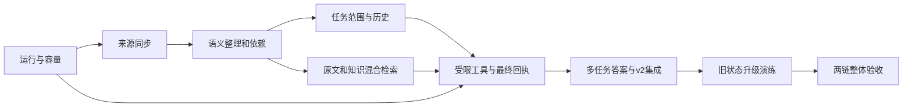

# 语义检索与运行改造执行包

**2026-11-14当前入口：** [Dogfood报告修复包](dogfood-report-repairs.md)与[实施Prompt](DOGFOOD_REPAIR_PROMPT.md)，已完成本地和Oracle独立方案交叉核对，见[审查记录](../../reviews/dogfood-repair-package-review-20261114.md)。六项任务覆盖真实报告F01–F10及相关验证缺口；用户已确认正常任务取消固定总调用次数，保留连续3次临时失败停止，原100元测试授权另行保持。当前只编包，产品未实施；唯一进度看[CURRENT](../../CURRENT.md)，不要从旧九阶段或旧Prompt重新开始。

**2026-11-10历史接续入口**为[查询准备与试用收尾包](query-submission-repairs.md)、[实施限定独审](../../reviews/query-submission-implementation-review-20261110.md)和[当时交接Prompt](CONTINUATION_PROMPT.md)。有效领取的并行续租、事务末尾交接与局部等待已实施，最小RED/GREEN、真实MySQL局部、默认v1、v2及query-text-authority相称验证完成。原夹具/启动失败保留，不能用后续正常采样解释历史迟延。工程后用户批准原trial延期2小时，唯一真实attempt已执行；新有效草稿因新增未经确认的客户度量未通过独立Q02校验，实际submit0，结果解释和续聊未进入，已停止本包。新增10次请求/89908微美元、原预留不变；日常服务未更新。实际状态只看[CURRENT](../../CURRENT.md)，09仍active。

此前[任务续接包](interaction-continuation-repairs.md)的两轮Oracle审包及四项澄清仍为合同依据；原消费者及交互证据按指纹复用，默认v1旧失败在本轮新运行中已完整通过，旧失败不改写。真实代表仍待新attempt证据，原实施和停止记录保留在CURRENT及[原限定独审](../../reviews/interaction-continuation-implementation-review-20261110.md)。

**2026-11-08历史入口**为[交互修复包§3.1](interaction-delivery-repairs.md#31-2026-11-08实施纠偏与接续顺序)及[审查记录](../../reviews/interaction-delivery-package-review-20261107.md)。其流式、保存尾项、短游标和Pi上下文编辑合同保留；第9节旧Prompt已由顶部交接取代，不再作为本轮启动指令。

**2026-11-06历史接续入口**为[09答案交付修复包](dogfood-delivery-repairs.md)、[根因与交叉审查](../../reviews/dogfood-delivery-root-cause-audit-20261106.md)和[交接Prompt](CONTINUATION_PROMPT.md)。前包工程已完成，核心20pass/1partial；本包修正常final被等待状态覆盖、交付归属与多任务来源混淆，有限诊断维护残留，保留21+1范围。三轮Oracle最高5/5交叉审查已完成，最后定向审包ready；恢复发布落点及文档一致性另经本地核对。产品状态只看CURRENT，编包不代表修复已通过。

本目录保存九阶段实施规格；唯一当前状态在[CURRENT](../../CURRENT.md)。**2026-11-04新增[核心问题修复执行包](dogfood-core-repairs.md)及[根因审计](../../reviews/dogfood-core-audit-20261104.md)，已完成本地及两轮Oracle最高5/5交叉审查，该包保存上一轮任务；最新接续以顶部新包及CURRENT为准。** **2026-11-03用户确认：当前执行[09核心验收](integrated-dogfood.md#本轮核心范围)，复用已完成前置和有效证据，不再自动跑完100项及十条综合轨迹。** 完整清单保留为长期回归库；后置不改题、不改失败、不算通过。[前置修复包](dogfood-readiness-repairs.md)仅按实际剩余问题引用，不重新执行已关闭部分。[全项目审计报告](../../reviews/project-readiness-audit-20261102.md)已逐项[复核](../../reviews/project-readiness-confirmation-20261102.md)，不能照旧报告扩大修复。十条综合轨迹及全部要求映射仍在[冻结清单](integrated-trajectories.json)。

历史[剩余交付缺口修复包](delivery-repairs.md)已取得18条去重命令通过收据；[14项修复包](closure-repairs.md)的30命令收据保留历史身份，不能替代全项目效果验收。[全项目审计入口](global-audit.md)是历史审计任务；[CONTINUATION_PROMPT](CONTINUATION_PROMPT.md)顶部保存当前交接；[能力导航](global-audit-map.md)仍可按疑点查用。R02/R07/D1/D2已确认，不重复决策。

**2026-10-29历史编包：** 当时将01–05既有接入的三项问题纳入06–09；当前已有实现、已改未验和未修问题的区分见新执行包，不再从06开头重做。具体保留/替换边界仍见 [Pi复用约束](pi-reuse.md)。编包本身不授予当前代理后续执行权限。
原始编包日期：2026-10-23。以下九阶段路线和公共约束仍作规格导航，实际接续范围以上方当前交接为准。**这是实施规格，不是完成报告；提交、推送和部署另按具体授权。09真实模型及辅助端点沿已有有效授权，当前执行前提见[新包§7](interaction-continuation-repairs.md#7-一条真实代表成功后至多一条续接)。** 当前进度仅在 [CURRENT](../../CURRENT.md) 维护。

**2026-10-26历史接续范围：** 当时任务为04收口、纠偏审计与交接；随后先完成[05混合检索](hybrid-retrieval.md)，该次提示保存在[AGENT_PROMPT](AGENT_PROMPT.md)。当前不重新执行这份旧交接，也不能沿“05只差环境/E2E”旧说法替代后来的审计证据。

## 1. 接手顺序与依据

1. 读根目录 [AGENTS.md](../../../AGENTS.md)、CURRENT 的最新决定和 `delivery.increment`，检查当前分支、HEAD、工作树。
2. 先读[查询准备与试用收尾包](query-submission-repairs.md)第1–3节，再按当前任务展开第4–7节与相关源码；原[任务续接包§7–8](interaction-continuation-repairs.md#7-一条真实代表成功后至多一条续接)保存单真实代表的具体合同，[09](integrated-dogfood.md)保留整体核心范围与未完成出口。遇具体缺口再展开原合同，不默默降低能力或改断言。
3. 按核心表复用证据、补受影响流程，按[轨迹清单](integrated-trajectories.json)和[覆盖与验收](coverage-and-validation.md)保留完整要求导航及后置缺口；不按旧prompt重做已完成实现或自动扩至全量试用。

2026-10-23最初编包代码基线为 `fed8276`，分支为 `codex/semantic-maintenance-prototype`；它不是当前接手HEAD。当前基线和未提交状态见 CURRENT 与新执行包。接手时重新核实，**保留这些工作，不 reset、不用旧 HEAD 的设计覆盖它们**。旧的 `analysis-capabilities-execution.md` 是历史实施材料，本轮冲突内容以 CURRENT 和第17节为准。

本包依据 dev_co 的持续交接、小步可验证实施方法，以及 contract-first 的共享合同方法组织。参考了小步重构与纵向切片技能；未开启 Issue/PR 发布工作流。Oracle 和独立源码审查的处置见[交叉验证记录](cross-validation.md)。

## 2. 九个阶段，一个完整任务

| 包 | 用户可观察结果 | 前置 | 建议 CURRENT 增量 ID | 详细文件 |
| --- | --- | --- | --- | --- |
| 01 | 慢检索不阻塞续租，Worker可恢复；模型容量正确，Pi原生压缩可续接 | 现有基线 | 保留 `I2-RUNTIME-CAPACITY` | [运行与容量](runtime-capacity.md) |
| 02 | 空库与后续同步同路；完整生产SQL、分页重启、负责人和退休正确 | 01 | `I2-SOURCE-SYNC` | [来源同步](source-sync.md) |
| 03 | 任意文档和SQL可分批整理；人工值、出处和实际依赖正确 | 02 | `I2-SEMANTIC-PREPARATION` | [语义整理](semantic-preparation.md) |
| 04 | 条件跨轮保留、来源限制生效；旧分析可看，当前采用另核验 | 03 | `I2-TASK-CONTEXT` | [任务与历史](task-context.md) |
| 05 | 原文与知识共同索引，中文混合召回先过滤、按相关性排序 | 03；受限取证接04 | `I2-HYBRID-RETRIEVAL` | [混合检索](hybrid-retrieval.md) |
| 06 | 既有Pi检查点导出与同侧校验精简；v2搜索、批量补读、支持内容和四种续读完整；个人资产不退化 | 01、04、05 | `I2-EVIDENCE-DELIVERY` | [工具与依据交付](evidence-delivery.md) |
| 07 | 修单answer槽；同消息多任务分别交付，中断恢复不丢已定稿答案、不混来源；v2集成具备切换条件 | 04、06 | `I2-TASK-ANSWERS` | [答案定稿与组合](task-answers.md) |
| 08 | 从旧状态升级和恢复通过；三个进程统一版本，索引切换后再启用新消息v2 | 01–07 | `I2-COMPATIBLE-UPGRADE` | [升级演练](compatible-upgrade.md) |
| 09 | 核心流程及代表性复杂问题验收，完整回归库后置、缺口明确 | 08 | `I3-SEMANTIC-DOGFOOD` | [核心验收](integrated-dogfood.md) |

这些编号只用于计划、需求与验收映射。**产品目录、类、函数、变量、数据库对象和测试名称使用业务含义；禁止 `M01Service`、`step2_handler`、`phase3_store` 等。** `source_sync`、`read_source`、`finalize_task_answer` 是职责名称示例，不要求照抄。真实协议版本、迁移序号和业务阶段可按含义命名，不借此机械重命名无关旧代码。

默认顺序执行；不是要求用户逐包批准。多人协作时，03公开接口稳定后，04与05可在不重叠文件中并行。每包内按“反例→合同→owner规则→用例/入口→验证”做小切片，不先铺完整数据库层再铺API/UI。

此处描述整体路线。当前接手者按09核心范围补剩余缺口；不重新实施01–08或已关闭前置包。Pi复用、简洁性和已确认范围继续适用，不另增业务阶段。

05先证明真实索引/候选及回源链，不宣称v2公开工具已完成；06用受控测试运行验证新合同，保留默认运行选择；07在已经接上新集合的专用验收实例证明完整v2；08演练并落实“兼容读取/回填→新写入→新公共索引目标→新消息v2”的统一切换。实际部署另按授权。旧登记调用始终按原合同接回。02/03允许短期保留尚未就绪新目标的pending，但必须按kind/schema阻止旧消费者误领，05接通后补齐处理；这不代表可以把半成品部署给用户，或把已入队写成业务完成。这样的过渡只覆盖真实升级需要，不做长期双实现、双索引或假成功stub。

## 3. 不变的范围

- 保留十二模块、具名 `use_cases`、同库短事务、React/Rust/Node-Pi/Worker分工。MySQL正式当前内容，Milvus公共派生索引，Mem0个人记忆，Pi原生Skill。
- 一张表一份完整当前生产SQL，沿 `CatalogTable.node`。生产SQL只同步和解释；指标可有多个查询示例。无SQL血缘不意味着禁止有充分依据的JOIN。
- 上游交付授权范围内完整资料；手动全量比较、后台分批处理。不加定时同步、多生产者或逐资料不可得状态体系。
- 每条用户消息24次、连续临时失败3次；恢复/摘要/SDK重试沿原budget scope和操作身份。当前09沿已授权DeepSeek、整理模型、Embedding和Mem0完成必要验证，不额外设置累计测试门槛、不逐批重问；更换付费服务或实质扩大范围时另行确认。
- Pi是唯一Agent及压缩/恢复机制；不另建规划器、摘要器、问题重写模型、重排模型、图服务或检索会话存储。
- 不增加全历史全文库、旧分析变更监听/提醒/自动重算、永久结果缓存、长期双索引。latest-only不删除现有历史、任务、账本或资产。
- 不以dogfood通过为目标改写期望；修一般原因。缺少真实证据就标未验证，不能用mock或文档检查代替。

## 4. 合同、迁移和并行所有权

| 共享面 | 单一整合责任 | 并行者的边界 |
| --- | --- | --- |
| `packages/contracts/schema.json`、`openapi.json`、生成文件、契约样本 | 合同负责人逐包改真源、生成、核验provider/consumer | 先给消费需求与样例；不手改generated，不各写一份类型 |
| `migrations/`及当前内容/旧profile/authority回填 | 存储负责人分配迁移序号和兼容路径 | 不并行抢序号；不删除旧历史；先在专用合成库演练 |
| `use_cases/data_tools.rs`、`knowledge.rs`、`context_authority.rs` | Rust整合负责人顺序合入 | 按领域公开接口实现独立文件；不重复一套来源核验、不在组合层裸SQL |
| `session/deliver.ts`、`tools/data-tools.ts`、检查点和provider | Pi整合负责人统一接容量、投影、回执、答案 | 独立纯计算/测试可分工；不并行覆盖Agent交付入口 |
| CURRENT、证据与阶段关闭 | 主实施者 | 审查者只给发现/审查记录；不各建当前计划 |

同一人可以兼任多个责任。任何子代理任务都给文件归属、前置合同和非目标，告知共享工作树不得撤销别人修改。允许并行不意味着必须四路开工；边界未稳定时先串行。

## 5. 每包开工与关闭

开工时将该包的需求、模块、实际允许路径、不变量和反例映射到 CURRENT；状态改active，验收命令必须指向实际存在的可执行检查。包内写出的“需扩展/新增”只是待写测试，不能提前登记通过。测试超时按实际流程设定，不用调低产品阈值加快验收。

每次保持可构建的小结果。先跑相关窄检查，再跑共享合同/类型/架构及本包回归；通过后不无故反复跑整套。实现改变受影响边界，同批更新对应Schema、测试、模块设计与图源。新增接口不得仅存在于文档。

每包关闭必须满足：

1. 可观察反例已有实际结果；原能力回归通过，失败/未知/取消没有被空结果掩盖。
2. 未负责该部分实现的审查者按原要求检查代码、测试预期和运行证据；发现修复后有界复查。主实施者不冒充独立审查者。
3. `make verify-delivery`通过记录检查；真正关闭时使用已有 `make verify-increment`。先补真实审查JSON与范围指纹，再执行已绑定命令，引用其生成收据。参见 `scripts/check_delivery.py` 的实际格式；不手写假执行收据。
4. CURRENT保存证据位置、环境/版本、剩余缺口和下一包。旧包证据可以归档为静态结果，当前active只保留一个；不能把本包通过解释成整条D/C/A要求全部完成。
5. 在用户交付的范围内继续；当前交接明确要求前置修复完成后连续进入09，不在中间停等。只有发现会改变已定产品行为、不可逆数据操作、缺少外部执行授权或无法满足合同的证据时，才提出具体阻塞；其余独立工作继续。

本包不要求每阶段commit；用户未授权时不commit/push。阶段关闭依靠实际证据与内容指纹，不靠提交数量。已有未提交设计仍保留。

## 6. 升级与验证的公共纪律

迁移在相应功能包内实现并测试，08是完整旧状态升级演练与切换，不能把前面“可运行”的必需迁移全部拖到08。03准备新写路径，停止新修订全文复制要等历史/恢复/冻结输入消费者齐备，08才实际切换。旧资料身份、原回执、会话和预算是兼容主体；生成器、协议、旧writer边界具体见08。

本地集成harness会启动真实API/Worker/Pi、建立专用合成MySQL测试库并使用本地provider。运行前核实目标；不要把主库改造成测试库，也不要打印口令。基础设施不可用记录环境缺口，不偷换成mock后报通过。本轮编包没有启动这些测试或服务；实施者按前置修复和09要求执行。

所有测试证据注明：纯函数/合同、本地数据库与协议替身、真实Milvus/embedding、真实模型、真实平台/用户试用。现有 `--check` / `--audit` 只检查资料或历史证据，不能代表本轮真实调用。详情见[覆盖与验收](coverage-and-validation.md)。
