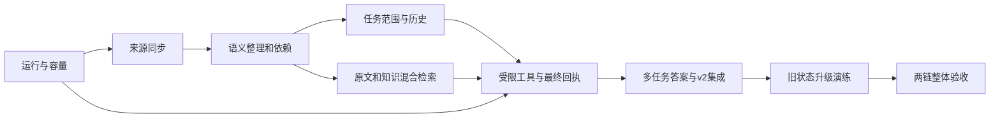

# 语义检索与运行改造执行包

日期：2026-10-23。用途：交给其他 coding agent，一次接单，按阶段连续实现、验证和交接。**这是实施规格，不是完成报告，也不授予提交、推送、部署或付费执行权限。** 当前进度仅在 [CURRENT](../../CURRENT.md) 维护。

## 1. 接手顺序与依据

1. 读根目录 [AGENTS.md](../../../AGENTS.md)、CURRENT 的最新决定和 `delivery.increment`，检查当前分支、HEAD、工作树。
2. 读[实现设计第17节](../../architecture/implementation-design.md#17-语义检索与上下文的实施合同2026-10-23)和[最终审计第10节](../../reviews/predevelopment-closure-audit-20261023.md#10-最终技能专项审计与交接修订)。本包细化实施顺序，不替代它们的业务合同。
3. 读本入口、[覆盖与验收](coverage-and-validation.md)，再读当前阶段。执行提示见 [AGENT_PROMPT.md](AGENT_PROMPT.md)。不要每阶段重新通读全部历史。

编包代码基线为 `fed8276`，分支为 `codex/semantic-maintenance-prototype`；编包时已有未提交设计、图与说明，后续实现和提交状态见 CURRENT。接手时重新核实最新HEAD与工作树，**保留这些工作，不 reset、不用旧 HEAD 的设计覆盖它们**。旧的 `analysis-capabilities-execution.md` 是历史实施材料，本轮冲突内容以 CURRENT 和第17节为准。

本包依据 dev_co 的持续交接、小步可验证实施方法，以及 contract-first 的共享合同方法组织。参考了小步重构与纵向切片技能；未开启 Issue/PR 发布工作流。Oracle 和独立源码审查的处置见[交叉验证记录](cross-validation.md)。

## 2. 九个阶段，一个完整任务

| 包 | 用户可观察结果 | 前置 | 建议 CURRENT 增量 ID | 详细文件 |
| --- | --- | --- | --- | --- |
| 01 | 慢检索不阻塞续租，Worker可恢复；模型容量正确，Pi原生压缩可续接 | 现有基线 | 保留 `I2-RUNTIME-CAPACITY` | [运行与容量](runtime-capacity.md) |
| 02 | 空库与后续同步同路；完整生产SQL、分页重启、负责人和退休正确 | 01 | `I2-SOURCE-SYNC` | [来源同步](source-sync.md) |
| 03 | 任意文档和SQL可分批整理；人工值、出处和实际依赖正确 | 02 | `I2-SEMANTIC-PREPARATION` | [语义整理](semantic-preparation.md) |
| 04 | 条件跨轮保留、来源限制生效；旧分析可看，当前采用另核验 | 03 | `I2-TASK-CONTEXT` | [任务与历史](task-context.md) |
| 05 | 原文与知识共同索引，中文混合召回先过滤、按相关性排序 | 03；受限取证接04 | `I2-HYBRID-RETRIEVAL` | [混合检索](hybrid-retrieval.md) |
| 06 | v2搜索、批量补读、支持内容和四种续读完整；个人资产不退化 | 01、04、05 | `I2-EVIDENCE-DELIVERY` | [工具与依据交付](evidence-delivery.md) |
| 07 | 同消息多任务分别交付；中断恢复不丢答案、不混来源；v2集成具备切换条件 | 04、06 | `I2-TASK-ANSWERS` | [答案定稿与组合](task-answers.md) |
| 08 | 从旧状态升级和恢复通过；三个进程统一版本，索引切换后再启用新消息v2 | 01–07 | `I2-COMPATIBLE-UPGRADE` | [升级演练](compatible-upgrade.md) |
| 09 | 两条主链及复杂座舱问题完成分层验收，文档与实际能力对齐 | 08 | `I3-SEMANTIC-DOGFOOD` | [整体验收](integrated-dogfood.md) |

这些编号只用于计划、需求与验收映射。**产品目录、类、函数、变量、数据库对象和测试名称使用业务含义；禁止 `M01Service`、`step2_handler`、`phase3_store` 等。** `source_sync`、`read_source`、`finalize_task_answer` 是职责名称示例，不要求照抄。真实协议版本、迁移序号和业务阶段可按含义命名，不借此机械重命名无关旧代码。

默认顺序执行；不是要求用户逐包批准。多人协作时，03公开接口稳定后，04与05可在不重叠文件中并行。每包内按“反例→合同→owner规则→用例/入口→验证”做小切片，不先铺完整数据库层再铺API/UI。

05先证明真实索引/候选及回源链，不宣称v2公开工具已完成；06用受控测试运行验证新合同，保留默认运行选择；07在已经接上新集合的专用验收实例证明完整v2；08演练并落实“兼容读取/回填→新写入→新公共索引目标→新消息v2”的统一切换。实际部署另按授权。旧登记调用始终按原合同接回。02/03允许短期保留尚未就绪新目标的pending，但必须按kind/schema阻止旧消费者误领，05接通后补齐处理；这不代表可以把半成品部署给用户，或把已入队写成业务完成。这样的过渡只覆盖真实升级需要，不做长期双实现、双索引或假成功stub。

## 3. 不变的范围

- 保留十二模块、具名 `use_cases`、同库短事务、React/Rust/Node-Pi/Worker分工。MySQL正式当前内容，Milvus公共派生索引，Mem0个人记忆，Pi原生Skill。
- 一张表一份完整当前生产SQL，沿 `CatalogTable.node`。生产SQL只同步和解释；指标可有多个查询示例。无SQL血缘不意味着禁止有充分依据的JOIN。
- 上游交付授权范围内完整资料；手动全量比较、后台分批处理。不加定时同步、多生产者或逐资料不可得状态体系。
- 每条用户消息24次、连续临时失败3次；恢复/摘要/SDK重试沿原budget scope和操作身份。测试套件不额外设置累计次数上限，不等于自动授权付费执行。
- Pi是唯一Agent及压缩/恢复机制；不另建规划器、摘要器、问题重写模型、重排模型、图服务或检索会话存储。
- 不增加全历史全文库、旧分析变更监听/提醒/自动重算、永久结果缓存、长期双索引。latest-only不删除现有历史、任务、账本或资产。
- 不以dogfood通过为目标改写期望；修一般原因。缺少真实证据就标未验证，不能用mock或文档检查代替。

## 4. 合同、迁移和并行所有权

| 共享面 | 单一整合责任 | 并行者的边界 |
| --- | --- | --- |
| `packages/contracts/schema.json`、`openapi.json`、生成文件、契约样本 | 合同负责人逐包改真源、生成、核验provider/consumer | 先给消费需求与样例；不手改generated，不各写一份类型 |
| `migrations/`及当前内容/旧profile/authority回填 | 存储负责人分配迁移序号和兼容路径 | 不并行抢序号；不删除旧历史；先在专用合成库演练 |
| `use_cases/data_tools.rs`、`knowledge.rs`、`context_authority.rs` | Rust整合负责人顺序合入 | 按领域公开接口实现独立文件；不重复一套来源核验、不在组合层裸SQL |
| `session/deliver.ts`、`tools/data-tools.ts`、检查点和provider | Pi整合负责人统一接容量、投影、回执、答案 | 独立纯计算/测试可分工；不并行覆盖Agent交付入口 |
| CURRENT、证据与阶段关闭 | 主实施者 | 审查者只给发现/审查记录；不各建当前计划 |

同一人可以兼任多个责任。任何子代理任务都给文件归属、前置合同和非目标，告知共享工作树不得撤销别人修改。允许并行不意味着必须四路开工；边界未稳定时先串行。

## 5. 每包开工与关闭

开工时将该包的需求、模块、实际允许路径、不变量和反例映射到 CURRENT；状态改active，验收命令必须指向实际存在的可执行检查。包内写出的“需扩展/新增”只是待写测试，不能提前登记通过。测试超时按实际流程设定，不用调低产品阈值加快验收。

每次保持可构建的小结果。先跑相关窄检查，再跑共享合同/类型/架构及本包回归；通过后不无故反复跑整套。实现改变受影响边界，同批更新对应Schema、测试、模块设计与图源。新增接口不得仅存在于文档。

每包关闭必须满足：

1. 可观察反例已有实际结果；原能力回归通过，失败/未知/取消没有被空结果掩盖。
2. 未负责该部分实现的审查者按原要求检查代码、测试预期和运行证据；发现修复后有界复查。主实施者不冒充独立审查者。
3. `make verify-delivery`通过记录检查；真正关闭时使用已有 `make verify-increment`。先补真实审查JSON与范围指纹，再执行已绑定命令，引用其生成收据。参见 `scripts/check_delivery.py` 的实际格式；不手写假执行收据。
4. CURRENT保存证据位置、环境/版本、剩余缺口和下一包。旧包证据可以归档为静态结果，当前active只保留一个；不能把本包通过解释成整条D/C/A要求全部完成。
5. 继续下一包。只有发现会改变已定产品行为、不可逆数据操作、缺少外部执行授权或无法满足合同的证据时，才提出具体阻塞；其余独立工作继续。

本包不要求每阶段commit；用户未授权时不commit/push。阶段关闭依靠实际证据与内容指纹，不靠提交数量。已有未提交设计仍保留。

## 6. 升级与验证的公共纪律

迁移在相应功能包内实现并测试，08是完整旧状态升级演练与切换，不能把前面“可运行”的必需迁移全部拖到08。03准备新写路径，停止新修订全文复制要等历史/恢复/冻结输入消费者齐备，08才实际切换。旧资料身份、原回执、会话和预算是兼容主体；生成器、协议、旧writer边界具体见08。

本地集成harness会启动真实API/Worker/Pi、建立专用合成MySQL测试库并使用本地provider。运行前核实目标；不要把主库改造成测试库，也不要打印口令。基础设施不可用记录环境缺口，不偷换成mock后报通过。当前执行包不启动这些测试或服务。

所有测试证据注明：纯函数/合同、本地数据库与协议替身、真实Milvus/embedding、真实模型、真实平台/用户试用。现有 `--check` / `--audit` 只检查资料或历史证据，不能代表本轮真实调用。详情见[覆盖与验收](coverage-and-validation.md)。
