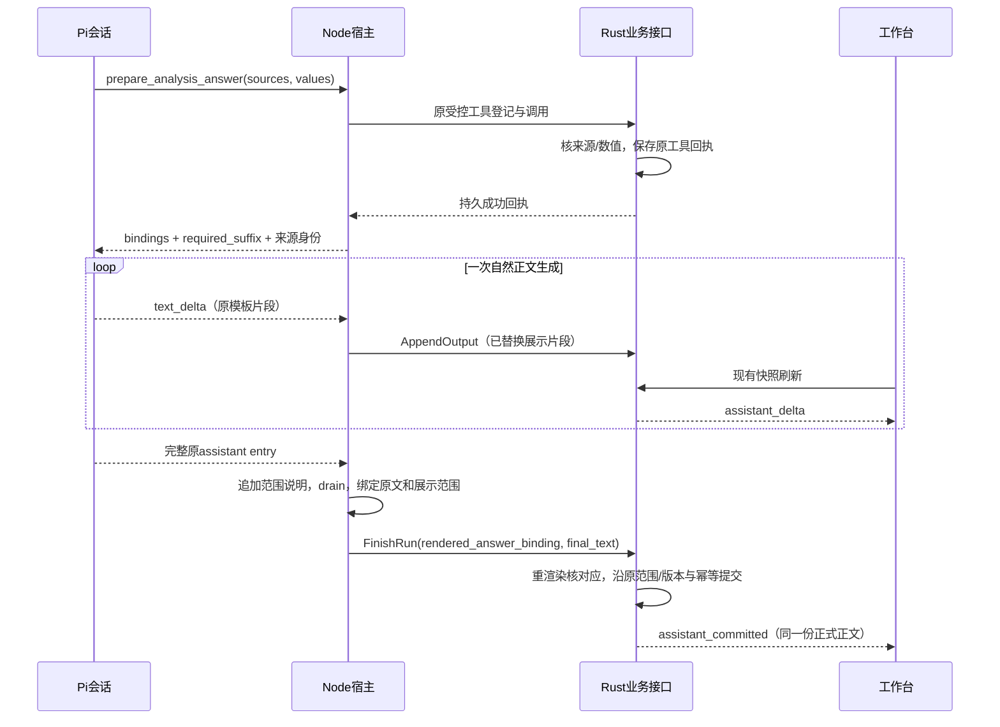

# 交互等待、流式交付与检索游标修复包

当前接续已转至[任务续接修复执行包](interaction-continuation-repairs.md)及[交接Prompt](CONTINUATION_PROMPT.md)，实际状态只看[CURRENT](../../CURRENT.md)。本包保留原实现合同和历史纠偏依据；§3.1六组已有相应工程成果，按新包核对并复用，不按本包§9旧Prompt重做。新包与本包冲突的执行说明、验证入口以新包为准，来源/权限与批量授权边界仍须保留。

修订：2026-11-08。保留2026-11-07经本地及两轮Oracle最高5/5审查的架构与业务合同，新增§3.1纠正实施中已确认的六组问题，并更新§9接续Prompt。本次局部修订已作本地源码核对，未再次提交Oracle；此前审包不代表当前实现通过。原Oracle第二轮的四项必要澄清保持，准确答复及两份附件已核对原提交指纹，错误采集作废。证据见[审查记录](../../reviews/interaction-delivery-package-review-20261107.md)，实际实施状态只看[CURRENT](../../CURRENT.md)。

## 1. 入口与完成目标

沿当前 `codex/semantic-maintenance-prototype` 工作树接续。编包基线 HEAD 为 `04d27d0`；大量现有未提交修改是有效基线，不能 reset、覆盖或按 HEAD 重做。唯一当前状态为 `docs/CURRENT.md`，本包只处理最新用户试用暴露的通用交互问题，不接管整个09的其他缺口。

启动必读：`AGENTS.md`、CURRENT 最新“交互修复实施纠偏”入口、本包第1–3节（含§3.1）。从现有实现继续，不从头重做。开始具体任务时再读对应章节、代码和测试；历史执行包只在需要解释已有合同或兼容行为时按引用补读。

可观察的完成结果：

1. 普通查询完成后，用户在模型正文生成结束前看到有意义的回答前缀，后续持续增加；完整正文只生成一次。最后刷新、续聊与已定稿答案一致。
2. 同一份查询的同次执行授权只提交一次；显式批量授权仍按原合同分别执行各查询，不新增“每消息只能一条SQL”的限制；执行和解释状态清楚，结构化状态不倒退；提交正文只确认已发生的事实，避免迟到的等待描述。任意自然语言的时态正确性仍需真实代表观察，不能宣称有程序级证明。
3. 检索的分页位置仍可恢复，但完整候选窗口不进入新模型请求；未翻页的普通检索不为携带大游标支付上下文开销。
4. 已有任务续接不先调用明知被来源门禁止的读取工具，再用错误回执学习补route；必要来源裁决与查询授权保留。
5. 查询原值保留，已有ratio可按百分比和指定精度展示；已有语义里的零分母说明不因数字字符被整轮拒绝。
6. 已有多任务冻结、旧会话恢复、已读来源限制和权限撤回继续成立。上述改动与合成座舱表名、问题、答案无关。

按 `dev_co` 维持一份执行记录；跨语言改动用 `contract-first`，以 `packages/contracts/schema.json` 为唯一合同源；新增行为按小步TDD验证。UI部分只做已确定的状态和内容层次调整，可用 `compose-ui-kit` 做局部落实，不重启原型设计。

## 2. 事实、取舍与不做的内容

脱敏后的单次诊断事实：初次准备约73秒；用户确认执行到平台结果约93秒，其中真正提交到结果约2秒；结果到说明又约95秒。18次Agent模型调用成功、1次网络失败。应用和平台均只有一次查询提交。不是性能分位数，不承诺修复后的秒数或费用降幅。

三次检索回执87,302字节，其中71,126字节为翻页游标；输入从约2.1万涨到约9万tokens。最终说明只产生完整提交事件，前两轮有文字增量。一次约10.5秒模型网络超时独立存在，不能用它解释所有等待，也不能承诺本包解决外部网络。

本包保留：Pi 1.3.0唯一Agent循环、流式事件、会话、取消、压缩与恢复；原每消息24次调用和连续临时失败3次；原operation/origin/run/预算身份；Rust权限、来源、版本、执行授权和结果归属；MySQL正式状态、Milvus检索索引。

本包不做：更换/降低模型或思考档，缩小模型容量，改检索排序/类型配额，换数据库，Redis、WebSocket、新检索会话、后台清理系统、通用表达式计算器、另一套Agent/摘要/恢复/规划器、全面UI重设计、OpenAI网络代理、09其他历史问题、自动全跑100项。

四条实施规则：

- 只处理本轮已证问题和新增合同必需的失败语义。极少见的额外边界/并发保护先给触发证据、成本和取舍，由用户决定；不得虚构概率。
- 外部数据只在对应入口校验一次，内部携带类型化结果。权限、业务状态已变化或新信任边界可重核，不用它解释同一不变结构的多层重复校验。
- 简单单次逻辑就地写；只为实际复用、独立职责或复杂度隔离抽取函数。不造通用Pipeline/Manager/Registry。
- 非必要不用try/catch；不吞错；只在可恢复、协议转换或补充定位信息时捕获。测试验证行为，不复述实现、不为了覆盖率扩矩阵。

## 3. 顺序、所有权与合同摘要

同一实施owner顺序整合共享Schema、`data_tools.rs`、`task_answers.rs`、`finish_run.rs`、`deliver.ts`及Pi工具入口。可以只读咨询，不把这些共享入口同时分给多个写作者。

| 顺序 | 连贯结果 | 主要落点 |
| --- | --- | --- |
| 一 | 大游标移出模型上下文，翻页仍可恢复 | `use_cases/evidence_delivery.rs`、`data_tools.rs`、runtime私有store、Pi工具回执投影 |
| 二 | 数字准备与一次正文流式生成接通 | 同源Schema、`analysis_answers.rs`、`task_answers.rs`、`finish_run.rs`、`session/deliver.ts`、`output-stream.ts` |
| 三 | 已有任务续接与提交确认收敛 | Pi活动工具集合、`tools/data-tools.ts`、条件补丁入口、执行回执 |
| 四 | 页面状态准确、位置稳定、结论可读 | snapshot运行摘要、`Workbench.tsx`、`conversation-timeline.ts`、现有SQL/依据卡片 |
| 五 | 有界复验、独审及文档 | 现有测试接缝、CURRENT、受影响设计/架构图、试用说明 |

任务序号只用于本包，不进入实现命名。任何新增公开字段先补Schema、生成Rust/TS，然后同一增量修改提供者和消费者，不维护手抄类型。旧接口和持久回执的必要兼容以真实已有会话为依据，不预建版本协商框架。

### 3.1 2026-11-08实施纠偏与接续顺序

先让当前单条检查结束并保存真实退出码、完整日志和当前改动，停止继续启动旧批次。不要杀数据库、清库、reset或重做已完成部分；随后直接按下列顺序接续，不另等逐项批准。本文序号仅导航，不写入代码名称。

审计时主要功能已有代码，尚未收尾；本轮起点指纹在`.local/checks/interaction-delivery-20261107/baseline-hashes.json`。相对该起点发现58份已有文件变化、3份新增文件，这是当时快照，不是固定允许文件数。先核对接手后有无新修复；已真正修好且有对应证据的项直接复用。CURRENT当时仍写“待实施”，不能以它的旧措辞推翻实际代码，也不能用已有局部passed替代本包完成。

**先修流式分片与收尾，复用`session/render.ts`和`deliver.ts`。** 已复现合法正文`成功率为{{rate}}。`在两个`{`之间分片时返回`answer_render_invalid`；普通尾部`}`进入finish.display却没有进入输出chunks。根因分别是未暂存可能组成标记起点的单个`{`，以及收尾缓存没有交给原outputStream。只缓存识别标记所需的尾部；原assistant正常结束时把合法残留文字和required_suffix送出一次，drain后生成绑定，保证`所有展示delta拼接 == display == 正式正文`。具体返回值可在现有渲染器内调整，不新增事件管道、不在最后重发整篇正文。未知或未闭合双花括号标记仍不能定稿，普通单花括号保持原字面含义。

最小证明放回`check-rendered-text.mjs`：对一条含绑定的短正文遍历每个单切分点，另给逐字符输入；普通尾部`{`/`}`及后缀收尾核对流式拼接与display相等。现有检查挑的切分点漏了实际故障，且尾部`}`用例只核display；补足行为断言即可，不引入随机测试框架或排列所有切分组合。沿现有渲染交付接缝证明Rust接受同一展示范围。

**随后补齐普通自然尾项，核`deliver.ts`与`task_answers.rs`。** 当前`selectDelivery`只给rendered答案绕过allTasksFrozen，natural仍被alreadyFrozen挡住。按§5.4统一候选准入：最后冻结entry之后、同范围且完整的新尾项可以是自然文字或渲染文字；一任务一冻结part、最多一个新尾项、原24项及容量上界保持。不按同task一律丢弃，也不强迫保存说明调用prepare；原entry身份和顺序判断保持，不能只去掉判重。复用现有答案接缝验证“一段普通说明冻结→保存操作→自然保存结果说明”，核两内容单元仍属一任务，并保已有来源检查。新尾项失败时不删除已冻结正文。

**校正Pi活动工具集及测试预期，核`task-projection.ts`、`data_tools.rs::requires_source_context`。** 当前未裁决时仍暴露read_analysis_task、validate_sql、prepare_skill_draft、propose_semantic_change，而现有Rust门会拒绝这些调用；不能把read_analysis_task当成任务目录。按现有实际准入收窄纯受限工具；保留update_analysis_task、cancel_query，以及search_knowledge/source_identity、read_conversation/task_directory、manage_personal_asset/disable_memory这些多用途工具的合法分支，多用途工具的其他分支仍由Rust校验。继续用Pi `setActiveToolsByName`，不增工具路由框架或新权限协议，不为过测试放开Rust门。`check-result-notification-answers.mjs`中要求上述纯受限工具必须可见的断言应修正，并在CURRENT记录原值、新值及“宿主已拒绝”的合同依据。沿该测试现有provider payload断言同时证明未裁决收窄和裁决后恢复，不额外建一套工具目录测试。

**修正短游标定位范围与存储边界，核runtime/store和data_tools协调入口。** 当前`read_search_cursor`要求原工具与当前run的recovery_chain_id相等，普通新用户消息却会生成新链；这给§4.2增加了未经要求的“换消息即不能续页”限制。删除短引用读取中的同恢复链要求，保同用户/空间/会话、原成功evidence回执及SearchSelection对查询参数、任务条件、来源范围和修订的原校验。只调整这条读取路径，不能全局放宽所有工具重放或答案恢复的chain约束。下一条真实消息的续页是当前消息的新工具操作，费用沿当前消息预算；原搜索回执和旧恢复操作身份不改。

同时去掉runtime私有store对conversations表的JOIN。由已有use_case在conversations公开接口完成本次会话授权，runtime只访问自己的工具记录；沿现有已核run/会话身份传递，不创建新鉴权层。复用短游标接缝，在同会话下一条消息、相同任务/条件/范围下使用原引用取得后页，再沿已有范围变化拒绝断言证明边界仍在。原成功回执、arguments和fingerprint字节不变，不用重新检索假充续页。

**修正输出模块依赖方向。** 当前`modules/runtime/outputs.rs`反向调用`use_cases::analysis_answers::display_from_preparation`；同一变更中的runtime/store越表访问已被现有架构检查拒绝。去掉反向调用，把确需复用的一份纯字符串替换逻辑收拢到现有输出职责，由use_cases向下调用；数值取源、格式化及权限业务仍放在原业务用例。不要复制第二份Rust替换实现，也不要把整个analysis_answers搬进runtime或新造通用模板库。用现有字符串合同样例和相邻输出检查验证，架构检查通过后仍人工核对依赖方向，因为当前脚本并未覆盖所有反向调用。

**补齐旧Pi分支的短游标投影。** 新回执已短化，但尚未找到§4.2要求的旧结构化结果context edit。只对能准确关联成功search回执operation_id的原条目替换模型可见cursor，使用Pi原生appendContextEdit，保原entry、持久回执及原调用参数；不改用户文字、不扫旧摘要、不重新执行原搜索。复用旧检查点/检索和原生压缩接缝，用同一份旧分支证明普通请求和摘要请求都看到短引用，原内容及排序不变。原生压缩一般回归通过不能替代此断言。

这六组完成后才做§7的局部收尾：核新prepare接线、原身份恢复、页面状态和真实可见增量，补一条整体浏览器流程及既定少量真实模型代表。旧日志保留但逐项区分是否对应当前代码；不要接着按脚本目录扩跑回归。最新旧用例出现的`Tool present_analysis_answer not found`须区分“新v2普通调用应改prepare”与“已登记旧present仍须可恢复”；source_limits:null的预期差异也先按原合同判定，不一律归因环境或批量改expected。实施中间版本的编译失败不能证明当前仍失败，也不能当当前通过。

本补充没有新增产品功能或新防御目标；它落实原包已有的流式、合法尾项、来源准入、同会话续页、模块归属和Pi上下文投影要求。必要断言并入已有接缝，不能以纠偏为由重跑100题或所有历史电池。

## 4. 分页状态留在宿主

### 4.1 行为与存储

新 `search_knowledge` evidence回执的 `search_coverage.next` 只返回一个短的不透明收据引用，例如 `rc1:<operation_id>`；无后页仍为null。引用由宿主产生，目标长度不超过96 ASCII字节。这个长度是本次新引用的验收目标，不扩大旧请求/结果限制。

完整候选窗口、查询与范围绑定、任务条件版本、通道位置和本窗去重信息继续由宿主保存。优先复用现有持久工具回执，保存原内部续取状态并提供确定的公开投影；不新建检索会话、表、进程或清理作业。初次成功回执和其续取状态沿原短事务保存，再发布短引用；同操作重放返回同一引用。不得先发一个尚未可恢复的引用。

私有续取状态不通过Node工具content、Pi摘要、错误hint或工作区快照重新漏入模型。`response_budget`按真正公开回执计算；不能把节省的空间变成增加命中条数或改变排名的借口。内部有界候选窗口和原真实终止语义保留。

### 4.2 续页和旧记录

收到短引用后，通过runtime公开的窄读取接口，按当前用户/空间/会话、原成功的evidence搜索操作定位原回执，再交原 `SearchSelection`/`SearchContinuation` 恢复和核验。当前查询参数、任务版本、来源范围及索引修订仍按原规则检查。短引用不是读取凭据。原工具登记的 arguments 仍保存模型收到并传回的短引用，指纹也基于它；仅在检索内部构造 effective_cursor，不把展开后的大游标回写原参数。引用固定读取原成功回执 data.search_coverage.next，不接受任意JSON路径或其他工具回执。

同会话下一条真实消息在相同任务/条件/查询/范围下仍可使用原短引用，不要求沿同一recovery_chain；本次续页按当前消息授权和预算登记新操作，原回执和旧恢复身份不变。会话授权复用conversations公开边界，runtime私有store不跨表归属重查conversations。

保持旧JSON/gzip cursor解码；不修改旧成功回执或工具参数指纹。不能收到失效引用时静默发起一次新检索，并把结果冒充原后页；不能允许引用递归成引用链。`source_identity`与个人资产的既有游标沿原独立协议，不在本包顺带迁移。

已恢复Pi分支中的旧长游标，只对成功结构化search工具结果、明确operation_id和原长cursor做模型可见投影；通过Pi原生context edit保留原条目/回执，只替换模型可见content中的cursor。Pi 1.3.0的prepareCompaction使用buildSessionProjection，当前可见工具结果的持久context edit也会进入原生压缩；测试核实这一接线。只替换投影不重新登记或执行原工具，不扫描正文猜ID。新结果的content/details都只包含短投影，完整内部回执不进入Node。不能正则扫改用户文字或旧压缩摘要；已经写入旧摘要、无法准确定位的长文本不做全量迁移，沿Pi正常压缩收敛，明确列为历史优化限制。

这项明确修订旧设计中“游标完全自包含且不新增服务端状态”的实现取舍：不新建独立服务端检索会话，改为引用已存在的持久工具回执。原因是已测到游标占回执81.5%，并非为理论上更稳增加基础设施。实施时同步实现设计17.5的相应文字。

### 4.3 最小验证

复用 `check-evidence-search-continuation.mjs`、`check-evidence-cursor-boundaries.mjs` 和 `check-search-continuation-lifetime.mjs` 的接缝，选择覆盖当前变化的用例，不整套穷举：正常后页、本窗不重不漏、不同允许范围不可借引用读取、同操作重放、旧cursor、进程重启后同引用可用。断言公共回执短、同一查找结果/顺序/正文覆盖保持；不能只断言字符串变短。

Pi验证检查普通请求和原生压缩输入均不携大cursor，恢复后不需要模型重打一段压缩字符串。此验证可以使用合成provider，不需要新付费调用。

## 5. 答案准备、一次流式正文与定稿

### 5.1 一次准备，不再让模型写两遍全文

新增 `PrepareAnalysisAnswerInput` 与工具 `prepare_analysis_answer({sources, values})`，复用现有 `AnalysisAnswerSource/AnalysisAnswerValue` 的引用方式和数量上限；不接收template、不返回完整answer_text。纯概念回答/保存确认仍可自然final，不强迫每个回答调用准备工具。

Rust沿现有 `analysis_answers.rs` 读取原查询结果、核实列/定位/来源，生成展示字符串。成功回执 `data` 包含 `bindings: Record<string,string>`、核验后的sources/result_dependencies，以及required_suffix（完整结果为空串，部分结果沿现有“仅覆盖实际取得结果”范围说明）；`answer_task_ref`仍由宿主产生。准备结果经现有工具账本持久保存再交给Pi；它仅是“已核定的数值绑定”，不是答案完成、不是冻结part、不覆盖通知，也不设置Pi terminate。

新v2模型工具目录默认提供prepare，移除日常present选择；`present_analysis_answer`保持原含义，旧已登记操作、旧checkpoint和v1所需路径继续可恢复。不能把旧名字悄悄改成准备操作，也不能删除旧解码/回执分支。工具目录、定义校验、Rust派发/回放及provider模拟策略同步更新。恢复可调用旧登记定义不等于模型要看见它；容量估算使用实际活动工具集，不因保留旧定义双算两套目录。

准备成功后，Pi下一次正常正文流写一次解释，例如 `达成率为{{rate}}，对应{{count}} / {{total}}。`。复用已有 `{{name}}`、小写字母/下划线、最长60字符语法。宿主仅作单次字符串替换，不递归解释替换值、不计算自由表达式。准备字符串沿原Markdown字面量转义，模型端不二次转义。普通文字立即流出，只缓存可能尚未闭合的标记尾部；原assistant完整结束时，将准备回执的required_suffix追加一次；沿已有工具冻结/提交的异步接缝await drain后绑定展示范围，不能丢掉旧实现对部分结果的范围提示；普通单个左花括号不构成一个必须完成的标记，已经开始的双花括号标记未知、非法或未闭合则不成功定稿，沿Pi现有纠正/失败/恢复语义处理，不静默删字。

### 5.2 数值展示与证明边界

在 `AnalysisAnswerValue` 增加可选 `format`：缺省或 `{style:"raw"}`为原值；`{style:"decimal",precision:0..12}`为固定小数位；`{style:"percent",precision:0..12}`只对单个ratio乘100并加百分号。raw不接受precision，decimal/percent必须给precision，null不是默认值。保留原来源值，不把展示字符串写回查询结果。

十进制格式化在Rust完成，采用半值远离零；NULL沿原空值展示，不当0；非数字字符串不猜单位/百分比；十进制文本不能先过JS Number。先检查现有可复用数值设施，确无合适实现时仅新增一个成熟十进制依赖并锁定版本，说明必要性，不手造计算引擎。格式是展示单值，不允许两个绑定相除、跨行求和、差值/环比、任意表达式或SQL替写。需要未返回的统计值仍说明缺口、按原规则另行申请查询；仅把0.4显示为40%不再要求新查询。

同步删除Present模板Schema数字pattern、Rust数字字符拒绝和提示里的同类禁令。保留原来源/列/任务/版本核验；正常的“分母为0时比例为空”、年份、编号可以写。程序保证绑定值、格式与来源一致，不能宣称所有自由正文数字、因果或领域解释都经过机械证明。系统提示要求查询所得定量值使用绑定，既有语义常数可正常表达，禁止中文数词绕过也不再是正确性手段。

### 5.3 原Pi文本与展示文本分别绑定

新增同源 `RenderedAnswerBinding`，用于FinishRun、AnswerPartReference及AnswerHandoff的新互斥分支。字段冻结如下（不是让模型提供的工具参数）：

```ts
type RenderedAnswerBinding = {
  assistant: AssistantOutputBinding; // 原Pi entry/attempt/stop/tool IDs/SHA256；此处不含chunk范围
  source_text: string;               // 原Pi完整正文，含标记，非展示后的文字
  prepared_sdk_tool_call_id: string; // 原成功prepare回执
  first_chunk_seq: string;           // 已持久化展示片段范围
  last_chunk_seq: string;
};
```

`source_text`来自Node宿主的SessionManager原assistant entry，不来自模型工具参数或投影后的正文。它解决现有Rust只有hash+展示chunks、拿不到原Pi模板的问题；不假装Rust能访问Node的pi_session文件。Node在原生message结束时用原entry生成binding，保留原entry_id/attempt/text_sha256；Rust边界核对source_text的UTF-8 SHA256与binding。这里沿用当前对Node宿主输出绑定的信任边界，没有增加“模型原文独立认证”承诺。

绑定中的assistant禁止first/last_chunk_seq；外层范围专指展示片段。source_text和渲染后的单份正文各沿既有自然单份上限8000 Unicode字符，组合仍沿原384281上界，不能用UTF-16 length混算或借格式化另增容量。FinishRun.final_text始终是展示正文而非模板：单份时是该份display；组合时是未冻结末项的display，整轮正文由Rust的FinalOutput::compose拼接，不把整轮组合全文塞进这个末项字段。

每个assistant在message_start绑定当时已成功的prepare回执，直到本条结束使用同一份；本条中的prepare调用只能作用于后续assistant，不能拿后来得到的值倒填此前正文。Node消费Pi `text_delta`，以Rust准备回执中的字符串渲染后交现有outputStream；`AppendOutput.text`、output_chunks和assistant_delta始终是用户展示文本，不在本包增加raw chunk管道。渲染代码只处理标记拼接，不重复业务校验/数值计算。展示等式固定为 `display = replace_once(source_text, bindings) + required_suffix`。同一准备回执提供bindings与required_suffix；每个绑定正文的后缀追加一次，计入展示长度和chunk范围，原text_sha256只计算source_text。Rust在冻结/finish入口用此等式完整重渲染：单份或组合未冻结末项核 `display == 已确认展示chunk范围 == FinishRun.final_text`；AnswerHandoff冻结仅核display与展示范围相等，不要求它携带FinishRun字段。整轮组合由FinalOutput::compose完成。旧bound_output_text直接把chunks与原文SHA比较，不能原样用于新分支；旧分支含义不变。两侧替换规则使用同一组合同样例，不新建模板语言。

### 5.4 所有交付入口闭环

| 入口 | 新分支的约束 |
| --- | --- |
| `FinishRun` | 单份 `rendered_answer_binding + final_text`，与旧output_binding/answer_sdk_tool_call_id/control_delivery_ref/answer_parts/final_start_chunk_seq互斥；完整自然final须stop、无toolCall。组合时走answer_parts的末项新分支，不同时传顶层rendered；final_text只核该未冻结末项display，不是整轮组合全文。 |
| `AnswerPartReference` | 未冻结末项可用rendered_answer_binding，和旧output_binding/answer_sdk互斥；已冻结引用仍用finalized_by_sdk_tool_call_id/scope_fingerprint/source_query_ids。 |
| `AnswerHandoff` | 新分支使用rendered_answer_binding而非重复顶层assistant。当前冻结route所在原assistant允许toolUse，tool_call_ids只含本次route；保留原handoff登记、原scope与原operation。旧assistant+可选answer_sdk分支不改义。 |
| runtime读取/输出 | 原read_answer_tool只认present；增加清楚区分prepare与present的窄读取路径。准备值校验和答案正文核验复用同一业务实现，不把prepare回执强转成带answer_text的旧答案。 |
| `FinalOutput`/历史 | 沿已有OutputReadUnit保存展示正文、原chunk范围、authority/result_dependencies；新增可选prepared_sdk_tool_call_id，新rendered输出单元必须填原prepare ID，旧单元可缺省，旧answer_sdk_tool_call_id仍只指present。旧read_binding和NULL回退可读；当前最终输出不靠回读任意文本猜范围。 |

冻结与输出消费者要显式补齐两个接缝：`task_answers::finalize_in_tx`目前只在body含旧answer_sdk_tool_call_id时生成source_query_ids，新rendered正文也须从已核验result_dependencies生成该集合，不能沿用“必须是present”的前提。`FinalOutput::answer_sdk_tool_call_ids()`目前只列旧present；输出单元及回源/通知消费者必须识别实际采用的prepare身份，按工具种类接原回执，不能把prepare ID塞进旧present字段。实现时沿`covered_notification_in_tx`、冻结读回和历史read_binding逐个核实际消费者，不能凭Schema字段已经生成就宣称完成接线。

`finish_run`的候选预存checkpoint、事务外结果回源、事务内权限/范围版本核验、原提交幂等都包含新分支。新prepare被正文实际采用后，才能参与结果通知覆盖；只有prepare成功不能让needsResultAnswer=false。来源覆盖仍核原query/task/condition及通知原source scope，不能只比较query ID。不要为prepare重写一套权限规则或每个delta回源。

同一准备表在当前task/condition内可跨普通读或保存调用保留；新prepare替代旧准备，task/condition/来源context_reset使其失效。现有 `invalidateAnswer()`仍按旧present合同处理，不能一调用工具就清空新准备。已冻结part不因后续保存失败消失；失败说明仍要真实交付。

候选选择同时处理新完整正文与冻结part。当前allTasksFrozen/alreadyFrozen优先分支会压掉冻结之后新的完整自然末条，Rust组合也拒绝同task尾项；在本次交付调整中作窄修复：允许最多一个在最后冻结entry之后新生成、同范围且合法的完整尾项，例如保存结果说明。按原Pi entry身份区分，不按字符串相似度去重、不把同task一律丢弃；不开放任意重复冻结或无界尾项。冻结登记仍保持一任务一part、原任务集合与冻结数量约束；只调整最终组合的同task尾项判重及“数量受任务集合约束”的Schema说明，允许一个已冻结任务后接一个合法新末项。尾项不创建任务、不补任务/模型额度；组合引用数仍等于冻结项数加最多一个新末项，绝对项数不超过24、总容量不超过原上界。没有新合法entry时只交已有冻结结果。直接验收“一任务冻结后保存，最终两内容单元但仍一任务”，不把它扩成任意重复冻结。`scope_fingerprint`与每个unit来源不合并成宽范围。

### 5.5 恢复与Pi复用

复用Pi订阅、SessionManager原entry/context edit、原生压缩与abort。新渲染绑定记录到已有输出绑定custom entry，携message/recovery_chain/task及原attempt，不另建会话或恢复框架；完整已绑定正文先沿原checkpoint发布路径落定，再finish。完整候选在finish失败后可直接接原binding和prepare回执完成提交，不重叫模型、不重做查询。

尚无完整正文时，使用原Pi分支及原已登记成功回执恢复当前task/condition/source context内仍有效的prepare；后续普通读取或保存不使准备表丢失，不能套用当前“最后一个toolResult必须是present”的恢复条件。遇任务、条件或来源重置，沿原失效规则剔除准备；不重新登记/调用prepare。已有完整候选时，必须接其binding指定的prepared_sdk_tool_call_id，即使分支上存在后来prepare，也不能用“最近一份”替代原准备回执。

恢复只看原entry的source_text/hash，不把 `applyDeliveryContext` 的展示替换当原始模型正文。正式交付用原生context edit把展示正文投影给后续会话，原entry保持。截断、取消或未闭合标记不是已完成候选；部分输出沿原未完成/替换规则，不能恢复时拼成假成功。已登记旧present调用照原身份恢复，不把旧操作改登记成prepare。

这套方案消除完整正文的重复生成，不承诺必然减少一次模型请求：准备仍是一轮短工具调用，后面是一轮正文；不要以减少调用次数为由牺牲必要查证。



## 6. 任务续接、提交确认与页面状态

### 6.1 合法工具可见性与条件补丁

来源未裁决时，用Pi已有 `setActiveToolsByName` 调整模型可见工具集合，保留合法归属/来源身份/任务目录/取消及已有资产停用能力，暂停正文读取与执行工具；成功回执和必要projection刷新确认当前范围后恢复相应集合。在首次prompt、resume pending tools结束、context_reset及后续模型请求边界保持一致，使用真实Pi接缝检查当轮payload。Rust最终业务门保留。

不得根据“执行吧”等字符串授予权限，也不默认继承可能被新消息收窄的资料范围。原message恢复/有效结果唤醒可直接沿已有准入事实，不额外要求形式route；批量执行仍保留原整批授权合同，不因可见性调整增加逐查询route。多用途search/source_identity、read_conversation/task_directory、manage_personal_asset/disable_memory继续沿原view或action和Rust限制，不能为隐藏其中受限分支而禁掉合法分支，不新增工具路由框架或多份重复Schema。

本例read_analysis_task/get_query先被拒两次应由正确可见性和工具顺序消除，不能把拒绝改成成功；**执行前仍按现有合同读取真实SQL、参数、草稿/条件版本，工作区仅有query ID和状态不能替代它。** 不强行合并route/read/execute为复合工具，也不硬设模型调用数目标。

`ConditionPatch.unset`省略即空集合，在唯一入口规范化；显式数组仍清除指定字段，null仍非法。set仍必需，其内容/来源/版本校验不放宽。原登记arguments和fingerprint保持，执行时仅使用规范化后的类型值，不回写旧操作指纹。

### 6.2 提交确认只描述已发生的事实

本次迟到等待描述可在原Pi自然assistant正文找到；`selectDelivery`会优先natural，单改control投影不能修复。调整系统资源、execute工具说明、formatResult的status_note和宿主control文案：确认只写“已提交查询，可在卡片查看执行状态”，不要生成随时间变化的“仍未返回”“还在运行”状态结论。原execution_state字段仍表达回执时刻的真实快照，不改假成功；不要让status_note诱导模型把旧快照描述成当前状态。排队/运行/成功由实时查询卡负责，查到结果后进入原通知解释。

不得正则删改任意自然正文，不得因waiting_query存在就丢掉一条混合任务的完整回答，也不对execute_query无条件terminate。对同一run晚到的旧control回执，保持现有幂等/投影规则，文案改为稳定事实即可，不增加状态监视器。

“结构化状态不倒退、同一授权只执行一次”是硬验收；任意模型自然句绝不陈旧无法由提示证明。真实代表中观察提交说明是否遵循稳定事实约定，若仍误导用户，记录具体失败并在本范围定位，不能加关键词过滤器假称解决。

### 6.3 当前阶段、卡片位置与正文层次

同源 `RunSnapshot` 增加来自已有持久记录的message_id、attempt_id、purpose（user_request/query_result），结果通知另带result_query_id。旧快照解码允许缺少这组新增字段，缺省purpose时显示中性处理提示，不推测为结果解释；新API始终给全。runtime提供本模块run身份，conversations提供可信server:query-result消息关联，use_case组合，禁止跨模块私表SQL。

UI活动优先表达原结果通知“正在解读查询结果”；普通run已经出现当前attempt的正文增量时为“正在生成回答”，否则“正在处理本次请求”。只看当前run和对应attempt，不能旧轮曾cancelled就显示“本次已停止”。取消/失败历史沿原消息保留，不增一套阶段状态机。

`QueryView.timeline_event_seq`表示原查询首次query_changed事件的持久序号。由conversations公开批量读取接口从现有事件求首次值，查询列表use_case组合，避免N+1与跨模块私表读取；不需新时间线表或后台迁移。当前API必须提供，旧Schema输入可缺省兼容；前端已有值不能被后续有限事件页覆盖。不能仅把findLast改find，因为当前加载页可能根本没有首次事件。首次挂载、刷新、加载历史后，同一查询卡位置一致；状态更新只改卡内内容，完成通知仍关联原query。

现有700ms活跃快照刷新继续用；`/events`是有限批次，不能宣传已接通持续SSE。本包不建WebSocket/新事件系统。浏览器屏障要求：受控provider还未结束时，DOM已有正文前缀并随后增长，最终与刷新正文一致；生成不足700ms的短句只显示一次不判失败。

聊天优先业务结论、主要数字、时间范围和必要限制。SQL、参数、完整定义与依据沿现有卡片/展开入口，普通回复不重贴整份SQL；需要解释SQL的请求仍正常回答。不靠特判题目/表名生成结论，不为缩短显示删除必要条件。

## 7. 验证与执行节奏

### 7.1 从小反馈到工程出口

每段先补一个真正能暴露相应问题的行为检查，再实现并跑相邻回归。复用现有harness；同一Rust批次修改完成后统一重建API/Worker，再跑串行数据库测试，不每修一行就重建。

Node使用仓库要求版本。Cargo加入本机PATH。真实存储测试通过harness隔离环境，禁止把真实密钥或全部环境打印到失败日志。沿 `colima-data-agent`，数据库harness串行运行；不能因宿主网络过滤慢而放宽业务断言。时序测试优先用显式屏障，不用短睡眠猜测状态。

命令按用途执行，不把展开命令和Make目标各跑一遍：

| 时机 | 入口 |
| --- | --- |
| 同源Schema修改后 | `npm run contracts:generate`，随后用局部合同/行为检查反馈 |
| 一批Rust修改完成、准备启动数据库harness前 | 分别 `cargo build --offline --locked -p data-agent-api` 与 `cargo build --offline --locked -p data-agent-worker`，核对harness实际使用的新二进制 |
| 最终工程出口 | 一次 `make verify-contracts verify-code verify-architecture` |

现有verify-code已经包含fmt、clippy、TypeScript和web build，verify-contracts已经包含contracts:check与双侧合同检查；不要再逐项重复同输入检查。开发中有新改动/失败时可单独使用对应命令获得及时反馈，最终证据对应最终输入。本包使用CURRENT中的现有09增量，启动时增加本包要求/文件/相称验收，不删历史缺口或改旧成绩。只有准备关闭整个增量且其全部绑定前提具备时，才运行一次 `make verify-increment`；本包局部完成但09其他项未齐时，只交本包证据并保留active，不能强跑包含全部旧09/外部模型项的29组电池来换一个关闭收据。不存在虚构的filter参数。检查失败只重跑受修复影响项；输入不变的通过证据直接复用。

### 7.2 本包必须证明的行为

| 范围 | 证据 | 明确不代表 |
| --- | --- | --- |
| 合同/格式 | 新旧输入可解、百分比和精度确定、NULL不变零、正常语义数字不误拒 | 模型理解已经正确 |
| 真实Pi + 合成provider | 生成结束前有可显示前缀，只有一份正文生成，未完成不能定稿；多任务与恢复保持 | 真实供应商速度/质量 |
| Rust + MySQL | 短引用恢复、原身份幂等、范围/版本核验、最终正文与片段对应 | Milvus/真实平台全场景效果 |
| 浏览器 | 状态时序准确、卡片不移动、增量可见、刷新正式正文一致 | 只读截图能证明实时过程 |
| 真实模型代表流程 | 实际调用数、输入tokens、工具拒绝、首个可见正文和最终交付时刻；平台提交次数为一 | p50/p95、稳定收益比例或100项完成 |

现有入口优先：`check-answer-state.mjs`、`check-result-notification-answers.mjs`、`check-task-query-answers.mjs`、`check-waiting-task-delivery.mjs`、`check-conversation-timeline.mjs`、`check-native-compaction.mjs`，以及第4节的检索测试。按本次变化选对应分支；新协议需要新增用例时放在最贴近的现有接缝。冻结最小行为集：短引用后页与重放/范围拒绝/旧cursor；数字格式与NULL/0说明、部分结果后缀只加一次且计入展示范围；实时前缀；A冻结+B回答及一任务冻结后保存尾项；prepare后普通保存再恢复保持绑定、完整候选恢复零新增模型调用、取消不提交；一次旧present恢复；卡片跨分页锚点与当前状态。把可合并的断言放在同一流程，不做所有异常交叉排列。最多一个针对本轮整体交互的浏览器流程，不再建一套评测/评分系统。

真实模型沿现有09授权和DeepSeek Flash/high、原允许资料与运行规则，使用隔离harness，不动日常入口，先做一条“准备草稿→明确执行→自动解释”的代表流程。原失败、unknown、费用和记录保留，新证据使用新attempt。通过后只补一条受本包影响最大的续接/多任务流程；不自动扩成全套。失败先定位，有新证据/修复才复验，不盲目重试求pass，不新增套件累计费用上限。

测试断言改变须在CURRENT记录原值、新值与合同依据。例如“新公开游标不再包含gzip快照”是已明确协议变化；当前timeline测试把位置固定为后一次query_changed（例4/8）并允许缺早页时为0，须按首次持久锚点（例2/6）改预期并补跨页，不能只跑旧测试就宣称稳定位置已验；不能把真实结果正确性、来源限制或单次提交断言降低。旧模板工具恢复场景继续保留，不能全部换成新mock掩盖退化。

### 7.3 收尾

完成后由未参与实现的审查者核对本包要求、接口、测试和实际结果，重点检查Pi复用及四条编程规则。使用一名有明确范围的审查者即可，不自动组织多轮审查团；不能伪造独审结论。

更新CURRENT的实施状态、修改范围、有效证据和剩余缺口；同步确实受影响的实现设计、工具/流式时序图和试用说明。静态部署拓扑未变时不重画部署图。README只更新与用户当前使用方式有关的说明。

本包交付不自动意味着整个09关闭；OpenAI实际连接等无关未完成项保留。未经当前明确授权不commit/push、部署或重启用户正在使用的服务。使用harness的隔离验证不等于更新日常试用入口。

## 8. 要求映射与交接出口

| 本包要求 | 对应既有要求 | 必须留下的证据 |
| --- | --- | --- |
| 短检索续页引用、同范围恢复 | C02、C05、C06、A06 | 新旧续页协议/回执投影、实际Pi普通与压缩输入 |
| 一次正文流、合法数字展示 | D02、D13、D14、D15、C01、C05、C08 | 真实Pi可控provider、Rust最终正文/来源、浏览器屏障 |
| 多任务/保存/恢复不丢正文 | D03、D08、D09、C01、C02、C05、A02 | 原entry与最终组合、原身份恢复、旧接口读回 |
| 执行一次、状态不倒退 | D09、D13、C04、C05、C08 | 应用/平台提交次数、真实事件序、跨分页稳定位置 |
| 通用性、边界与可交接 | D07、D16、D17、C07、C08 | 本包delta审查、有效指纹/相称检查、未完成项 |

编号含义已按系统设计第21节核对，不因本包只涉及子项就宣称整条要求完成。交付必须区分：工程行为通过、真实模型代表表现、外部网络限制、整个09状态；不存在单个“全过”替代这四项。结束时给文件清单、执行命令及有效结果、真实耗时/调用变化和剩余缺口，不写未经测量的性能收益。

## 9. 给实施者的接续Prompt

```text
先在当前单条检查结束后保留真实退出码和完整日志，停止启动原回归批次。
不用杀进程、清库或reset。保留现有代码，随后直接接续，不等待第二次批准。

读取AGENTS.md、docs/CURRENT.md最新“交互修复实施纠偏”小节，
以及docs/execution/semantic-runtime/interaction-delivery-repairs.md的2026-11-08修订。
先读第1–3节，重点按§3.1执行；按当前问题展开第4–7节，不从头重做旧包。

先确认审计之后是否已有对应修复，有有效证据就复用；否则依次修正：
1. 两个左花括号之间分片时标记不识别，以及普通尾部花括号漏入输出chunks。
2. 已冻结答案之后合法的自然保存结果说明仍被allTasksFrozen/alreadyFrozen吞掉。
3. 未裁决来源时纯受限工具仍可见，测试还错误要求它们可见；按Rust原准入对齐Pi工具集。
4. 短游标被额外绑定同一recovery_chain，导致同会话下一条消息不能续页；同时去掉runtime跨表JOIN。
5. runtime输出模块反向依赖use_cases；在原职责内共享纯替换逻辑，消除反向调用。
6. 旧结构化search回执缺Pi原生context edit短化，普通与压缩请求都须覆盖。

保原包四项Oracle澄清及完整交付合同：后缀等式、prepare来源消费者、
跨普通读/保存的原准备恢复、一个合法新尾项。旧present登记恢复继续有效。
Pi仍是唯一循环、会话、压缩、恢复和取消机制；保24/3及原操作/预算身份。
不新增框架、服务或防御目标，不按座舱题目特判。

沿dev_co执行，跨语言变化用contract-first，局部行为用相称TDD。
外部边界校验后靠类型传递；不重复分层校验、不预抽象单次简单逻辑、
不为未证实低概率事件加保护、无恢复/错误转换目的不加try/catch。
共享Schema、Rust交付和Pi入口仍由单owner顺序整合。

优先补能暴露上述问题的现有断言，修完相关代码再跑必要相邻回归。
同批Rust完成后统一重建，数据库harness串行。旧失败和费用保留；
测试预期变化记录原值、新值和合同依据，不能改mock或降低断言冒充通过。
复用有效结果，不继续扩跑全部脚本。按§7完成一次工程出口、最多一条整体
浏览器流程及获准的一条真实代表，通过后至多补一条受影响续接/多任务。
不要自动跑100题或为关闭09强跑全套旧电池。

连续完成后做一名未参与实现者的限定审查，更新CURRENT及受影响文档/图。
给出每项修复、对应有效证据和未完成项，区分工程、真实模型及整个09状态。
09其他缺口仍保留；不提交、推送、部署，不修改用户日常服务。
```
