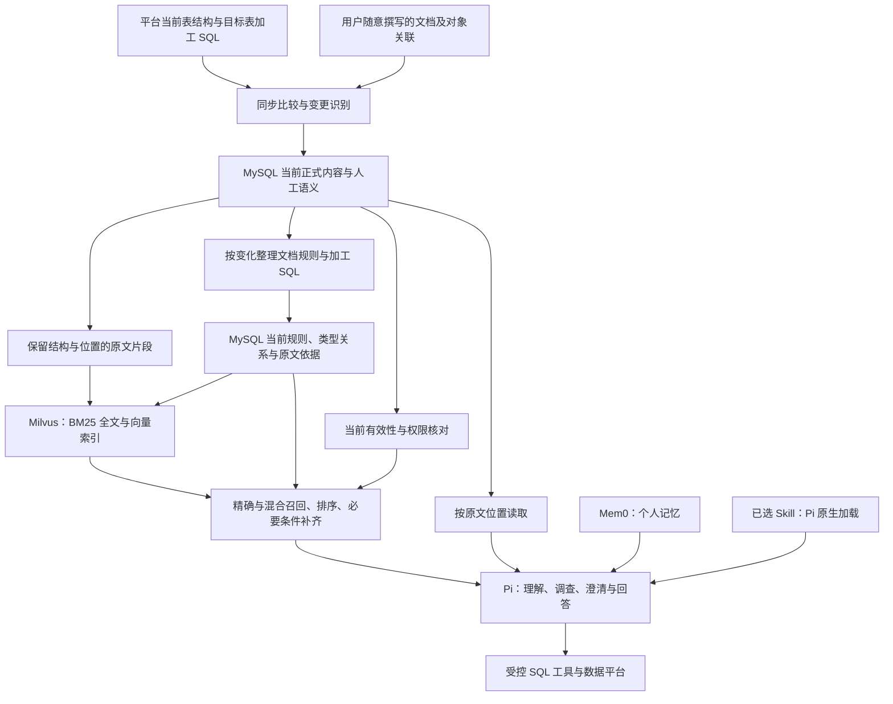
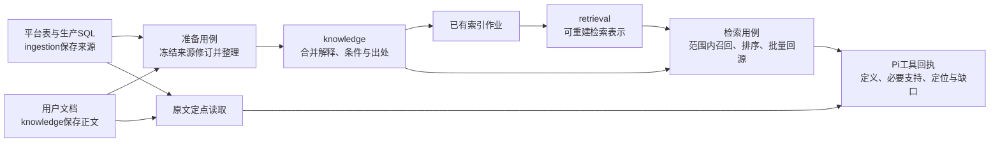
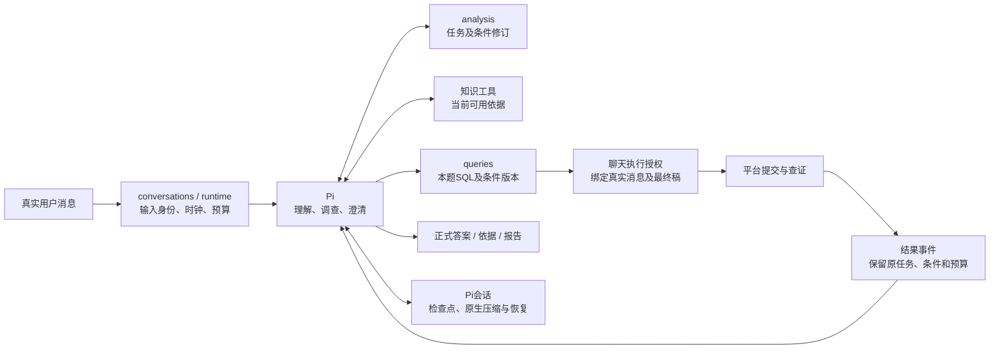

# 语义存储、文档处理与 Agent 检索架构讨论稿

日期：2026-10-22；讨论决定更新：2026-10-23。代码基线：`fed8276`。状态：**研究与讨论，尚未批准实施**。

本稿结合当前源码、本轮座舱 Dogfood 既存报告及官方资料，列出问题、推荐结构和待讨论取舍。本轮没有修改产品实现、配置或数据库，没有运行新的产品模型、检索对照或服务实验；2026-10-23按用户要求进行Oracle外部设计咨询，研究证据集中在第13节。下文的接口、数据结构和流程都是建议，不是已实现能力。唯一当前状态入口仍是 [CURRENT](../CURRENT.md)；本稿保留研究过程；正式目标合同已归入实现设计第17节，已发布边界仍以packages/contracts为准。

**2026-10-23工程设计收口：**模块字段、存储/依赖索引、工具续读、Pi容量及迁移已整理到[实现设计第17节](../architecture/implementation-design.md#17-语义检索与上下文的实施合同2026-10-23)，对应模块图与README同步。本稿下文的“仍需细化”描述该讨论阶段当时的缺口；当前完成范围只看CURRENT。Schema、产品代码和实际配置尚未修改。

**2026-10-23范围更正：**用户明确暂不考虑多个独立作业写同一张表。本轮按一张表、一份完整当前生产SQL设计，不新增多生产者数组、关系表或兼容兜底。下文相关目标与验收已调整；指标的多份查询示例仍是另一类资料。

**阅读定位：**已有产品、模块与接口基线见[实现设计](../architecture/implementation-design.md)；本稿主要调整资料准备、语义组织、检索、依据交付与Pi容量接入。关于哪些保留、哪些调整及三种接口方案，优先读[第15节](#15-原架构保留范围与接口方案复核2026-10-23)。旧推荐和后续修正有历史顺序，当前数据库推荐以第13.5节为准。

## 1. 已明确的用户决定与本稿修正

1. 当前只讨论结构与原因，不实施、不先开展实验。
2. 表、目标表的调度 SQL、语义以**当前有效内容**为中心。同步比较变化，没变不更新；变化后仅处理受影响部分。不能每次同步全库重新解释。
3. 不默认建设保存每版表结构、加工 SQL、文档和语义全文的历史仓库。可以保留稳定 ID、当前修订标记和内容指纹，用来比较变化；修订标记不等于历史全文。
4. 调度 SQL 首先是写入目标表的加工逻辑，与目标表强关联。它提供的 JOIN 是重要参考，但没有调度 SQL 或已知图边，不代表两张表不能 JOIN。
5. 用户可以随意撰写文档，也可以让一篇文档关联多张表、多个字段。不能要求文档预先符合固定模板或有可靠章节结构。
6. Pi 仍是唯一 Agent 循环。个人记忆继续优先复用 Mem0，Skill 继续复用 Pi；本次不是另建 Agent 或记忆框架。
7. 保持每条用户消息 24 次模型调用、连续临时失败 3 次停止的已定范围；恢复、压缩、结果唤醒不凭空获得新的消息额度。
8. 充分利用已选模型的输入、输出和总窗口能力，给推理、工具回执及近期原文留足空间；不能沿用小样阈值把正常调查挤到反复压缩。具体数值仍须匹配实际模型与协议，没有在本轮修改配置。
9. 正常对话不能仅因历史累积变长而要求用户手动压缩、重启或新建会话；自动整理和续接优先复用 Pi。该要求不取消既有调用次数、取消及真实服务故障边界。
10. 自动整理资料的使用边界已确认：录入后默认可用于调查，明确事实与依据充分的推导可以直接用于回答和生成SQL，包括有依据的新JOIN；不逐段人工审核，也不因内容由模型整理或推导就要求确认。模型优先自行补查，只有实质影响结果且补查后仍不能确定的歧义才询问用户。采用的口径记入当前任务，不因一次聊天自动改写公共语义；SQL执行沿用既有授权规则。用户明确要求避免过度保守。
11. 来源冲突的处理已确认：按用户问题及资料的对象、版本和适用范围选择依据，Agent优先自行消解差异；不设人工定义、SQL或最新文档无条件优先的全局顺序。解释现有字段、按业务定义重新计算、复现既有报表分别核对相应依据。只有实质影响结果且无法判断的冲突才询问，保留不受影响的进度，必要时展示不同草稿及差异，不因发现冲突就中断整个任务；本次采用不自动改写公共定义。
12. 分析范围与证据范围的区分已确认：限定分析对象不自动限制支撑资料，Agent可自主读取有权限且与本题必要相关的通用定义、维表和关联规则，不逐次询问。用户明确限定资料来源时遵守该边界，确需扩大才询问。模型推测的业务域通常用于召回/排序，不得自动升为排除其他必要资料的硬条件；不能借补查扩展用户要求的分析目标。
13. 调查完成与范围控制已确认：由Pi中的模型围绕当前问题判断依据是否够用，足以回答或生成SQL就交付；仅针对实质缺口补查，不强制通读全文、穷尽关系或整库扩搜，不自行增加分析目标。定义、粒度、分母、时间和JOIN等是按题判断的参考，不是每题必须执行的固定清单；不新增依据评分器或强制调查流程。非关键缺口可说明限制并交付，关键缺口先自行补查，仍无法确定时具体澄清，或在用户要草稿时明确假设并保留进度。用户特别强调不要无脑扩展范围。
14. 索引异步更新方向已确认：当前原文保存后可读，耗时整理与索引在后台更新，沿用已有任务和有效性检查。针对当前问题涉及的资料，相关内容已变而索引未就绪时可直接读当前原文，相关索引有效时按正常检索路径使用；不因其他对象更新切换整个空间的读取方式。用户接受短暂检索覆盖不完整，不建设双套索引、全局切换或新的补偿框架。此取舍不取消正常异步索引更新。
15. 语义变化跟踪与提醒明确列入暂不做范围：用户最终决定，分析完成后保留当时结果，不继续跟踪相关语义或索引变化，不主动提醒是否按新口径重做，不自动重算或替换旧数字，也不在每轮聊天额外扫描历史依赖。用户再次提出分析需求时，沿正常检索路径读取当时有效的资料；已有权限、版本、来源有效性和执行校验保留。该取舍接受旧结果不会因后续语义变化而自动得到通知，不建设监听、影响分类、任务自动改写/重算、专门提醒流程或全历史库。此决定替代前一轮“发现相关变化后提醒用户选择”的建议，不将暂缓事项偷偷纳入实施或验收。
16. 用户明确本机仅用于验证，未来部署到资源更充足的云端，并要求据此确定方案。此前我们推荐Neo4j统一公共检索；经本次用户要求的独立审计、Oracle及官方资料交叉核对，第13节修正为MySQL保存正式内容和有来源的语义关系、Milvus承担公共BM25＋向量检索。云端前提、Mem0保持Milvus及不做Qdrant迁移均不变。这是审计后推荐，不能把推荐写成用户已经批准实施或已验证性能。

前一版建议需要修正三处：

- 不能把“按标题切块、给章节加关系”当作任意文档的完整解决方案。标题可能缺失或错误，规则可能跨段、跨表格甚至跨文档。
- 不能强制把目前所有文字正文搬到对象存储。关系库可保存当前正式文本；图向量层承担检索。二进制原文件和附件才需要对象存储。
- 不能说现有同步每次都会重建全部语义。现在已有指纹跳过和任务去重；真正缺口是变更粒度、依赖影响分析和跨修订复用。

## 2. 当前实现：哪些已经有，哪些没有

| 能力 | 当前证据 | 准确结论 |
| --- | --- | --- |
| 同步比较 | `ingestion/store.rs` 比较来源 fingerprint；`catalog_import.rs` 跳过未变来源 | 已有“没变不更新”，不是从零建立 |
| 调度 SQL 归属 | `CatalogTable.node`，`ingestion/catalog.rs` 将 SQL 写入目标表的 `etl` | 与目标表绑定正确 |
| SQL 语义生成 | SQL 原文交给预填，结构化结果可选 | 尚不能宣称已有完整 AST 字段血缘、过滤、JOIN 事实提取 |
| 文档多对象关联 | 创建页多选 `KnowledgePicker`，保存 `related_ids` | 支持一文档关联多表、多字段，但主要是整篇级泛化关系 |
| 文档关联编辑 | 单 part 可编辑；历史多 part 聚合文档限制整篇元数据编辑 | 存在旧表示方式造成的产品限制 |
| 字段身份 | ID 由空间、命名空间、平台表 ID、字段 ID 组成 | 物理字段身份独立，不按名称合并，这部分应保留 |
| 结构化语义 | `SemanticStructure` 有粒度、键、关联、指标规则、案例等 | 不是只有裸文本；当前指标结构主要绑定单表，跨表及共同概念表达不足 |
| 语义资料规模 | 合成目录 543 对象：28 表、421 字段、26 指标、14 文档、54 关系 | 规模不大，但文档长、对象装配重；不能由此推断大规模能力 |
| 指标规则覆盖 | 26 指标中 12 个有结构化 metric 定义 | 其余仍有文字/SQL 定义，不能说没有语义；尚未充分结构化 |
| 公共向量检索 | Milvus；专用 `qwen3.7-text-embedding`，1024 维 | 已配置 embedding，公共知识不经 Mem0；本轮失败试用实际用 lexical |
| 文档分块 | 每 360 字符一片、步长 280、每对象最多 128 片 | 未按规则/表格组织，并且长文档存在向量覆盖上限 |
| 词法检索 | 整对象 JSON 的 `INSTR` 匹配，候选先限量再完整装配 | 不是已实现的全文倒排检索；有扫描与重复读取成本 |
| Pi 上下文 | Pi 1.3.0 原生会话、原生压缩；动态事实经 context 扩展注入 | 已复用 Pi。问题在应用交付和限制协调，不是已证明 Pi 无法管理上下文 |
| Skill | Pi `loadSkills`、`ResourceLoader`、`createReadTool` | 已有文本型 Skill 按需加载；不需要再造加载框架 |
| 个人记忆 | Mem0 2.2.1，私有向量 collection，应用保存资产记录 | 与正式公共语义职责不同；不能让个人记忆覆盖公共口径 |

源码入口见第 12 节。本轮没有重新运行这些能力的验收，因此表中区分源码机制与既存运行证据。

## 3. 推荐架构与数据归属

审计后推荐：**MySQL正式当前内容与有类型语义关系＋Milvus全文和向量联合检索＋Pi按需调查**。保留语义图的表达和定向关系展开，本轮不新增Neo4j；具体理由及Oracle意见采纳范围见第13节。个人Mem0保持现有Milvus接入，公共与个人集合继续分离。云端资源不受本机配额限制，但也不以资源充足代替组件适用性判断。没有实测优胜结论，本稿不代表已经获得实施或部署指令。



### 3.1 到底存在哪里

| 数据 | 正式保存位置 | 检索表示 | 写入责任 |
| --- | --- | --- | --- |
| 当前表结构、字段元数据、目标表加工 SQL | MySQL，当前正文及内容指纹 | MySQL有索引的表、字段、作业及派生关系；Milvus检索投影 | 来源同步；人工解释另存，不覆盖原始事实 |
| 当前文字文档 | MySQL，一份完整正文及元信息；搜索不再扫描整个对象 JSON | 可定位的原文块和检索块；Milvus全文和向量 | 用户文档保存入口 |
| 原始二进制文件/附件 | 若产品已有或以后支持这类输入，放对象存储，MySQL 保存引用 | 提取的文本和位置；提取失败区域保留状态 | 文件接入；本轮不据此新增 PDF/OCR 产品 |
| 人工确认的定义、对象关联、适用范围 | MySQL 当前正式语义及关系 | 关系按主体/目标和类型索引；必要说明进入Milvus | 现有语义维护规则 |
| 自动提取的说明、规则和关系候选 | MySQL 保存当前派生成果，带原文定位、必要支持依赖、提取方式与状态 | Milvus检索视图；正式人工维护仍由原入口保存，不阻止有依据的自动成果用于调查 | ingestion 生成，knowledge 按现有语义入口保存；use_cases 组合 |
| 向量、BM25索引、可重建检索块 | Milvus公共集合 | 元数据前过滤后召回；原文最终回源核对 | 索引维护 |
| 用户偏好、个人纠错 | 现有个人资产记录与 Mem0 | Mem0 私有检索 | 现有资产规则和 Mem0 |
| Skill 正文及配套文件 | 当前资产存储，按既定个人/公共生命周期维护 | Pi 元信息目录与按需读取 | 现有资产模块；不借本稿改变 Skill 历史策略 |
| 任务、SQL 草稿、执行回执、对话 | 沿用现有应用和 Pi 存储 | 按任务读取 | 原所属模块 |

Milvus公共集合中可以保存用于检索的片段正文；这是有来源的副本，不是第二份可独立编辑的正式文档。人工修改必须回正式入口，否则重建时会丢失或出现两套口径。语义关系保存在MySQL的结构化记录并建立双向索引，避免用JSON字符串扫描代替关系查询。

模型已经整理出的说明、规则与关系候选也只保留当前有效成果。重建检索索引直接复用这些成果，不重新调用模型从零解释资料。来源、必要支持依赖或明确选择的整理方法变化，才重新生成受影响的成果；“重建检索索引”和“重新理解业务资料”是两种操作。

保留 MySQL 是为了当前正式记录、修订控制与应用事务。不是继续让 JSON 字符串扫描承担公共语义检索，也不要求把图、全文、向量全部模拟成关系库查询。PostgreSQL 也能承担正式记录，但本轮没有证据支持同时迁移整个应用数据库。

### 3.2 必须区分的对象与关系

以下词汇按领域建模技能复核，定义业务含义；存储与模块归属另见第3.1及14节。

| 术语 | 含义与不得混用的概念 |
| --- | --- |
| 物理字段 | 某张表中具有独立身份的字段，带单位、编码、空值、角色、粒度与加工方式；同名不等于同义或同值 |
| 共享概念 | 多个物理字段可表达的共同业务含义；不代表它们的编码、单位或标识空间相同，也不是JOIN证明 |
| 指标口径 | 一个指标在明确适用范围内的统计对象、粒度、分子分母、时间角色、去重和固有排除条件；不能用一个名称抹平不同口径 |
| 本题条件 | 用户本次分析选择的时间、过滤与分组；“最近七天、只看弱网”通常不意味着创建新的公共指标 |
| 指标查询示例 | 实现一个或多个指标口径的参考SQL及适用说明；同口径可以有不同数据路径，SQL能运行不代表适用于本题 |
| 计算关联 | 查询示例的哪个输出列或表达式计算哪个指标口径；与只参考指标定义、用指标过滤等普通依赖不同 |
| 生产SQL | 从已有数据写入目标表的加工逻辑；本轮一张目标表对应一份完整当前SQL；内部CTE/子查询不是独立生产来源 |
| 文档绑定 | 文档与表、字段等对象的相关线索；不代表文档里的每条规则都适用于全部绑定对象 |
| 语义陈述 | 针对对象、带完整适用条件的定义或约束，可由一处或多处原文支持；条件、例外和推导性质不能被拆散后改变含义 |
| 必要支持 | 某条陈述成立或正确使用必须具备的出处、前提及例外；普通相关链接不自动成为必要支持 |
| 加工血缘 | 作业的写入目标、字段输入及表达式来源；加工中观察到的JOIN只证明其原上下文下的用法 |
| 分析可用关联 | 当前问题有依据可采用的连接方式，需考虑键、时间、粒度和匹配数量；不要求先在生产SQL中出现 |

同名字段是同义候选，不是等价证明；异名也可能同义。共同指向“语音轮次标识”的两个字段仍各自保留主键/外键角色。共同概念不能自动授权 JOIN，也不能证明 JOIN 后不会重复计数。

“首次成功率”与“最终成功率”是不同口径；明细计算和日汇总计算则可能是在适用范围内实现同一口径的两条路径。优先沿已有指标、规则陈述和`term`表达，不因此新增“指标家族—变体—实现”等多层实体体系。latest-only允许当前有效资料同时描述多个有明确范围的口径；它限制历史全文保存，不要求每个名称只能保留一个无条件定义。

## 4. 表和加工 SQL：一次整理、按变化更新

### 4.1 同步与问答分开

同步路径负责比较、解析与准备可复用知识。问答优先使用已整理的规则和关系；只有细节未覆盖、来源变化、存在冲突或需要核实时，才回读相关 SQL 原文。

本轮沿平台表稳定身份和既有单节点关联保存一份完整当前生产SQL；节点ID为来源属性，SQL内容hash用于比较变化，不作为对象身份。SQL更新仍属于同一张表的生产逻辑；分段理解时保留CTE、子查询和多层计算依赖，不能把切出的片段当成多个独立生产者。现有单node形状符合本轮范围，多作业写同表及其兼容逻辑明确暂不做。

```text
读取平台当前来源
  → 按稳定对象 ID 对比内容
  → 内容未变：复用当前语义与索引
  → 内容变化：替换当前来源，定位变化项
  → 找出受影响的字段、规则、指标与解释
  → 重算受影响派生项，保留未受影响内容
  → 更新当前图关系、全文与向量
```

指纹要按用途拆开：DDL/字段定义/注释/SQL 等语义内容，与维护者、采集时间、平台整体版本分开。维护者变化可以更新归属，不应迫使模型重新解释全部字段。

### 4.2 SQL 处理的产物

同一目标表、同一 SQL 内容的解析与解释可以供多个字段共用，不让每个字段独立从零通读一遍。

| 产物 | 应保留的信息 |
| --- | --- |
| 写入关系 | 调度节点、目标表、写入方式和必要分支 |
| 字段加工 | 输入字段、表达式、类型/单位转换、原文位置 |
| 过滤与粒度 | WHERE/HAVING、GROUP BY、窗口、去重、UNION 分支及有效条件 |
| 加工 JOIN | 左右对象、实际条件、关联角色、原文位置；不自动等同通用查询关系 |
| 业务解释 | 依据哪些加工事实和文档，哪些已明确、哪些为推断 |
| 缺口 | 未支持方言、动态 SQL、缺失依赖、无法确定的业务含义 |

SQL 解析器只能证明它成功解析的语法和结构，不能单独证明业务意义、真实数据唯一性或运行时结果。模板变量和方言无法解析时保留原文及缺口，不凭空生成确定图边。

### 4.3 更新影响的具体例子

| 变化 | 建议影响范围 |
| --- | --- |
| 只改负责人 | 归属信息；不重做 SQL 解释或 embedding |
| 改一个字段注释 | 该字段及依赖这段解释的语义 |
| 改一个输出表达式 | 对应目标字段及依赖其计算的指标 |
| 改 WHERE、GROUP BY、去重或 JOIN | 可能影响整张目标表的粒度、覆盖和多项指标，不能只看改了哪一行 |
| 新增无关字段 | 新字段及确实受它影响的关系；原字段不默认重建 |
| 无法可靠确定差异影响 | 重建该 SQL/该表的相关派生物；不猜测“无影响”，也不扩大到全库 |

人工覆盖不能被新预填覆盖。受影响的人工定义保留并标明需复核；未受影响的人工定义继续使用。依赖计算应复用同一套来源语义，避免“失效检查”和“重建调度”各自认定不同依赖。

### 4.4 只保留最新内容怎样与任务续接衔接

以下说明latest-only与已有任务记录的边界。2026-10-23用户最终明确保留已完成结果，语义变更的跟踪、主动提醒和自动重算均列入暂不做范围；再次分析沿正常检索与既有校验处理。前一轮“发现变化后提醒用户”的建议已撤回，不据本节重新引入。

- 保留当前正文、稳定 ID、当前修订标记及内容/依赖指纹；不因要比较变化而永久保存每版全文。
- 已有任务、查询 SQL、条件、执行身份和结果仍由其模块保存。这些不是公共语义历史全文库，不在本决定中删除。
- 未变化依赖可以继续使用；变化后的旧引用不能偷偷解析成新正文，冒充当时的依据。
- 受影响的上下文重新核对，通过 Pi 的会话能力处理失效材料；不把整段对话和所有任务一概丢弃。
- 已提交查询按原身份查结果，不能因语义变化重做。旧答案不会自动被新口径改写成另一组数字。
- 选择 latest-only 后，不承诺任意历史版本的原始文档/加工 SQL 都能全文重演。这是明确取舍，不以此为理由重新引入全历史库。

当前实现确有 `source_snapshots`、`catalog_table_snapshots`、`knowledge_versions` 历史全文。未来切换需要明确迁移方案；本轮只记录新方向，不删除数据。

## 5. 任意写法文档：原文、切块与语义整理

### 5.1 不能依赖理想文档结构

用户可能粘贴没有标题的长段落，夹杂表格、SQL、旧口径、修订说明、例子、多个字段和跨段指代。结构解析能帮助定位，但无法保证自动理解全部业务规则。

因此保留两条独立可用的路径：

1. 原文的全文/向量搜索与按位置读取，不以语义抽取成功为前提。
2. 基于有来源的概念、定义、限制、例外和关联进行查询与补齐。

图可以改进第一条路径；不能让图抽取遗漏变成原文无法检索。

### 5.2 四种表示，不是四份可编辑文档

| 表示 | 含义 | 位置与身份 |
| --- | --- | --- |
| 当前原文 | 用户实际提供的完整材料 | `document_id + current_content_hash`，保留原始文字 |
| 原文块 | 有位置的段落、句子组、列表、表格、代码或其他可解析范围 | 关联原文偏移/行号；保留顺序、类型及可靠的父子结构 |
| 检索块 | 为全文/向量检索组合的一个或多个原文块 | 引用原文块；可带必要表头、标题和上下文说明；可重建 |
| 语义断言 | 某段材料表达的定义、条件、例外、别名或关系 | 必须带来源范围、对象候选、适用条件、依据类型和状态 |

“语义断言”只是本稿对可定位规则的称呼，不要求新增一套通用推理系统。它不能代替原文。模型生成的片段背景说明只帮助召回，不作为新事实引用。

### 5.3 如何切块：按材料情况处理

| 文档情况 | 处理方法 | 不应做的事 |
| --- | --- | --- |
| 有可靠标题/列表 | 保留结构，按完整段落和列表项组合 | 把每个标题都当作正确业务范围 |
| 没有标题、只有连续文字 | 保留顺序，优先句子/段落边界；可生成辅助主题分组 | 凭模型生成标题把后面所有内容归到同一对象 |
| 超长单段、多主题混写 | 允许按句子分割，保留相邻位置和完整父范围；语义映射可以跨块 | 固定字符切开后丢掉前后指代 |
| 公式及变量说明 | 关联公式、变量定义、适用条件和分母规则 | 仅把公式向量化，忽略约束 |
| 大表格 | 保留行列结构，拆成行组时携带表头、单位和行标签 | 每几百字硬切，造成列和值错配 |
| SQL/代码 | 保留代码边界、行号、语句/表达式范围，关联说明 | 将中间几行当成完整加工逻辑 |
| 原文很短 | 保持完整，避免不必要碎片 | 为统一尺寸硬拆 |
| 无法可靠解析的内容 | 保留原文和可读范围，注明未提取范围 | 上传成功就宣称全内容可检索 |

块大小受 embedding 和生成模型能力影响，不能在未验证前把一个固定字符数当作语义规则。重叠只缓解边界切断，不能解决相隔很多段的例外。

现有文本/Markdown优先使用格式解析和有位置的文本分段。若以后需要复杂文件解析，Docling 等可以复用文档元素、表格及位置能力；其结构分块不等于业务语义完全正确。此次不新增上传格式或 OCR 产品范围。

### 5.4 文档关联只是起点，怎样定位到字段

用户把整篇文档关联 A 表、B 表，首先保存为 `document relevant_to object`。它可以帮助排序和缩小解释候选，但不能证明每一段都同时适用于 A、B。

细化时综合以下证据：

- 完整表/字段标识、字段清单和代码中的明确引用。
- 所在段落的主语、可靠标题、表格列头与相邻解释。
- 已确认业务术语、目标表加工事实、字段的类型/单位/角色。
- 用户给的文档级关联，作为线索而非唯一归属。

结果可以是一段解释一个对象、多段合起来解释一个对象、一段分别解释多个对象，或暂时无法区分多个候选。不得因为相关 ID 列表里有两个表，就复制两份同样的规则给两表。

自动整理可形成 `explains`、`constrains`、`exception_to`、`defines`、`mentions` 等有含义的关系。关系具体如何编码留待实现契约，不用字符串 `related_to` 掩盖所有含义。归属不明就保留候选，原文仍可查，不要求用户逐段审核才能使用。

明确原文可直接作为调查依据；自动推断的扩展含义须标明推断。正式人工维护的口径按已有权限入口保存。文档和加工冲突时同时呈现依据，不按最后写入时间或向量分数自动决定谁正确。

### 5.5 前提、例外与跨块指代

仅靠“父章节”不够。建议在语义整理时建立已发现的定义—条件—例外—引用关系；问答检索时还保留针对当前对象的补查路径，以抵消抽取遗漏。

例如原文分散写着：

```text
成功率按最终结果统计。
……
这里的结果指轮次结果，重试过程中的失败尝试不能重复计入分母。
……
首尝试指标除外，其统计单位是首次尝试。
```

不能只返回第一句。命中它后，应组织“对象是轮次、分母去重条件、首尝试例外”的原文依据。如果最后一句没有被抽成图边，仍应能通过对象/别名的全文或向量检索找到。

补齐方法包含：已知依赖边、明确文内引用、相邻原文、针对同一概念的其他匹配段落。可依据问题在允许范围内搜索过滤、排除、时间、版本、例外和冲突，不把若干中文关键词当作穷尽规则的证明。

**能检查“可解析原文是否全部进入索引”，不能证明“所有业务规则都被模型正确理解”。** 返回已覆盖内容、已知冲突与未展开范围，不提供假的“语义完整 100%”。

### 5.6 文档的增量不能只比较每块文字

以下变化会影响未改文字的含义：

- 文首从“全部版本适用”改成“仅 A 版本适用”。
- 表头从“毫秒”改成“秒”，数据行没变。
- 段落移位使“上述字段”指向不同对象。
- 文档绑定改变，使同名字段的候选归属发生变化。

因此派生物要依赖正文、继承范围、表头、必要上下文和相关语义，而不仅是本块字符串。文本向量若加入了背景说明，复用键也应包含实际 embedding 输入及模型/解析配置指纹。

无影响的向量和语义复用；影响不确定时重新整理该文档的相关范围，必要时整篇派生层重建。单文档重建不等于全库重建。新正文发布后，旧索引不能冒充当前索引；构建中的临时内容不作为永久历史仓库。

索引更新期间，当前原文仍可按 ID 读取，精确对象及用户关联目录保持可发现；搜索回执明确索引处理中或覆盖不全。不能把过滤旧索引后得到的空结果解释为资料不存在，也不恢复整库 JSON 扫描来伪装完整检索。

### 5.7 异步更新采用简单方案

用户已同意正常索引异步更新，进一步明确低概率更新窗口的专门处理暂不建设。保留三件常规工作：

1. 保存当前原文，沿既有事务/job机制安排后台更新；原文读取不等待昂贵的模型整理或embedding结束。
2. 复用已有内容修订、依赖检查和索引状态，保持旧任务不能覆盖新内容、未完成不冒称已完成；不移除当前权限和有效性约束。
3. 失败沿现有重试或重建入口处理，接受更新期间检索短暂不完整。本题涉及的索引未就绪时按现有能力读当前原文，未受影响索引照常使用，不要求聊天新增智能降级或自动等待恢复流程。

早先对更新窗口的详细降级建议仅保留为讨论背景，不是本轮实施或验收清单。不建设双套索引、全局切换、跨库分布式事务、新消息总线、全局版本库或补偿平台，也不为保证每个在途问题无缝继续新增机制。正常索引构建的可靠性仍需做好；专门处理低概率窗口则按用户决定暂缓。

## 6. 查询链路：如何找到、排序并拿到合适信息

### 6.1 由 Pi 表达意图，检索模块执行查询

Pi 仍决定调查什么、什么时候补查和是否澄清。检索模块实现可重复的查找、融合、去重和依据组织，不另建隐藏的自主规划循环。普通精确定位无需每次多调用一个模型做查询改写。

检索输入应能表达：问题文本、已明确的对象、用户限定的范围、当前采用的口径/时间条件。身份和可读范围由宿主绑定，不能由模型自报。推测的业务域只是相关性线索；用户明确限定的范围和权限才是硬边界。

多轮输入的指代、条件继承、纠正与换话题主要交给现有 Pi 中的大模型。应用提供相关会话和当前任务条件，不为每条消息另跑一个问题重写模型，也不另造分词、指代和意图识别流水线。全文分析器及向量模型的 tokenizer 负责检索表示，不能替代对话理解。

例如“看9月轮次成功率”→“只看弱网”→“按版本拆一下”，Pi 应结合当前任务形成完整查询；后续“改成10月，别限定弱网”要替换月份并移除过滤。换成“首尝试成功率”时重新核对粒度和分母。多个任务之间“这个也拆一下”确实无法归属时才澄清。上述为期望行为，尚未据此运行新验收。

现有 `update_analysis_task` 已支持条件 set/unset，`read_analysis_task` 和 `read_conversation` 能补读条件、任务目录与原话；应继续使用。检索表达不替换用户原话，也不把模型推测升级成已确认口径或执行授权。临时任务条件不放进个人长期记忆；不将整段聊天拼成向量查询，也不只拿最后一句省略表达检索。

### 6.2 多路召回与排序

| 步骤 | 处理方式 | 解决的问题 |
| --- | --- | --- |
| 精确定位 | 稳定 ID、完整表字段名、已确认且有范围的别名 | 用户明说对象时不依赖近似匹配 |
| 全文召回 | 中文与标识符兼容的全文索引，检索原文和正式定义 | 精确词、缩写、单位和公式不易被纯向量遗漏 |
| 向量召回 | 对原文检索块、必要概念说明检索 | 自然表达、同义改写 |
| 融合 | RRF 等排名融合，不直接相加不可比的原始分数 | 合并不同通道 |
| 精排 | 对问题与候选进行语义相关性排序；可采用独立 reranker | 区分“提到某指标”与“真正解释本问题” |
| 归组去重 | 同一规则/近重复块归组，保留不同来源与冲突 | 长文多片挤占候选、重复证据 |
| 依据补齐 | 加入所选定义的必要条件、变量、例外和关联路径 | 避免 top-k 只保留公式而丢失限制 |
| 当前核对 | 批量核对最终候选来源、权限、内容修订 | 不逐个装配全部候选，也不让旧索引绕过有效性 |

精排模型是建议能力，尚未选定或测试。它只排序，不能裁决业务冲突。精确命中、用户已选口径及硬范围不被一个黑盒分数覆盖。

候选过滤和核验分阶段进行：候选正文进入外部精排模型之前，先核对当前可读性、来源有效性与该端点可接收范围；最终交付 Pi 前再检查当前状态。表中的最终核对不能被理解成“先把旧内容发送出去再判断是否可用”，沿用已有应用边界即可。

取消按对象种类机械补齐的思路：相关的四个字段可以都返回，不必挤出位置放一个弱相关文档。必要关联和规则按当前问题补齐，不是固定补两个关联对象。

候选要在检索引擎中按相关性取得，再批量读取必要元信息和最终少量正文；不能按数据库 ID 先取前 1000 个匹配对象并完整装配后才排序。过滤应尽可能进入召回阶段，最终再回源核对；单纯召回后过滤可能只剩几个结果，且无法代表范围内没有其他答案。

### 6.3 返回“依据组合”，而不是满屏对象 JSON

“依据组合”指同一问题所需的相关原文与结构信息，不是模型自由生成的一篇新总结。示意：

```json
{
  "subject": {"object_id": "metric-example", "current_revision": "r7"},
  "meaning": "轮次成功率",
  "definition": {"text": "原文中的定义", "source_span_ids": ["s12"]},
  "conditions": [
    {"text": "原文中的分母条件", "source_span_ids": ["s38"]}
  ],
  "alternatives": [{"meaning": "首尝试成功率", "object_id": "metric-other"}],
  "conflicts": [],
  "unexpanded_source_refs": ["s41"],
  "coverage": {"index_state": "current", "omitted_relevant_content": true}
}
```

示意不是最终 schema。`current_revision` 用来识别当前内容，不要求保存 r1–r6 全文。未展开内容有读取入口；不能只留下“更多内容”而没有定位。没有结构化定义时直接返回原文片段与候选归属，不以空字段伪装无规则。

首次返回可以给少量高相关对象，但必要条件不能因普通截断从定义中脱离。确实无法一次容纳时，返回明确的未展开引用，Pi 按需补读；不把所有资料全文塞入一次回执。

### 6.4 图查询应补什么、不应推断什么

围绕当前对象查询有业务含义的关系：字段属于哪张表、表达哪个概念、由哪段加工产生、指标依赖什么、文档哪里定义或限制它。

不能无差别扩展所有两跳邻居。图中的关系存在不代表当前问题需要它；图中没有关系也不代表不允许调查。JOIN 路径必须携带键、角色、粒度、时间和去重条件；候选路径可以由现有键与业务语义发现，不依赖调度 SQL 白名单。

用户问单字段解释时不必展开整条生产链；问跨表指标时才补必要路径。这种按需投影比“把整张知识图交给模型”更符合上下文与正确性要求。

### 6.5 指标与获取指标的 SQL 示例

用户补充：指标通常除了语义解释，还带有获取该指标的 SQL 示例。指标的完整资料应包含业务定义、计算口径及可用的查询示例；不能只有自然语言解释或一个孤立公式。生产 SQL 解释目标表如何生成，指标查询 SQL 解释如何从已有数据计算指标，两者分别关联、按问题使用，不能相互冒充。

当前并非没有指标 SQL：座舱合成目录的26个指标均有非空 `entries[path=sql]` 计算SQL条目；独立 `query_example` 契约也已存在，其依赖可引用指标，搜索范围可据 `related_object_id` 查关联示例。但读取指标不会自动反向展开独立示例。此处核对的是资料与源码，未运行新的功能验收；后续应统一现有两种入口的发现与按需读取，不重复建设。

复用现有 `query_example` 的问题、参数、SQL、粒度、依赖和验证说明，不另建一套示例库。设计上明确示例与指标的关联：一个指标可有多份示例，例如从明细计算或从日汇总计算；一份 SQL 也可能返回多个指标。每份示例保留适用条件、数据来源及已有验证状态，不能只凭关联到同一指标就认为可以互换。具体引用字段在实施时沿共用契约演进，本节不宣称当前已经实现完整的指标到示例交付。

需要区分“计算关联”与普通依赖：一份SQL输出首次与最终成功率，并用样本量过滤，三个定义可能都是依赖，但该SQL不一定输出样本量指标。查询示例应能将具体输出列/表达式关联到所计算的口径；现有`dependencies`并没有表达这个角色。自动整理无法确认时保留原文与未确定项，Pi仍可据原SQL判断，不把完整结构化映射作为资料可用的前提。

示例直接录在指标中，或嵌在随意文档里，都应能通过原文位置关联到指标。用户不必重复录入；整理出的示例保留唯一正式来源和当前修订，不形成两份需要分别维护的 SQL 正文。参数、方言、依赖表字段、粒度、时间与去重条件应能从原有说明和 SQL 中取得，必要的口径引用指标定义，不要求用户手工重复填写所有解释。

检索到指标后，工具应能发现其相关示例，并按本题的时间范围、维度、过滤、数据来源和方言选择可用参考。只问指标含义时不强制展开全部 SQL；需要生成查询时，交付选中示例的完整计算逻辑及必要条件，不能截掉 CTE、去重或分母片段。未展开示例保留可定点读取的引用，不机械返回全部示例，也不因普通类型配额丢掉本题需要的示例。

Pi 可以据示例调整参数、增加维度、组合有依据的关联，并沿现有 SQL 工具核对和执行。示例运行成功不等于适用于本题，也不新增执行授权；示例与当前口径矛盾时沿已确认的来源冲突规则处理，不设 SQL 示例无条件优先。没有示例时仍可按语义与表结构生成 SQL，不将示例变成调查前置条件。

## 7. 与 Agent、Pi 上下文和 Skill 的交互

### 7.1 优先演进已有工具

| 工具 | 建议职责 |
| --- | --- |
| `search_knowledge` | 返回相关对象、原文片段、必要规则、歧义候选、来源与未展开范围 |
| `read_knowledge` | 按对象、原文范围/块、规则组读取；保留原文定位和当前内容检查 |
| `read_source` | 在必要时读取原始 SQL/DDL/文档位置，不要求每题重读完整 SQL |
| `read_analysis_task` / `update_analysis_task` | 保存已采用的业务范围、时间/快照与口径，避免每次从历史猜 |
| 原有查询工具 | 保存、校验和执行 SQL；不让图检索替代真实平台执行 |

暂不新增十几个固定步骤工具，也不把用户流程固定为必须依次调用所有工具。新字段和读取语义在实施前通过同源契约明确，不在研究稿里承诺接口已兼容。

补充工具审计：现有搜索、同版原文分页、结构分页、任务增修/读取、会话原话补读、SQL校验/执行、结果行/统计/单元格、依据/报告和原生 Skill 读取已覆盖主要能力。主要缺口在资料交付合同，而非工具数量：

- `retrieval/excerpts.rs` 要求命中后从 offset=0 分页读取完整条目；任意长文往往整篇就是一条。这将“补齐必要规则”变成通读长文。应让相关定义、前提和例外可一起定位，保留按需扩读；不能仅删提示而放任遗漏例外。
- 搜索和结果页分别有24 KiB、23 KiB实际JSON预算，知识页却另带结构及元数据，任务读取还可能返回很大的合法条件。工具参数的字符 `limit` 不等于完整回执字节；目前并无统一的完整回执容量合同。极端条件风险已从代码确认，未证明其就是本次超限的触发项。
- 词法片段按命中词附近360字符截取，每对象最多3片，不保证跨段公式与限制同时出现。需要从文档组织和检索交付补足，Pi 无法在摘要中找回从未读到的条件。
- 搜索已有种类、业务域和关联锚点过滤；多轮条件主要由模型带入调用。这不是必须新建工具的证据，应通过当前任务事实与清晰参数支持模型，后续验证条件增删、跨任务及压缩续接。

### 7.2 三类上下文

1. 稳定规则：工具与系统规则，避免每轮把整个知识库描述加入。
2. 当前任务事实：本题对象、明确采用的口径、时间范围、数据快照、查询状态与必要引用。使用现有动态 context 注入，不重复拼到系统提示前部。
3. 按需依据：检索和读取工具提供。Pi 会话保留已读内容，压缩由 Pi 原生能力负责。

任务中要分开保存业务统计期间、数据可见截止点、加工/数据批次范围和当前系统时间。当前时钟不能自动替代数据快照；没有来源的快照不能由测试答案补入。

压缩后可通过任务中的已采用条件和引用补回必要依据，不另建压缩器或无限扩大工作区。没有变化的依据不主动重复灌入；来源失效时通过已有应用核验与 Pi 会话接口处理，不能让旧摘要继续冒充当前事实。

### 7.3 上下文限制单独修正

这里必须分清字节与token，也必须分清请求体上限、总窗口、输出上限及压缩后保留目标。**128 KiB是131072字节；代码里的最低128 tokens是压缩后近期原文保留目标，是完全不同的参数。** 本轮没有将任何设置调小或调大。

| 项目 | 当前核实事实 | 应如何处理 |
| --- | --- | --- |
| 供应商窗口与输出 | 官方当前 `deepseek-flash` 标称1M窗口，最大输出384K（API明确393216 tokens）；输入与生成合计受窗口约束 | 按实际端点/型号登记能力，不能把输入和输出分别用满总窗口 |
| 仓库默认配置 | input=65536、output=8192、payload=131072字节；与既存Dogfood相符 | 默认明显偏紧；不据此声称已经查询运行中数据库的配置 |
| Pi窗口接入 | `configured.ts` 把 `profile.input_limit` 同时当作 `contextWindow`，该值又被用作应用输入限额 | 区分模型总窗口与输入策略；所有预检、统计和Pi使用同一容量含义 |
| Pi压缩配置 | 应用固定reserve=2048，keepRecent=256/2048，还会按字节余量降至128；锁定SDK默认分别为16384/20000 | 应随模型和任务规模给充足余量，不能仅提高窗口而保留原来的极小尾部目标 |
| 摘要输出接入 | `controlled.ts` 在SDK options之后强制写 `maxTokens=profile.output_limit`，旧路径还改写payload | 尊重SDK针对该次请求选择的合法输出值；不能误报实际摘要只有1638 tokens，也不能无条件抬成普通回答上限 |
| 管理配置范围 | 当前可配输入至2000000、输出至131072、请求体至8388608字节（8 MiB）；旧无配置引用profile另有小范围约束 | 65536/8192/128 KiB是默认，不是所有模型不可变上限；若用393216输出还需调整契约/UI，不能只改一个配置值 |

建议以官方完整窗口为能力基准；输出空间按思考档位充分开放，官方当前thinking默认64K、max档128K可作为讨论起点，最大384K能力不应被错误描述为不支持。设置上限不等于强迫生成到上限。实际默认值尚未冻结，需同时考虑长SQL、长报告、推理与回答共用输出空间，而非统一沿用8192。

传输字节限制应按完整JSON载荷和端点实际能力设为相容的MiB级空间，不能让128 KiB继续冒充大模型窗口。8 MiB只是现有管理配置可达范围，不是已验证的所有端点通用值。近期原文保留目标也应上调到能容纳完整调查工作集的量级；压缩预留需覆盖实际输出、临时资料及估算误差。具体值与模型一起确定，不按固定字节/token比例声称精确容量。

**自动整理与继续对话的责任：**

1. Pi 1.3.0已有原生阈值压缩，按 `contextWindow-reserveTokens` 判断；已有完整会话恢复，继续使用同一会话，不要求用户新开对话。
2. 当前自定义 `request_too_large` 已被锁定Pi识别，并接入一次原生compact-and-retry；此前“Pi能否识别”的疑问可撤回。现有问题是过早、反复触发及仍可能无法恢复，不能描述成完全没接自动压缩。
3. 正常历史累积应在发送前自动整理。应用仅在必要边界补上实际资料/传输容量的薄预检，调用Pi原生接口；不另造摘要器、循环重试或固定对话轮数。预检需考虑系统/工具定义、动态工作区及本轮工具回执，不能只看上一请求的历史usage。
4. 单个工具回执过大时，历史摘要不一定能解决：当前完整工具组可能就是大头。工具应提供可续读的相关内容、必要规则和来源定位，避免把整篇长文连续灌入后才补救；不能为了不报错静默删关键依据。
5. 压缩前后任务条件、已采用口径、时间/快照和依据引用仍可恢复；这类业务事实由现有任务工具保存，Pi继续负责历史摘要。是否保留充分必须用真实多轮行为验证，不能仅检查出现了compaction事件。

期望用户体验：在既有调用额度与有效资料范围内，正常累积、多轮调查和工具读取不因上下文变长而停摆；用户无须手动压缩或重开。单条原始输入本身超过真实模型能力、供应商故障、用户取消及既有24次额度耗尽仍须如实处理，这不等于允许普通历史超限直接失败，也不引入无限重试。提高窗口不会给原消息新增调用额度。

后续验收应观察连续任务在多次自动压缩后仍继承正确条件、回读必要依据、不重复成功操作，并在追加大工具回执时提前安排容量；同时覆盖供应商意外超限后的原生恢复。当前仅定义行为，未开始实验。

### 7.4 Mem0 与 Skill

个人偏好和可复用纠错继续由 Mem0 帮助提取和检索。正式业务定义、共享指标与文档关系由公共语义层管理，不以个人记忆自动覆盖。

个人/公共 Skill 使用相同内容包形式，差别在所有权、发布与选用规则。当前已复用 Pi 元信息目录和按需读取；保持这一方向。新增图检索不应把所有 Skill 全文或所有个人记忆一起放进每次请求。

## 8. 本轮 Dogfood 问题完整清单

证据来自 `.local/dogfood-runs/voice-cockpit-20261022/` 的既存 `FINDINGS.md`、`AUDIT.md` 和 `audit/`。这是合成业务数据、平台 mock、真实模型试用；不把它表述为已验证真实生产平台表现。私有日志不复制进本稿。

### 8.1 原报告 F1–F9

| 编号 | 复核结论 | 根因归类与修复方向 | 证据边界 |
| --- | --- | --- | --- |
| F1 文档重复 | 部分确认：展示多出标题/引言，非全部正文两遍 | 工程：修正文档展示组合，厘清完整文档与历史 part | Agent 不走此展示函数，不能用它解释上下文膨胀 |
| F2 VAD/ASR 零召回 | 撤回原结论：真实接口能返回，精确表名首位正确 | 试用器探针仅取目录前页、模拟排序失真；修探针 | 不能因此宣布检索质量良好，慢检索独立成立 |
| F3 快照变成当前时钟 | 确认，S07/S09 同 SQL 只改快照可恢复正确结果 | 语义结构＋上下文交付＋模型取舍：明确时间角色，相关规则一起交付，已选条件持久保存 | S07 曾见正确快照仍选错；不能全部归咎模型，也不能硬编码案例日期 |
| F4 worker 退出 | 确认 MySQL OOM 与 worker/启动器退出 | 环境容量＋工程恢复：优化压力，处理顶层临时存储错误，保持原操作身份 | `jobs::defer` 的具体归因不准确；不能把所有早期 HY000 都算 OOM |
| F5 缺 carol | 环境前置缺失，非已证明产品故障 | 补试用角色与正确环境预检 | G02/G04 权限能力尚未完成验证 |
| F6 已明确月份仍不出 SQL | 确认交付不足 | 模型/交互策略：已明确问题可以给草稿并说明无覆盖，只澄清影响口径的缺项 | 题面只要计数，验收额外要求比例 NULL 不成立 |
| F7 检索阻塞续租 | 高置信机制成立 | 工程事务：耗时读取不占续租同一行锁；优化检索和批量装配，回写核对运行身份 | 不能说任何工具超过 15 秒都必然失败；未逐一归因所有案例 |
| F8 错误退化 | 确认取消及部分模型错误被泛化 | 工程契约：保留取消、临时故障、上下文和额度等分类，恢复及提示使用真实原因 | 不是所有 unexpected_error 都是取消；补白名单不等于恢复全正确 |
| F9 结果解释共用预算 | 共享预算是既定要求，不作为缺陷 | 保留 24 次范围，减少前序无效检索/压缩/重试；准确告知终止 | 结果解释耗尽预算的事实成立，不能给系统消息另造额度 |

### 8.2 原 F 清单之外的产品与语义问题

| 问题 | 已知事实 | 推荐处理 |
| --- | --- | --- |
| 上下文反复超限 | 36 个匹配日志去重后有 83 条超限事件、97 次压缩、5 条额度耗尽；不是付费失败次数 | 协调字节/token限制、工具依据投影和 Pi 原生压缩 |
| 检索慢 | 既存真实接口单次 22.089/24.789 秒；SQL JSON扫描、排序前完整装配和重复依赖读取存在 | 倒排＋向量召回、批量读取、晚装配、缩短事务；不让新图库掩盖旧锁问题 |
| S03 同名 locale | 会话与轮次字段角色不同，题面没有指定；参考答案暗含选择 | 共同概念与字段角色分开；有默认用默认，无依据时允许澄清 |
| S05 无唤醒 | 无声学唤醒与无记录不等价，存在 button/continuous 合法路径 | 澄清业务概念和案例表述；不能把合法绕过说成数据故障 |
| P06 长文读取 | 轨迹有续读；仍需核对本题所需规则是否读齐 | 用必要依据与结论核对，不以全文是否读完作为唯一标准；暂不改判通过 |

### 8.3 新研究发现的设计缺口与风险

| 问题 | 已确认的机制 | 影响与建议 |
| --- | --- | --- |
| 文档向量覆盖上限 | 单对象 128 片；96,116 字符正文只能覆盖前 35,920 字符 | 这是向量索引覆盖缺口；整篇分批索引，不用总片数截掉尾部 |
| 文档关联过粗 | `related_ids` 为整篇级泛化关系，不能说明某规则作用于哪个字段 | 原文定位＋具体解释/约束关系，保留歧义 |
| 固定字符切片 | 360 字符、步长 280，不识别完整公式/表格条件 | 保真块与检索块分开；有结构用结构，无结构保顺序和补读 |
| 更新粒度粗 | 来源包含整体平台信息；表变化可重分析所有字段 | 内容/归属分离，按依赖定位变化；跨修订复用未变 embedding 输入 |
| 重建依赖不完整 | 变更调度与来源有效性检查使用的依赖集合不完全一致 | 同源依赖定义，区分“已判失效”和“已更新完成” |
| SQL成果未充分结构化 | 原文预填与可选结构结果为主 | 共用 SQL 解析/解释成果，字段/指标按需投影 |
| 候选排序前截断 | 词法通道先按 ID 等取最多 1000；向量先取 200 片再对象去重 | 有潜在召回偏差；本轮没有大库效果证据，改为检索引擎相关性候选 |
| 范围过滤偏晚 | 向量预筛部分字段，domain/anchor主要回源核对 | 可能让其他域占候选；要兼顾召回前过滤与最终有效性 |
| 类型补齐排序 | 已保前三，但仍按类型补位 | 不重报旧“前三被挤掉”缺陷；进一步按问题相关性与必要依据组织 |
| 指标/共同概念表达 | 部分指标缺结构定义，metric结构主要绑定单表，暂无明确共享概念映射 | 完善粒度、分母、时间角色、关联与多义概念，不靠提高模型规格补缺失事实 |

这些机制中有的是确定缺口，有的是尚未量化用户影响的风险。不能把全部写成已发生的答案错误，也不能声称换图向量库会全部消失。

### 8.4 试用工程与报告问题

- 脚本执行完就写 `ok:true`，即便全部 Agent run 失败；应分别记录脚本、Agent、SQL、答案质量。
- 只等当前 run，没有等查询和异步解释；前置无草稿仍发执行指令。需要按真实业务状态推进。
- `results.json` 只判 17 项，而已有 29 case/46 条完整消息；不能用旧表计算整轮成功率。
- 旧记录 `model_requests:0` 与账本不符，交接进度冲突；需要从持久状态核对。
- 停止后仍有后台试用进程；既存审计已终止残留并取消 J04。本轮没有重启或重发。

以上是试用工具自身的修复，不应计作语义层或模型能力退化。

## 9. 技术选型与未定事项

| 方案 | 与本设计的匹配 | 主要代价/限制 | 当前建议 |
| --- | --- | --- | --- |
| MySQL结构化关系＋Milvus BM25/向量 | 复用当前来源和关系记录，统一中文全文、向量及前过滤 | 公共集合schema和接入仍需改造；关系批量读取、排序/索引覆盖必须验证 | 第13节交叉审计后的推荐方案 |
| Neo4j 图＋向量＋全文 | 原文块/概念/字段/规则可共用身份，召回后沿图补依据 | 全文范围和中文可通过明确适配实现；额外存储、索引投影及插件维护成本，当前没有专用图库必要性证据 | 前一轮推荐经第13节修正；保留候选，不进入本轮默认实施范围 |
| FalkorDB | 图、向量、全文同库，可承担类似关系检索 | 官方向量文档提示属性过滤限制；不能仅据宣传承诺更省内存或更快 | 备选 |
| ArangoDB | 文档、图、向量统一，AQL 可组合 | 向量索引训练与持续新增数据分布变化带来维护问题 | 备选 |
| Milvus/Qdrant＋独立图 | 向量规模与过滤可独立优化 | 多套索引协调和当前内容一致性成本 | 确有独立扩展需要时选择，不默认同时叠加 |
| PostgreSQL＋pgvector | 正式数据/向量较易整合 | 业务图、中文检索和关系组织仍需实现 | 不能仅靠换关系库解决本次问题 |
| LightRAG | 有检索结果接口、自定义图和图＋向量组合 | 自动实体合并、候选归属、更新语义需适配；不把框架回答循环带入 | 可以作为文档处理/检索部件，不整体替换 Pi |
| Microsoft GraphRAG | 局部实体检索、全库主题总结；也支持自带图 | 社区摘要不能替代精确公式、过滤和JOIN依据；索引成本取决于方法 | 全库主题需求明确后再考虑，不作 SQL 语义主路径 |

一体库不自动提供正确业务关系；普通向量库内部的 HNSW 图也不是我们需要的业务知识图。本设计讨论的是图关系与向量/全文协同检索的完整路径。

公共检索改造沿现有Milvus，使用支持BM25/dense和过滤元数据的公共集合；个人Mem0集合不随之修改。需要一次明确的公共索引schema调整/重建，不能称为仅改一个配置即可完成，也不建设长期双索引或热切换平台。云端资源按各服务职责配置，本机只作同技术路径的代表性验证，不因本机容量迁移个人记忆。本轮不安装。

本稿不锁定 reranker 或新的 embedding 型号。现有已有专用 embedding；本轮 lexical 失败不足以证明它差。先解决内容完整性、适用范围和索引/检索路径，模型选择依据待后续授权验证。

### 9.1 Neo4j候选的核对依据（历史选型研究，非当前推荐）

六项行为规则收拢不等于完成物理选型。2026-10-23补查官方资料、仓库公开配置及已安装依赖，未启动服务或实验：

- **范围过滤须区分版本和通道。** Neo4j官方当前文档说明2026.01起向量`SEARCH`支持索引内属性过滤，2026.06起支持其中的`IN`；过滤字段须在索引中声明。普通MATCH上的WHERE仍是召回后过滤，不能假装与索引内过滤相同。全文SEARCH从2026.09提供，但其内部不支持WHERE。不能直接以旧Python Hybrid检索器限制推断数据库不支持过滤。
- **全文通道需要具体方案。** 建议对空间等硬范围采用可准确定位的索引分区或明确的索引查询范围；全文的Lucene字段查询可以帮助缩小候选，但分词后的字符串匹配不能替代身份/权限检查。不能在全库只取几个结果后再过滤，宣称范围内没有资料。空间/资料硬范围与模型推测的业务域继续区别处理。
- **中文能力尚未完成部署验证。** 首次补查确认全文使用Lucene且可选分析器；后续第13.4节已核对CJK源码及可行适配，效果仍未测试。要把中文正文、缩写、SQL标识符分开对待：标识符走精确定位，自然语言走中文全文与向量。不能把Neo4j默认分析器等同于已解决中文检索，也不在此擅自增加独立搜索服务。
- **Mem0与公共索引默认共用Milvus实例。** 仓库启动器和示例配置指向同一Milvus地址，公共/个人使用不同collection。当前Milvus standalone 3.0.2依赖etcd与MinIO；个人Mem0没有配置graph store。公共索引迁走后，保持个人接入不变就仍需这三项服务。本次未读私密配置，因此不声称已经检查运行实例地址。
- **本机容量有实际约束。** 只读核对物理内存16GiB；仓库Colima配置4CPU/6GiB/30GiB磁盘，MySQL/Milvus/etcd/MinIO上限分别1024/3584/384/384MiB，合计5.25GiB。上限不等于常驻实耗，未作Neo4j容量测试；不能按旧配额直接叠服务并宣称资源足够。

本节资料曾支持把Neo4j作为云端公共后端候选，但不能从“需要业务关系”推出“需要专用图库”。第13节核对现有Milvus能力及实际关系访问方式后，最终推荐已调整，原能力核查保留作比较依据。

此前为降低本机资源提出过Mem0迁Qdrant候选：已安装包支持Qdrant，但当前service.py有Milvus专用连接/flush等逻辑，切换需要重建与验证。用户明确云端目标后，撤回基于本机容量的迁移倾向，保留Mem0当前Milvus后端及其etcd/MinIO依赖。这一额外资源成本是明确的架构取舍，避免将公共语义优化扩大为个人记忆后端迁移；Qdrant不进入本轮实施范围。

源码入口：`compose.yaml`、`scripts/infra.py`、`scripts/development.py`、`apps/memory/service.py`、`apps/memory/config.example.json`。正式版本、中文全文实现和总资源预算仍须在部署前定案；本次不安装，不迁移，不依据宣传给出性能保证。

### 9.2 云端目标与本地验证的职责

| 部分 | 本轮设计选择 | 边界 |
| --- | --- | --- |
| 正式内容、语义关系与状态 | MySQL | 当前文档/表/SQL、人工语义及当前派生成果、任务和资产；类型关系建立主体/目标索引，不再让整对象JSON扫描承担主要知识检索 |
| 公共检索 | Milvus | 原文及语义说明检索块、BM25全文及向量、前置范围过滤；可重建，保持来源定位与业务有效性核对 |
| 个人记忆 | Mem0＋现有Milvus | 保持当前提取、隔离和资产合同；不把公共语义交给个人记忆管理 |
| Agent与Skill | Pi＋现有应用资产存储 | Pi唯一调查循环与原生上下文；Skill按既有明确选用方式按需读取 |

云端先按以上服务边界分配资源，应用业务进程沿现有组织，不借此拆一批微服务。Rust具名检索用例组合`retrieval`的Milvus召回、`knowledge`的批量知识/关系读取及`ingestion`的来源核对；检索模块不直接访问其他模块的私有存储，Pi继续决定调查。公共检索与个人Mem0使用分离集合，不把公共业务语义交给Mem0，也不接入另一套GraphRAG回答循环。

本地使用同类数据库、模型协议与工具接口验证代表性资料和流程，可以降低测试规模/并发或随后安排远程验证；不把更换存储引擎或仅用mock当作完整云端链路验证。生产容量、可用性级别和云厂商资源型号按真实需求另定，云端资源更丰富不自动证明检索正确或解决事务锁、worker恢复和Pi参数问题。

后续工程方案按第13节明确的Jieba/BM25、标识符精确匹配、每路前过滤、融合排序及按关系补齐依据落地。通过这些正常流程的验证再交付，未通过时诚实报告具体能力缺口；不因为另一个后端理论规模更大就预先增加公共索引或图库。

## 10. 用具体反例检查架构，而不是现在运行实验

| 反例 | 设计应有的行为 |
| --- | --- |
| 同一表和 SQL 再同步一次，内容完全相同 | 不增加解释任务、不重建向量 |
| 只改维护者或平台总体版本 | 更新对应管理信息，不当成全表语义变更 |
| SQL 改一处 WHERE，目标字段表达式没变 | 识别数据范围变化，更新受影响字段/指标条件 |
| 图里没有两个表的 JOIN，但有明确业务键依据 | 允许 Pi 调查、说明并生成新关联，检查粒度，不被白名单拒绝 |
| 一篇随意文档绑定 A/B 表，段落分别解释两表 | 文档级绑定仅做线索，规则不批量套用 |
| 无标题长段里交错出现两种成功率 | 保留原文范围和多义候选，不按块唯一归属强行合并 |
| 公式在开头，排除条件在最后 | 原文尾部有索引，已知规则关系与独立全文路径都可找到 |
| “上面说的状态仅指最终轮次”跨段出现 | 能读取指代上下文；不确定时不固化等价边 |
| 文档绑定轮次表，但正文解释了未绑定的尝试表 | 权限允许时正文仍可搜索，不能因未绑定隐藏内容 |
| 表头定义单位，后续行跨块 | 返回表头/单位与对应行，不能只回孤立数值 |
| 当前文档同时写旧口径、新口径、反例 | 区分引用历史和当前规则；latest-only不等于每句话都是当前规则 |
| 只改文首适用版本，后续文字没变 | 受范围影响的派生规则重新整理 |
| 图抽取漏了某条关系 | 原文全文/向量与回读路径仍可工作 |
| 索引还没追上最新文档 | 显示当前构建覆盖；不把旧索引关系当最新事实 |
| 请求同名 locale，两个角色都合理 | 展示真实差异，依据任务选用或澄清，不按最高分强选 |
| 压缩后继续问同一指标 | 从任务条件与必要引用接回，保持 Pi 原生会话与原操作身份 |
| 输入装得下，但结构化提取输出被截断 | 不把部分输出记成整篇整理完成；已索引原文仍可检索，剩余整理沿原任务继续 |
| “A版本且弱网时排除X” | 作为完整条件陈述使用，不拆成任一条件成立就排除的独立规则 |
| 检索辅助背景误写了所属指标 | 不将辅助背景当原文证据或第二个独立来源，结论仍核对真实原文 |
| 其他空间或用户未指定资料有大量更高分命中 | 在召回阶段应用硬范围，范围内相关资料不被全库top-k排挤 |
| 文档缩短或删除后重建索引 | 对应旧片段和派生关系被移除；纯索引重建复用当前整理成果 |
| JOIN关系有键但没有可靠基数依据 | 允许未知，按本题核查重复计数风险，不为满足schema编造一对一关系 |
| 指标有明细与日汇总两份SQL示例，用户要求半天范围 | 按时间粒度选择可适用示例，不能仅凭名称匹配套用整日汇总SQL |
| 文档嵌有指标查询SQL，其中CTE负责去重 | 关联到对应指标并保留出处，获取示例时保留完整计算逻辑，不只返回最终SELECT |

这些是讨论用的反例，不是已通过测试。更新窗口沿正常异步索引、原文读取和现有有效性检查处理；语义变化跟踪、主动提醒与自动重算已按用户取舍暂缓，不作为本轮新增实施或验收要求。其他条目同样需结合已确认范围，当前不为它们搭建新测试系统或消耗模型额度。

## 11. 尚未讨论充分的行为与取舍

本节是对讨论完整性的审计，不表示用户已批准这些推荐，也不建立实施计划。已定的latest-only、SQL目标表归属、无ETL也可有依据地JOIN、Pi/Mem0分工、每消息24次及先讨论后实施，不再要求用户重复选择。先解决当前容量与自动续接，再按下面顺序讨论影响答案的规则。

2026-10-23六项行为讨论已收拢：前四项确定自主使用、冲突处理、范围和依据充分的原则；第五项正常异步索引、本题相关索引未就绪时按正常读取路径使用原文；第六项保留已完成结果，后续语义变化跟踪和提醒不做。已有版本、权限与有效性校验保留，不承诺所有在途变化均无缝继续。这些决定见第1节，不再把已暂缓事项作为待实现缺口追问。

**明确暂不做的部分（用户已接受的取舍）：**

- 不为已完成分析持续监控或主动核查语义/索引更新，不新增每轮聊天扫描历史依赖。
- 不因后续语义变更主动提醒用户选择是否重做，不自动修订任务、重算或改写旧结果。旧结果保留当时口径，再次分析通过正常流程使用有效资料。
- 不为低概率更新窗口建设双套索引、全局切换、独立影响分类器、专用提醒/补偿流程或全历史语义库。正常异步索引和已有校验继续保留。

接受的限制：旧分析不会因为后续定义改变自动收到通知；局部索引更新可能暂时影响检索覆盖，已有校验仍可能拒绝失效操作。这是当前范围选择，不标成已实现能力，也不作为本轮必须补齐的缺陷。

还需完成、但不应将原始参数选择推给用户的工程设计：

- **模型与Pi容量配置**：明确总窗口/输入/输出/字节含义，选充分的默认空间，尊重SDK摘要参数；自动压缩后继续任务的可观察验收见第7.3节。用户已给出方向，不再问是否允许利用大窗口。具体容量配置、旧profile兼容和配置生效时机在实现前给出一致方案。
- **公共检索部署工程方案**：第13节审计后推荐MySQL正式内容及类型关系、Milvus公共BM25/dense检索，Mem0现有接入保留；按云端目标核对版本兼容、公共集合重建、中文全文和每路范围过滤。本地只验证，Neo4j及Mem0迁Qdrant不进入本轮默认范围。已有MySQL OOM与事务问题仍单独修复。
- **同步依赖与检索合同**：规则、原文位置、适用范围与来源修订采用一致身份；检索补齐必要规则、工具分页和索引失效使用同一事实。细粒度同步可以后做，但不能先固化互不兼容的引用模型。

后续即使批准实施，也应区分两条工作：事务锁、错误恢复、上下文门槛、展示和试用器的明确修复；语义依赖、文档处理和图向量检索的架构调整。前者不能靠后者自动解决，后者也不能只靠调大额度或换强模型替代。后续选择默认规则时记录其依据与影响，不把本节未决项当作必须逐项审批的清单。

## 12. 证据与资料入口

### 本项目代码和既存证据

- [当前状态](../CURRENT.md)、[系统设计](../semantic-retrieval-design.md)、[模块契约](../architecture/implementation-design.md)。
- [同步指纹与快照](../../crates/data-agent/src/modules/ingestion/store.rs)、[目标表及字段来源](../../crates/data-agent/src/modules/ingestion/catalog.rs)、[同步组合用例](../../crates/data-agent/src/use_cases/catalog_import.rs)。
- [预填](../../crates/data-agent/src/modules/ingestion/prefill.rs)、[知识更新](../../crates/data-agent/src/modules/knowledge/store.rs)、[来源核验](../../crates/data-agent/src/use_cases/knowledge_sources.rs)。
- [检索候选与装配](../../crates/data-agent/src/use_cases/knowledge.rs)、[排序](../../crates/data-agent/src/modules/retrieval/mod.rs)、[词法 SQL](../../crates/data-agent/src/modules/retrieval/store.rs)、[向量分块](../../crates/data-agent/src/modules/retrieval/vector.rs)、[工具回执](../../crates/data-agent/src/modules/retrieval/search_reply.rs)。
- [文档创建](../../apps/web/src/features/knowledge/KnowledgeCreator.tsx)、[文档读取/保存](../../crates/data-agent/src/use_cases/knowledge_documents.rs)、[同源契约](../../packages/contracts/schema.json)。
- [Pi 接入与压缩配置](../../apps/agent/session/deliver.ts)、[动态上下文](../../apps/agent/session/workspace-context.ts)、[provider 门槛](../../apps/agent/provider/controlled.ts)、[工具定义](../../apps/agent/tools/data-tools.ts)。
- 既存运行核对：`.local/dogfood-runs/voice-cockpit-20261022/AUDIT.md`；`audit/live-search.json`、`audit/read-only-reproductions.json`、`audit/distinct-session-events.json`、`audit/mysql-oom.txt`、`audit/document-rendering.json`。这些本地证据未随公开文档复制。

### 本轮核对的官方资料

- [Docling 文档模型](https://docling-project.github.io/docling/concepts/docling_document/)与[分块](https://docling-project.github.io/docling/concepts/chunking/)：文档元素、位置、结构和 token 约束分块；不能由此推断业务规则理解完整。
- [Unstructured 分块](https://docs.unstructured.io/open-source/core-functionality/chunking)：从已解析文档元素形成块，超长元素仍需拆分。
- [Anthropic Contextual Retrieval](https://www.anthropic.com/engineering/contextual-retrieval)：片段背景、全文与向量协同的参考；不迁用其收益比例，也不把生成背景当正式依据。
- [Neo4j GraphRAG Retriever](https://neo4j.com/docs/neo4j-graphrag-python/current/user_guide_rag.html)：混合召回后遍历及版本相关过滤限制；可复用检索思路，不引入其生成循环。
- [Neo4j SEARCH](https://neo4j.com/docs/cypher-manual/current/clauses/search/)、[全文索引](https://neo4j.com/docs/cypher-manual/current/indexes/semantic-indexes/full-text-indexes/)：2026-10-23补查数据库原生过滤与全文分析器接口，区分索引内部过滤和召回后过滤。
- [Mem0 Qdrant配置](https://docs.mem0.ai/components/vectordbs/dbs/qdrant)：作为后端迁移候选能力，结合本地锁定包核对，不代表已完成迁移或验证中文混合检索。
- [FalkorDB 向量索引](https://docs.falkordb.com/cypher/indexing/vector-index)、[ArangoDB 向量索引](https://docs.arangodb.com/3.12/index-and-search/indexing/working-with-indexes/vector-indexes/)：能力与限制。
- [Milvus 全文检索](https://milvus.io/docs/full-text-search.md)、[Qdrant 混合查询](https://qdrant.tech/documentation/search/hybrid-queries/)、[pgvector](https://github.com/pgvector/pgvector)：比较候选，不是已运行对照。
- [LightRAG Core](https://github.com/HKUDS/LightRAG/blob/main/docs/ProgramingWithCore.md)：检索数据接口、自定义图与存储；main 文档不等于已锁定可部署版本。
- [Microsoft GraphRAG Local](https://microsoft.github.io/graphrag/query/local_search/)、[Global](https://microsoft.github.io/graphrag/query/global_search/)、[自带图](https://microsoft.github.io/graphrag/index/byog/)：不同查询路径的适用范围。
- [Pi 1.3.0 Skill](https://github.com/earendil-works/pi/blob/v1.3.0/packages/coding-agent/docs/skills.md)、[SDK](https://github.com/earendil-works/pi/blob/v1.3.0/packages/coding-agent/docs/sdk.md)：保持原生资源与会话接入；压缩细节另核对本地锁定版本文档。
- [Pi 1.3.0 coding-agent压缩](https://github.com/earendil-works/pi/blob/v1.3.0/packages/coding-agent/docs/compaction.md)：已结合本地锁定包核对阈值、近期保留和溢出恢复，不将另一个durable包的接口当本项目能力。
- [DeepSeek当前模型能力](https://api-docs.deepseek.com/quick_start/pricing)、[Chat Completions参数](https://api-docs.deepseek.com/api/create-chat-completion)：本轮核对1M总窗口、输入与输出合计限制、384K最大输出及思考模式默认输出。网页为当前能力，不能反推历史试用时的模型版本，也不代表已实测本机端点的大请求。

公开文档来源只支持相应能力和限制。性能、中文检索效果、自动归属准确率、真实模型质量和迁移收益均未在本轮测试，不给出改善百分比。

## 13. 外部实现与独立审计交叉核对（2026-10-23）

用户要求自行审计、使用 Oracle Web 独立审计，并调查大型公司公开实现后收敛方案。本节记录研究证据与推荐，不表示实施已获授权。当前只有文档和本地研究材料变化，没有安装服务、修改产品配置、迁移数据或运行新的模型/数据库质量实验。Oracle 咨询本身是用户明确要求的外部审计，不计作产品能力验证。

### 13.1 大型公司公开证据支持什么

下表均读取第一手正文。供应商产品文档证明其公开能力和使用方式；工程文章或研究文章是作者自报，不能当成本项目的独立效果测试，也不能据此推断其未公开的数据库架构。

| 来源 | 证据性质与已核实做法 | 本项目采用的原则与边界 |
| --- | --- | --- |
| [Google：Parse and chunk documents](https://docs.cloud.google.com/generative-ai-app-builder/docs/parse-chunk-documents) | 产品文档：布局元素分块、祖先标题、相邻片段及原文位置 | 保留结构和位置，检索块可补邻段；不能据此保证远处业务例外已找到，不照搬服务的块长限制 |
| [AWS：Knowledge Bases chunking](https://docs.aws.amazon.com/bedrock/latest/userguide/kb-chunking.html) | 产品文档：先召回小子块，再以较大父块提供上下文 | 检索单位与交付单位分开；父块扩展仍不能代替跨段条件/例外关系 |
| [Microsoft：Hybrid search](https://learn.microsoft.com/en-us/azure/search/hybrid-search-overview) | 产品文档：全文和向量并行、RRF融合，可接语义重排 | 标识符/术语与自然语言采用互补召回；不把其示例的后过滤当作本项目范围完整性的证明 |
| [Microsoft：Index projections](https://learn.microsoft.com/en-us/azure/search/search-how-to-define-index-projections) | 产品文档：源到子块的一对多投影、变化同步、缩短文档清理多余子块；删除须有相应检测 | 正式内容与索引副本分开；更新必须移除过时块，索引不开放独立正文编辑；不引入双索引切换 |
| [Anthropic：Contextual Retrieval](https://www.anthropic.com/research/contextual-retrieval) | 厂商研究/实验自报：为片段生成特定背景，再结合词法、向量和重排 | 背景帮助召回，单独标记且不能替代原文证据；不照搬收益比例、模型型号或top-k |
| [Snowflake：Semantic View YAML](https://docs.snowflake.com/en/user-guide/views-semantic/semantic-view-yaml-spec) | 产品文档：表来源、维度、事实、指标表达式、同义词、关系及关系路径 | 业务语义要保留可计算表达、粒度及关系角色，不能只存自然语言和泛化边；不证明文档可自动可靠转换 |
| [Snowflake：Verified Query Repository](https://docs.snowflake.com/en/user-guide/views-semantic/verified-query-repository) | 产品文档：相关问题与已验证SQL对作为参考，错误示例也会误导 | 复用现有分析SQL示例与验证状态；运行成功不自动成为公共标准，不混同加工SQL |
| [Databricks：Tune Genie quality](https://docs.databricks.com/aws/en/genie-agents/tune-quality) | 产品文档：字段解释、JOIN、可复用表达式及业务称呼与字段值匹配 | 补清枚举值、别名、空值和适用条件；对象局部规则不全放系统提示；不借此新增全量业务值采集产品 |
| [Uber：QueryGPT](https://www.uber.com/gb/en/blog/query-gpt/) | 工程团队自报：单纯向量匹配DDL/SQL遇到规模问题，采用意图、选表和列裁剪 | 由现有Pi结合任务理解检索意图，按需选资料；不照搬多Agent、每题人工选表、硬业务域隔离及其旧窗口数字 |
| [Microsoft GraphRAG：Query overview](https://microsoft.github.io/graphrag/query/overview/) | 框架文档：local结合图与原文，global通过社区报告回答全库主题 | 借鉴关系与原文共同使用；本项目精确口径/SQL主路径不引入社区摘要及另一套回答循环 |

共同支持的结论是：结构保留、原文可定位、词法与向量互补、必要上下文扩展、显式业务语义、按题选择上下文。**这些来源没有证明Neo4j是普遍最优后端，也没有证明大上下文能一次完整抽取任意文档。** 是否采用专用图库须由本项目实际关系查询与维护成本决定，具体结论见第13.5节。

### 13.2 对前一轮文档建议的修正

“能装入有效上下文就优先整篇整理”不再作为充分判据。输入容量、信息密度、预计结构化输出量和文档结构共同决定处理范围：短而简单的文档可一次完成；长或规则密集的文档按对象/原文区域处理，必要时使用全文作为理解背景，并对相关对象归并定义、条件、例外。整篇背景不要求一次枚举全部成果。

原文位置清单和索引覆盖可检查；语义处理范围可记录；二者都不等于模型已经理解全部规则。截断、失败或未处理范围须沿已有任务状态表达，不把部分结构化输出记成整篇完成。不采用单向滚动摘要替代原文及后文对前文的修正，也不建设另一套Agent/摘要框架。

复用的基本单位是一条完整、有来源的陈述。例如“仅A版本且弱网时排除X”保留为同一条件陈述，不拆成三条看似独立成立的图边。对象、完整表述、适用条件、所约束规则、原文位置、原文明示/模型推导、现行描述/历史描述/示例等信息随成果保留；条件先允许准确文字，不建设通用逻辑语言。图负责定位和组合相关依据，Pi负责针对问题理解采用。

排序主要命中后补齐已知必要条件，再按依据组合交付。必要例外不能再次与普通片段竞争而被top-k挤掉；确实放不下时返回具体未展开位置。没有抽到图边的原文仍独立参加全文/向量召回。生成背景、规则和图边若来自同一出处，不能算多份独立佐证。

### 13.3 复用已有语义结构，补实际缺口

独立审查核对了`packages/contracts/schema.json`的`SemanticStructure`、`ingestion/catalog.rs`、`knowledge/structure.rs`及`queries/semantic_checks.rs`：

| 已有基础 | 应演进的缺口 |
| --- | --- |
| 表的grain、unique_keys、时间列role、默认过滤和constraints | 与具体来源范围和条件联系起来，不重建粒度模块 |
| 字段meaning/type/unit/values/calculation/limitations文本 | 必要时补有出处的结构化取值映射；不能称当前无法保存取值含义 |
| relationship双端表、join_keys、cardinality、scope | 区分关系角色、加工观察与分析用途；允许未知基数，不为满足必填枚举硬猜；附加时间/范围条件可定位 |
| metric表达式、输入粒度、时间列、单位、过滤和维度 | 当前单表绑定需支持有依据的跨表指标、分子分母及聚合条件；不把已有表达式能力称为新增 |
| query_example问题、参数、SQL、粒度、依赖和验证说明 | 复用现有资产与发布边界，加强相关检索；不新增另一套示例库 |
| 目标表etl条目及独立lineage | 保存可共用的当前解析/解释成果；目标表归属本来就有，不每次问答或逐字段重解全部SQL |

现有JOIN键集合与SUM放大风险检查继续使用。图中的基数记录不证明实际数据唯一性，查询执行和权限仍由原模块负责。

### 13.4 Neo4j中文与范围查询的可行路径（经比较后不作为首轮选型）

本次进一步取得[Neo4j 2026.09分支的CJK分析器源码](https://github.com/neo4j/neo4j/blob/2026.09/community/lucene-index/src/main/java/org/neo4j/kernel/api/impl/schema/fulltext/analyzer/providers/CJK.java)，确认该分支存在名为`cjk`的Lucene CJKAnalyzer，采用双字组与规范化。它证明实现存在，不证明中文业务检索效果已通过。此前“未核实具体中文分析器”的资料缺口由此缩小，但默认分析器仍不等于已满足本项目。

官方[AnalyzerProvider扩展](https://neo4j.com/docs/java-reference/current/extending-neo4j/full-text-analyzer-provider/)和Lucene [PerFieldAnalyzerWrapper](https://lucene.apache.org/core/9_12_1/analysis/common/org/apache/lucene/analysis/miscellaneous/PerFieldAnalyzerWrapper.html)支持按字段选择分析方式。拟定可部署路径为支持安装该适配的云端自托管Neo4j：身份字段使用KeywordAnalyzer，中文正文使用保留否定信息的CJK分析，标识符走独立精确属性索引。Lucene参考版本只说明该接口能力，最终编译须匹配选定Neo4j附带版本；不宣称任意托管服务或Aura允许该插件。

全文查询由宿主构造字段限定的空间/来源必需条件与正文查询，在Lucene候选产生阶段限定范围。身份条件须不贡献相关性分数，字符串查询方式需验证零boost的实际行为；用户自然语言不得直接作为可执行Lucene条件拼接。向量使用原生索引内WHERE，过滤属性随索引声明；外层WHERE不视为等价。

允许来源列表很大时，优先沿用已有紧凑授权范围；确需显式ID集合时分成互斥批次，在同一索引、同一正文查询、身份不计分条件下召回并合并，不建立每用户一套索引。未完成全部相关批次时不能报范围内无资料。最终回源校验保留；索引过滤不替代授权。

该方案增加一个小型分析器适配的维护成本，避免另加独立公共搜索服务，但仍增加Neo4j本身。它说明Neo4j并非做不到中文与范围检索；后续第13.5节选择沿用Milvus，是比较实际查询和新增成本后的推荐，不是把Neo4j误报为缺少相关能力。本轮未运行该路径，也不建设该插件。

### 13.5 Oracle意见、二次核对与最终选型

Oracle Web本次仅进行一次咨询，已取得完整答复；发送前滑块证据为`Power, item 5 of 5 (slider ARIA)`，状态verified。会话已提交并完成，所拥有的Chrome进程和临时Profile均已清理。本地原答复及证据保存在`.local/research/semantic-final-review-20261023/`。Oracle没有获得源码，其对本项目代码机制的意见是基于审计摘要，不能替代本地核对。

Oracle支持文档、规则、来源、范围和Pi的多数设计，但明确反对立即新增Neo4j，建议MySQL关系＋Milvus混合检索。我们没有把外部意见直接当结论，而是再次读取官方资料、当前公共索引代码并由独立审查者复核关系访问方式：

- Milvus当前v3.0.x官方文档确认[BM25全文](https://milvus.io/docs/full-text-search.md)、[Jieba中文分词及search模式](https://milvus.io/docs/jieba-tokenizer.md)、[标准过滤先限定候选范围](https://milvus.io/docs/filtered-search.md)、[dense/sparse混合与RRF](https://milvus.io/docs/multi-vector-search.md)。每条AnnSearchRequest均可绑定过滤。它证明可用接口，不证明本项目索引已启用或中文质量通过。
- 仓库`compose.yaml`锁定Milvus`v3.0.2`镜像；公共`retrieval/vector.rs`通过REST v2调用，当前只建立dense集合、执行单路向量搜索，没有配置BM25/analyzer/hybrid。Mem0另用锁定的`pymilvus==2.5.18`，不能把公共检索改造等同于升级个人记忆SDK。这里只核对仓库配置，没有启动实例确认运行版本。
- 当前关系访问是按表找字段、按对象找资料/规则/依赖、定向展开传递依赖。`knowledge/store.rs`和`search_scope.rs`使用JSON查询，`use_cases/knowledge.rs`存在逐对象展开；现有慢检索没有证明结构化索引后的关系查询已成为瓶颈。
- 专用图库即使没有全图算法也可能有价值，因此不采纳“没有PageRank就不需要图库”的绝对推断。此处取舍依据是实际所需路径、额外关系副本与插件/运维成本，以及Milvus已有检索能力；不以本机内存或当前目录较小为理由。

**最终推荐修正为：MySQL当前正式内容、语义陈述和有类型关系；Milvus公共BM25＋dense检索；Rust批量取证及条件补齐；Pi唯一Agent；Mem0个人集合保持。** 前一轮“Neo4j统一公共检索”的推荐撤回。图式关系、跨段规则、共享概念、多表字段关联和有依据的新JOIN均保留。

MySQL的关系需用结构化列表达空间、主体、关系类型、目标、来源修订，建立以`space_id + subject_id + relation_type`及`space_id + target_id + relation_type`为前缀的查询索引；规则与原文范围采用明确多对多关联。复杂条件保留在完整陈述中。这是逻辑方案，不机械要求新增固定数量的表，也不将旧JSON换个字段名后继续全量扫描。

关系展开按命中主体批量读取所需类型，必要时继续下一组对象并去重。可以支持多层关系，但不无差别展开全图、不逐边读取整个对象，不为此建设通用图引擎。Milvus命中本就需要回源核验，关系直接从MySQL读取无需再维护Neo4j关系投影。

Neo4j重新进入选型的触发条件：出现频繁且复杂的变长路径/候选路径比较需求；或经过正确索引和批量读取后，代表性规模下证据明确指向关系展开瓶颈；或产品明确需要全局关系探索等能力且图库能减少实际实现复杂度。资料数量增长本身不是充分条件。不预建第二套适配或备用部署。

### 13.6 最终数据链路与工程取舍

1. **保存与准备。** MySQL保存当前原文及稳定身份，短事务更新既有job。结构解析完整覆盖原文，产生带修订和位置的片段；全文/向量索引不等待模型抽取成功。语义整理按输入、输出、信息密度分组并归并相关条件，当前成果与必要依赖保存到MySQL。模型和远程索引调用不持有会话续租行锁。
2. **加工SQL。** 以平台稳定生产来源身份定位当前SQL及解析成果，写目标和适用范围作为当前关系/属性；不把可变范围当身份键。支持表达一个目标有多个生产来源，但不要求本轮扩大只提供单node的现有平台适配器。过滤、去重、聚合、时间和JOIN保留共同上下文；`SELECT *`依赖schema等事实也参与复用判断。没有实际来源时不推断历史批次的生产版本。
3. **同步与复用。** 来源未变不重整；仅负责人变化不触发模型或embedding。第一版对影响不确定的变化按文档或目标SQL重整，可靠局部变化再复用，不先做任意粒度影响分析框架。纯索引重建复用当前整理成果；文档缩短、删除和旧任务晚到按已有版本/job机制清理或拒绝过时投影。
4. **检索表达。** Pi结合当前任务与用户原话形成查找表达，继承/撤销条件由现有任务工具保存。数据库分词只负责全文检索，不承担多轮理解。不新增强制问题重写模型。
5. **召回与排序。** 标识符先按数据源命名规则精确定位；中文全文明确采用Jieba search作为起始方案，dense沿用现有embedding，不无依据换模型。空间、可读来源和用户明确限制应用于精确、BM25、dense及关系读取；模型猜测业务域用于相关性。两路融合采用RRF，必要时接精排，模型及收益须另验证。先排名再批量取正文，不按ID预截断和完整装配，不设类型配额。
6. **证据交付。** 从当前MySQL记录批量核对来源、必要支持依赖与权限；先核对再将正文交给外部精排。选中定义后补齐已知且与本题相关的条件/例外，再组成可引用依据。多来源共同推导与普通相关链接分开，避免把无权来源的推导伪装成另一来源解释。未展开位置绑定源修订，允许定点续读，不强制从零通读。
7. **Pi上下文。** 沿第7.3节修正模型总窗口、输入、输出和传输字节的含义，尊重SDK输出预算；配置充分的压缩预留与近期原文。Pi原生压缩、恢复、重试继续使用，任务和现有evidence保存口径、快照和必要引用。Oracle引用公开main版本的工具摘要截取机制只提示风险，不直接认定锁定1.3.0具有同一缺陷。每消息24次及连续失败3次不变。

公共集合的BM25函数、分析器、dense字段和过滤字段需要按目标REST接口创建并重建。现有集合是否可原地变更不能凭文档概述保证；实施时采用一条明确的公共重建/切换操作，不做长期双写或复杂热切换，不影响Mem0集合。公开文档证明功能存在，当前部署兼容、中文效果、大范围过滤成本和端到端质量仍需正常验收。

### 13.7 优先级、证据边界与下一步

后续获实施指令后，先修复已有确定故障：长事务/续租竞争、worker临时存储错误退出、错误分类、时间/快照及Pi容量接入。语义检索改造按“来源与规则合同→完整文档片段及公共混合索引→批量关系取证与工具交付→真实多轮验收”推进；这些是开发顺序，不强制用户每次分析按固定流水线调用工具。

质量验收使用第10节反例，并补单表大SQL的完整依赖和变更复用、上游去重才安全的JOIN、两个指标不同分母、跨来源必要依赖、中文否定/首次/最终等条件、压缩后定点取回依据。预期来自独立合成定义，不比较唯一SQL字符串，也不以索引ready、任务无异常或读取全文当正确答案。

本次完成的是设计审计：本地源码复核、独立审查、Oracle最高档答复、官方文档交叉验证。没有运行产品功能测试、真实模型Dogfood或性能对照；没有提交推送、安装部署或数据迁移。已确认的自主调查、来源冲突处理、分析/证据范围区分、够用交付、异步索引及不做变化提醒等决定全部保留。最终推荐需由下一步讨论或实施指令承接，不以本稿替代产品验收。

## 14. 领域建模与模块接口技能核查（2026-10-23）

用户要求实际利用相关技能。本轮读取并应用`domain-modeling`和`codebase-design`：前者通过术语、关系与合成反例核对领域模型，后者核对Module的职责、Interface对调用者的要求及Seam的位置，并对照现有代码与模块契约。它们不是另一轮外部评审或实现验收。

按仓库约定，词汇与设计修订直接写入本稿，进度只写CURRENT，不新增CONTEXT、ADR或第二套计划。技能中的“单一Adapter不能有接口”“替换测试”等通用建议不覆盖本项目已有外部接口和验收规则，本轮不删除测试、不改变模块所有权。数据库推荐保持第13节结论。

### 14.1 核查后已修正的模型歧义

- 第3.2节明确指标口径、查询实现与本题条件，保留多范围当前定义；不把参数变化都固化成新指标。
- 第4.1和13.6节修正生产SQL身份：来源身份稳定，目标及适用范围可变。多来源写同表不意味着它们的过滤、粒度自动适用于整表。
- 第6.5节补查询示例的输出角色：`dependencies`只能说明引用，不能直接等同“此SQL计算并返回该指标”。
- 文档绑定、陈述对象与必要出处分开；共享概念保留字段单位、编码和标识空间，不据同名或同义推定JOIN。

这些都是已认可方向的设计细化，没有新增需要用户决定的产品规则。具体来源冲突仍按本题范围消解，不增设全局来源优先序。

### 14.2 三种引用身份不能互换

| 引用 | 回答的问题 | 可以独立变化的情况 |
| --- | --- | --- |
| 来源定位 | 哪份原始材料、哪个内容修订、哪一处原文？ | 平台SQL或文档正文更新 |
| 知识引用 | 哪个维护/整理对象、哪个知识修订、哪个条目？ | 人工解释更新，原始SQL仍未变化 |
| 检索块身份 | 哪次可重建索引中的哪个片段？ | 调整分块或重建索引，原文与口径未变化 |

现有`EvidenceRef`是`object_id/version/path`，契约明确它不是`read_source`的`source_id`；实施时应显式表达两者的联系，不静默改变旧字段含义。引用要能回到实际出处，不能只存Milvus chunk ID。用户文档的当前原文仍归`knowledge`，平台来源归`ingestion`，不因称为“来源”就重复搬存。

### 14.3 Module与Interface的具体分工

目标是让调用者用少量业务操作取得完整行为，同时隐藏存储和调用顺序的复杂度。深度不以模块大小或新增接口数量衡量，也不把所有行为塞进一个Rust检索Module。

| Module / 组合位置 | Interface应承诺什么 | Implementation内部处理什么、不承担什么 |
| --- | --- | --- |
| `ingestion` | 按稳定来源及当前内容准备可复用的解析/解释成果，报告实际覆盖和缺口 | 来源比较、SQL/文档整理、准备进度；不改写人工覆盖，不把重建索引变成重新理解 |
| `knowledge` | 读取/保存当前有效知识，批量返回指定对象的陈述、关系及已记录的必要支持 | 来源与人工层合并、版本、出处、关系索引及完整条件；不替Pi选择模糊口径 |
| `retrieval` | 在明确范围内找候选、融合排序，返回可核验定位和召回覆盖 | BM25/dense、索引格式、分块检索和候选分页；不直接读写知识/来源私表，不判定业务结论 |
| 现有具名`use_cases` | 组合身份核对、候选召回、当前知识/来源读取和证据交付 | 事务边界、批量调用与数据传递；业务规则仍由所属Module执行，不长成规划器 |
| Pi与现有任务工具 | 模型判断本题口径、选用示例、补查与生成；应用保存明确任务条件 | Pi继续负责会话、工具循环和压缩；Rust不会因为回执格式简单就接管自主调查 |

“必要依据补齐”明确限定为：对已选定义取齐已记录的前提、例外、出处和计算依赖；无法确定适用性的条件随依据交付，由Pi中的模型结合问题判断。Rust可执行已有结构化条件检查，但不额外调用一套模型在检索内部反复规划、判冲突或生成答案。

来源准备、知识保存与索引投影共用当前成果，边界沿已有`apply_prefill`、索引用例及模块公开接口演进。网络与模型工作在事务外，回写核对原对象/来源修订和作业身份。索引重建在已有成果可用时不重新调用生成模型；这不承诺变更embedding模型或索引表示后永远无需重新生成向量。

### 14.4 Agent工具需要隐藏和保留的信息

继续演进`search_knowledge`、`read_knowledge`和`read_source`，不新增要求模型逐个操作BM25、向量、图遍历和SQL示例库的工具，也不把搜索改成代替Pi直接回答的工具。

| Interface约定 | 调用者不必处理的细节 | 必须让调用者知道的事实 |
| --- | --- | --- |
| 搜索问题、对象或相关示例 | Milvus集合、融合算法参数、MySQL逐表读取及回源顺序 | 命中身份、适用范围、候选歧义、依据出处、实际召回覆盖 |
| 批量取定义及已知支持 | 支持关系的批量读取和去重 | 条件/例外、未取到的必要支持、内容是否完整；无支持记录不等于已证明没有例外 |
| 读取指定来源范围 | 存储分块方式、内部索引游标 | 源修订与位置、实际返回范围、继续读取入口；不能把截断SQL标成完整示例 |
| 检索范围 | 授权集合、每路范围过滤及最终回源检查 | 用户明确来源限制与模型相关性偏好分别表达；没有命中不能冒充全库不存在 |

当前业务域/关联锚点可硬过滤候选，不能直接把“只分析ASR”塞入相同过滤字段就声称区分了分析与证据范围。查询中自然语言的含义仍由模型解释；工具与任务记录需清楚承载已明确的来源限制，组合用例将其应用到各召回和关系读取路径。模型临时尝试的检索范围应能调整，不能悄悄变成永久来源限制；不新增用户必须填写的范围表单。

引用定位失败、必要内容被省略、索引覆盖不足都是结果语义的一部分；不能靠隐藏这些事实把Interface伪装得简单。已返回完整依据时则不强制再读全文，也不要求每个问题依次调用全部工具。

### 14.5 用合成场景检查设计

| 场景 | 预期可观察行为 |
| --- | --- |
| 一个SQL输出首次与最终成功率，又用样本量过滤 | 能区分两个输出对应的口径，依赖样本量不被误称为输出样本量 |
| 同一口径有明细与日汇总示例，用户选半天范围 | 选适用路径或据定义改写，不因名称一致使用整日汇总 |
| 生产节点A扩大适用范围，节点B仍写同一表 | A沿原稳定身份更新，两份来源保留各自条件，不推成整表通用过滤 |
| 分块方式改变但原文不变 | 原文引用仍可解释，索引重建复用当前语义，不把chunk变动当业务口径变化 |
| 只分析ASR，必要分母定义在共享语音文档 | 有权且未限制证据来源时可读取共享定义；明确只用某两文档时各路均遵守 |
| 选中的示例需要前置CTE，回执容量不足 | 返回可续读定位及未完整状态，补读完整逻辑后使用，不把最后SELECT冒充完整查询 |

场景是设计检查和未来验收建议，没有运行新实验或据此宣称正确率。核对依据包括`packages/contracts/schema.json`中的metric/query_example/EvidenceRef，`modules/ingestion/catalog.rs`的单node导入，`search_scope.rs`的范围语义，以及已有知识、检索与组合用例契约。本轮只改讨论稿和CURRENT，不改已生效的实现设计或产品代码；接口/schema细化仍应在实施前沿同源契约完成。

## 15. 原架构保留范围与接口方案复核（2026-10-23）

用户希望先厘清原架构与近期检索讨论的关系，避免把架构审查变成整体重写。本轮应用`improve-codebase-architecture`核查相关Module及Seam，生成临时HTML前后对照；对已讨论的检索/读取Interface再用`design-an-interface`并行形成三种方案。`ubiquitous-language`的用词核对复用本稿，`decision-mapping`的紧凑依赖图写入CURRENT，不创建另一套当前状态文件。本轮仍只读产品代码，不实施、迁移或运行新实验。

### 15.1 原来已有模块和接口设计，不需要从零开始

| 层面 | 已有依据 | 本轮结论 |
| --- | --- | --- |
| 产品与交互 | 工作台、语义维护、个人积累，以及既有分析/查询流程 | 产品目标与主流程保持，局部资料展示按实际合同演进 |
| Module划分 | 实现设计第2节M01–M12及Rust/Node/React实际目录 | 保留身份、知识、同步、检索、会话、任务、查询、运行、资产、作业的主体归属 |
| Interface与契约 | 实现设计第4节HTTP/Pi操作表，packages/contracts同源类型与运行时校验 | 演进有证据不足的输入输出；无需另建协议或重写全部接口 |
| 数据与组合事务 | 实现设计第5节owner和具名use_cases，模块私有store | 批量取证沿原组合位置改进；慢工具持锁是需要修正的具体实现 |
| Agent与个人资产 | Pi原生会话/压缩/Skill，Mem0及assets既有分工 | 保持框架，修正容量接入与资料交付；不重造Agent或记忆系统 |

静态核查能确认设计和代码存在，不能据此声明全架构无缺陷或所有接口已通过真实模型验收。近期主要讨论“来源与文档→准备→知识→索引→检索→依据交付→Pi上下文”，并由Dogfood发现续租、worker和错误传播等相关运行问题；不是重新定义全部产品。

旧设计也存在需要校对的示意：例如runtime-modules中的conversations内部拆分图与当前集中在private store的文件组织不完全相同；sql_drafts的逻辑描述不等于目前独立物理表。它们本身不是重构依据。类型配额、历史全文保存等旧合同与最新讨论有差异，实施方案确定时应同步相关契约与图，当前不能把讨论建议冒充现状。

### 15.2 三个有依据的局部改进候选

1. **搜索与取证顺序，Strong。** 当前`data_tools.rs:563–610`的检索处在会话/运行锁内，`use_cases/knowledge.rs:788–812`对候选逐一装配语义后才最终排名。建议保留原Module，将“范围内找候选→排序/补取→批量核验与取证”放到正确Seam，慢工作不占续租行锁。删除retrieval会把召回和融合散到调用方，因此应深化而非删除；移除不必要的全候选装配和类型配额。
2. **完整的已知依据交付，Strong。** 当前`retrieval/excerpts.rs:60`要求模型从零补读完整条目，`data_tools.rs:706–736`主要返回单对象文本页。建议让knowledge的Interface提供所选定义及已记录必要支持，组合用例核对并交付，Pi针对缺口定点补读。去掉该职责会让每个调用者重做条件与出处拼装，具有实际复用价值；不增加只转发旧分页的包装Module。
3. **来源准备与索引投影分开，Worth exploring。** 当前`prefill_materials.rs:112–133`的输入截取与`retrieval/vector.rs:238–281`的固定检索窗口各自工作。沿已有指纹、准备/索引job及人工覆盖规则，形成可复用的完整结构与语义成果；索引只生成检索表示。实际存储合同仍需细化，不能把新方案称为已落地，也不引入通用流水线。

三项都沿现有owner深化Interface。验证应观察续租是否被阻塞、候选装配规模、已知条件与SQL完整交付、原文尾部覆盖及重建是否复用成果，不能只比较函数长度或Module数量。HTML是本轮临时阅读产物，持久结论以本稿与CURRENT为准。

### 15.3 已选检索与读取Interface的三种设计

需求沿用已确认行为：调用者是Pi及现有知识读取入口；需要查找对象、定义、指标SQL示例及出处，支持必要关系和定点续读。访问身份由宿主绑定，用户明确来源限制与相关性线索分开；程序不自由裁决口径、不增加模型调查、不写任务或执行SQL。方法形状仅作设计比较，不是现行Schema。

共同约束：已明确的用户来源限制应通过现有任务/运行上下文作用于各次读取；单次调用省略限制不等于撤销它，临时检索偏好也不自动成为永久限制。自然语言意图仍由模型理解，承载这些事实的具体字段需在同源契约细化时确定。来源定位、知识引用分别表达；正文交付状态、已知支持交付状态和召回覆盖各自记录。

**方案A：搜索直接给有用依据，按引用继续读。**

```text
search_knowledge(query, source_limits?, hints?)
  → hits（定义、已知条件、SQL示例引用、出处、续读位置）+ search_coverage
read_knowledge(refs[])
  → 每项内容、支持交付状态、截断/续读信息
read_source(source_ref, locator)
  → 指定来源正文及续读位置
```

例如先搜索“ASR首次成功率”，取得定义、取消条件和明细/日表示例；再批量补读所选明细SQL和未展开的例外。Interface隐藏混合召回、排序、关系批量读取与存储布局，Pi选择口径和下一步。不创建新的检索会话或资料包记录；跨调用重新校验，不承诺一组读取共享全局快照。

**方案B：显式查对象、沿关系探索、读取原文。**

```text
find_objects(query, hints?, source_filter?) → 对象候选
read_objects(refs[]) → 定义与已记录条件
follow_relations(refs[], relation_types?, direction?) → 关系与相关引用
read_source(source_ref, locator) → 原文
```

同题依次找到指标、读定义、查必要支持与示例关系、批量读示例，再补原文。Interface隐藏数据库实现，但将资料导航交给Pi。自由度高，常见问题也可能需要4–6次调用，模型容易漏查必要支持或过度展开普通关系。它不暴露数据库查询语言，也不因遍历结束就声明业务依据完整。

**方案C：按当前分析任务组织一组资料。**

```text
read_task_knowledge(task_id, condition_version, focus, purpose, after?)
  → definitions + query_examples + sources + alternatives + gaps
    + content_coverage + support_coverage + search_coverage + continuation
```

同题直接引用已保存的“最近七天、弱网、按车型”任务条件取得材料，仍由Pi选择含糊口径并通过现有工具补读。Interface隐藏任务条件如何参与检索和证据装配，但服务端只作确定性处理，不调用另一模型、不修改任务，也不新增资料包会话。日常分析方便；目录浏览和未建任务的问题仍需普通搜索，任务变化也可能使整组材料重新定位。

**比较与推荐。** A的方法少，内部可封装批量取证，既能服务当前任务也能独立查询知识，正确使用不要求模型先学图导航。B把调查路径显式交给模型，特殊探索更自由，但常见流程的往返与遗漏风险较高；不建议为了开放图能力，把所有问题都改为逐关系调用。C对已有任务提供较高Leverage，但容易把知识读取与任务生命周期耦合，且需要控制大回执和条件过期。

目前推荐A：在现有搜索/读取Interface内深化行为，吸收B对必要支持和关系角色的明确表达；由Pi结合现有任务工具提供条件，不先增加C的任务专用工具。这个选择基于调用者负担、正确使用、复用和职责归属，不以改动行数最少作为理由。它是本轮推荐，还不是已冻结的字段清单；不改变24次调用与既有授权规则。

### 15.4 统一术语，避免把不同层面说成同一件事

`ubiquitous-language`核对沿用第3.2节词汇，不另建重复词汇文件。

| 推荐说法 | 一句话定义 | 避免含混说法 |
| --- | --- | --- |
| 生产SQL | 将上游数据加工写入目标表的当前逻辑 | 用“SQL示例”代称生产来源 |
| 指标查询示例 | 取得一个或多个指标口径的参考查询及适用条件 | 用“生产SQL”代称取数范例 |
| 本题SQL草稿 | 为当前任务和条件生成、尚需沿现有流程校验/执行的查询 | 将检索到的示例直接称为已确认查询 |
| 指标口径 | 带范围的计算含义及固有条件 | 将名称、公式和本题过滤统称“指标” |
| 分析对象范围 | 用户本次要分析的对象集合 | 把“只分析ASR”改写为“只能读ASR资料” |
| 证据来源限制 | 用户明确允许本次采用哪些资料的约束 | 与模型临时检索线索混称“范围” |
| 来源定位 | 指向具体原始内容修订及位置的引用 | 与知识版本或索引块ID混称“版本/引用” |

关系按最新范围：一张表对应一份完整生产SQL；一个指标口径可有多份查询示例，一份示例可计算多个指标；文档绑定和原文支持均可多对多。本题SQL可参考示例，但不会因此成为新的公共标准。

以下是说明术语的合成对话，不代表新增用户决定：

> 设计者：用户把日期改为最近七天，要新建一个指标吗？
>
> 业务说明：通常更新本题条件，指标口径仍然不变。
>
> 设计者：日表查询示例不能计算半天范围时怎么办？
>
> 业务说明：换适用的明细实现或依据口径生成本题SQL，保留原指标含义。

### 15.5 收口与验证边界

当前不需要重新讨论产品目标或推翻全部Module。下一步围绕A细化工具合同，核对当前知识结构、来源准备和索引投影的owner及引用；只有确有证据的问题才扩大修改面。锁事务、worker恢复与错误分类已有依据，可以独立形成修复，不必等所有语义新结构完成。

实现前需统一的文档包括本次改变涉及的知识/检索契约、调用/数据流图及配置说明；无关主流程不重画。每项交付按实际行为验收，原Schema生成和架构检查复用。静态核查不替代真实多轮、完整依据、平台执行或性能验证，未重新运行的旧能力不宣称本轮复验通过。

## 16. 两条主链的交接核对（2026-10-23）

本轮沿代码基线`fed8276`核对实际调用、持久字段和同源契约，继续使用`codebase-design`检查Module的职责与Interface，用`domain-modeling`区分来源、条件、口径和查询。没有再次调用Oracle、运行模型或性能实验，也没有修改产品实现。以下“可保留”表示存在对应机制，不表示本轮重新通过了运行验收；“推荐合同”尚未写入正式Schema。

**结论：原来的模块主干有实现依据，可以继续使用；要深化资料准备、依据交付和任务事实的接口，并修复具体运行问题。** 不能把所有问题归为模型能力，也不能把检索引擎替换当作完整修复。两条链在“本题采用的依据及条件”处相接，这个交接需要同时携带身份、修订、适用范围、必要支持和未交付部分。

### 16.1 第一条链：资料更新到依据交付



图表示推荐的责任与数据流，原文读取不依赖整理或索引全部完成；不表示新的准备结构和混合索引已实现。

| 交接 | 实际传递及可保留机制 | 确认的问题或差异 | 最小调整及责任 |
| --- | --- | --- | --- |
| 平台 → 来源 | `catalog_import`在事务外分页采集，以namespace/table稳定定位，核对采集基线；相同来源指纹复用 | `CatalogTable.node`单份生产SQL符合本轮范围；仍需明确完整SQL与表结构等内容的变化范围，避免无关变化引起重复整理 | ingestion沿表稳定身份及单节点关联保存完整SQL，来源内容和管理属性分别比较；具名同步用例组合变更。沿用幂等、当前修订和人工覆盖，不新建同步框架 |
| 文档保存 → 后续整理 | knowledge保存人工正文、关联、版本及索引作业；`document-<id>`可作为原文读取别名，不另复制正文 | **文档编辑路径没有登记依赖语义的重新整理。** 读取有效性却检查文档版本，因此依赖旧文档的建议可能被拒绝，而不会仅因本次编辑自动生成新建议 | 文档保存用例通过knowledge公开依赖查询，原子登记必要的已有准备作业；后台读取新正文整理。索引作业与语义准备作业分别表达，不能用“已排索引”代替“已排重新解释” |
| 来源 → 准备输入 | 已有冻结输入、两阶段分析/复核、来源版本核对；模型网络调用在事务外 | 当前按对象组装有界来源并从开头截取；全文已保存不代表模型已处理全文。首次未优先分析的目录对象还会跳过预填，和最新“默认自动整理”要求不同 | ingestion负责准备进度和输入；源owner提供无损位置与正文。按内容密度分批处理、记录未覆盖部分，复用当前成果；新默认触发行为需同步旧合同，不将其误称为旧实现违反原要求 |
| 准备成果 → 正式知识 | knowledge通过`reanalyze_in_tx`保护人工值；旧作业提交前重新校验版本 | 整篇`related_ids`和通用dependencies不能表达“此处的取消规则限定哪个成功率”；有效性读取比同步触发检查的来源集合更完整 | knowledge拥有当前语义陈述、适用范围、必要支持及来源定位；同步/整理调度与读取有效性共用同一依赖定义。普通相关、必要条件、解释对象、输出指标分别表达 |
| 正式知识 → 索引 | 保存知识与索引待办同事务；索引网络工作在事务外；已有按版本/代次回写和重建操作 | 当前固定360字符/步长280、每对象128片，长文尾部可不进入向量索引；缺中文BM25及完整混合召回 | retrieval只生成检索表示，按批覆盖全部当前有效片段；结构与语义解释由前序复用。更换embedding可以重算向量，不应顺带重做业务解释 |
| 索引候选 → 排序与回源 | 索引命中回源，核对对象/来源版本及权限，保留覆盖说明 | JSON扫描、按ID先截1000候选、全候选语义装配后再排名；前三之后仍按类型补位。当前工具在会话/运行锁内进行这段慢读取 | retrieval在有效范围内召回和融合；组合用例分批取得候选及必要内容，排序后批量取证，过滤后不足可继续取候选并说明覆盖。慢工作移出续租行锁，回写重新核对运行身份 |
| 知识 → Agent | 已有`search_knowledge/read_knowledge/read_source`、同版分页、片段定位和回执裁剪 | 读工具仍单对象；命中说明要求从零读完整条目。一个定义读完，并不能证明其已知例外/前置CTE/分母都已交付 | 沿方案A深化原工具，批量按引用读取所选定义和已知必要支持；原文按位置续读。正文完整、已知支持交付和检索覆盖分开，Pi仍判断是否够用 |

**文档更新断点的具体反例。** 指标建议依据`document-A`修订1保存；用户将文档改到修订2。`knowledge_sources::requirements/versions_in_tx/assert_in_tx`会发现旧依赖，而`knowledge_documents::edit → save_document_in_tx → persist`只给修改的文档登记索引作业。该保存路径没有给依赖者登记预填，不能宣称“异步索引完成后依赖解释自然也更新”。这是假设已有依赖关系的源码推演，尚未运行新夹具；不是声称此次Dogfood每个失效都由它造成。

这里补的是**正常编辑事务后的派生内容维护**，不恢复已明确暂缓的全局变化监听、对话逐轮影响扫描、主动提醒或自动重算。依赖不够细时可按受影响单文档/SQL重整，不能伪装成已经具有精确行级增量。

主要源码依据：`use_cases/catalog_import.rs:110–157`；`modules/ingestion/catalog.rs:7–46`、`modules/ingestion/store.rs:95–145`；`use_cases/knowledge_documents.rs:97–139`、`modules/knowledge/store.rs:74–160,184–205`；`use_cases/semantic_prefill.rs:17–100,231–289`、`prefill_materials.rs:24–133`；`use_cases/knowledge_sources.rs:25–68,72–151`对比`use_cases/knowledge.rs:329–369,556–565`；`modules/retrieval/vector.rs:238–281`；`use_cases/data_tools.rs:540–615,673–767`；`use_cases/knowledge.rs:743–871`。以上Rust路径均相对`crates/data-agent/src/`。

### 16.2 第二条链：用户提问到多轮续接



| 交接 | 实际传递及可保留机制 | 核对结论 | 最小调整及责任 |
| --- | --- | --- | --- |
| 输入 → 运行 | `receive_message`去重、保存真实消息与请求时钟、冻结模型配置和预算、排作业；运行绑定租约及恢复链 | 存在完整机制，不能说每条消息都是新建独立聊天 | 保留conversations/runtime组合；工具事务调整不得改输入、预算及原操作身份 |
| Pi → 任务条件 | `AnalysisUpdate`已有create/revise/route/split；set/unset生成条件修订，未改字段保留；普通追问不会自动关闭未答问题 | `Conditions.channel`仍只有web/app/store；时间仅有统计起止和时区，证据来源限制及业务快照角色没有独立合同。它们可以写入filters/notes/SQL参数，但恢复与跨工具使用缺少统一含义 | analysis保存本题已采用事实；用现有通用过滤承载业务维度，不把座舱类别再次硬编码。补明确来源限制和已采用时间/快照的角色、值及依据；不建立通用查询DSL |
| 任务 → 检索/读取 | 目前`SearchInput`有kinds、related_object_id、business_domain；后两者实际硬过滤。`read_knowledge/read_source`并不继承这次搜索参数 | **分析目标、相关性线索、用户来源限制仍未形成贯穿合同。** 搜索参数省略就回到默认范围，不是持久的任务限制 | Pi通过现有任务更新表达用户限制，analysis保存其归属与修订；检索组合用例生成宿主有效范围，贯穿所有召回、关联补齐和读取。领域猜测只做线索，不能替代用户限制 |
| 依据 → SQL草稿 | `request_query`核对任务版本/依赖并调用平台校验；Rust另给语义检查覆盖和诊断，查询保存SQL、参数、版本与出处 | `QuerySemanticResolution`只在工具入口检查，`save_draft_in_tx/view`没有保存/返回完整的口径决策对象。理由可能在工具历史、summary或notes里，不能保证以后按统一字段恢复；SQL编译或引用有效也不证明口径完整 | 当前采用的口径及关键依据随任务/草稿明确保存、读取；查询保留当时引用，不由最新公共定义静默替换。不复制一套模型推理记录 |
| 草稿 → 执行 | 首次确认核对条件/草稿/知识与真实消息，确认与排队同事务；平台网络调用在事务外；未知提交先查证；已确认重放不重复授权 | 主干保留。现有显式未决口径会阻止`request_query`保存可确认稿，这与“先给带假设的SQL供讨论”需区分 | 带未决假设的SQL可在普通解释中展示并保留澄清，不能假装已保存为可执行稿。正式`request_query`仍表示口径已决定的稿，不为此新增草稿状态体系或放松执行规则 |
| 结果 → 解释/报告 | 结果通知携query/task/condition版本并沿执行消息预算；旧结果不推进新条件阶段。`present_analysis_answer`绑定真实值；依据与报告保留各来源归属 | 有明确实现，不能重报为没有结果绑定。数值有出处仍不证明解释因果或上游SQL口径正确 | 保留结果链，纳入新语义的端到端复验；普通回答仍要求工具之后独立完整，不能仅凭最后一句短确认判断正确性 |
| 历史 → 后续轮次 | 使用Pi SessionManager存储/恢复；工作区以context扩展注入，不再放进易变系统前缀；失效上下文有宿主校验与处理 | Pi已接原生压缩及溢出恢复。接入却以input_limit填contextWindow、固定reserve=2048、近期目标256/2048且可降到128；provider覆盖SDK传入的maxTokens | 统一模型总窗口、输入上限、输出上限和载荷字节配置；按真实容量推导Pi设置并保留SDK较小的摘要输出要求。补工具回执容量协调，继续用Pi压缩，不造第二个压缩器 |
| 故障 → 恢复/提示 | 查询、预填、索引循环已有部分错误处理；Agent主循环有续租和稳定恢复身份 | 主worker部分存储错误仍通过`?`结束进程；Node外层错误分类比provider/deliver更窄，取消和具体故障可被泛化 | 修主循环临时故障恢复及端到端错误合同，区分取消、额度、超限、临时故障与未知回执；不无限重试，也不改变每消息24次/连续临时失败3次的规则 |

**时间角色要分开。** “九月发生的语音轮次”是统计区间；“截至十月某次数据快照已到齐”是观察截点；`request_clock`是解释“本周”等相对输入的时钟；结果`data_freshness`是平台实际返回元数据。后两者不能自动替代前两者。当前SQL及参数已能保存具体截点，问题是从资料选择、任务修订到重写SQL的共同表达不足；不能宣称所有快照错误都由缺字段造成。模型是否正确选择仍需真实题验证。

**来源限制要有连续性。** 对已有来源限制的任务，新一轮、直接按ID读取、关联补齐和恢复上下文不能因省略一次参数而取消限制。多任务采用不同限制时，用经宿主核对的任务/条件引用选定本次操作归属，不能合并成更大的允许集；不明确时返回可修正的归属缺口。普通知识浏览不强制创建分析任务；进入有约束的分析时，利用现有任务工具登记，身份与权限仍由宿主绑定。新限制收紧时，不能把历史已读取内容当作自动可继续采用的依据，沿现有Pi上下文接口与宿主有效性机制处理，不另造历史管理框架。

主要源码依据：`use_cases/receive_message.rs:21–91`、`deliver_run.rs:94–223`；`modules/analysis/store.rs:96–115,251–443,641–707`；`packages/contracts/schema.json`的Conditions、ConditionSet、SearchInput、ReadKnowledgeInput、ReadSourceInput、QuerySemanticResolution；`use_cases/query_semantics.rs:4–37`、`modules/queries/store.rs:25–27,142–221`；`use_cases/query_workflow.rs:228–275,445–575`、`finish_run.rs:118–168`；`apps/agent/session/journal.ts:54–64`、`workspace-context.ts:9–61`、`deliver.ts:167–245,249–297`；`apps/agent/provider/configured.ts:89–99`、`controlled.ts:188–195`；`apps/worker/src/main.rs:101–160`、`apps/agent/transport/server.ts:6–11,34`。Rust use_cases/modules路径相对`crates/data-agent/src/`。

### 16.3 要补的接口合同，不是新增一批Module

以下将第15节推荐A落到责任归属。名称是合同内容描述，不是要求创建同名类、服务或目录。

| 合同 | owner与调用方 | 必须表达的内容 | 失败、时序与容量含义 |
| --- | --- | --- | --- |
| 当前来源及读取位置 | 外部来源由ingestion拥有；人工文档由knowledge拥有；`knowledge_sources`用例统一读取入口 | 稳定来源ID、当前修订、内容/依赖指纹、具体位置；生产SQL当前写目标与范围；原文位置明确字符/字节/行单位 | 旧修订不能静默读成新正文；来源不可用不返回空文档伪成功。准备状态与原文可读性分别表达 |
| 准备结果及应用 | ingestion拥有准备输入/进度；knowledge拥有采用后的语义；use_cases组合两者 | 覆盖过的原文范围、已解释语义、尚不明确内容、带出处与适用范围的关系；指标示例还要区分输出指标与普通依赖 | 提交时核对当前修订；旧作业不能覆盖新人工值。相同内容可复用；影响不明确可重整单来源，不宣称精确增量 |
| 索引输入与回执 | knowledge提供当前有效知识；retrieval负责可重建索引 | 对象/条目引用、来源定位、可过滤范围、完整检索文本、投影/embedding版本及已覆盖部分 | 索引落后允许暂时漏召回，相关原文仍正常可读；命中必须回源。不做全局切换或持续提醒 |
| 有效检索范围 | analysis拥有用户已声明限制；access拥有权限；use_cases组合；retrieval只执行候选范围 | 分开保存分析目标、明确来源限制、临时相关性线索；模型端点资料限制沿既有机制核对 | 权限与明确来源限制作用于每条召回通道，并在交付前复核；省略参数不清空已存限制，线索不升级为权限 |
| 依据读取回执 | knowledge提供定义及已记录必要支持；use_cases回源组合；Pi使用原search/read工具 | 知识引用与来源引用分别表示；定义、条件/例外、相关示例、支持角色、适用范围和定点续读；批量逐项状态 | 正文交付、已知支持交付、检索覆盖三项分开。已知必要支持被裁剪时明确指出；不以complete宣称业务真理或全库无遗漏 |
| 本题采用事实与SQL | analysis拥有条件及采用事实；queries保存当时草稿/执行绑定；Pi决定语义选择 | 统计范围、业务时间角色、采用口径、依据、未决项；草稿绑定条件修订，读回能够解释本稿选择 | 条件变更沿原版本机制；旧结果不改归属。保存出处不等于程序证明语义正确，不增加强制独立问题重写模型 |
| 模型容量接入 | runtime模型配置拥有能力与策略；Node适配到Pi | 供应商能力、配置的总窗口/输入/输出及字节限制各自明确；普通生成和摘要使用同一许可与调用账本 | SDK请求更小输出时宿主只施加上限；容量预处理使用Pi。正常累计历史可压缩续接，单条超出真实能力、供应商故障或额度耗尽仍如实结束 |

因此不新增资料包会话、图查询Agent、检索规划器、万能来源仓库或跨模块SQL入口。新增关系与状态要落到已有owner；公开合同仍从`packages/contracts`生成和校验。正式字段、迁移和批量大小属于后续工程细化，不把此表当已完成Schema设计。

### 16.4 问题分类与处理顺序

| 性质 | 对应事项 | 如何处理 |
| --- | --- | --- |
| 现有实现故障/缺口 | 慢检索持有续租所需的锁、排序前反复装配、文档编辑缺依赖重新整理、更新与有效性依赖集合不一致、worker退出、错误泛化 | 在原模块和组合用例内修复，先消除会让正常链路停摆的原因 |
| Interface表达不足 | 整篇关系、必要支持、示例输出角色、跨工具来源限制、时间角色、采用口径的持久返回 | 定义合同后同步Rust/Node/UI必要字段与测试；不能只在prompt里增加解释 |
| 最新要求与旧基线不同 | 当前内容为主、默认自动整理、无类型配额、充分利用模型窗口；单表一份完整生产SQL保持 | 作为已讨论方向的设计演进，不追称旧实现全部是bug；同步受影响的旧架构图和契约 |
| 模型仍需验证的行为 | 是否选择正确口径/快照、是否只澄清实质歧义、是否在依据够用时停止、是否产生无依据因果解释 | 工程与资料交接修好后再跑有独立参考的真实多轮；不靠增加安全层、强制全文阅读或换模型掩盖 |
| 本轮不扩入 | 专用图库、个人记忆迁移、持续变化提醒、全历史库、通用DSL/框架、整个生产平台接入 | 保留已定取舍。当前SQL目标仍是合成平台，生产适配与多空间部署另按既有产品范围验证，不能据本审查宣称已上线可用 |

建议实施依赖顺序：先修检索事务、worker和错误传播，并协调Pi容量；随后统一来源/依赖/准备成果与任务事实合同；再接完整片段索引、混合召回、批量依据交付；最后沿两条链做真实多轮验收。检索晚装配等工程修复可以先做，完整公共索引和依据交付需依赖新合同；不要求等所有新结构完成才修已证实故障。

### 16.5 可观察的验收与尚未完成的工程细化

| 场景 | 应观察到的结果 |
| --- | --- |
| 一张表的完整大SQL包含多层CTE，其中一处过滤或计算改变 | 保留原表和来源身份，完整更新SQL，重新整理受影响语义；未变化时复用成果，分段不丢依赖、不新增生产者 |
| 文档尾部有改变分母的例外，正文长且无可靠标题 | 尾部进入检索覆盖；所用定义携带该已知例外或明确待补位置，不要求每题从零通读 |
| 编辑已被指标引用的文档 | 新正文正常可读；依赖语义的准备已登记，旧建议不冒充新版本；后台完成后能够正常取得新依据；不触发对话主动提醒 |
| 来源只出现在material_refs/structured_evidence中 | 更新调度与有效性检查对同一依赖有一致认识，不发生只拒绝而不排必要更新 |
| 一个示例输出两个指标，并依赖另一个指标作过滤 | 两个输出与各口径对应，过滤依赖不被误认为输出；完整CTE及条件可按引用读取 |
| 问同表多个字段，库内有大量同名弱命中 | 高相关字段不被类型配额挤走；范围过滤发生于候选生成，读取不逐个装配整库候选；慢检索期间续租可正常进行 |
| 先限定只采用两份文档，再直接按ID补读或经压缩续接 | 限制保持；允许分析ASR时读取共享定义，但不能越过用户真正设定的资料限制 |
| 用户只把九月改成十月，观察快照和口径不变 | 只修订明确改变的条件；新SQL/任务读回保留原快照角色及依据，不替换为request_clock |
| SQL已执行，用户提出新条件后旧结果才到达 | 解释仍用原SQL、参数和条件版本；不覆盖新条件，不重复执行，不给旧查询补新预算 |
| 连续长对话、轮内大工具回执、SDK摘要请求较小输出 | 正常历史经Pi自动压缩续接；近期必要事实可恢复；provider不放大摘要输出要求，不因小字节阈值反复压缩耗尽额度 |
| 取消、临时数据库故障、平台提交回执未知 | 分别呈现取消、可恢复存储故障及待查证状态；不泛化为同一错误，不终止整个worker后悄然无人处理，不重做未知副作用 |

这些是后续验收设计，**本轮没有执行或填通过**。已有契约、恢复、并发、结果归属测试应沿用，补充的反例来自上述要求与交接，不按当前输出反写预期。

本节核对时留下的工程细化，现已写入实现设计17.2–17.8：字段与兼容、当前内容迁移、依赖索引、分块/批量初值及Pi容量。正式文档与图同步到该目标；机器可执行Schema、迁移及产品验证仍待实现。未发现需要重新选择数据库或推翻模块的依据，也没有新增必须由用户决定的产品原则；静态核对不能当作Dogfood通过。
